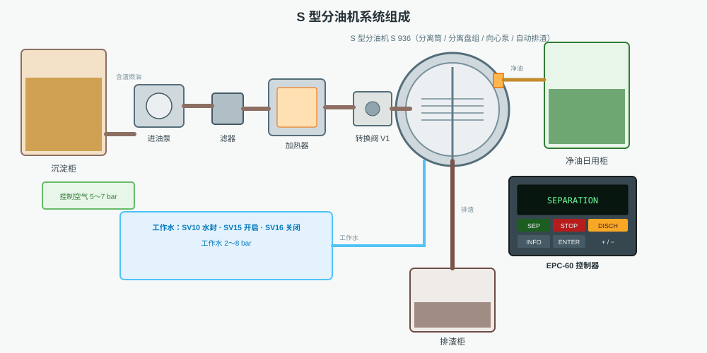
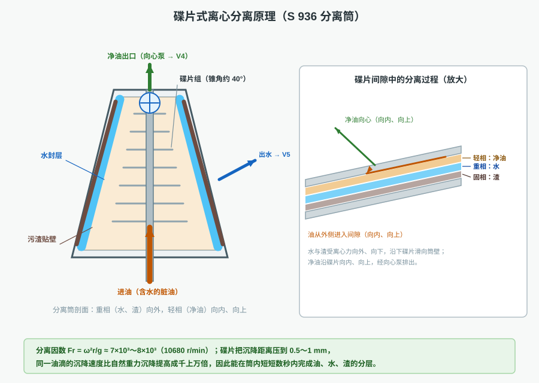
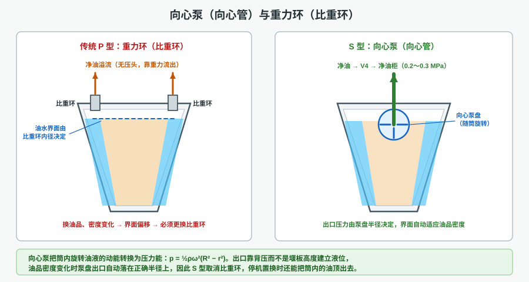
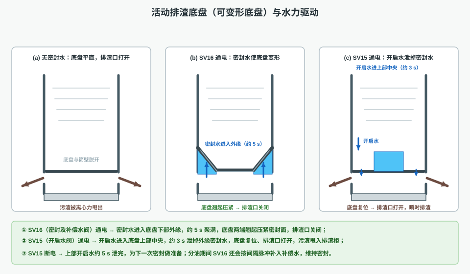
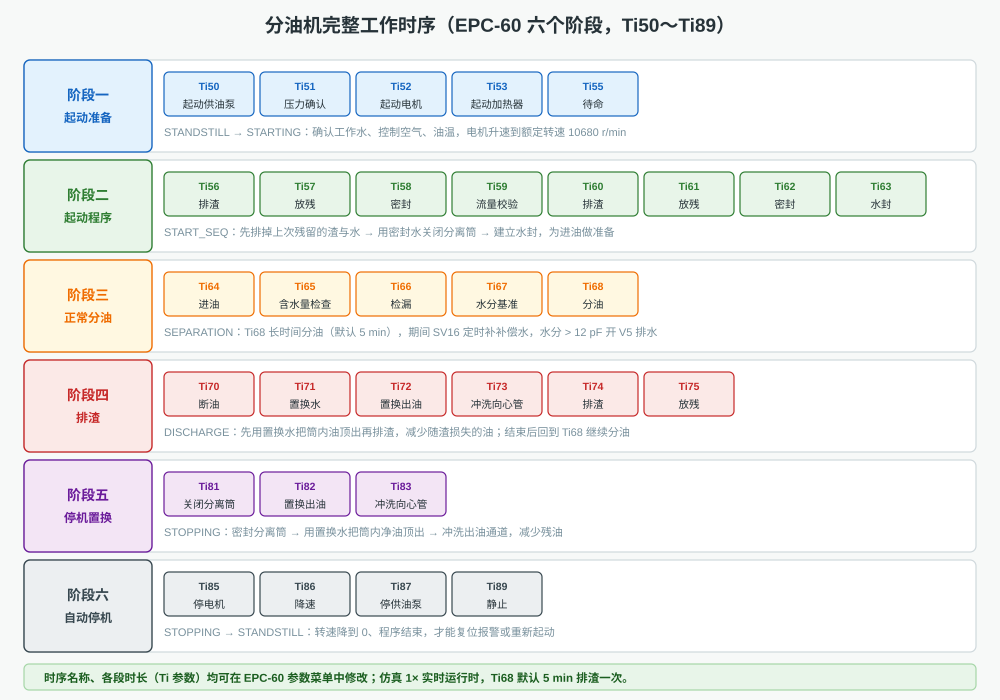
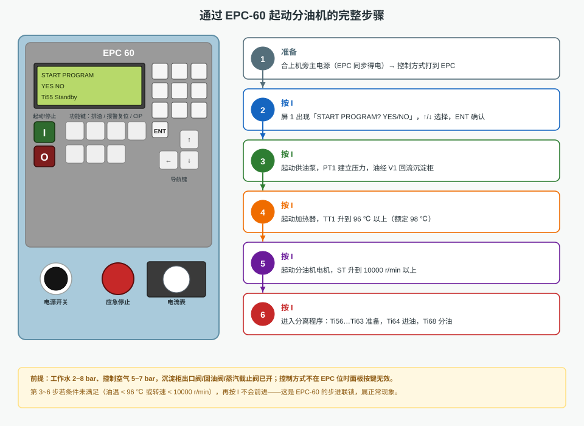
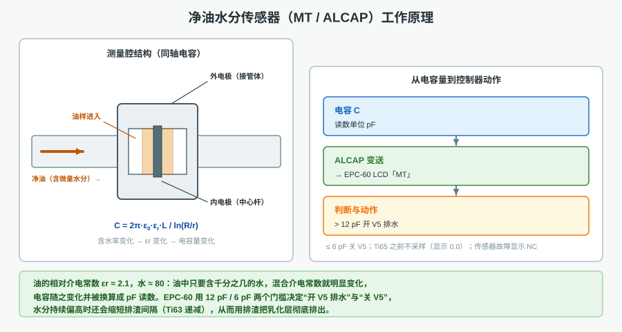
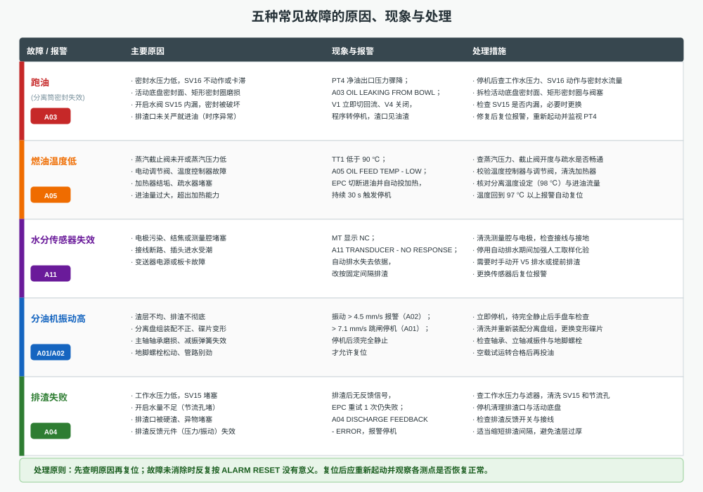

# 分油机自动控制操作程序及故障处理

> 本文配合本仿真软件使用。第 1 页「分油机运行状态」显示转速、温度、压力、水分、流量、油柜液位与报警；第 2 页「S 型分油机系统与机旁控制」是 P&ID 流程与机旁控制箱；第 3 页「EPC-60 面板与系统模拟图」左侧为控制器面板、右侧为系统模拟图。建议一边打开软件一边对照阅读。

---

## 一、分油机的工作原理

### 1.1 分油机在船上做什么

船用燃油（重油）在储存、驳运和加装过程中不可避免地混入水分和机械杂质。水的存在会使喷油器雾化恶化、燃烧不良、高压油泵锈蚀；机械杂质（砂粒、锈屑、催化剂粉末）会磨损精密偶件。分油机就是在燃油进入日用柜之前，用**高速旋转产生的离心力**把水与杂质从油中分离出来的设备。

分油机处理的是"油—水—渣"三相混合物。分离后的三个去向是：

- **净油**：经向心泵、净油出口阀 V4 送往净油日用柜；
- **水**：聚集在分离筒外缘形成水封层，经出水阀 V5 排到接水盘/污水柜；
- **渣**：贴在筒壁的渣空间，定期或在渣空间将满时通过排渣口甩入排渣柜。



在燃油系统中，分油机的典型布置是"沉淀柜 → 分油机（供油泵 → 滤器 → 加热器 → 分离筒）→ 净油日用柜"。它不负责"储存"，也不负责"精细过滤"——储存由沉淀柜完成（靠重力沉降掉大颗粒和水），过滤由滤器完成，分油机解决的是**滤器滤不掉、沉淀沉不下**的乳化水和微小杂质。所以正确的顺序是：先在沉淀柜沉淀、放残，再进分油机；如果把含大量水和渣的油直接打进分油机，只会加速排渣、造成跑油报警。

S 型（以 Alfa Laval S 936 为原型）与常见 P 型的差别集中在三处：**取消比重环**、**用向心泵（向心管）输出净油**、**用可变形底盘（CentriShoot）排渣**。这三处正是下面三小节要讲清楚的。

### 1.2 离心分离原理

#### 1.2.1 从重力沉降到离心沉降

静止的油罐里，水滴靠重力下沉，沉降速度服从斯托克斯定律：

&nbsp;&nbsp;&nbsp;&nbsp;v_g = d²(ρ_w − ρ_o) g / (18 μ)

其中 d 为水滴直径，ρ_w、ρ_o 为水与油的密度，μ 为油的动力黏度。若水滴直径 50 μm、油水密度差 100 kg/m³、黏度 0.01 Pa·s，则 v_g 只有约 0.02 mm/s——分一层要几十个小时，船上不可能这样等。

分油机把同样的油放进半径 r、角速度 ω 的旋转场中，离心加速度为 ω²r，替换上式中的 g：

&nbsp;&nbsp;&nbsp;&nbsp;v_c = d²(ρ_w − ρ_o) ω²r / (18 μ) = v_g · Fr

比值 Fr = ω²r / g 称为**分离因数**。S 936 额定转速 10680 r/min，在 r≈0.1 m 处：

&nbsp;&nbsp;&nbsp;&nbsp;ω = 2π·10680/60 ≈ 1118 rad/s，ω²r ≈ 1.25×10⁵ m/s²，

即 Fr ≈ **7000～8000**：同一颗水滴的沉降速度比重力场中快七千倍以上，原本几十小时的分层在筒内几秒即可完成。

#### 1.2.2 碟片的作用

只提高转速还不够。油在筒内是连续流动的，停留时间只有几十秒；如果水滴要从筒壁一直沉到中心，距离太长仍然来不及。

分离盘组由几十片锥形碟片叠成，片间间隙只有 0.5～1 mm，把液流切分成几十层薄薄的"薄饼"。水滴只需在**一片碟片之间**的间隙内完成沉降（零点几毫米），就能贴到碟片下表面并沿碟片下滑到筒壁；油则贴着碟片上表面向内、向上流动。沉降距离缩短上千倍，等效于把分离时间也缩短上千倍——这就是碟片分油机能在很小体积内完成分离的原因（图 2）。



#### 1.2.3 三相分层的稳定形态

正常分油时，分离筒内从外到内依次是：

1. **渣层**：最外缘，固体颗粒被甩到筒壁，堆积在排渣口上方的渣空间；
2. **水封层**（重相）：紧贴渣层内侧，是分离筒的"水封"，它封住了出水通道，防止油从出水口跑掉；
3. **油层**（轻相）：在水封层以内，经碟片向中心汇集，由向心泵引出；
4. **中心空腔**：压力最低，是进油分配的通道。

水封层的厚度不是固定值，而是由"出水口位置 + 油水密度比"共同决定的动态平衡：水多则水封变厚，油多则变薄。**一旦水封被破坏（例如开启水误动作、密封水泄漏），油就会顺着出水通道跑掉——这就是"跑油"故障的物理本质。**

#### 1.2.4 影响分离效果的四个因素

同一台分油机，分离效果好坏主要取决于四件事：

1. **温度**。温度升高使油的黏度下降，水滴与杂质的下沉阻力减小；同时油水密度差也会变化。S 型要求进油温度约 98 ℃，低于 90 ℃ 就报警。温度每低 10 ℃，黏度可能上升一倍以上，分离效果成倍下降。
2. **流量**。流量越大，油在筒内的停留时间越短，水滴来不及沉到碟片表面就被带走。因此额定流量是分离效果的"上限"，超流量运行等于放弃分离精度。
3. **背压**。净油出口必须有稳定背压（向心泵提供 0.2～0.3 MPa），否则筒内液面位置不稳定，水封层厚度会漂移。出水阀 V5 的开关也会短时影响背压，所以 V5 不能长时间大开。
4. **排渣间隔**。渣空间充满后，渣层会占据分离空间、破坏水封，分离效果急剧恶化。排渣间隔应按油品含渣量设定；含渣多时缩短间隔，宁可多损失一点油，也不要让渣层"顶"到分离区。

### 1.3 向心管（向心泵）的工作原理，兼答"为什么可以取消比重环"

#### 1.3.1 传统 P 型的做法：比重环（重力环）

P 型分油机在净油出口装一只**可更换的环**——比重环。净油漫过环的内缘溢流出去，环的内径决定"油能从多大的半径上溢出"，也就锁定了油水界面的位置。

问题是：**界面位置必须与油、水的密度相匹配**。同一台机器换烧不同密度的燃油（甚至同一种油在不同温度下密度也不同）时，界面就会偏移：

- 界面太靠内 → 水封层变薄 → 油会从出水口跑掉；
- 界面太靠外 → 水封层过厚 → 油中含水量上升、分离效果下降。

所以 P 型必须按油品密度"选环、换环"，属于需要人工经验的操作。

#### 1.3.2 S 型的做法：向心泵（向心管）

S 型在分离筒顶部中心装一个随筒一起旋转的**向心泵盘**，盘上有若干条从中心向外的叶片通道，净油从外缘进入通道、向中心流动。油在通道里被"强行"带着一起旋转，离心力把它压向中心出口——**把旋转的动能转换成了压力能**：

&nbsp;&nbsp;&nbsp;&nbsp;p = ½ ρ ω² (R² − r²)

R 为泵盘外缘半径，r 为出口半径，ρ 为油的密度。

这个公式说明三件事：

1. **出口有正压头**。S 936 净油出口约 0.2～0.3 MPa（仿真中 PT4 读数即为此值），足以直接送到净油日用柜，不需要另设输油泵，也不会因为背压波动而"倒空"。
2. **界面是"自动"稳定的**。泵盘把油"挤"在一个固定的半径附近，油品密度变化时泵盘出口的液柱高度自动变化以平衡背压，界面随之自动补偿。**不依赖任何堰板尺寸，因此可以取消比重环**——这就是 S 型最大的特征。
3. **停机时能把筒内的油顶出来**。向心泵相当于一台小离心泵，只要筒还在转，就能把筒内的油往外排；配合置换水（Ti71、Ti72、Ti82），可以把筒内净油尽量排净，减少停机时的油损失与下次起动的污染。



#### 1.3.3 工程上的连带好处

取消比重环带来的不仅是"不用换环"：

- 分离筒顶部结构简化，减少了一条易漏的静密封；
- 净油出口压力稳定，出水阀 V5 与净油阀 V4 的控制逻辑可以做得很简单（有压/无压判断）；
- 与 ALCAP 水分传感器配合，控制器可以只凭"水分"这一个信号决定"排水还是排渣"，不必再考虑油品密度。

#### 1.3.4 向心泵的维护要点

向心泵是静止的进出口与高速旋转的泵盘相配合的部件，维护上有三点：

- **泵盘与筒盖之间的间隙**必须符合说明书，间隙过大时油会"倒流"回筒内，出口压力下降；间隙过小会摩擦发热；
- **出油腔的静密封**（筒盖上的 O 形圈）老化会引起漏油或压力波动，拆装时一律更换；
- **停机后不要长时间带油存放**：筒内残油会变质、结胶，下次起动时堵塞向心泵通道，表现为 PT4 建立缓慢、Ti64 进油后压力偏低。

### 1.4 活动排渣底盘的特征

S 型分离筒的底部不是固定的底座，而是一个可以**弹性变形**的圆盘——文献上叫滑动底盘、可变形底盘或 CentriShoot 排渣盘。它的形状很像一只浅浅的碟子：中间平、两端向上翘。

- **未变形时**（平直）：底盘外缘与筒壁之间留有一圈环形缝隙，这就是**排渣口**，污渣可以从这里甩出；
- **变形时**（两端上翘、压紧）：外缘顶住筒壁上的密封面，排渣口被完全封闭，筒内建立正常分离所需的压力。

它的三个特征值得记住：

1. **没有机械传动件**。开、关排渣口不靠连杆、凸轮或气缸，而是靠**工作水的压力**让底盘变形。没有往复运动的密封件，可靠性高、维护量小。
2. **动作极快**。底盘是薄壁弹性件，密封水一泄，几十分之一秒内就能弹回原位，排渣口瞬间全开——所以 S 型的排渣是"瞬排"，污渣几乎整体甩出，不需要长时间开着排渣口（排渣时转速只下降约 700 r/min，见 5.4 节）。
3. **密封依靠"水压 + 离心力"双重作用**。密封水在底盘下方的水腔里被离心力压向外缘，形成一圈高压水垫，把底盘顶紧在密封面上；水垫压力与筒转速的平方成正比，转速越高密封越可靠。这也是为什么低速时不能起动分离程序（转速低于额定 90% 不允许起动）。

#### 1.4.1 底盘相关的日常检查

- 每次排渣后确认排渣口确实关闭（PT4 能重新建立、无跑油报警）；
- 定期检查底盘外缘密封面与筒体上的矩形密封圈，任何划伤、压痕、老化都要更换；
- 检查排渣口是否有硬渣、异物卡住——排渣失败多数出在这里；
- 底盘是弹性件，禁止用锤击、撬棍强行拆装，变形后必须整套更换。

### 1.5 水力驱动密封与打开排渣口的原理

底盘的开、关由三路工作水配合完成（图 4）：

| 阀 | 名称 | 作用 |
|----|------|------|
| **SV16** | 密封及补偿水阀 | 向底盘**下部外缘**供密封水，使底盘变形、关闭排渣口 |
| **SV15** | 开启水阀 | 向底盘**上部中央**供开启水，泄掉外缘的密封水，使底盘复位、打开排渣口 |
| **SV10** | 水封及置换水阀 | 建立分离筒水封；停机/排渣前作置换水把筒内油顶出 |

**关闭排渣口（密封）**：SV16 通电，密封水从分离筒下部进入底盘下侧的外缘水腔，在离心力作用下迅速向外甩满。水垫把底盘外缘顶起、压紧密封面，排渣口关闭。整个过程约 **5 s**（仿真中 `seal` 由 0 渐变到 1，可以清楚看到左右两个"水角"逐渐充满、底盘两端慢慢翘起）。

**打开排渣口（排渣）**：SV15 通电，开启水进入底盘**上部中央**。开启水把底盘中央往下压，同时打开外缘的泄水通道，让下部的密封水在约 **3 s** 内泄完。密封水一撤，底盘靠自身弹性回到平直状态，外缘与筒壁脱开，排渣口打开，筒壁上的渣层被离心力整体甩出。

**为下次密封做准备**：SV15 断电后，上部中央的开启水要在约 **5 s** 内泄完（否则下次密封时中央的水会顶住底盘、密封不到位）。这一条在实际操作中常被忽略——排渣后如果立即重复排渣或立即密封，就会因为开启水没排干净而导致"密封不到位 → 跑油"。

**补偿水**：正常分油期间（Ti68），密封水会有微量泄漏，EPC-60 按设定间隔给 SV16 一个短脉冲（约 3 s），补入少量密封水维持密封。仿真中可以看到 SV16 周期性点亮、底盘不变形而"厚度"维持。



> 一句话总结：**SV16 关、SV15 开；关闭 5 s 建立、打开 3 s 泄放、断电 5 s 排空。**

---

## 二、分油机完整的工作时序

EPC-60 把整个工作过程分成六个阶段，用 Ti 编号的定时器串起来（图 5）。所有 Ti 名称都显示在液晶屏第一行，操作时"看屏就知道走到哪一步"。



### 2.1 阶段一：起动准备（Ti50～Ti55）

按「I」键确认起动后进入本阶段，状态从 `STANDSTILL` 变为 `STARTING`：

- **Ti50 起动供油泵**：泵把沉淀柜的燃油升压，此时 V1 仍在回流位，油经回流阀回到沉淀柜，形成循环；
- **Ti51 压力确认**：观察 PT1 是否建立压力（约 0.28 MPa），压力建立不起来会报 **A17 供油泵无压力**；
- **Ti52 起动分油机电机**：电机经摩擦离合器带动分离筒升速，必须在规定时间内升到额定转速 90% 以上，否则报 **A18 筒速无响应**；
- **Ti53 起动加热器**：蒸汽经截止阀、电动调节阀进入加热器，把油加热到 98 ℃；
- **Ti55 待命**：一切正常后进入起动程序。

本阶段的实质是"**让三个前置条件成立**"：油压、油温、筒速。三者任何一个不满足，后面的分离程序都无法起动。

### 2.2 阶段二：起动程序（Ti56～Ti63）

状态为 `START_SEQ`。这一段是 S 型最有"仪式感"的部分，目的是**把分离筒恢复到干净、密封、有水封的状态**：

| 定时器 | 名称 | 动作与意义 | 典型时长 |
|--------|------|-----------|---------|
| Ti56 | 排渣 Discharge | SV15 通电，预排渣，清除上次停机残留的渣与水 | 3 s |
| Ti57 | 放残 Drain water | 开启水泄放，底盘复位，排渣口保持敞开 | 6 s |
| Ti58 | 密封 Close bowl | SV16 通电，密封水建立，关闭排渣口 | 5 s |
| Ti59 | 流量校验 Flow check | SV10 通电向筒内注水，检查供水与排水通道是否畅通 | 20 s |
| Ti60 | 排渣 Discharge | 再次 SV15 通电，把校验水全部排掉 | 5 s |
| Ti61 | 放残 Drain water | 放掉残余开启水 | 5 s |
| Ti62 | 密封 Close bowl | 重新 SV16 密封，筒内已空 | 8 s |
| Ti63 | 水封 Water seal | SV10 建立水封层（水封层就是出水口的"封口") | 9 s |

注意 **Ti59 与 Ti60 的"注水—排掉"**：这不是浪费水，而是一次**功能校验**——确认工作水能进得去、排得出、SV15/SV16 都能动作。如果工作水压力不足（<2 bar），这一步就会报 **A08 工作水压力低**并禁止起动。

### 2.3 阶段三：正常分油（Ti64～Ti68）

状态变为 `SEPARATION`：

| 定时器 | 名称 | 动作与意义 |
|--------|------|-----------|
| Ti64 | 进油 Fill separator | V1 转到供油位，油进入分离筒，从水封层向中心逐渐充满——筒内液体由"全是水"变为"外水内油" |
| Ti65 | 含水量检查 Water check | 投入 ALCAP 水分检测（此之前 MT 显示 0.0），建立水分基准 |
| Ti66 | 检漏 Leak test | 关闭进油，观察 PT4 是否异常下降；若压力过低报 **A03 跑油** |
| Ti67 | 水分稳定基准 Reference | 记录当前水分作为基准值，供后续比较 |
| Ti68 | 分油 Separation | 长时间稳定分油（默认 5 min 一次排渣），期间 SV16 定时补补偿水，水分超限则开 V5 排水 |

**Ti68 是分油机真正"干活"的阶段**，也是唯一可能长时间停留的阶段。仿真中：进油流量约 1.5 m³/h，PT4 稳定在 0.2～0.3 MPa，MT 在 4～12 pF 之间缓慢上升；水分超过 12 pF 时 V5 打开排水，降到 6 pF 关闭；一个排渣周期结束（Ti68 计时到）自动进入阶段四。

#### 2.3.1 Ti68 期间控制器在自动做什么

正常的"分油"看起来什么也没发生，其实控制器一直在做三件事：

1. **补偿水**：按设定间隔给 SV16 一个约 3 s 的短脉冲，补足被泄漏掉的密封水，维持底盘压紧；
2. **水分监视与排水**：ALCAP 连续测量净油水分，超过 12 pF 打开 V5 排水，降到 6 pF 关闭；此时画面上"水封层"会先变厚再变薄；
3. **排渣倒计时**：Ti68 计时到设定值（默认 5 min）就转入阶段四排渣；如果水分持续偏高，控制器还会缩短水封建立时间（Ti63），让排渣更频繁。

这三件事共同保证"分油质量稳定 + 密封可靠 + 渣不堆积"。

### 2.4 阶段四：排渣（Ti70～Ti75）

状态变为 `DISCHARGE`。自动周期排渣与手动按「排渣」键走的是同一套程序：

| 定时器 | 名称 | 动作与意义 |
|--------|------|-----------|
| Ti70 | 断油 Stop feed | V1 切回回流位、V4 关闭，停止向筒内进油 |
| Ti71 | 置换水 Displace oil | SV10 送入置换水，把筒内的油向中心"顶" |
| Ti72 | 置换出油 Displace out | 继续置换，V4 开启，把筒内净油经向心泵顶出去（减少排渣时随渣损失的油） |
| Ti73 | 冲洗向心管 Flush paring | 关 V4、开 V5，冲洗出油/出水管路 |
| Ti74 | 排渣 Discharge | SV15 通电，排渣口打开，污渣甩入排渣柜（排渣柜液位上升，转速瞬时下降约 700 r/min） |
| Ti75 | 放残 Drain | 放掉开启水，为重新密封做准备 |

随后程序自动回到 Ti68 继续分油；如果是"停止"命令触发，则转入阶段五。

**为什么要先置换再排渣**：如果直接打开排渣口，筒内的油会跟着渣一起甩出去，一次可损失几十升油。先注置换水把油顶到中心、经向心泵收走，再排渣，油损失可以降到最低。

### 2.5 阶段五：停机置换（Ti81～Ti83）

状态为 `STOPPING`：

- **Ti81 关闭分离筒**：SV16 密封，保证停机过程中不会跑油；
- **Ti82 置换出油**：SV10 注水、V4 打开，把筒内净油顶出；
- **Ti83 冲洗向心管**：开 V5 冲洗出水管路。

机旁手动（HAND）方式下的"分离停止"走到 Ti83 就结束，电机继续运行（待命）；EPC/AUTO 方式下则自动进入阶段六。

### 2.6 阶段六：自动停机（Ti85～Ti89）

- **Ti85 停电机**：切断电机，分离筒开始惰走降速；
- **Ti86 降速**：转速降到安全值以下；
- **Ti87 停供油泵**：泵停止，系统卸压；
- **Ti89 静止**：转速降到 0，显示 `STANDSTILL`，程序结束。

**只有回到 `STANDSTILL` 才允许复位报警或重新起动**。分离筒未静止时（转速 >100 r/min）任何操作都可能造成筒体损伤。

### 2.7 时序中的关键联锁

| 联锁 | 条件 | 后果 |
|------|------|------|
| 转速联锁 | 起动分离程序要求转速 ≥ 额定 90% | 否则拒绝起动，提示"分油机转速不足" |
| 温度联锁 | TT1 ≥ 96 ℃（设定 98 ℃，低于 90 ℃ 报 A05） | 温度不足切断进油；持续 30 s 停机 |
| 压力联锁 | 工作水 ≥ 2 bar、控制空气 ≥ 5 bar | 不足报 A08/A09，禁止起动或密封 |
| 排渣柜联锁 | 排渣柜液位 > 90% | 报 A10，禁止排渣 |
| 排渣反馈 | 排渣后须收到反馈 | 无反馈重试 1 次，仍失败报 A04 并停机 |

---

## 三、通过 EPC-60 起动分油机的完整步骤

EPC-60 采用"**一键式步进起动**"：同一个「I」键按五次，分别完成"问答确认 → 供油泵 → 加热器 → 电机 → 分离程序"，每一次都要等前一步的条件满足（图 6）。



### 3.1 起动前的检查（必须在机旁完成）

1. **油路**：沉淀柜出口阀开、回油阀开（起动阶段油走回流）、净油去日用柜的阀开；
2. **汽路**：蒸汽进口截止阀开，蒸汽压力正常，疏水器畅通；
3. **水路**：工作水进口阀开，压力 2～8 bar（低于 2 bar 会报 A08）；
4. **气路**：控制空气进口阀开，压力 5～7 bar（低于 5 bar 会报 A09，V1/V4/V5 无法动作）；
5. **电气**：机旁主电源开关合上（EPC-60 面板同步得电），控制方式转换开关打到 **EPC**；
6. **机械**：确认无人检修、护罩复位、排渣柜有空间。

> 若控制方式不在 EPC 位，EPC-60 面板上除电源与应急停止外的按键**一律无效**，屏上仍显示但按键只弹出提示。这是仿真的"操作模式联锁"，与实船一致。

### 3.2 五步起动

**第 1 步：上电与模式**——合主电源，面板得电，LCD 显示主界面（Ti55 Standby）。控制方式旋钮打到 EPC。

**第 2 步：按「I」进入起动问询**——屏 1 显示

```
START PROGRAM?
   YES   NO
```

用「↑」「↓」键在 YES/NO 之间切换，用「ENT（↵）」确认。确认后进入屏 2/3 的起动画面，I 键指示灯开始闪烁。

这个"问答"是 EPC-60 的**安全确认**：只有人工确认"现在可以起动"，程序才允许继续。选择 NO 或长时间不确认，起动流程就停在问询屏，不会动作任何阀门——这为检修、检查留出了安全窗口。

**第 3 步：再按「I」起动供油泵**——PT1 建立压力，油经 V1 回沉淀柜。

**第 4 步：再按「I」起动加热器**——等待油温升到 96 ℃ 以上。这一步最耗时（视蒸汽量与油量，约 20～60 s）。若温度未到而按「I」，程序不会前进，属正常的**步进联锁**。

**第 5 步：再按「I」起动分油机电机**——分离筒升速到 10000 r/min 以上（额定 10680 r/min）。电机中心/面板上的运行指示灯亮，电流表指针上摆到约 14 A。

**第 6 步：再按「I」进入分离程序**——程序从阶段二 Ti56 开始自动执行：预排渣 → 放残 → 密封 → 流量校验 → 排渣 → 放残 → 密封 → 水封 → 进油（Ti64）→ 含水量检查 → 检漏 → 基准 → 正常分油（Ti68）。

### 3.3 观察要点

| 观察对象 | 正常表现 | 异常含义 |
|---------|---------|---------|
| LCD 第一行 | Ti 序号依次前进 | 长时间停在同一 Ti → 条件未满足或故障 |
| ST 转速 | 升到 10680 r/min 后稳定 | 升不到 90% → A18 筒速无响应 |
| PT1 | ≈0.28 MPa | 建立不起来 → A17 / 出口阀未开 |
| TT1 | 98 ℃ ± 2 | 低于 90 ℃ → A05 |
| PT4 | 0.2～0.3 MPa | 骤降 → A03 跑油 |
| MT | Ti65 后显示 4～12 pF | 显示 NC → A11 传感器故障 |
| 电流表 | 分离约 14 A | 排渣时 +10%，密封失效时 +20% 且不回落 |

### 3.4 运行中的监视与调整

起动完成不等于"可以不看了"。正常运行时应定期查看：

- **PT4 净油出口压力**：稳定在 0.2～0.3 MPa。缓慢下降多为滤器/通道渐堵，骤降则要怀疑跑油；
- **MT 水分**：应在 4～12 pF 之间缓慢变化。长期高值说明水封太薄、排渣不够或进油带水；
- **TT1 温度**：98 ℃ ± 2。温度波动大时查蒸汽压力与调节阀；
- **电流表**：分离约 14 A。排渣时短时下降 700 r/min、电流上升 10% 属正常；若电流持续偏高要查渣层、轴承；
- **振动**：超过 4.5 mm/s 就要找原因，不要等到跳闸；
- **排渣柜液位**：超过 90% 会禁止排渣（A10），要及时起动排渣泵把渣驳走。

### 3.5 起动失败时的排查顺序

1. **按 I 无任何反应** → 控制方式不在 EPC，或面板未上电（检查主电源、电源旋钮）；
2. **停在 Ti50 之前** → 供油泵起动条件不满足（主电源、出口阀、泵故障）；
3. **停在 Ti51** → 泵后压力建立不起来（滤器堵、回流阀未开、泵空转）；
4. **停在 Ti53** → 油温上不去（蒸汽阀未开、加热器故障、进油量过大）；
5. **停在 Ti52/Ti85** → 转速上不去（电机、离合器、筒体卡阻、振动跳闸）；
6. **进 Ti56 后反复报警** → 工作水压力不足（A08）或控制空气不足（A09）。

---

## 四、水分传感器（MT / ALCAP）的工作原理

### 4.1 为什么必须测水分

分油机的排渣与水封都是"按需动作"的：水多了要排水（开 V5），水更多或渣多了要排渣。若没有在线水分信号，只能按固定时间间隔排渣——间隔短则油损失大，间隔长则分离效果差。ALCAP 水分传感器就是给控制器提供"油中到底有多少水"的连续信号。

### 4.2 测量原理：同轴电容

传感器装在净油出口管路上，测量腔是一段**同轴圆柱电容**：外电极就是管体（或一段金属套筒），内电极是一根与它同轴的中心杆，油从两者之间的环形间隙流过（图 7）。

&nbsp;&nbsp;&nbsp;&nbsp;C = 2π ε₀ ε_r L / ln(R/r)

L 为电极长度，R、r 为外、内电极半径，ε_r 为油水混合物的**相对介电常数**。

关键在于：**油的 ε_r ≈ 2.1，水的 ε_r ≈ 80**，相差近 40 倍。油中只要混入千分之几的水（包括乳化态），混合物的 ε_r 就明显上升，电容量随之增大。控制器把电容量换算成 pF 读数，就是 LCD 上的 MT 值。之所以用 pF（皮法，10⁻¹² F）而不是"含水百分比"，是因为电容的变化量与含水量之间是非线性关系，且与油品、温度有关；用原始电容量作为统一标尺，再由控制器按油品标定曲线换算，既直观又便于校验。



### 4.3 从 pF 到控制器动作

| 读数 | 含义 | EPC-60 动作 |
|------|------|------------|
| < 6 pF | 几乎不含水 | 正常分油，V5 关闭 |
| 6～12 pF | 含少量水 | 继续监视；水封层随水分缓慢增厚 |
| > 12 pF | 含水偏多 | **开 V5 排水**，让水封层变薄；水封层在图上明显加厚 |
| 持续偏高 | 乳化层或大量进水 | 缩短排渣间隔（Ti63 递减），用排渣把乳化层彻底排掉 |
| NC | 传感器无响应 | 报 **A11**，自动排水失去依据，改为按固定间隔排渣 + 人工化验 |

仿真中 MT 的显示时机也要注意：**Ti65「含水量检查」之前 MT 固定显示 0.0**，因为此时分离筒里还没有进油，测量的不是净油；进入 Ti65 后开始显示实际 pF 值。若传感器故障，则显示 `NC`。

### 4.4 使用与维护要点

1. **保持测量腔清洁**。燃油中的胶质、沥青质容易在电极上结焦，结焦后电容值偏高，会造成"虚假高水分"→ 频繁排水、油损失增大。定期拆洗电极是常规维护项目。
2. **防止气泡与空腔**。测量腔内若有气泡，电容会瞬间跌落，出现"假低水分"。因此传感器必须装在**有背压**的出口管段上（向心泵出口正好满足）。
3. **正确标定**。ALCAP 一般用两种已知含水量的油样标定零点与斜率，标定后 EPC-60 才能把 pF 换算成含水量。
4. **注意与温度的关系**。介电常数随温度变化，传感器内部有温度补偿；如果温度补偿失效，读数会整体偏移。
5. **故障时不要盲目复位**。A11 复位后若电极仍然污染，报警会再次出现；应先清洗、检查接线，再复位。

### 4.5 三个常见误区

1. **"MT 显示 0.0 就是没水"**：Ti65 之前 MT 不参与测量，显示 0.0 是程序规定，不代表真的无水。
2. **"水分高就一直开 V5"**：V5 长时间大开会让筒内压力下降、水封层被抽薄，反而引起跑油。正确做法是"短时排水 + 必要时排渣"。
3. **"换个传感器就好了"**：多数 A11 是电极污染或接线问题，先清洗、先查线，再考虑换件。

---

## 五、常见故障的原因分析和处理措施

下面五种是本仿真中重点演示、也是实船最常遇到的故障（图 8）。处理原则永远是：**先查明原因，再复位；故障未消除时反复按 ALARM RESET 没有任何意义。**



### 5.1 跑油（A03 OIL LEAKING FROM BOWL）

**现象**：净油出口压力 PT4 迅速下降（从 0.2～0.3 MPa 跌到接近 0），A03 报警；EPC-60 立即把 V1 切到回流位、关闭 V4 并转入停机程序；排渣口/接水盘处可见油迹；严重时排渣柜、污水柜见油。

**原因分析**（按发生概率排序）：

1. **密封水建立不起来**：工作水压力低、SV16 不动作或阀芯卡滞、密封水孔堵塞——底盘压不紧，排渣口实际是"半开"的；
2. **密封面损伤**：活动底盘外缘的密封面或筒体上的矩形密封圈磨损、老化、有划伤，密封水再多也封不住；
3. **开启水误动作/内漏**：SV15 内漏使开启水常通，等于一直"命令"底盘打开；
4. **时序异常**：Ti58/Ti62 的密封时间被改得太短，或排渣后开启水没排完就重新密封。

**处理措施**：

- 停机后先查**工作水压力**与 SV16 的动作（面板指示灯、听动作声）；
- 拆检活动底盘密封面与矩形密封圈，磨损的必须成套更换，密封面有划伤要研磨；
- 检查 SV15 是否内漏（拆下出口管观察是否持续滴水）；
- 修复后按 A03 复位，重新起动并**重点监视 PT4**；PT4 能稳定建立才说明密封确实恢复。

> 提示：跑油时控制器**不会**自动重复起动，必须人工确认修复后重新起动——这是为了防止"每次起动都跑一次油"。

**判断要点**：跑油的典型特征是"PT4 骤降 + 排渣后发现"两个同时出现。如果 PT4 只是缓降而排渣口干净，多半是出油通道渐堵（向心泵、V4、滤器），不是密封失效；如果 PT4 正常但排渣柜出现大量油，则是排渣时置换不彻底，属操作参数问题。分清这两类，处理方向完全不同。

### 5.2 燃油温度低（A05 OIL FEED TEMPERATURE - LOW）

**现象**：TT1 温度低于 90 ℃，A05 报警；EPC-60 立即切断进油（V1 回油位），同时自动投入加热器；若 30 s 内温度仍不回升，执行停机程序。

**原因分析**：

1. **汽侧问题**：蒸汽截止阀未开、蒸汽压力低、蒸汽含水多；
2. **控制侧问题**：温度控制器故障、电动调节阀卡涩或开度不足、温度设定值被误改；
3. **换热侧问题**：加热器结垢（传热恶化）、疏水器堵塞（凝水排不出，加热器"水击"）；
4. **负荷问题**：进油量过大（流量设定太高），超出加热器的加热能力。

**处理措施**：

- 现场先看**蒸汽压力**与截止阀开度，再看凝水是否畅通；
- 校验温度控制器与调节阀，必要时手动给定开度；
- 停炉清洗加热器、检修疏水器；
- 核对分离温度设定（98 ℃）与进油流量，两者要匹配；
- 温度回到 **97 ℃ 以上**时 A05 自动复位、进油自动恢复。

> 注意：低温分油是"白分"——黏度大、密度差小，分离效果急剧下降，还可能把水带进日用柜。所以控制器宁可停机也不允许低温长时间运行。

**判断要点**：看 TT1 的变化速率。若温度是"慢慢掉下来"，多为蒸汽量不足、结垢或负荷过大；若是"突然掉"，要查截止阀是否被误关、调节阀是否失气（控制空气压力低时气动调节阀会失位）。另外注意区分"真低温"与"温度传感器故障"：后者往往温度读数跳变或明显不合理。

### 5.3 水分传感器失效（A11 TRANSDUCER - NO RESPONSE）

**现象**：LCD 上 MT 显示 `NC`，A11 报警；自动排水逻辑失去依据，EPC-60 改为按固定间隔排渣。

**原因分析**：

1. **电极污染结焦、测量腔堵塞**（最常见，尤其是烧劣质重油时）；
2. **接线问题**：插头松动、进水受潮、屏蔽层接地不良；
3. **变送器/板卡故障**：供电异常、放大电路漂移；
4. **测量腔无油流过**：出口阀未开或旁通开得太大，腔内是空腔。

**处理措施**：

- 拆下传感器清洗电极与测量腔，检查密封圈；
- 检查接线、插头、接地；
- 暂时无法修复时：**加强人工取样化验**，按化验结果手动开 V5 排水或提前排渣，并缩短排渣间隔；
- 更换或修复后复位 A11，观察 MT 是否恢复稳定的 pF 读数（正常应在 4～12 pF 缓慢变化，而不是乱跳）。

**判断要点**：把"读数异常"与"读数正常但偏高"分开。显示 NC、乱跳、长期不变 → 传感器/变送器问题（本故障）；读数缓慢上升并在排水后回落 → 真实的水分变化。后者不要误换传感器，应从进油带水、水封厚度、排渣间隔上找原因。

### 5.4 分油机振动高（A01/A02）

**现象**：振动 > 4.5 mm/s 报 **A02**（警告）；> 7.1 mm/s 报 **A01** 并跳闸停机。振动大时往往伴随转速波动、电流波动、异常噪声。

**原因分析**：

1. **渣层不均**：长时间不排渣、渣空间局部填满，重心偏移——这是"渐进式"振动的典型原因；
2. **装配问题**：分离盘组装配不正、碟片变形或缺口、锁紧螺母未拧到位；
3. **磨损**：主轴承磨损、立轴减振弹簧（或橡胶减振件）老化失效；
4. **安装问题**：地脚螺栓松动、机架与管路"别劲"、减振器失效。

**处理措施**：

- 立即停机，**必须等完全静止**（转速为 0）后才允许检查；
- 手盘车检查是否有卡阻、异响；
- 拆检分离盘组：清洗、检查碟片平面度、按顺序装配并按规定扭矩锁紧；
- 检查轴承间隙与减振件，必要时更换；
- 检查地脚与管路连接；
- 空载（不投油）试运转，振动合格后再投油运行。

> 处理"振动"最忌讳的做法是"复位后再起一次看看"——如果原因是装配或轴承，反复起动可能造成筒体损坏甚至飞车，必须停机检查。

**判断要点**：看振动出现的时机。升速过程中就大 → 装配、碟片、轴承问题；分油一段时间后才逐渐变大 → 渣层不均、排渣不足；排渣瞬间大然后恢复 → 排渣冲击（属正常范围）；一投油就大 → 进油不均或水封异常。时机不同，检查方向完全不同。

### 5.5 排渣失败（A04 DISCHARGE FEEDBACK - ERROR）

**现象**：排渣程序执行后控制器没有收到排渣反馈信号（压力/振动突变），自动重试 1 次仍失败，报 A04 并停机。

**原因分析**：

1. **工作水不足**：压力低、滤器堵，SV15 打开后没有足够的水压让底盘动作；
2. **开启水量不足**：SV15 阀芯或节流孔堵塞，水进得太慢，底盘打不开；
3. **排渣口堵塞**：硬渣、异物卡在排渣口，底盘即使动作渣也排不出；
4. **反馈元件故障**：反馈开关/传感器损坏，实际已排渣但信号没回来（假故障）。

**处理措施**：

- 查工作水压力与滤器，清洗 SV15 与节流孔；
- 停机清理排渣口与活动底盘，检查是否有硬渣、异物；
- 检查排渣反馈元件与接线，必要时更换；
- 确认排渣柜有空间（>90% 会禁止排渣并报 A10）；
- 适当缩短排渣间隔，避免渣层过厚导致排渣困难。

**判断要点**：先区分"真没排"与"假没排"。打开排渣柜观察：若排渣时确实有渣落下而报警，是反馈元件或接线问题；若排渣时毫无动静，则查工作水、SV15、排渣口。前者不必拆筒，后者必须停机处理。

### 5.6 报警与联锁一览


处理故障的通用步骤：

1. **读报警**：LCD 报警页显示代码与文本，先弄清是哪一类（振动/温度/压力/水分/排渣）；
2. **看趋势**：对比故障前后的 PT1、PT4、TT1、MT、转速、电流，判断是"突变"还是"渐变"——突变多为阀件动作异常，渐变多为结垢、磨损、负荷变化；
3. **停机检查**：涉及分离筒内部（跑油、振动、排渣失败）必须停机、完全静止后拆检；
4. **修复后复位**：按 ALARM RESET 复位，重新起动并观察各测点是否回到正常范围；
5. **记录**：把报警代码、发生时间、处理过程记入轮机日志，便于分析重复故障。

---

## 六、仿真操作提示

- **加快时间**：EPC-60 参数页可修改「仿真时间倍率」，Ti68 默认 5 min 一次排渣，1× 实时观察最直观；
- **单步观察**：把「单步演示」打开后，每按一次「下一步」程序前进一步，适合讲透 Ti56～Ti75 的每个动作；
- **调故障**：用工具栏「故障设置」注入本文第五节的五种故障，观察报警联锁与画面动画（如水封层加厚、底盘变形、油柜液位变化）的对应关系；
- **对照三页**：页 2 看流程与阀门，页 3 看控制器与模拟图，页 1 看仪表与报警，三者同步观察效果最好。

> 本文中的时序参数、报警阈值与仿真模型一致；实船参数可能因机型、油品和船东习惯不同而调整，操作时以本船 EPC-60 的参数页与实际说明书为准。

---

## 七、附录：主要参数与报警速查

### 7.1 EPC-60 主要可调参数

| 参数 | 说明 | 默认值 |
|------|------|--------|
| 分离温度 | 进油温度设定值（TT1） | 98 ℃ |
| 温度低报警 | 低于此值切断进油并报警 | 90 ℃ |
| 进油流量 | 正常分油流量设定 | 1.5 m³/h |
| 排渣间隔 | Ti68 正常分油的计时长度 | 5 min（可调 2～240） |
| 水分门槛 | 水分超过此值缩短排渣间隔 | 15 pF |
| 振动报警 / 跳闸 | 振动高报警与停机阈值 | 4.5 / 7.1 mm/s |
| 工作水压力低 | 低于此值禁止起动/密封 | 2 bar |
| 控制空气压力低 | 低于此值气动阀失效 | 5 bar |

> 参数页里的 Ti 时长（Ti56、Ti57、Ti59、Ti63、Ti68 等）也可修改，但**必须与分离筒特性和油品匹配**，随意缩短密封时间（Ti58/Ti62）会直接导致跑油。

### 7.2 报警代码速查

| 代码 | 文本 | 处理方向 |
|------|------|---------|
| A01 | HIGH VIBRATION – SHUTDOWN | 停机检查装配、碟片、轴承 |
| A02 | HIGH VIBRATION – WARNING | 加强监视，查渣层与排渣 |
| A03 | OIL LEAKING FROM BOWL | 查密封水、密封面、SV15 内漏 |
| A04 | DISCHARGE FEEDBACK – ERROR | 查工作水、SV15、排渣口、反馈元件 |
| A05 | OIL FEED TEMPERATURE – LOW | 查蒸汽、调节阀、加热器、疏水 |
| A08 | OPERATING WATER PRESSURE – LOW | 查工作水泵、滤器、截止阀 |
| A09 | CONTROL AIR PRESSURE – LOW | 查空压机、减压阀、管路泄漏 |
| A10 | SLUDGE TANK LEVEL – HIGH | 起动排渣泵把渣驳走 |
| A11 | TRANSDUCER – NO RESPONSE | 清洗电极、查接线、必要时更换 |
| A12 | SEPARATOR MOTOR – FAILURE | 查过载、供电、主电源 |
| A14 | EMERGENCY STOP – BUTTON PUSHED | 查明原因，静止后复位 |
| A17 | FEED PUMP – NO PRESSURE | 查泵、滤器、出口阀、回流阀 |
| A18 | BOWL SPEED – NO RESPONSE | 查电机、离合器、筒体卡阻 |

### 7.3 一页纸操作口诀

- **起动**：阀开齐 → 电送到 → 模式对 → 按五次「I」→ 看 Ti 走完全程；
- **运行**：看 PT4、MT、TT1、电流、振动五块表；
- **排渣**：先置换、后开腔，排完放残再密封；
- **停机**：按「O」走程序，等 `STANDSTILL` 再动设备；
- **故障**：先查原因再复位，跑油、振动、排渣失败必须停机拆检。
