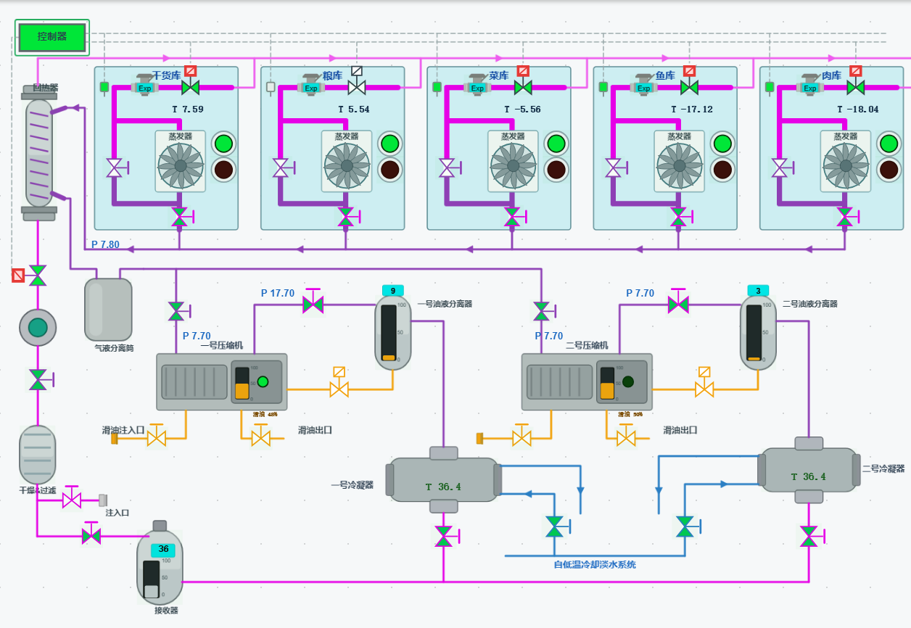
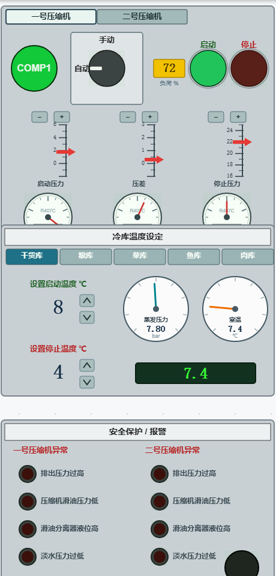
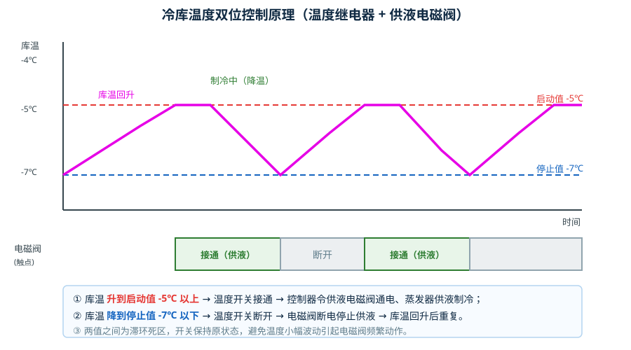
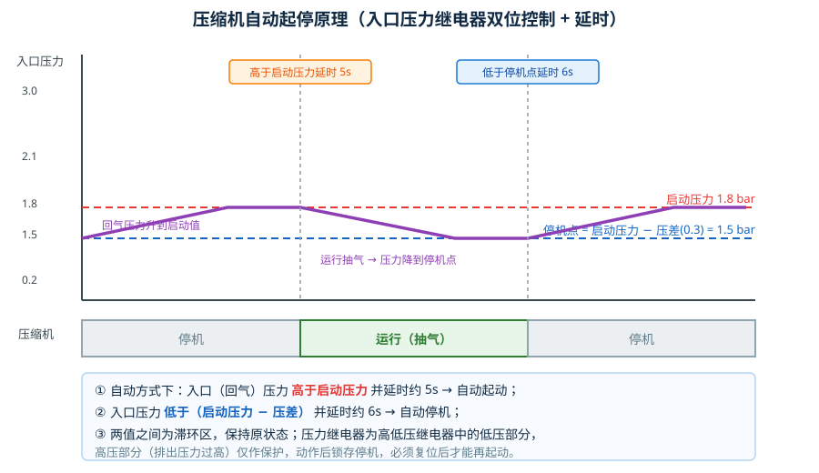
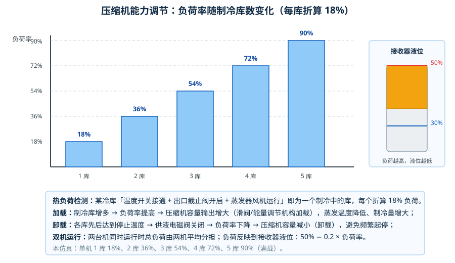
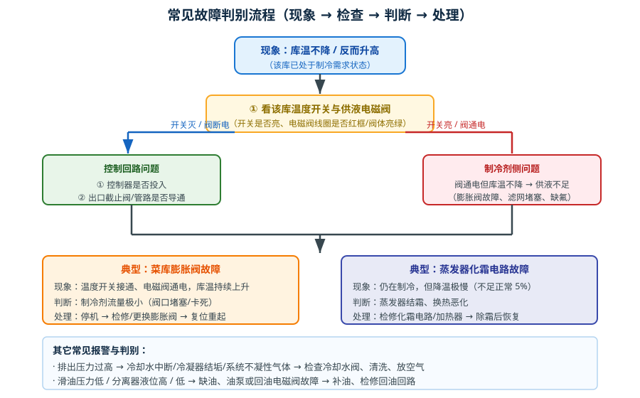
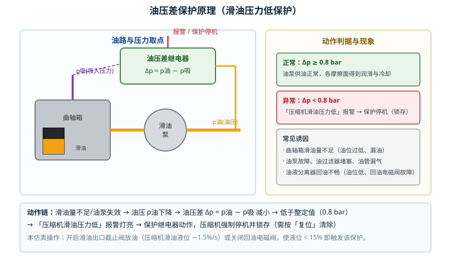
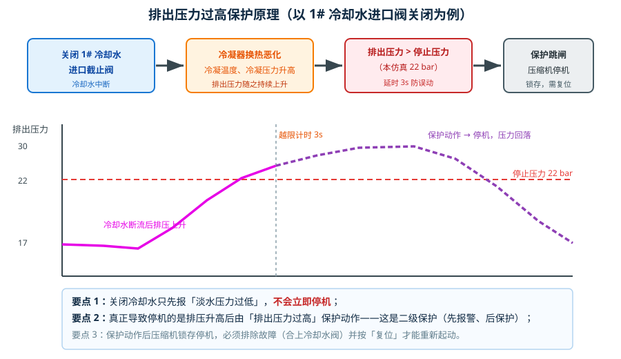

# 制冷系统的自动控制、安全保护及故障处理

> 适用对象：船舶制冷 / 冷库管理相关专业学生与轮机人员
> 仿真工程：`syy21_refrige`（两机五库船舶冷库制冷系统）
> 配套资源：本文所有插图位于 `docs-img/` 目录

---

## 一、系统组成与工艺流程

本仿真系统按一艘船舶伙食冷库的实际布置建模：**两台活塞式制冷压缩机并联于同一吸气总管**，各自经油液分离器、冷凝器后把冷凝液汇入**接收器（储液器）**，再经**干燥过滤器 → 回热器 → 供液总管**分配到 **5 个冷库**（干货库、粮库、菜库、鱼库、肉库）的膨胀阀与蒸发器，蒸发后的低温低压回气经回气总管返回压缩机，构成完整的单级压缩制冷循环。



*图 1　制冷系统工艺流程图（仿真界面截图，控制器已投入、各路截止阀已开启、两个冷凝器正在运行）*



*图 2　右侧三块操作面板：①压缩机操作台（手动/自动旋钮、起动/停止按钮、负荷率、三项整定值、三只压力表）；②冷库温度设定（五库分页、启动/停止温度、蒸发压力与库温表）；③安全保护/报警（两机各四路报警灯 + 复位按钮）*

### 主要设备功能一览

| 设备 | 功能 |
|---|---|
| 压缩机 | 把低温低压回气压缩为高温高压排气，是循环的"心脏" |
| 油液分离器 | 分离排气中夹带的润滑油，并把滑油回流至曲轴箱 |
| 冷凝器 | 用低温冷却淡水带走冷凝热，把排气冷凝为高压液体 |
| 接收器（储液器） | 储存冷凝液并起液封作用，稳定向蒸发器供液 |
| 干燥过滤器 | 除去制冷剂中的水分与机械杂质，防止冰堵与脏堵 |
| 回热器 | 高压液与低压回气换热：液过冷、气过热，提高单位制冷量并防止液击 |
| 膨胀阀 | 节流降压并按过热度自动调节供液量 |
| 蒸发器 | 制冷剂汽化吸热，冷却库内空气（配蒸发器风机强制对流） |
| 气液分离筒 | 分离回气中夹带的液滴，防止压缩机吸入湿蒸气（液击） |
| 温度继电器 | 按库温通断，输出"制冷需求"信号 |
| 供液电磁阀 | 受控制器驱动，控制该库蒸发器的供液通断 |
| 高低压继电器 | 低压部分控制压缩机自动起停；高压部分作排出压力过高保护 |
| 油压差继电器 | 监视滑油压力与吸入压力之差，滑油压力过低时报警并停机 |

工艺流程如图 1：制冷剂经"压缩 → 冷凝 → 节流 → 蒸发"周而复始，**冷库温度由温度继电器控制供液电磁阀通断来实现**，而压缩机的起停与能力则由压力继电器与热负荷共同决定。

---

## 二、冷库温度控制原理（重点一）

### 2.1 为什么采用双位控制

冷库的库温不需要连续精确调节，只要维持在允许范围内即可，因此普遍采用**双位（两位式）控制**：温度高于某个值就让蒸发器供液制冷，低于某个值就停止供液。这样做的好处是控制环节简单、执行机构（电磁阀）动作可靠、能耗低。

双位控制的关键是**两个整定值 + 滞环**：

- **启动温度（上限）**：库温高于此值时温度继电器接通，发出"需要制冷"信号；
- **停止温度（下限）**：库温低于此值时温度继电器断开，撤消"需要制冷"信号；
- 两值之间是**滞环死区**：库温在这区间内变化时，继电器**保持原有状态**，避免温度小幅波动造成电磁阀频繁通断。



*图 3　库温呈锯齿状波动：升到启动值 → 供液制冷 → 降到停止值 → 停供 → 库温回升，如此往复*

### 2.2 控制链路

冷库温度自动控制的完整信号链是：

```
库温变化 → 温度继电器（温度开关）动作 → 控制器（接收开关信号并输出）
        → 供液电磁阀通电/断电 → 蒸发器供液/停供 → 库温下降/回升
```

需要特别强调两点：

1. **温度开关只受库温控制**。库温高于启动值它就接通，低于停止值它就断开，**与控制器是否工作无关**。控制器不工作时，温度开关照样按库温变化动作，学员可以看到开关灯点亮/熄灭；只是此时电磁阀**得不到输出**，无法执行供液。
2. **控制器不工作 → 电磁阀无输出**。控制器是"开关信号 → 电磁阀输出"的中间环节，它一旦停用，各库供液电磁阀全部保持关闭，系统虽然"有制冷需求"却不会真正制冷。这一点在实际操作中很容易被忽视：排除了"温度开关不动作"的可能，却忘了控制器没有投入。

### 2.3 本仿真各库整定值

| 冷库 | 初始温度 | 启动温度（上限） | 停止温度（下限） | 滞环宽度 | 库温变化速度系数 |
|---|---|---|---|---|---|
| 干货库 | 7 ℃ | 8 ℃ | 4 ℃ | 4 K | 1.00（基准） |
| 粮库 | 4 ℃ | 6 ℃ | 2 ℃ | 4 K | 1.10 |
| 菜库 | −6.5 ℃ | −5 ℃ | −7 ℃ | 2 K | 1.21 |
| 鱼库 | −15 ℃ | −14 ℃ | −18 ℃ | 4 K | 1.33 |
| 肉库 | −15 ℃ | −16 ℃ | −20 ℃ | 4 K | 1.46 |

（"库温变化速度系数"指该库降温/升温相对于基准库的快慢，越靠右的库升降温越快。）

### 2.4 运行观察要点

以菜库为例观察一个完整周期：

1. 库温低于停止值（−7 ℃ 以下），温度开关断开、电磁阀断电，库温**缓慢回升**；
2. 库温升到启动值（−5 ℃ 以上），温度开关**接通并点亮**，经 1 s 延时后供液电磁阀**通电导通**（线圈呈红色加粗外框、阀体亮绿），蒸发器开始供液制冷；
3. 库温持续下降，降到 −7 ℃ 以下时温度开关断开，电磁阀延时 1 s 断电关闭，供液停止；
4. 库温再次回升，重复上述过程。

学员应能根据画面上"温度开关灯 + 电磁阀颜色 + 库温数字"三者的对应关系，判断该库当前处于"制冷中"还是"停止中"。

---

## 三、压缩机自动起停原理（重点二）

### 3.1 压力继电器双位控制

压缩机不能简单地随库温起停，否则会因起停过于频繁而损坏电机与接触器。实际船上普遍以**吸气（入口）压力**作为起停信号——因为吸气压力反映了各蒸发器的蒸发量与热负荷大小：热负荷大、蒸发量大，回气压力就升高；冷量富余时回气压力就下降。

高低压继电器中的**低压部分**即为压缩机起停控制器，采用双位控制：

- **启动压力**（如 1.8 bar）：入口压力高于此值 → 说明蒸发器需要抽气 → 延时后自动起动；
- **压差**（如 0.3 bar）：入口压力低于"启动压力 − 压差" = **停机压力 1.5 bar** → 说明冷量已富余 → 延时后自动停机；
- 两值之间为滞环区，保持原状态。

### 3.2 延时环节的必要性

本仿真中：**高于启动压力延时约 5 s 起动，低于停机点延时约 6 s 停机**。

延时的作用是避开压力波动（例如某库电磁阀刚开启、回气压力瞬间抖动）造成的误动作。参数整定时延时过短会频繁起停，过长则响应迟缓、库温波动加大。



*图 4　入口压力上升越过启动压力并保持 5 s → 压缩机起动；压力下降到停机点以下并保持 6 s → 压缩机停机*

### 3.3 手动与自动

| 方式 | 起停依据 | 适用场合 |
|---|---|---|
| 手动 | 由操作人员按"起动/停止"按钮（`manualRun`） | 检修、试车、保护动作后重新投入 |
| 自动 | 由入口压力继电器按启动压力/压差自动起停 | 正常值班运行 |

保护动作（排出压力过高、滑油压力低等）会**强制停机并锁存**，此时不论手动还是自动都不能起动，必须先排除故障并按"复位"清除锁存。

### 3.4 状态判读练习

在压缩机操作台上把一号机切到自动，观察：

- 入口压力表指针随各冷库电磁阀开启而上升；
- 越过启动压力约 5 s 后，运行指示由暗绿变亮绿，负荷率开始上升；
- 各冷库先后到达停止温度、电磁阀关闭后，入口压力下降，跌破停机点约 6 s 后压缩机自动停机；
- 停机后回气压力又逐渐回升，再次自动起动——形成与冷库负荷同步的起停循环。

---

## 四、压缩机能力调节原理（重点三）

### 4.1 为什么要做能力调节

冷库的热负荷是随货物入库量、开门次数、环境温度频繁变化的。如果压缩机只有"全速运行"和"停机"两种状态，低负荷时就会大量"空转"，且起停频繁。因此需要让压缩机的**制冷能力随热负荷增减**（加载/卸载），保持较高的运转率和经济性。

### 4.2 热负荷的检测：如何判断"有多少库在制冷"

本仿真把热负荷的检测归结为**统计处于制冷状态的冷库数**。一个冷库被判定为"制冷中"，必须同时满足：

1. **供液电磁阀接通**（温度开关已动作、控制器有输出）；
2. **出口截止阀（管路）接通**；
3. **蒸发器风机运行**（带灯按钮处于"起动"状态）。

三者缺一，该库就不产生有效制冷量、不计入热负荷。这一点非常贴近实船：库内出口阀没开、风机没开，即使电磁阀通电，蒸发器也取不走热量。

### 4.3 负荷率与加载/卸载

每个"制冷中"的冷库折算 **18%** 的负荷率：

| 制冷中的冷库数 | 1 | 2 | 3 | 4 | 5 |
|---|---|---|---|---|---|
| 负荷率 | 18% | 36% | 54% | 72% | 90% |

- **加载**：又有冷库进入制冷状态 → 负荷率提高 → 压缩机容量输出（能量调节机构）随之增大，蒸发温度进一步降低、制冷量增大，直至满足全部冷库的需求；
- **卸载**：各冷库先后达到停止温度、电磁阀关闭 → 负荷率下降 → 压缩机自动减小容量输出，避免频繁起停；
- **双机运行**：两台压缩机同时运行时，总负荷由两机平均分担。



*图 5　负荷率随制冷库数线性变化（18%/库），接收器液位随负荷升高而下降*

### 4.4 负荷率的其它体现：接收器液位

负荷升高时，系统需要的制冷剂循环量增大，接收器内储存的液位随之下降。仿真的对应关系为：

```
接收器液位 = 50% − 0.20 × 负荷率
```

停机时液位保持 50%，负荷 100% 时降到 30%。因此**接收器液位是判断系统负荷的直观指示**：液位持续走低说明负荷大（或供液不足），液位过高则可能是冷凝压力低、膨胀阀开度过小或系统循环量不足。

### 4.5 典型计算实例

**例**：一号机单独运行，干货库、菜库、鱼库三个库处于制冷中（电磁阀接通、出口阀接通、风机运行）。求负荷率、接收器液位、油液分离器油位。

- 制冷库数 = 3 → 负荷率 = 3 × 18% = **54%**
- 该机负荷率 = 54%（单机运行不分担）→ 系统负荷 54%
- 接收器液位 = 50% − 0.20 × 54 ≈ **39%**
- 油液分离器油位 = 3% + 0.82 × 54 ≈ **47%**

**再例**：五库全部制冷、两机同时运行。总负荷 = 90%，每台机分担 45%，接收器液位 = 50% − 0.2 × 45 = 41%。

---

## 五、压缩机常见故障现象及排除方法（重点四）

判别故障的基本思路是"先看信号、再看执行、最后看制冷剂侧"，即先确认温度开关是否动作、控制器是否有输出、电磁阀是否通电，再判断制冷剂循环是否正常。



*图 6　库温不降/反而升高时的判别流程*

### 5.1 排出压力过高（排气压力高保护动作）

- **现象**：排压力表指示迅速上升并超过停止压力，压缩机的"排出压力过高"报警灯亮，压缩机保护停机并锁存。
- **常见原因**：冷却水进口阀关闭或开度过小、冷却水泵故障、冷凝器水管结垢、冷却水温过高、系统内混有不凝性气体、冷凝器出液阀或排出阀未全开。
- **排除方法**：检查并开启冷却水进出口阀、确认冷却水泵运行；清洗冷凝器；放空气；检查截止阀开度；故障排除后按"复位"，重新起动。

### 5.2 压缩机滑油压力低

- **现象**："压缩机滑油压力低"报警灯亮，同时触发保护停机。
- **常见原因**：曲轴箱滑油量不足（漏油、放油阀误开）；油泵磨损或失效；油过滤器堵塞；滑油分离器回油不畅（分离器油位过低、回油电磁阀故障）；油压差继电器整定值不当。
- **排除方法**：检查油位并及时补充滑油（可打开滑油注入口截止阀补油）；清洗或更换油过滤器；检修油泵；检查回油电磁阀与油路是否畅通；复位后重新起动。

### 5.3 滑油分离器液位高 / 低

- **现象**：分离器视窗液位超过上限报警（本仿真 > 30% 即报警）；液位过低则会导致滑油压力低保护。
- **原因分析**：分离器正常工作时液位缓慢上升（压缩机运行时油气带入，约 +6%/min）。当液位升到 20% 时，回油电磁阀自动接通向压缩机回油（液位以 1%/s 下降），降到 3% 时电磁阀关闭——如此循环。如果回油电磁阀故障打不开，液位会持续上升至高限报警；如果回油阀关不住或滑油出口阀误开，液位会持续下降。
- **排除方法**：检查回油电磁阀及其控制回路；核对滑油注入口/出口截止阀的开闭状态；必要时手动补油或放油。

### 5.4 淡水压力过低（冷却水压力低）

- **现象**："淡水压力过低"报警灯亮，但**不会立即停机**。
- **原因分析**：这是一个"预警型"报警。冷却水中断后，冷凝热无法带走，冷凝温度、冷凝压力随之升高，压缩机的排出压力会持续上升，**最终由"排出压力过高"保护动作停机**。也就是说，淡水压力过低是"前因"，排出压力过高是"后果"，两级保护构成递进的防线。
- **排除方法**：尽快恢复冷却水（开启冷却水进口阀、检查冷却水泵与滤网）；若已停机，则待排压力恢复正常后按"复位"重新起动。

### 5.5 菜库膨胀阀故障（供液量极小）

- **现象**：温度开关已接通、供液电磁阀已通电（阀体亮绿），但**库温不降反升**。
- **原因分析**：膨胀阀阀口堵塞或卡死，制冷剂流量极小，蒸发器内几乎没有汽化吸热的过程，因此"阀通电但不制冷"。
- **排除方法**：停机后拆检膨胀阀，清洗或更换阀芯/滤网；确认感温包安装良好；处理后重新抽真空、补充制冷剂。
- **判别要点**：与"控制回路故障"（开关不动作、电磁阀断电）区分——本故障的关键特征是**电磁阀已通电、执行环节正常**，故障点在其后的制冷剂侧。

### 5.6 蒸发器化霜电路故障（鱼库）

- **现象**：冷库仍在制冷，但**降温速度极慢**（仿真中降至正常的 4% 左右），长时间达不到停止温度。
- **原因分析**：化霜电路失效导致蒸发器表面结霜并逐渐加厚，霜层热阻大，空气与制冷剂之间的换热严重恶化，制冷量大幅下降。
- **排除方法**：检修化霜电路（加热器、控制器、定时器）；人工或自动除霜后恢复正常；同时检查库门密封与结霜来源（开门频繁、湿度过大）。

### 5.7 故障现象—原因—排除方法汇总表

| 故障/报警 | 主要现象 | 常见原因 | 处理方法 |
|---|---|---|---|
| 排出压力过高 | 排压升高、保护停机锁存 | 冷却水中断、冷凝器结垢、有空气、阀未全开 | 恢复冷却水、清洗、放空气、开阀后复位 |
| 压缩机滑油压力低 | 报警 + 保护停机 | 缺油、油泵故障、滤油器堵、回油不畅 | 补油、检修油泵与油路、复位 |
| 滑油分离器液位高 | 分离器液位超上限报警 | 回油电磁阀故障、回油管堵 | 检修回油电磁阀/管路 |
| 淡水压力过低 | 报警灯亮（不停机） | 冷却水阀关闭、水泵停、滤网堵 | 恢复冷却水；若已停机则复位后重起 |
| 菜库膨胀阀故障 | 阀通电但库温不降 | 阀口堵塞/卡死、感温包失效 | 拆检清洗/更换膨胀阀 |
| 蒸发器化霜故障 | 制冷中但降温极慢 | 化霜电路失效、蒸发器结霜 | 检修化霜电路、除霜 |
| 库温不降（控制侧） | 温度开关不动作或电磁阀断电 | 控制器未投入、出口阀未开、风机未开 | 投入控制器、开启出口阀与风机 |

---

## 六、压缩机安全保护功能测试（重点五）

### 6.1 油压差保护原理

压缩机运转时，滑油泵把滑油送到各摩擦面（轴承、轴瓦、气缸壁）。**判断滑油是否真正到位，不能只看"油泵出口压力"，而要看"油压与吸入压力之差"**——因为排气压力、吸入压力的整体抬升并不代表润滑改善，只有油压高于吸入压力一定数值，滑油才能被压入摩擦面。

油压差继电器取两个压力信号：

```
Δp = p油（滑油泵出口压力） − p吸（压缩机吸入压力）
```

当 Δp 低于整定值（本仿真 0.8 bar）时，说明供油不足，继电器动作：先发出"压缩机滑油压力低"报警，随即**强制停机并锁存**，防止轴瓦在缺油状态下烧毁。



*图 7　油压差取压方式、动作判据与常见诱因*

**保护动作链**：滑油量不足 / 油泵失效 → 油压下降 → Δp 减小 → 低于整定值 → 报警 + 保护停机（锁存）。

**仿真复现方法**：运行状态下打开 1# 滑油出口截止阀（压缩机滑油液位以 1.5%/s 下降），或让回油电磁阀长期关闭，使压缩机滑油液位降到 15% 以下，即触发该保护。

### 6.2 排出压力过高保护原理

排出压力过高会导致排气温度升高、润滑油碳化、阀片与缸头损坏，甚至冷凝器爆裂，因此必须设置高限保护。

保护判据：**排出压力 > 停止压力整定值（本仿真 22 bar）并持续约 3 s** → 保护动作、压缩机停机并锁存。

3 s 的延时是为了避开压缩机起动瞬间的压力冲击，防止误动作。



*图 8　以关闭 1# 冷却水进口阀为例：冷却水中断 → 冷凝压力升高 → 排压升高 → 越限延时 3 s → 保护停机*

**要点**：关闭冷却水**不会**直接停机，先是"淡水压力过低"报警提示；随着排压不断上升，最终由"排出压力过高"保护动作停机。这正是本系统**"先报警、后保护"分级防护**思想的体现。

### 6.3 安全保护功能测试步骤（对应操作流程 4）

| 步骤 | 操作 | 应观察到的现象 | 判据 |
|---|---|---|---|
| 1 | 点击工具栏"起动系统"，系统投入运行 | 各截止阀开启、控制器投入、1# 机自动投入 | 系统运行且控制器在工作 |
| 2 | 关闭 1# 冷凝器冷却水进口截止阀 | 阀体由绿变白 | 冷却水阀处于关闭状态 |
| 3 | 观察报警与压力 | ①"淡水压力过低"灯亮；②出口压力表持续上升；③超过停止压力后"排出压力过高"灯亮、压缩机停机 | 淡水压力过低报警 且 排压过高保护动作、压缩机停转 |
| 4 | ①模式转手动 ②合上冷却水进口阀 ③按"复位" | 保护锁存被清除、报警灯熄灭 | 模式为手动、冷却水阀已开、排压过高锁存已清除 |
| 5 | 手动起动 1# 机，确认正常后转自动 | 压缩机正常运转、排压恢复正常、运行灯亮绿 | 模式为自动且压缩机正常投入 |

### 6.4 测试记录表（建议打印使用）

| 项目 | 记录值 |
|---|---|
| 起动时入口压力 | ______ bar |
| 关闭冷却水后"淡水压力过低"报警时刻 | ____ : ____ |
| 排出压力开始上升时刻 / 上升速率 | ____ : ____ / ______ bar·min⁻¹ |
| 保护动作压力 / 动作时刻 | ______ bar / ____ : ____ |
| 保护动作延时（越限→停机） | ______ s |
| 复位后重新起动的入口压力 | ______ bar |
| 保护动作前压缩机运行状态是否正常 | □正常　□异常（说明：__________） |

### 6.5 测试注意事项

1. 保护测试必须在**系统运行稳定**后进行，避免与其它扰动混淆；
2. 保护动作属**锁存型**，不按"复位"压缩机无法再起动——这是刻意设计，防止故障未排除就强行重起；
3. 每次测试后必须把阀门、模式恢复原状，并记录在轮机日志；
4. 严禁长期在保护值附近运行；发现保护频繁动作应查明原因，而不是简单复位了事。

---

## 七、仿真操作流程索引

| 流程 | 名称 | 主要内容 |
|---|---|---|
| 流程 1 | 船舶冷库制冷系统的认识 | 16 步：识别压缩机、油分、冷凝器、接收器、回热器、膨胀阀、蒸发器、气液分离器、温度继电器、电磁阀、高低压继电器、油压差继电器，并穿插 4 道作用原理测试题 |
| 流程 2 | 船舶冷库制冷系统的起动 | 8 步：看油位液位 → 开风机与冷却水阀 → 开各截止阀 → 开冷库出口阀 → 开控制器看电磁阀 → 看入口压力手动起 1# 机 → 转自动，含 2 道测试题 |
| 流程 3 | 船舶冷库制冷系统故障的判别 | 5 步：起动系统 → 观察菜库正常制冷周期（降到 −7 ℃ 停供）→ 触发膨胀阀故障 → 观察到"阀通电却不制冷"→ 修复后降温恢复 |
| 流程 4 | 船舶冷库制冷系统安保功能测试 | 5 步：起动系统 → 关 1# 冷却水阀 → 观察报警与排压升高直至保护停机 → 转手动 + 恢复冷却水 + 复位 → 手动重起并转自动 |

---

## 八、思考与练习

1. 某冷库温度开关已接通、电磁阀已通电，但库温持续上升。请列出至少三种可能原因，并说明如何用"看开关—看电磁阀—看管路"的顺序逐步缩小范围。
2. 为什么压缩机自动起停要以**吸气压力**为信号而不是直接以**库温**为信号？如果直接用库温控制压缩机接触器会带来什么问题？
3. 一号机单机运行，鱼库与肉库同时制冷。请计算负荷率、接收器液位与油液分离器油位；若机器改为"自动"方式，其起停将受什么信号控制？
4. 关闭 1# 冷却水进口阀后，为什么系统先报"淡水压力过低"而不立即停机？如果取消"排出压力过高"保护，可能造成什么后果？
5. 油压差继电器的整定值为什么要采用"油压 − 吸入压力"而不是单纯的油泵出口压力？当系统排压升高时，油压差会怎样变化？
6. 菜库膨胀阀故障与"控制器未投入"这两种情况都会造成库温不降，请说明其在仿真画面上的**区别特征**。
