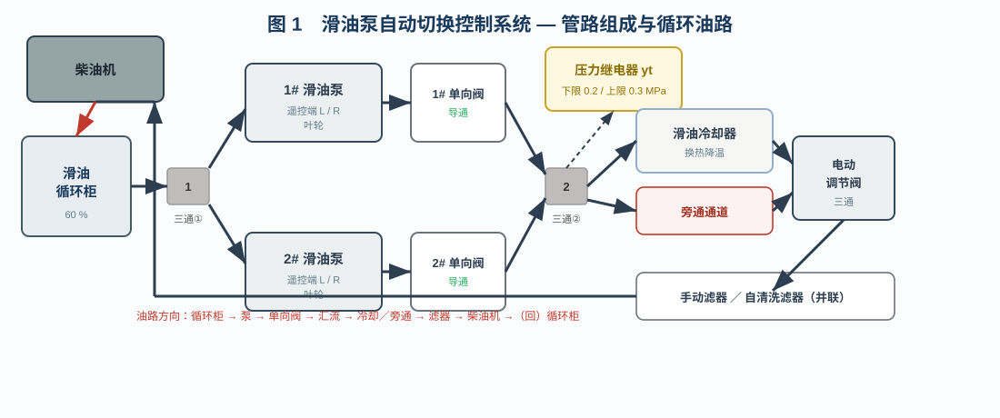
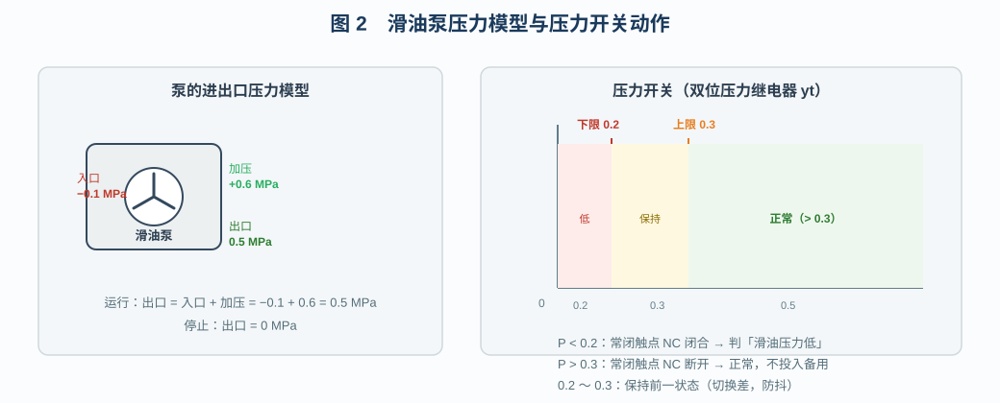
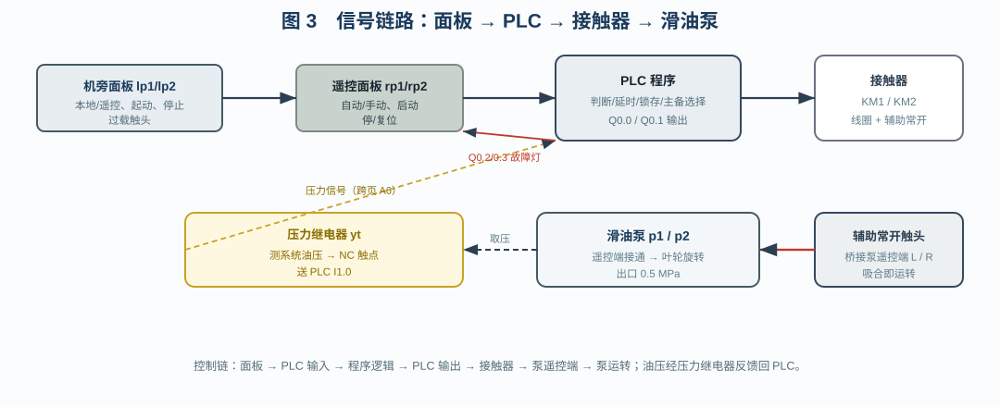
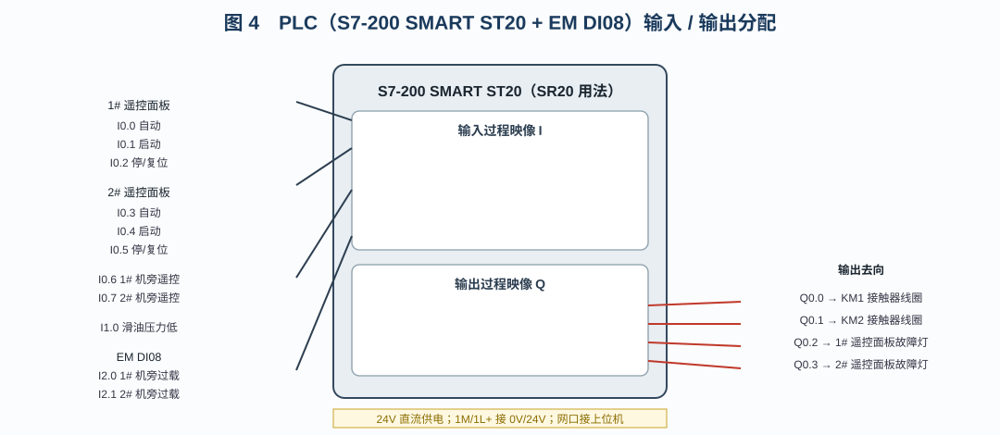
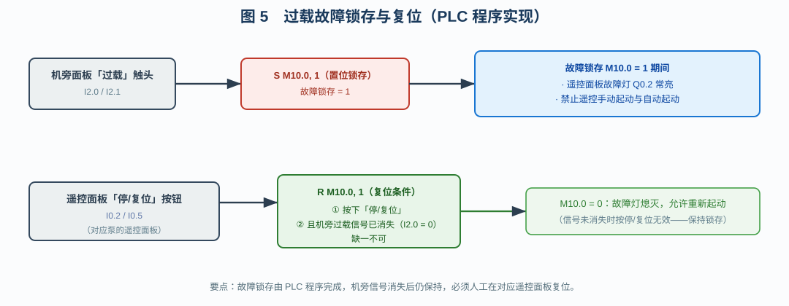
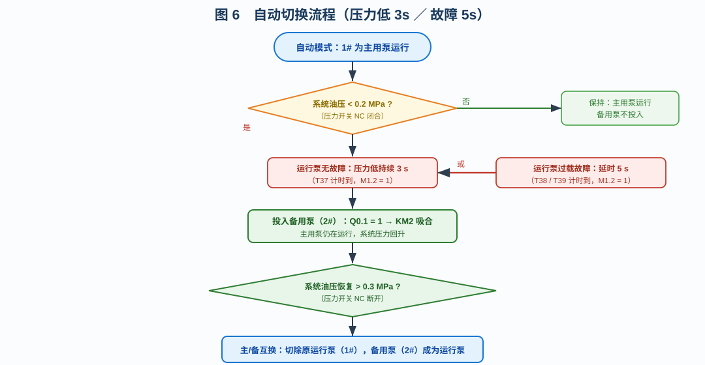

# 滑油泵自动切换控制系统

> 工业仪表与过程控制仿真教学平台 · 多页面仿真工程教学文档
> 重点：**滑油泵自动切换的实现原理** 与 **PLC 程序逐行解读**

---

## 目录

1. [系统概述与教学目标](#一系统概述与教学目标)
2. [管路组成与循环油路](#二管路组成与循环油路)
3. [滑油泵的压力模型与压力开关](#三滑油泵的压力模型与压力开关)
4. [电气控制回路与两处控制站](#四电气控制回路与两处控制站)
5. [PLC 硬件、I/O 分配与跨页连接](#五plc-硬件io-分配与跨页连接)
6. [自动切换的实现原理（核心）](#六自动切换的实现原理核心)
7. [PLC 程序逐行解读（核心）](#七plc-程序逐行解读核心)
8. [操作、演示与演练](#八操作演示与演练)
9. [故障一览与处理](#九故障一览与处理)
10. [小结](#十小结)

---

## 一、系统概述与教学目标

滑油（润滑油）是柴油机、汽轮机等旋转机械的“血液”。主机在运转过程中，轴承、齿轮、凸轮等摩擦副需要持续、稳定的压力油膜来承载与散热。一旦滑油压力跌落甚至断油，摩擦副会在极短时间内烧瓦、拉缸，造成重大机损事故。因此，主机滑油系统必须做到：**压力连续、供给不中断**。

为此，船上滑油系统普遍采用 **两台滑油泵互为备用** 的方案：正常时一台作为“运行机组”连续运行，另一台作为“备用机组”热备用；一旦运行泵因故障跳闸，或系统油压跌落到不允许的程度，另一台必须能够自动、及时地投入，保证油压不中断。这就是本工程“**滑油泵自动切换控制系统**”要解决的问题。

本仿真工程以“真 PLC + 接触器”的方式重建了这套系统，包含两个页面：

- **页面 1「机旁滑油控制」**：完整滑油循环油路（循环柜 → 双泵 → 单向阀 → 汇流三通 → 冷却器／旁通 → 电动调节阀 → 双滤器 → 柴油机 → 回循环柜），并布置两台滑油泵的**机旁控制面板**与接触器（KM1/KM2）回路。
- **页面 2「遥控与 PLC 控制」**：两台滑油泵的**遥控面板**、S7-200 SMART 型 PLC（ST20 用法）、EM DI08 扩展模块、24V 电源与跨页连接器。

通过本工程，学员应掌握：

1. 滑油泵的**压力模型**（入口负压、泵加压、出口压力）；
2. 压力开关的**双位（上下限）动作**与切换差；
3. 两台泵**自动切换的触发条件与延时**（压力低 3 s、故障 5 s）；
4. **故障锁存与复位**：故障信号触发后锁存，须在遥控面板手动复位；
5. PLC 指令表（STL）程序的**逐条含义与逻辑组合**。

---

## 二、管路组成与循环油路

### 2.1 组成

系统的管路组成如图 1 所示。



主要设备如下表：

| 位号 | 名称 | 说明 |
|------|------|------|
| tank | 滑油循环柜 | 系统油源与回油汇；顶部进口（来自柴油机出口），右侧靠下出口（去 1# 三通） |
| tee1 | 第 1 三通 | 把循环柜来的油分流给 1#、2# 两台泵的吸入口 |
| p1 / p2 | 1# / 2# 滑油泵 | 遥控端口 L/R 接通即运转；中部为旋转叶轮 |
| cv1 / cv2 | 1# / 2# 单向截止阀 | 只允许泵向系统排油，防止一台泵的油倒灌另一台 |
| tee2 | 第 2 三通 | 两台泵出口汇流到同一根排油总管 |
| teem | 测压三通 | 从排油总管引出测压支路 |
| yt | 双位压力继电器 | 测量系统油压，输出常闭触点信号 |
| tee3 | 第 3 三通 | 把总管来油分为“冷却器支路”与“旁通支路” |
| cooler | 滑油冷却器 | 与旁通并联，用于调节油温 |
| valve | 电动调节阀（三通） | 控制经过冷却器与旁通的流量比例 |
| tee4 | 第 4 三通 | 把调节阀出口分为手动滤器支路与自清洗滤器支路 |
| f1 / f2 | 手动滤器 / 自清洗滤器 | 并联过滤，保证供油清洁 |
| tee5 | 第 5 三通 | 双滤器出口汇流 |
| engine | 柴油机 | 用油设备，回油返回循环柜 |

### 2.2 循环路径

油路走向为：

> 循环柜 → 1#/2# 三通 → 1#、2# 滑油泵 → 单向阀 → 第 2 三通（汇流）→ 测压三通 → 第 3 三通 →（冷却器 或 旁通）→ 电动调节阀 → 第 4 三通 → 手动滤器／自清洗滤器 → 第 5 三通 → 柴油机 → 滑油循环柜

其中两条支路是**并联**的：

- **泵支路并联**：1#、2# 泵从同一根吸入管取油，经各自的单向阀汇入同一根排油总管。这样任何一台泵运行都能向系统供油，而单向阀保证停运泵不被倒灌。
- **滤器支路并联**：手动滤器与自清洗滤器并联，任一路畅通即可供油；两者出口再汇入第 5 三通。

冷却器与旁通也是并联（经三通调节阀分配），用于在“油温偏高”时增大冷却器流量，实现温度调节。本工程中电动调节阀默认处于手动开度，用于演示旁通/冷却流量的分配；它有独立的“三通调节阀”部件与开度显示。

---

## 三、滑油泵的压力模型与压力开关

### 3.1 泵的压力模型

工程中滑油泵按如下模型仿真（图 2）：



- **运行**时：入口为负压 **−0.1 MPa**（吸入侧），泵加压 **+0.6 MPa**，因此出口压力为

  $$P_{out} = P_{in} + \Delta P = -0.1 + 0.6 = 0.5\ \text{MPa}$$

- **停止**时：泵不产生压升，出口压力为 **0 MPa**。

工程实现上，滑油泵组件对外提供 `getOutPressure()`：运行时返回入口压力与加压量之和，停止时返回 0；当设置了“泵压不足”故障时返回一个低于下限的压力（默认 0.1 MPa）。气路求解器把该压力作为“压力源”注入排油总管，并沿管路把压力传播到测压支路与压力继电器，从而让压力开关读到真实的系统压力。

### 3.2 压力开关（双位压力继电器）

压力开关 `yt` 采用**双位（两位）**动作特性，带**切换差**（回差），以避免压力在临界点附近时触点频繁抖动：

- **下限 0.2 MPa**：系统压力低于 0.2 MPa 时，常闭触点 NC **闭合**，输出“滑油压力低”；
- **上限 0.3 MPa**：系统压力高于 0.3 MPa 时，常闭触点 NC **断开**，判定“压力正常”，备用泵不投入；
- **0.2 ～ 0.3 MPa 之间**：保持前一状态（切换差区间）。

在本工程中，压力开关的 COM 端接 24V，NC 触点跨页送到 PLC 的 DI1.0。于是：

- 油压低（< 0.2 MPa）→ NC 闭合 → I1.0 = 1；
- 油压正常（> 0.3 MPa）→ NC 断开 → I1.0 = 0。

这一定性关系是 PLC 程序判断“是否需要投入备用泵”的关键输入。

---

## 四、电气控制回路与两处控制站

### 4.1 两处控制站

滑油泵控制系统按船舶习惯设置**两处控制站**：机旁（就地）与遥控（集中）。

**机旁控制面板**（页面 1，每台泵一个）：

- 第一排 3 个圆形指示灯：**电源（白）、运行（绿）、过载（红）**；
- 第二排：**绿色「起动」按钮、红色「停止」按钮、本地/遥控转换开关**；
- 默认处于**本地**模式。

面板对外提供真电气信号触点：

- 「本地」运行时 `sw_com↔loc_o` 闭合（内部自锁：起动置位、停止/切遥控复位）；
- 「遥控」位 `sw_com↔rem_o` 闭合（送 PLC 判定机旁是否处于遥控）；
- 「过载」`sw_com↔flt_o` 闭合（送 EM DI08）。

**遥控面板**（页面 2，每台泵一个）：

- 上排 4 个指示灯：**电源、备用、运行、故障**；
- 中排：**加热器（关/开）转换开关、模式（手/自）转换开关**；
- 下排：**绿色「启动」按钮、红色「停/复位」按钮**；
- 「加热器」是**带灯开关**：打到“加热”且滑油泵**停机**时，开关指示灯亮**蓝色**（防止电机受潮的加热器投入指示）。

遥控面板对外提供：`auto_o`（自动/手动）、`sa_o`（启动，点动）、`sb_o`（停/复位，点动）；`flt_i` 为故障灯驱动输入（接 PLC 故障输出）。

### 4.2 本地控制方式

当机旁面板处于「**本地**」时，起动/停止按钮直接控制接触器线圈（不经过 PLC）：

- 24V → 面板公共端 → 本地触点 → 接触器线圈 A1 → 线圈 A2 → 地；
- 按下「起动」：内部自锁，触点保持闭合，KM 吸合；
- 按下「停止」：自锁复位，KM 释放。

### 4.3 遥控控制方式与接触器

当机旁面板处于「**遥控**」时，泵的起停交由 PLC 与遥控面板：

- PLC 输出 Q0.0 / Q0.1 经跨页连接器驱动 KM1 / KM2 线圈（另一路经机旁本地触点，二者并联）；
- **接触器吸合后，其辅助常开触头桥接泵的遥控端 L 与 R**；滑油泵检测到 L/R 接通即运转（这与空压机的“遥控端接通即运转”一致）；
- 所以，接触器是“控制指令”与“泵运转”之间的执行枢纽。

信号链路的全貌如图 6 所示。



---

## 五、PLC 硬件、I/O 分配与跨页连接

本工程使用西门子 S7-200 SMART ST20（仿真中按 SR20 用法运行）作为控制器，并挂接 **EM DI08** 数字量扩展模块。I/O 分配如图 3 所示。



### 5.1 输入（I）

| 地址 | 名称 | 来源 |
|------|------|------|
| I0.0 | 1# 遥控面板「自动」 | rp1.auto_o |
| I0.1 | 1# 遥控面板「启动」 | rp1.sa_o（点动） |
| I0.2 | 1# 遥控面板「停/复位」 | rp1.sb_o（点动） |
| I0.3 | 2# 遥控面板「自动」 | rp2.auto_o |
| I0.4 | 2# 遥控面板「启动」 | rp2.sa_o |
| I0.5 | 2# 遥控面板「停/复位」 | rp2.sb_o |
| I0.6 | 1# 机旁「遥控」位 | lp1.rem_o |
| I0.7 | 2# 机旁「遥控」位 | lp2.rem_o |
| I1.0 | 滑油压力低 | 压力继电器 yt 的 NC 触点 |
| I2.0 | 1# 机旁过载 | lp1.flt_o → EM DI08 通道 0 |
| I2.1 | 2# 机旁过载 | lp2.flt_o → EM DI08 通道 1 |

### 5.2 输出（Q）

| 地址 | 名称 | 去向 |
|------|------|------|
| Q0.0 | 1# 接触器 KM1 线圈 | 跨页 A2 → KM1 |
| Q0.1 | 2# 接触器 KM2 线圈 | 跨页 A3 → KM2 |
| Q0.2 | 1# 故障灯（锁存） | rp1.flt_i |
| Q0.3 | 2# 故障灯（锁存） | rp2.flt_i |

### 5.3 跨页连接与电源

由于油路与机旁面板在页面 1、PLC 与遥控面板在页面 2，机旁侧的“遥控位”“过载触头”“压力继电器触点”以及 PLC 对 KM 线圈的驱动，都要经过**跨页连接器 XPL**（`xpl1` / `xpl2`，同 deviceid 自动互通）传递。主要通道：

- A2 / A3：PLC Q0.0 / Q0.1 → KM1 / KM2 线圈；
- A4 / A5：1# / 2# 机旁「遥控」→ PLC DI0.6 / DI0.7；
- A6：压力继电器 NC → PLC DI1.0；
- A7 / A8：1# / 2# 机旁过载 → EM DI08 din0 / din1。

控制器供电：24V 直流电源 → PLC 的 24V / 0V；1M 接 0V（输入公共端），1L+ 接 24V（输出负载电源）。

---

## 六、自动切换的实现原理（核心）

### 6.1 运行机组与备用机组

自动模式下，两台泵按“**一台运行、一台备用**”工作。工程约定：

- **1# 顺序优先**：只要 1# 具备自动条件，1# 即为“运行机组”，2# 为“备用机组”；
- 当 1# 不具备条件（未投自动 / 不在遥控 / 故障），而 2# 具备条件时，2# 成为运行机组；
- “主用/备用”由 PLC 内部状态位（M20.0 / M20.1）记忆，并会在切换后互换。

所谓“具备自动条件”，指：**该泵机旁处于遥控 + 遥控面板处于自动 + 无故障锁存**。

### 6.2 触发条件一：滑油压力低（延时 3 s）

运行泵正常运行时出口 0.5 MPa，系统油压高于 0.3 MPa，压力开关 NC 断开，备用泵不投入。

当运行泵失压（例如泵压不足、吸入中断）导致系统油压低于 0.2 MPa 时，压力开关 NC 闭合，PLC 输入 I1.0 = 1。PLC 并不立即动作，而是**延时 3 s**（短时压力波动不误动作）。3 s 后若压力仍低，则判定为异常，**投入备用泵**。

备用泵投入后，两台泵同时运行，系统油压回升。当油压恢复到 0.3 MPa 以上（NC 断开）时，说明备用泵已成功接替，此时**切除原运行泵**，完成“主/备互换”，只留备用泵继续运行。

### 6.3 触发条件二：运行泵过载故障（延时 5 s）

运行泵若发生过载（过流、过热等保护动作），机旁面板的“过载”触头闭合，经 EM DI08 送 PLC（I2.0 / I2.1）。故障发生时：

- 运行泵对应的输出被封锁，接触器释放，泵立即停机；
- PLC 对**运行泵故障**延时 **5 s** 后投入备用泵（比压力低延时长，因为故障停机会使油压快速下跌，用稍长的延时躲过瞬时扰动，也留出人工判断的余地）。

注意：故障停机后系统油压也会随之跌落。为了避免“压力低 3 s”通道抢先动作（那样就变成了 3 s 而不是规定的 5 s），程序在**运行泵存在故障锁存**时**屏蔽压力低 3 s 计时**，只保留“故障 5 s”通道。

### 6.4 压力恢复后的主/备互换

无论是“压力低”还是“故障”触发，备用泵投入、油压恢复后，都要把原运行泵切除，并把“运行机组”的身份交给备用泵。这样：

- 系统始终只有一台泵“挂帅”运行；
- 被切除的泵转为备用，其故障被锁存、等待人工复位；
- 下一次再发生异常时，由新的运行泵对应的备用泵顶替。

### 6.5 故障锁存与复位

**故障锁存**是本系统的重要安全特性（图 5）。



- 机旁过载信号一旦出现，PLC 用 `S` 指令把对应故障标志（M10.0 / M10.1）**置位并保持**；
- **即使机旁过载信号消失，故障锁存也不消失**——故障灯（Q0.2 / Q0.3）持续点亮，表示“该泵曾经故障、尚未复位”；
- 在锁存期间，该泵的**遥控手动起动与自动起动都被禁止**，避免“故障未查清就盲目重启”；
- 复位条件：**该泵机旁过载信号已消失**，且**在对应的遥控面板上按下「停/复位」**。二者缺一不可。按下「停/复位」时，PLC 执行 `R` 复位锁存，故障灯熄灭，该泵重新可用。

> 设计要点：锁存由 **PLC 程序**完成，而非面板自身。面板只负责把“停/复位”信号送到 PLC；是否允许复位由程序按“信号已消失”判定。这样既保证安全（故障未消失时按复位无效），又便于集中管理。

自动切换的完整流程见图 4。



### 6.6 压力/故障触发一览

| 触发 | 条件 | 延时 | 动作 |
|------|------|------|------|
| 压力低 | 系统油压 < 0.2 MPa（NC 闭合）且运行泵无故障锁存 | 3 s | 投入备用泵 |
| 运行泵过载 | 机旁过载信号 I2.0 / I2.1 出现 | 5 s | 运行泵停机并被封锁；投入备用泵 |
| 压力恢复 | 系统油压 > 0.3 MPa（NC 断开）且备用泵已投入 | — | 切除原运行泵，主/备互换 |
| 故障复位 | 机旁过载信号消失 + 遥控面板按「停/复位」 | — | 解除故障锁存，泵恢复可用 |

---

## 七、PLC 程序逐行解读（核心）

PLC 程序采用指令表（STL）编写。为便于对照，先给出程序全文，再逐段逐行解读。

### 7.1 程序全文

```text
// 滑油泵自动切换控制（SR20 / ST20 + EM DI08）
// —— 机旁过载故障信号 → 对故障锁存 ——
LD     I2.0
S      M10.0, 1
LD     I2.1
S      M10.1, 1
// 复位：对应遥控面板按「停/复位」且机旁故障信号已消失
LD     I0.2
AN     I2.0
R      M10.0, 1
LD     I0.5
AN     I2.1
R      M10.1, 1
// —— 参与自动（忽略故障）——
LD     I0.6
A      I0.0
=      M1.4
LD     I0.7
A      I0.3
=      M1.5
// —— 可用（参与自动 且 无故障锁存）——
LD     M1.4
AN     M10.0
=      M1.0
LD     M1.5
AN     M10.1
=      M1.1
// —— 主/备状态位：初始置 1# 为主用 ——
LDN    M20.0
AN     M20.1
S      M20.0, 1
// —— 参与自动变化时的即时接管（不含故障）——
LDN    M1.4
A      M1.5
A      M20.0
R      M20.0, 1
S      M20.1, 1
LDN    M1.5
A      M1.4
A      M20.1
R      M20.1, 1
S      M20.0, 1
// —— 运行泵故障标志（锁存）——
LD     M20.0
A      M10.0
LD     M20.1
A      M10.1
OLD
=      M1.3
// —— 压力低（非故障）延时 3s ——
LD     I1.0
AN     M1.3
TON    T37, 3000
// —— 运行泵故障延时 5s ——
LD     M20.0
A      M10.0
TON    T38, 5000
LD     M20.1
A      M10.1
TON    T39, 5000
// —— 备用投入请求 ——
LD     T37
O      T38
O      T39
=      M1.2
// —— 主用运行命令 ——
LD     M20.0
A      M1.0
=      M2.0
LD     M20.1
A      M1.1
=      M2.1
// —— 备用投入（锁存）——
LD     M1.2
A      M20.0
A      M1.1
S      M3.1, 1
LD     M1.2
A      M20.1
A      M1.0
S      M3.0, 1
LDN    M1.1
R      M3.1, 1
LDN    M1.0
R      M3.0, 1
// —— 备用运行且压力恢复 → 主/备互换、切除原运行泵 ——
LDN    I1.0
A      M3.1
S      M20.1, 1
R      M20.0, 1
R      M3.1, 1
LDN    I1.0
A      M3.0
S      M20.0, 1
R      M20.1, 1
R      M3.0, 1
// —— 遥控手动起保停（故障锁存时禁止）——
LD     I0.1
O      M0.1
AN     I0.2
A      I0.6
AN     I0.0
AN     M10.0
=      M0.1
LD     I0.4
O      M0.3
AN     I0.5
A      I0.7
AN     I0.3
AN     M10.1
=      M0.3
// —— 输出（故障锁存时禁止起动）——
LD     M2.0
O      M3.0
O      M0.1
AN     M10.0
=      Q0.0
LD     M2.1
O      M3.1
O      M0.3
AN     M10.1
=      Q0.1
LD     M10.0
=      Q0.2
LD     M10.1
=      Q0.3
END
```

### 7.2 指令速查

| 指令 | 含义 |
|------|------|
| `LD x` | 取（装入）常开触点 x 的状态到 RLO，并把上一逻辑块压栈 |
| `LDN x` | 取（装入）常闭触点 x 的状态（`LDN M20.0` 表示“M20.0 = 0”） |
| `A x` | RLO 与常开触点 x 相“与” |
| `AN x` | RLO 与常闭触点 x 相“与”（即与“非 x”） |
| `O x` | RLO 与常开触点 x 相“或” |
| `OLD` | 弹出栈顶块与当前 RLO 相“或”（用于并联支路合并） |
| `= x` | 把 RLO 赋给线圈/位 x |
| `S x, n` | 若 RLO 为 1，则置位 x（从 x 起 n 位） |
| `R x, n` | 若 RLO 为 1，则复位 x（从 x 起 n 位） |
| `TON T, PT` | 接通延时定时器：RLO 为 1 时开始计时，到达 PT 后定时器位为 1 |

### 7.3 第 1 段：过载故障信号的锁存

```text
LD     I2.0
S      M10.0, 1
LD     I2.1
S      M10.1, 1
```

- `LD I2.0`：装入 1# 机旁过载信号。只要机旁面板“过载”触头闭合，I2.0 即为 1。
- `S M10.0, 1`：当上一逻辑块（即 I2.0）为 1 时，**置位** M10.0 并保持。此后即使 I2.0 变为 0，M10.0 仍为 1——这就是**故障锁存**。M10.0 是“1# 泵故障锁存”位。
- 同理，`LD I2.1` + `S M10.1, 1` 对 2# 泵做同样的锁存。

> 关键理解：`S` 是**置位保持**指令，只有 `R` 才能把它复位。这条“置位—保持”特性正是故障锁存的实现基础。

### 7.4 第 2 段：故障锁存的复位

```text
LD     I0.2
AN     I2.0
R      M10.0, 1
LD     I0.5
AN     I2.1
R      M10.1, 1
```

- `LD I0.2`：装入 1# 遥控面板的「停/复位」按钮信号（点动，按下为 1）。
- `AN I2.0`：再与“非 I2.0”相与。I2.0 是机旁过载信号，`AN I2.0` 意为“**过载信号已经消失**”。
- 于是整条逻辑为：“**按下了 1# 停/复位** 且 **1# 过载信号已消失**”时，RLO = 1。
- `R M10.0, 1`：复位 M10.0，解除 1# 故障锁存。

对照第 1 段可以清晰看出复位条件的“与”关系：只能用对应泵的遥控面板按钮复位；且**故障信号仍在时，按复位无效**（因为 `AN I2.0` 不成立），仍保持锁存。这满足“必须在故障信号消失后，按下停/复位才能解除自锁”的要求。

### 7.5 第 3 段：参与自动（忽略故障）

```text
LD     I0.6
A      I0.0
=      M1.4
LD     I0.7
A      I0.3
=      M1.5
```

- I0.6 = 1# 机旁“遥控”位；I0.0 = 1# 遥控面板“自动”位。
- `LD I0.6` + `A I0.0`：两者都为 1 时 RLO = 1，即“1# 既在遥控又在自动”。
- `= M1.4`：把该结果存入 M1.4——**1# 参与自动**。
- 同理 `M1.5` = 2# 参与自动。

这里故意**不包含故障**，是为了后面“即时接管”能够仅根据“是否投自动”来切换主/备。

### 7.6 第 4 段：可用性（参与自动 且 无故障锁存）

```text
LD     M1.4
AN     M10.0
=      M1.0
LD     M1.5
AN     M10.1
=      M1.1
```

- M1.0 = M1.4 且 非 M10.0，即“**1# 参与自动 且 无故障锁存**”——称为 1# **可用**。
- M1.1 = 2# 可用。
- 故障锁存会直接让 M1.0 / M1.1 变为 0，从而**禁止该泵的自动运行与备用投入**。这就是“故障锁存期间禁止自动起动”的实现。

### 7.7 第 5 段：主/备状态位的初始化

```text
LDN    M20.0
AN     M20.1
S      M20.0, 1
```

- `LDN M20.0`：装入“非 M20.0”（M20.0 = 0）。
- `AN M20.1`：再与“非 M20.1”。即“两个主/备状态位都为 0”时 RLO = 1。
- `S M20.0, 1`：置位 M20.0。

含义：**上电/复位后，若主备状态尚未确定，默认把 1# 定为主用**（M20.0 = 1，M20.1 = 0）。这是一段“一次性”初始化逻辑：之后 M20.0 或 M20.1 已有一个为 1，该条件不再成立。

### 7.8 第 6 段：参与自动变化时的即时接管

```text
LDN    M1.4
A      M1.5
A      M20.0
R      M20.0, 1
S      M20.1, 1
LDN    M1.5
A      M1.4
A      M20.1
R      M20.1, 1
S      M20.0, 1
```

- 第一组：`非 M1.4`（1# 不参与自动）`且 M1.5`（2# 参与自动）`且 M20.0`（当前主用是 1#）→ 复位 M20.0、置位 M20.1。含义：**1# 退出自动而 2# 仍在自动时，主用立即交给 2#**。
- 第二组同理：**2# 退出自动而 1# 仍在自动时，主用立即交回 1#**。

这段逻辑使操作人员切换“手动/自动”或“本地/遥控”时，主/备关系能够无缝跟随，而不会出现“两边都不运行”的空档。

### 7.9 第 7 段：运行泵故障标志

```text
LD     M20.0
A      M10.0
LD     M20.1
A      M10.1
OLD
=      M1.3
```

- `LD M20.0` + `A M10.0`：主用是 1# 且 1# 故障锁存。
- `LD M20.1` + `A M10.1`：主用是 2# 且 2# 故障锁存。
- `OLD`：把上面两条并联支路相“或”。
- `= M1.3`：得到“**运行泵故障**”标志。

`M1.3` 将在两处使用：一是屏蔽压力低 3 s 计时；二是配合 5 s 定时器。

### 7.10 第 8 段：压力低延时 3 s

```text
LD     I1.0
AN     M1.3
TON    T37, 3000
```

- `LD I1.0`：滑油压力低（NC 闭合）。
- `AN M1.3`：且“运行泵无故障”。**这正是“故障时屏蔽 3 s 通道”的实现**。
- `TON T37, 3000`：接通延时定时器。上述条件为真持续到 3000 个时基单位（本仿真 1 ms 时基，即约 3 s）后，T37 位变为 1。

若中途压力恢复或出现运行泵故障，条件不成立，T37 立即清零，从而避免误动作。

### 7.11 第 9 段：运行泵故障延时 5 s

```text
LD     M20.0
A      M10.0
TON    T38, 5000
LD     M20.1
A      M10.1
TON    T39, 5000
```

- 若主用是 1# 且 1# 故障锁存 → 启动 T38 计时，5 s 到位；
- 若主用是 2# 且 2# 故障锁存 → 启动 T39 计时，5 s 到位。

两个定时器分别对应两种主/备情形。注意：故障一旦锁存，运行泵的输出已被 Q0.0/Q0.1 封锁而停机，此处仅是“多久之后投入备用泵”的计时。

### 7.12 第 10 段：备用投入请求

```text
LD     T37
O      T38
O      T39
=      M1.2
```

- 三个定时器任一到位，即认为“需要投入备用泵”，令 M1.2 = 1。
- 这里 T37 = 压力低 3 s，T38 / T39 = 故障 5 s。

### 7.13 第 11 段：主用运行命令

```text
LD     M20.0
A      M1.0
=      M2.0
LD     M20.1
A      M1.1
=      M2.1
```

- M2.0 = 主用是 1# 且 1# 可用 → “1# 作为主用泵运行”的命令；
- M2.1 = 主用是 2# 且 2# 可用 → “2# 作为主用泵运行”的命令。

主用泵在自动模式下**连续运行**（不再按压力起停），这正是“一台运行、一台备用”策略的体现。

### 7.14 第 12 段：备用投入（锁存）

```text
LD     M1.2
A      M20.0
A      M1.1
S      M3.1, 1
LD     M1.2
A      M20.1
A      M1.0
S      M3.0, 1
LDN    M1.1
R      M3.1, 1
LDN    M1.0
R      M3.0, 1
```

- 第一组：投入请求 M1.2 且 主用为 1#（M20.0）且 2# 可用（M1.1）→ 置位 M3.1（**2# 作为备用投入运行**）。
- 第二组：投入请求 M1.2 且 主用为 2#（M20.1）且 1# 可用（M1.0）→ 置位 M3.0（**1# 作为备用投入运行**）。
- 后两组：若备用泵变得不可用（M1.1 / M1.0 为 0），复位其备用投入锁存。

用 `S` 而不是 `=` 的原因：备用泵一旦投入就要**保持运行**，直到“压力恢复后主/备互换”把它转为主用；若用 `=`，一旦 M1.2 因压力恢复而消失，备用泵会立即停止，无法完成接替。

### 7.15 第 13 段：压力恢复 → 主/备互换、切除原运行泵

```text
LDN    I1.0
A      M3.1
S      M20.1, 1
R      M20.0, 1
R      M3.1, 1
LDN    I1.0
A      M3.0
S      M20.0, 1
R      M20.1, 1
R      M3.0, 1
```

- `LDN I1.0`：非 I1.0，即“**系统油压已恢复**（> 0.3 MPa，NC 断开）”。
- `A M3.1`：且“2# 已作为备用投入运行”。
- 满足则：置位 M20.1、复位 M20.0、复位 M3.1。含义：**把主用身份交给 2#（M20.1=1），撤销 1# 的主用（M20.0=0），并清掉 2# 的“备用”临时身份**。
- 主用身份一改变，第 11 段的 M2.0 变为 0（1# 不再运行），M2.1 变为 1（2# 成为主用继续运行）——于是**原运行泵（1#）被切除**。
- 第二组是镜像情形：1# 作为备用投入且压力恢复 → 1# 成为主用，2# 被切除。

### 7.16 第 14 段：遥控手动起保停

```text
LD     I0.1
O      M0.1
AN     I0.2
A      I0.6
AN     I0.0
AN     M10.0
=      M0.1
LD     I0.4
O      M0.3
AN     I0.5
A      I0.7
AN     I0.3
AN     M10.1
=      M0.3
```

以 1# 为例逐条解释：

- `LD I0.1`：装入“启动”按钮信号；
- `O M0.1`：与自身的输出 M0.1 相“或”——这是**自锁（起保停）**的关键：按下启动后，M0.1 自己保持；
- `AN I0.2`：一旦按下“停/复位”，自锁被打断（停止）；
- `A I0.6`：仅在机旁处于**遥控**位时才允许遥控手动起动；
- `AN I0.0`：仅在遥控面板处于**手动**（非自动）时才允许手动起动（自动时不使用手动通道）；
- `AN M10.0`：**故障锁存期间禁止手动起动**；
- `= M0.1`：输出到 M0.1。2# 同理（M0.3）。

### 7.17 第 15 段：输出

```text
LD     M2.0
O      M3.0
O      M0.1
AN     M10.0
=      Q0.0
LD     M2.1
O      M3.1
O      M0.3
AN     M10.1
=      Q0.1
LD     M10.0
=      Q0.2
LD     M10.1
=      Q0.3
```

- Q0.0（1# KM1）= “1# 主用运行（M2.0）”**或** “1# 备用投入（M3.0）”**或** “1# 遥控手动运行（M0.1）”，再与“非故障锁存（AN M10.0）”——即三种起动来源任一成立、且无故障锁存时，KM1 得电。
- Q0.1（2# KM2）同理。
- Q0.2 = M10.0：**1# 故障灯由故障锁存位驱动**，所以故障信号消失后灯仍亮，直到按停/复位。
- Q0.3 = M10.1：2# 故障灯。

至此，整段 PLC 程序闭环：故障锁存 → 可用性判断 → 主/备选择 → 压力低/故障延时 → 备用投入 → 压力恢复互换 → 三路起动来源合成输出 → 故障灯锁存输出。

---

## 八、操作、演示与演练

工程提供 4 个教学流程（工具栏下拉选择，可“自动演示 / 单步演示 / 演练 / 评估”）：

1. **滑油泵的机旁起停**：识别机旁面板与滑油泵 → 自动接线 → 切“本地”按“起动”运行 → 按“停止”停机。
2. **滑油泵的遥控手动起停**：识别遥控面板 → 自动接线 + 机旁切“遥控” → 遥控面板切“手动”按“启动” → 按“停止”。
3. **滑油泵的自动切换（运行泵泵压不足）**：自动接线 + 双遥控面板“自动” → 观察 1# 主用运行、2# 备用 → 设“1# 泵压不足”，1# 出口压力下降、压力开关动作，约 3 s 后 2# 自动投入 → 手动取消该故障，压力恢复后切除 1#，主/备互换。
4. **滑油泵的故障自动切换（故障跳闸）**：设“1# 滑油泵过载”，1# 跳闸停机、故障锁存，约 5 s 后 2# 自动投入 → 修复过载后在 1# 遥控面板按“停/复位”解除锁存。

工具栏另有「起动系统」（一键接线、切遥控/自动、PLC 置 RUN）、「5 点步进」（逐点改变电动调节阀开度以演示旁通/冷却流量分配）、「重置系统」等。

---

## 九、故障一览与处理

故障通过工具栏「故障设置」界面设置，共 4 项：

| 序号 | 故障 | 现象 | 处理 |
|------|------|------|------|
| 1 | 1# 滑油泵过载 | 1# 跳闸停机、故障锁存、故障灯亮；5 s 后 2# 投入 | 取消故障后，在 1# 遥控面板按「停/复位」解除锁存 |
| 2 | 2# 滑油泵过载 | 与上对称 | 取消故障后，在 2# 遥控面板按「停/复位」 |
| 3 | 1# 滑油泵泵压不足 | 1# 出口压力降至 0.1 MPa、压力开关动作；约 3 s 后 2# 投入；压力恢复后 1# 被切除 | 手动取消该故障（无锁存） |
| 4 | 2# 滑油泵泵压不足 | 与上对称 | 手动取消该故障 |

“过载”与“泵压不足”的区别：

- **过载**：由机旁面板“过载”触头产生电气信号，走 **EM DI08 → PLC 故障锁存**通道，需遥控面板复位；
- **泵压不足**：直接降低泵的出口压力，使 **压力开关动作**，走“压力低 3 s”通道，不产生故障锁存。

---

## 十、小结

本文以“滑油泵自动切换控制系统”为主线，讲清了三件事：

1. **系统怎么走油**：循环柜 → 双泵（并联、单向阀）→ 汇流 → 冷却／旁通 → 双滤器 → 柴油机 → 回柜；
2. **自动切换怎么实现**：以 PLC 为核心，用“压力低延时 3 s”“运行泵故障延时 5 s”两条通道决定是否投入备用泵，并用“压力恢复”判据完成主/备互换；故障信号锁存、须人工复位，锁存期间禁止起动；
3. **PLC 程序怎么看**：从故障锁存（S/R）、可用性判断、主/备状态位、三只定时器（T37/T38/T39）、备用投入锁存，到三路起动来源的合成输出与故障灯锁存输出，逐段逐行给出了指令含义与逻辑关系。

掌握以上内容后，学员不仅能“照着接线、按按钮”，更能读懂程序、理解每一步动作背后的保护意图，从而具备对滑油系统进行故障分析与设备管理的能力。
