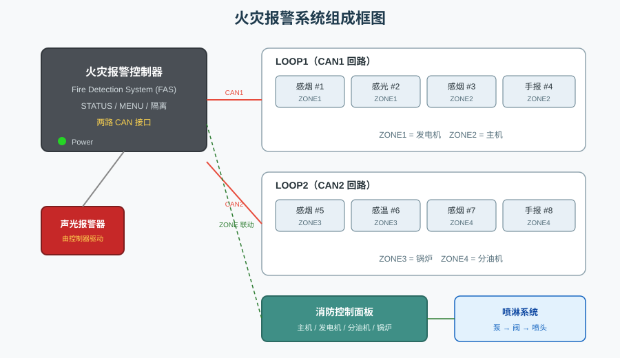
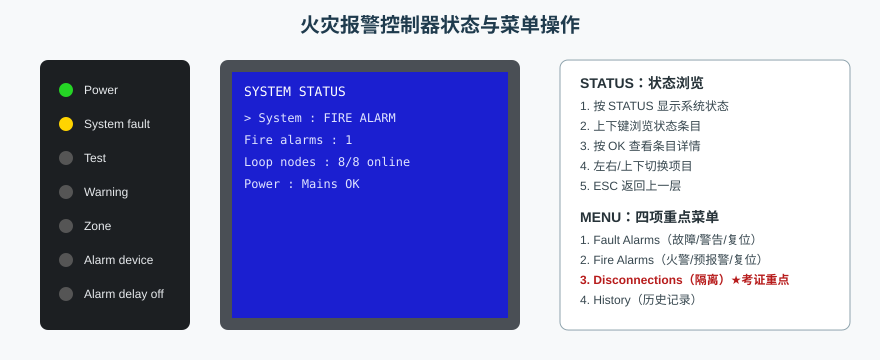
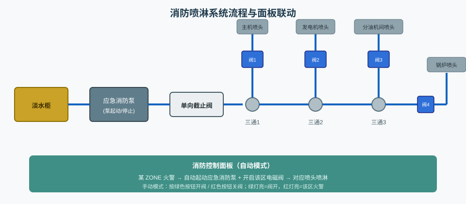
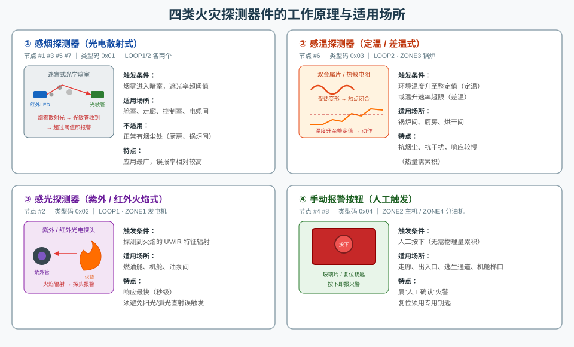
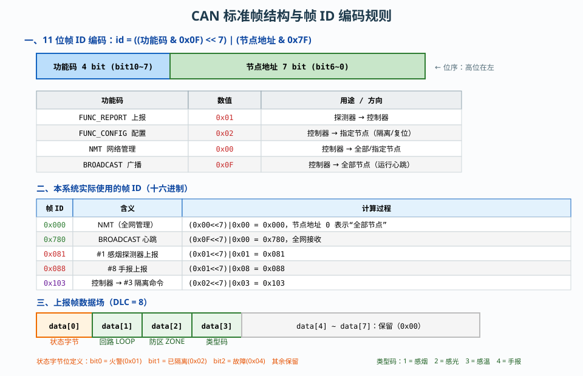
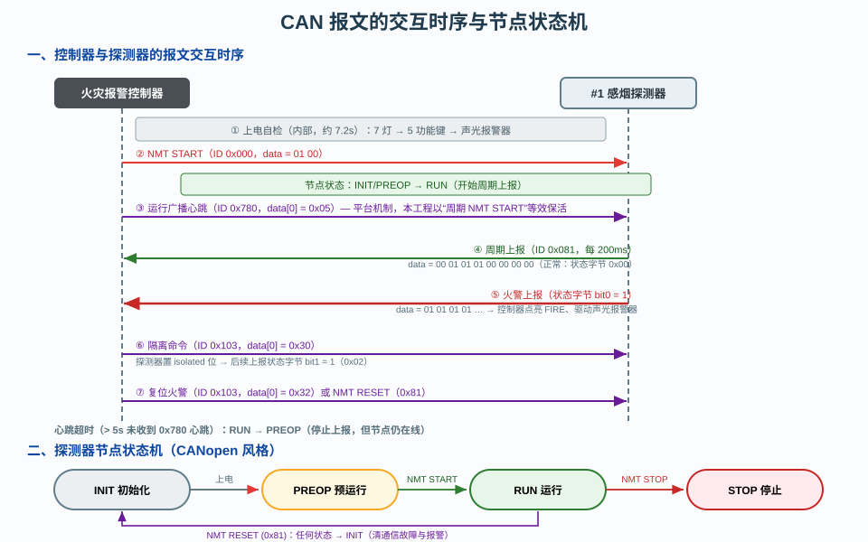
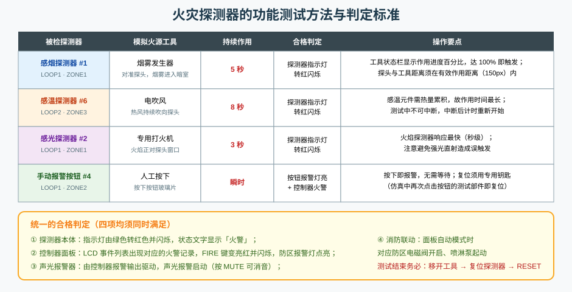
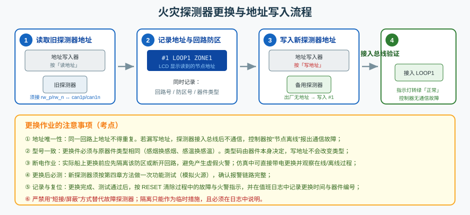

# 火灾报警系统的功能测试

本工程在船舶机舱仿真平台上复现“火灾报警系统（FAS）+ 火灾消防（喷淋）系统”，用于火灾探测、CAN 总线通信、分区隔离、探测器测试与更换、自动喷淋联动等项目的教学与考证训练。系统分两页展示：**页 1 火灾报警控制器**、**页 2 火灾消防系统（消防控制面板 + 喷淋系统）**。



---

## 一、火灾报警系统的组成

火灾报警系统由**控制器（主站）、探测器件（从站）、CAN 总线回路、声光报警器、电源和消防联动设备**六部分构成，是一个典型的“集中报警、总线传输、分区联动”系统。

### 1.1 火灾报警控制器

控制器是全系统的核心，采用 CS4000 风格面板，由四部分组成：

| 区域 | 组成 | 功能 |
|---|---|---|
| 左侧状态灯列 | Power、System fault、Test、Warning、Zone、Alarm device、Alarm delay off （共 7 只） | 指示电源、故障、测试、预警、防区、报警设备与延时等状态 |
| 上方标题与页签 | `Fire Detection System` 标题、**Status / Menu** 两个页签 | 状态浏览与菜单操作入口 |
| 中部 LCD | 蓝色液晶事件显示区（每页 12 行，可整页翻页） | 显示火警、故障、隔离、历史等记录 |
| 功能键与数字区 | FIRE、PreAlarm、Fault、Disablements、Shortcuts 五只带灯功能键；MULTIPLE ALARMS、RESET、MUTE；右侧 Esc、方向键、OK 与 0~9 数字键盘 | 报警查询、复位、消音、隔离、菜单导航 |

控制器底部与右侧引出 6 类端口：**左下**两路交流 220V 电源输入（主电 mainL/mainN、备电 bkL/bkN）；**下中** CAN 回路 2 接口（can2p/can2n）；**下右**报警输出干接点（alarm_o/alarm_r）；**右中** CAN 回路 1 接口（can1p/can1n）。



**STATUS / MENU 操作**：按 `Status` 页签显示系统状态（系统状态、火警数、故障数、隔离数、在线节点数、电源状态），上下方向键浏览条目，`ESC` 返回；按 `Menu` 页签进入主菜单，用上下键选择、`OK` 进入，本工程实现 Fault Alarms（故障）、Fire Alarms（火警）、Disconnections（隔离）、History（历史）四项。LCD 列表超出一屏时按左右方向键**整页翻页**（屏底显示 `Page n/m`）。

**指示与复位**：FIRE / Fault 在触发时文字与图标变亮红/亮黄粗体并同步闪烁，按 `MUTE` 消音后停止闪烁转为常亮；只要存在隔离，**Disablements** 按钮即亮红粗体（不闪烁）。`RESET` 仅复位“火警/故障已消失”的项——若报警源仍处于报警条件，则指示保持锁存、不能复位。

**上电与断电**：断电（电源开关断开）时 LCD 黑屏；再次合闸即从初始状态重新开始——先自检、再显示状态，不复现断电前的页面。

**上电自检**：合上控制器内部电源开关后，系统按三段顺序自检（不同时动作）——① 左侧 7 只指示灯以约 0.5s 为周期闪烁；② 5 只带灯功能键（FIRE/PreAlarm/Fault/Disablements/Shortcuts）依次闪烁；③ 触发一次外部声光报警器报警；全程约 **7.2 s**，完成后转入正常运行（RUN），此时才开始监测主电、备电与各节点通信，并允许触发火警。

### 1.2 探测器件（从站节点）

全系统共 8 个可寻址探测器件，分接两条 CAN 回路：

| 回路 | 节点地址 | 器件 | 防区 | 场所 |
|---|---|---|---|---|
| LOOP1（CAN1） | #1 | 感烟探测器 | ZONE1 | 发电机 |
| LOOP1（CAN1） | #2 | 感光探测器 | ZONE1 | 发电机 |
| LOOP1（CAN1） | #3 | 感烟探测器 | ZONE2 | 主机 |
| LOOP1（CAN1） | #4 | 手动报警按钮 | ZONE2 | 主机 |
| LOOP2（CAN2） | #5 | 感烟探测器 | ZONE3 | 锅炉 |
| LOOP2（CAN2） | #6 | 感温探测器 | ZONE3 | 锅炉 |
| LOOP2（CAN2） | #7 | 感烟探测器 | ZONE4 | 分油机 |
| LOOP2（CAN2） | #8 | 手动报警按钮 | ZONE4 | 分油机 |

节点数**固定为 8 个**，不随接线动态增减。因此若总线未接好，控制器会针对全部 8 个节点分别报出通信故障——这也是排查“为什么一上电就报一堆故障”的关键思路。

### 1.3 CAN 探测回路与总线连接器

每条回路从控制器出发，经 **4 个总线连接器（BusConnector）链式互联**，每个连接器下方挂 1 个探测器件。连接器之间用 CANH/CANL 两根线互联，形成“手拉手”的干线结构，末端接 CAN 总线分析仪。

采用总线型拓扑的好处：线路最省、任一节点断线不影响其余节点通信（只是该节点离线）。回路上**探测器由总线供电**——器件本身没有独立电源接口，只要 CANH/CANL 接入总线且控制器内部电源已合闸，探测器即带电工作。

> 注意：控制器端口分两处（右侧 CAN1、下中 CAN2），接线时不要接错回路，否则该器件会“报在线但回路号不符”，与清单对照时能立刻发现。

### 1.4 声光报警器

声光报警器由控制器的**报警输出干接点**直接驱动（不经总线、不经消防控制面板），所以它的动作条件是“控制器存在火警且未隔离外部报警设备”。按控制器 `MUTE` 键只停止声响与闪烁，报警指示依然保留。

### 1.5 消防控制面板与喷淋系统



页 2 用于演示**报警后的消防联动**：

- **喷淋系统**：淡水柜 → 应急消防泵 → 单向截止阀 → 三个三通 → 四条支路，每条支路经一个电磁阀（sv1 主机 / sv2 发电机 / sv3 分油机间 / sv4 锅炉）接对应消防喷头。
- **消防控制面板**（标准工业盘，四行）：行 1 主电源 / 应急电源 / 泵运行指示灯；行 2 主机、发电机；行 3 分油机、锅炉（每行左为绿色开阀/关阀按钮、右为火灾报警灯）；行 4 手动/自动旋钮、泵起动、泵停机、试灯。
- **面板电气接口**：底部为共用 24V、面板电子地与泵输出；右侧为 4 路电磁阀输出。**阀与泵共用 24V 作公共端**，但**各电磁阀与消防泵使用各自独立的接地**（不与面板电子地共用），以模拟真实系统中强电回路与信号回路的隔离。
- **联动逻辑**：面板 4 台设备分别对应页 1 的 4 个 ZONE。自动模式下某 ZONE 火警 → 自动起动应急消防泵并开启该区电磁阀 → 对应喷头喷淋；手动模式下由人工按开阀/关阀按钮控制。
- **电源约束**：主电与备电均无电时泵无法起动；24V 无电时面板不输出控制信号，指示灯也不亮。

### 1.6 电源

主电与备电均为 220V 交流（ACPower 组件），分别接控制器的 mainL/mainN 与 bkL/bkN。控制器周期性检测两路电源是否带电：主电失电即报 `FAS Main Power Failure`，备电失电即报 `FAS Backup Power Failure`——这是流程 2 的核心考点。

---

## 二、火灾探测器的工作原理



火灾探测器的共同原理是：把火灾发生时产生的**某一种物理量**（烟雾、热量、火焰辐射）转换为电信号，与阈值比较后输出报警判据。不同器件对应不同物理量，因而适用场所、响应速度和抗干扰能力各不相同。

### 2.1 感烟探测器（光电散射式）

内部是一个**迷宫式光学暗室**：一侧是红外发光二极管，另一侧是光敏管。正常情况下光线直线射向暗室对面的吸收壁，**照不到光敏管**，光敏管无输出。

当烟雾粒子进入暗室后，光线被粒子**散射**，一部分散射光折向光敏管；散射光强随烟雾浓度升高而增大，一旦超过阈值即判定火警。由于靠“粒子散射”而非“遮光”，灵敏度高、可在烟雾浓度较低时报警。

- 适用：舱室、走廊、控制室、电缆间等常态洁净场所；
- 不适用：厨房、锅炉间等正常有烟尘的场所（会误报）；
- 特点：应用最广，误报率相对较高。

### 2.2 感温探测器（定温 / 差温式）

感受环境温度。感温元件有**双金属片**与**热敏电阻**两类：双金属片受热后因两种金属膨胀系数不同而弯曲变形，达到整定温度时推动触点闭合；热敏电阻则通过阻值突变给出信号。

两类判据：
- **定温式**：温度升到整定值（如 68℃）动作；
- **差温式**：单位时间温升速率超过限值即动作，响应更快，适合升温剧烈的场所。

由于热量需要累积，感温探测器的响应**比感烟/感光慢**，因此本工程功能测试中电吹风需持续作用 **8 秒**（三者中最长）。

- 适用：锅炉间、厨房、烘干间等正常有烟尘但温升风险较高的场所；
- 特点：抗烟尘、抗干扰能力强，响应较慢。

### 2.3 感光探测器（紫外 / 红外火焰式）

对火焰辐射敏感：紫外（UV）式探测火焰中的紫外辐射，红外（IR）式探测火焰的闪烁红外辐射（火焰燃烧时辐射强度以特定频率脉动，可借此与阳光、白炽灯等稳定光源区分）。

- 适用：燃油舱、机舱、油泵间等明火风险大的场所；
- 特点：**响应最快**（秒级），不依赖烟气或温升的积累，但安装时须避免阳光直射、电焊弧光等干扰，否则会误触发。本工程测试中打火机仅需作用 **3 秒**。

### 2.4 手动报警按钮

不带任何敏感元件，由**人工按下**触发——按下后内部触点闭合（或玻璃片破碎），立即向控制器发送火警信号，同时按钮上的报警灯点亮。它属于“人工确认”火警，响应瞬时。

- 适用：走廊、出入口、逃生通道、机舱梯口等人员经过处；
- 复位：需用专用钥匙复位（仿真中再次点击按钮的测试部件即复位）。

### 2.5 四类器件对比

| 器件 | 敏感对象 | 类型码 | 响应速度 | 本工程节点 | 主要优点 | 主要缺点 |
|---|---|---|---|---|---|---|
| 感烟探测器 | 烟雾粒子 | 0x01 | 较快 | #1 #3 #5 #7 | 灵敏度高、应用广 | 易受烟尘/水汽干扰 |
| 感温探测器 | 环境温度 | 0x03 | 慢 | #6 | 抗干扰、寿命长 | 响应慢，易漏报初期火情 |
| 感光探测器 | 火焰辐射 | 0x02 | 最快（秒级） | #2 | 响应快、定位准 | 易受强光/弧光误触发 |
| 手动报警按钮 | 人工操作 | 0x04 | 瞬时 | #4 #8 | 可靠、无误报 | 依赖人员发现 |

### 2.6 总线供电与报警锁存

探测器件由总线供电，其在线状态由两个条件共同决定：**控制器内部电源已合闸**（回路得电）且**CANH/CANL 都已接入**。任一条件不满足，器件即判为离线。

报警状态则采用**锁存**机制：探测器的报警条件消失后（例如移开火源、探测器恢复正常），探测器本体会自动撤销报警指示灯，但**控制器侧的报警记录仍保持**，必须按 `RESET` 才能清除——这是消防规范要求，避免火警记录被自动抹掉。

---

## 三、CAN 总线报文详细解析

### 3.1 总线基础与物理层

本系统使用 **CAN 2.0A 标准帧**（11 位帧 ID），仿真波特率 **250 kbps**，采用 CANH/CANL 差分总线、总线型拓扑。总线上挂接：1 个控制器（主站）与 8 个探测器件（从站）；CAN 总线分析仪以“嗅探器”方式旁路接入，不参与仲裁，可捕获总线上**所有**报文。

软件层面按“**功能码 + 节点地址**”对报文分类编址，这是理解全部报文的钥匙。



### 3.2 帧 ID 编码规则

```
帧 ID = ((功能码 & 0x0F) << 7) | (节点地址 & 0x7F)
```

即 11 位 ID 中：**高 4 位（bit10~7）为功能码，低 7 位（bit6~0）为节点地址**。

| 功能码 | 数值 | 方向 | 用途 |
|---|---|---|---|
| FUNC_REPORT | 0x01 | 探测器 → 控制器 | 周期上报状态、火警、故障 |
| FUNC_CONFIG | 0x02 | 控制器 → 指定节点 | 下发隔离/解除隔离/复位火警命令 |
| NMT | 0x00 | 控制器 → 全网或指定节点 | 网络管理（启动/停止/复位） |
| FUNC_REPLY | 0x03 | 从站 → 主站 | 命令应答（本工程探测器件未使用） |
| BROADCAST | 0x0F | 控制器 → 全网 | 系统广播 / 运行心跳 |

常用帧 ID 实例：

| 帧 ID | 含义 | 计算 |
|---|---|---|
| `0x000` | NMT 网络管理 | (0x00<<7)\|0x00，地址 0 = 全部节点 |
| `0x780` | BROADCAST 广播/心跳 | (0x0F<<7)\|0x00 |
| `0x081` | #1 节点上报 | (0x01<<7)\|0x01 |
| `0x082` | #2 节点上报 | (0x01<<7)\|0x02 |
| `0x088` | #8 节点上报 | (0x01<<7)\|0x08 |
| `0x101` | 控制器 → #1 配置命令 | (0x02<<7)\|0x01 |
| `0x103` | 控制器 → #3 配置命令 | (0x02<<7)\|0x03 |

> 记忆技巧：**0x08x 段全是探测器上报**（0x081~0x088 对应 #1~#8），**0x10x 段是主站下发给对应节点的命令**，`0x000` 是全网网络管理，`0x780` 是全网广播。

### 3.3 探测器上报帧（功能码 0x01，DLC = 8）

这是总线上数量最多的报文，每个探测器**每 200ms 上报一帧**，数据结构如下：

| 字节 | 字段 | 说明 |
|---|---|---|
| data[0] | **状态字节** | bit0 = 火警(0x01)；bit1 = 已隔离(0x02)；bit2 = 故障(0x04)；其余保留 |
| data[1] | 回路号 LOOP | 1 或 2 |
| data[2] | 防区号 ZONE | 1~4 |
| data[3] | 类型码 | 1=感烟，2=感光，3=感温，4=手报 |
| data[4]~data[7] | 保留 | 全 0x00 |

**逐帧解读示例**：

| 报文 | 解读 |
|---|---|
| `0x081  [00 01 01 01 00 00 00 00]` | #1 感烟探测器：状态字节 0x00 → **正常**；回路 1、防区 1、类型 1（感烟） |
| `0x081  [01 01 01 01 00 00 00 00]` | #1 感烟探测器：状态字节 0x01 → **火警**；其余同上 |
| `0x082  [02 01 01 02 00 00 00 00]` | #2 感光探测器：状态字节 0x02 → **已隔离**（无火警无故障） |
| `0x086  [05 02 03 03 00 00 00 00]` | #6 感温探测器：状态字节 0x05 = 0x01\|0x04 → **火警 + 故障**；回路 2、防区 3、类型 3（感温） |

控制器收到上报帧后的处理：解析状态字节与回路/防区/类型 → 更新内部节点表（node.alarm / node.isolated / node.fault / node.lastSeen）→ 若 `alarm` 由 0 变 1 且该节点未被隔离，则生成一条 LCD 火警记录并点亮 FIRE。报警文本格式为：

```
LOOP<回路> <场所英文> <类型英文> Alarm,<地址号>
```

例如 `LOOP1 GEN Smoke Alarm,51500`——其中末尾数字是工程约定的器件地址号，按 `51000 + 节点号 × 500` 计算（#1 = 51500，#8 = 55000）。

### 3.4 主站配置 / 隔离命令帧（功能码 0x02）

控制器向**指定节点地址**下发单字节命令：

| data[0] | 命令 | 探测器侧动作 |
|---|---|---|
| `0x30` | 隔离设备 | 置 `isolated = true`，其后的上报帧状态字节 bit1 置 1，探测器指示灯转黄显示“已隔离” |
| `0x31` | 解除隔离 | 置 `isolated = false`，恢复上报 |
| `0x32` | 复位火警 | 清除该节点的人工火警锁存与外部激励 |

**隔离某防区**时，控制器对该防区内每个探测器地址**逐一下发 0x30**（广播式逐节点命令），因此抓包时会看到连续多帧 `0x10x` 报文。

### 3.5 网络管理帧 NMT（功能码 0x00，DLC = 2）

NMT 帧使用固定 ID `0x000`，数据场 2 字节：`data[0] = 命令码`，`data[1] = 目标节点地址`（**0 表示全部节点**）。

| 命令码 | 名称 | 作用 |
|---|---|---|
| `0x01` | START | 启动：节点进入 RUN，开始运行与周期上报 |
| `0x02` | STOP | 停止：节点进入 STOP，停止上报 |
| `0x81` | RESET | 节点复位：回到 INIT，同时清除通信故障与报警状态 |
| `0x82` | RESETCOM | 通信复位：清零收发计数，保持当前状态 |

实际报文示例：`0x000  [01 00]` = “全网节点启动”；`0x000  [81 03]` = “仅复位 #3 节点”。

NMT 属于**网络管理报文，具有最高优先级语义**：即使某节点因故障被判为“离线”，仍必须接收并处理 NMT 帧——否则会出现“断线重接后收不到复位命令、永远无法恢复”的死锁。这一点在代码层面有专门处理。

当控制器完成自检、进入 RUN 后，会**每 2 秒周期性广播一次 NMT START**，作用是让中途断线重接的节点自动重新进入运行并恢复上报，无需人工干预。

### 3.6 运行广播（心跳，功能码 0x0F）

广播帧 ID 固定为 `0x780`，数据场约定 `data[0] = 0x05`（对应 CANopen 的 Operational 状态）、`data[1] = 0x00`，即报文 `0x780  [05 00]`。

从站收到该帧表示“主站在线且系统处于运行状态”，会把自身状态置为 RUN，并刷新心跳计时。若节点处于 RUN 而**超过 5 秒未收到心跳**，会自动降为 PREOP（预运行）以自我保护——这是一种“主站失联则从站退出运行”的安全设计。平台中该心跳由中央计算机/总线管理器按 1 秒周期启动；本工程中主站以“周期 NMT START”方式完成等效的保活。

### 3.7 通信时序与节点状态机



**上电至进入正常监视的完整时序**：

1. 控制器合闸 → 内部自检（7.2s，三阶段），此期间 `onCanReceive` 不处理任何报警；
2. 自检结束 → 控制器进入 RUN，广播 `NMT START (0x000 [01 00])`；
3. 探测器（已得电、总线已接）收到 NMT START → 状态由 INIT/PREOP 转 **RUN**，开始每 200ms 上报 `0x081~0x088`；
4. 控制器周期性广播 NMT START 保活（每 2s），并维护节点在线表；
5. 探测器触发火警 → 上报帧状态字节 bit0 = 1 → 控制器点亮 FIRE、记录报警、驱动声光报警器；
6. 需要隔离时 → 控制器下发 `0x10x [30]` → 该节点上报帧 bit1 = 1；
7. 需要复位时 → 控制器下发 `0x10x [32]`（单节点）或 `0x000 [81 00]`（全网）。

**节点状态机**：`INIT（上电初始化）→ PREOP（预运行）→ RUN（运行）→ STOP（停止）`，任何状态收到 `NMT RESET(0x81)` 都回到 INIT 并清除故障与报警。

### 3.8 抓包实例逐帧解读

回路 1 末端接有 **CAN 总线分析仪**，**双击**组件可打开类 Wireshark 的抓包界面，逐帧列出 `序号 / 时间 / 帧ID / 类型 / 节点地址 / DLC / 数据 / 详细说明`，支持暂停、清空、关闭。报文类型与识别规则：

| 类型 | 判定依据 | 说明文本示例 |
|---|---|---|
| `DET-RPT` | 功能码 0x01 且发送方是探测器件 | `探测器上报：火警，LOOP1 ZONE1 Flame` |
| `CFG` | 功能码 0x02 | `主站 → 节点#1：隔离设备` |
| `NMT` | 功能码 0x00 | `网络管理：START 启动，目标 全部节点` |
| `BCAST` | 功能码 0x0F | `运行广播（心跳 Operational）` |

典型抓包片段（一次“感光探测器报警 → 隔离 → 复位”的过程）：

| 序号 | 帧 ID | 类型 | 数据 | 说明 |
|---|---|---|---|---|
| 1 | `0x000` | NMT | `01 00` | 网络管理：START 启动，目标全部节点 |
| 2 | `0x082` | DET-RPT | `00 01 01 02 …` | 探测器上报：正常，LOOP1 ZONE1 Flame |
| 3 | `0x083` | DET-RPT | `00 01 02 01 …` | 探测器上报：正常，LOOP1 ZONE2 Smoke |
| 4 | `0x082` | DET-RPT | `01 01 01 02 …` | 探测器上报：**火警**，LOOP1 ZONE1 Flame |
| 5 | `0x102` | CFG | `30` | 主站 → 节点#2：隔离设备 |
| 6 | `0x082` | DET-RPT | `02 01 01 02 …` | 探测器上报：**隔离**，LOOP1 ZONE1 Flame |
| 7 | `0x102` | CFG | `32` | 主站 → 节点#2：复位火警 |
| 8 | `0x082` | DET-RPT | `00 01 01 02 …` | 探测器上报：正常，LOOP1 ZONE1 Flame |

> 读包要点：**先看帧 ID 判断“谁发的、发给谁、什么性质”，再看 data[0] 状态字节判断“什么状态”**，最后用 data[1]~data[3] 核对回路、防区、类型是否与清单一致。

### 3.9 通信异常与容错机制

| 异常 | 判定条件 | 系统表现 | 恢复方式 |
|---|---|---|---|
| 节点离线 | 运行 3s 后，连续 3s 未收到该节点上报帧 | LCD 报 `LOOP1 #1 Comm Fault`，System fault 灯亮 | 重新接线，节点恢复上报后**自动清除**故障 |
| 总线断线 | 控制器的 CANH/CANL 未接通 | `busConnected = false`，全部节点离线 | 重新接线 |
| 节点通信故障标志 | 器件自身 `commFault` 置位 | 停止上报并主动下线 | 清除故障标志 |
| 总线错误注入 | 平台支持错误帧比例注入 | 帧被丢弃、统计 errorFrames 增加 | 关闭注入 |
| 心跳丢失 | RUN 状态下 5s 未收到心跳广播 | 节点降为 PREOP（停止上报） | 恢复心跳或 NMT START |

注意区分三类“故障”的**性质不同**：主电/备电故障属**电源类**（由电压检测得出）、节点故障属**器件类**（由器件自身上报 bit2 = 1）、通信故障属**链路类**（由控制器超时判定）。三者在 LCD 上都以 `FAULT` 开头，但恢复方式完全不同：主电故障需恢复供电后按 `RESET`，通信故障接线恢复后**自动清除**，器件故障需修好后由器件停止上报故障位。

---

## 四、火灾探测器的测试方法

### 4.1 测试目的与准备

探测器功能测试的目的是**验证“模拟火源 → 探测器响应 → 报警上传 → 控制器显示 → 声光报警 → 消防联动”整条链路是否完好**。测试前须完成：

1. 点击工具栏「自动接线」接好全部线路（开机默认不接线）；
2. 点击「起动系统」并等待自检完毕（约 7.2s），使两路 CAN 回路得电、8 个节点进入 RUN 并在线；
3. 确认控制器 LCD 显示 `SYSTEM NORMAL`、STATUS 页 `Loop nodes 8/8 online`，无故障记录。

### 4.2 测试工具

页 1 底部提供三件**可拖拽**的专用工具，用于产生仿真火源/激励信号。工具**点击整机即工作（再点停止）**，拖到对应探头附近后开始计时，状态栏实时显示作用进度百分比：

| 工具 | 目标器件 | 作用时间 | 现象 |
|---|---|---|---|
| 烟雾发生器 | 感烟探测器 | 5 秒 | 冒出灰色烟雾粒子 |
| 电吹风 | 感温探测器 | 8 秒 | 吹出橙色热风 |
| 专用打火机 | 感光探测器 | 3 秒 | 冒出黄色火苗 |

工具与探头的**有效作用距离为 150px**：只有探头落在工具作用点的有效范围内才计时；“工作中（未对准探头）”表示距离过远或没对准。测试中若中途移开工具，计时**重新开始**。

### 4.3 感烟探测器测试

1. 把 **烟雾发生器**拖到 #1 感烟探测器（LOOP1 #1）正下方并对准，工具状态栏出现进度条；
2. 持续作用 **5 秒**（进度达 100%），探测器被施加激励；
3. 观察：探测器指示灯由绿转**红并闪烁**、状态文字变为「火警」；控制器 LCD 出现 `FIRE LOOP1 GEN Smoke Alarm,51500`，FIRE 键变亮红并闪烁，ZONE1 灯亮；声光报警器响。

### 4.4 感温探测器测试

1. 把 **电吹风**拖到 #6 感温探测器（LOOP2 #6）旁，出风口正对探头；
2. 持续热风作用 **8 秒**（三者中时间最长，因热量需累积）；
3. 观察同 4.3，LCD 显示 `FIRE LOOP2 BOILER Heat Alarm,54000`。

### 4.5 感光探测器测试

1. 把 **专用打火机**拖到 #2 感光探测器（LOOP1 #2）旁，火苗正对探头窗口；
2. 持续作用 **3 秒**（响应最快）；
3. 观察同 4.3，LCD 显示 `FIRE LOOP1 GEN Flame Alarm,52000`。

### 4.6 手动报警按钮测试

1. 按下 **#4 手动报警按钮**（LOOP1 #4，ZONE2 主机）——仿真中点击按钮的测试部件；
2. 按钮报警灯立即点亮并向控制器发出火警，**无需等待**；
3. 观察：LCD 显示 `FIRE LOOP1 MAIN Hand Alarm,53000`，声光报警器响；
4. 复位：再次点击按钮测试部件（等效于用钥匙复位按钮），再按控制器 `RESET` 清除火警。



### 4.7 判定标准与记录

一次合格的探测器功能测试，**四项须同时满足**：

1. **探测器本体**：指示灯由绿转红并闪烁，状态文字显示「火警」；
2. **控制器面板**：LCD 事件列表出现对应火警记录，FIRE 键变亮红并闪烁，对应防区报警灯点亮；
3. **声光报警器**：由控制器报警输出驱动，声光报警启动（按 `MUTE` 可消音）；
4. **消防联动**：面板自动模式下，对应防区电磁阀开启、应急消防泵起动、对应喷头喷淋。

测试结束后务必按顺序收尾：**移开/关闭工具 → 使探测器恢复正常 → 按 `RESET` 复位火警**。注意移开工具后探测器本体会自动恢复（指示灯转绿），但**控制器的火警记录是锁存的**，必须 `RESET` 才能清除——若火警条件仍在，`RESET` 将无法清除（这是锁存设计的直接体现，可据此判断复位是否成功）。

### 4.8 常见问题排查

| 现象 | 可能原因 | 处理 |
|---|---|---|
| 工具“工作中（未对准探头）”，进度不涨 | 工具距离探头超过 150px，或工具类型与探头类型不匹配 | 拖近并对准（感烟用烟雾发生器、感温用电吹风、感光用打火机） |
| 探测器红灯亮，但控制器无反应 | 总线未接好 / 控制器未进入 RUN / 探测器未设地址 | 检查接线、等待自检完成、检查该节点是否在线 |
| 探测器显示“未设地址” | 器件未写入地址 | 用地址写入器写入地址（见第五章） |
| 探测器显示“离线/通信中断” | CANH 或 CANL 有一根未接 | 补齐连线，故障自动清除 |
| 按 `RESET` 清不掉报警 | 报警条件仍存在（火源未撤除或探测器仍报警） | 先排除火源/恢复正常，再按 `RESET` |
| 一上电就报 8 个通信故障 | 总线未接线（节点数固定为 8，故全部报离线） | 执行「自动接线」或逐根接线 |

---

## 五、火灾探测器的更换

探测器属于易损件，长期使用后灵敏度漂移、进灰污染或电子老化都需要更换。**更换的关键不是接线，而是“把原地址搬到新探测器上”**——因为控制器是按“节点地址”识别设备的，地址不对，新探测器接入后就会“占不到工位”。

### 5.1 更换原则

1. **型号一致**：必须用同类型器件替换（感烟换感烟、感温换感温）。类型码由器件本身决定，写地址不会改变类型；
2. **地址沿用**：新探测器必须写入**原探测器的地址与回路/防区**，这样液晶上的报警文本、防区联动关系才不用改动；
3. **先读后写**：不能凭记忆写地址，必须先用地址写入器读出旧探测器的地址，再写入新件；
4. **断电/隔离作业**：实际船上更换前应先隔离该防区或断开回路，避免拆卸过程产生虚假火警。

### 5.2 地址写入器与寻址原理

页 1 左下角（两路电源下方）备有一台**地址写入器**和一个**未设地址的备用感烟探测器**。器件未写入地址时，其 `nodeAddress = null`，此时：

- 状态显示为「未设地址」；
- **不参与总线通信**（不上报、不响应配置命令），等于“挂上去也没用”；
- 控制器侧该工位处于**离线**并报出通信故障。

写入器的操作有两步：按「读地址」读出所接待写器件的地址；按「写地址」把当前记录（或设定）的地址写入所接待写器件。**必须正确接线**才会显示“已接入”——写入器的 `rw_p / rw_n` 要与探测器的 `can1p / can1n` 对接，仅靠近不识别。



### 5.3 更换步骤

1. **读取旧探测器地址**：把待更换的旧探测器接到地址写入器（`rw_p/rw_n ↔ can1p/can1n`），按「读地址」，LCD 显示读到的地址；
2. **记录地址与回路防区**：记下地址号、回路号（LOOP1/LOOP2）、防区号（ZONE）与器件类型，例如 `#1 LOOP1 ZONE1 感烟`；
3. **写入新探测器**：断开旧探测器，接入备用探测器，按「写地址」，把原地址写入新件（写地址的同时会同步回路与防区）；
4. **接入总线验证**：把新探测器接到原总线连接器下方端口，观察探测器指示灯转为绿色「正常」，控制器无通信故障、STATUS 显示在线节点数恢复为 8/8。

### 5.4 更换后验证

更换完成后应做一次完整的功能测试（第四章方法）：

1. 用对应工具（感烟→烟雾发生器）对**新探测器**施加模拟火源；
2. 确认探测器报警、控制器 LCD 显示的地址/回路/防区与更换前一致；
3. 确认防区联动正常（自动模式下对应电磁阀与消防泵动作）；
4. 移开工具，确认探测器恢复正常，按 `RESET` 复位，系统回到正常监视状态。

### 5.5 注意事项

1. **地址唯一性**：同一回路上地址不得重复，否则两个器件会互相覆盖状态，导致报警丢失；
2. **断电作业**：更换前应先隔离该防区或断开回路，作业完成后再恢复；
3. **严禁短接/屏蔽**：不得用短接导线、长期隔离等方式“顶替”故障探测器；隔离只能作为临时措施，且必须在值班日志中说明原因与恢复时间；
4. **记录齐全**：更换完成、测试通过后，应在值班日志中登记更换时间、器件编号、新器件序列号与测试结果；
5. **复位收尾**：按 `RESET` 清除作业过程中产生的故障与火警指示，确认系统恢复正常。

---

## 六、故障处理与隔离（Disconnections）

### 6.1 故障设置与现象

工具栏「故障设置」可注入以下故障：

| 故障 | 现象 | 复位条件 |
|---|---|---|
| 感烟探测器线路故障 | 该节点上报故障位，LCD 报 `LOOP1 #1 Smoke Fault` | 修复后按 RESET |
| 探测回路通信故障 | 节点离线，LCD 报 `LOOP1 #1 Comm Fault` | 接线恢复后**自动清除** |
| FAS 主电源故障 | System fault 灯亮，LCD 报 `FAS Main Power Failure` | 恢复供电后按 RESET |
| 应急消防泵故障 | 泵无法起动，面板泵运行灯不亮 | 修复后自动 |

### 6.2 隔离功能（考证重点）

隔离不只改变显示，而是**改变系统实际报警行为**：

- 隔离某**探测器/手动报警按钮**后，该设备无论发生火警还是故障，**都不产生火警或故障报警**；控制器记录隔离事件并清除其指示，器件指示灯转黄显示「已隔离」；
- 隔离某**分区（ZONE）**时，区内全部设备一律不产生火警与故障报警（控制器逐节点下发 `0x30`）；
- 隔离**外部报警设备**后，控制器仍显示火警，但**声光报警器不动作**。

操作：按 `Disablements` 功能键（或 `MENU → Disconnections`）进入隔离列表，列表包含外部报警设备、4 个分区与全部 8 个探测器（左右方向键整页翻页），上下键选择、`OK` 切换隔离/解除隔离。解除隔离时，若该设备正处于报警条件，控制器随即恢复产生火警。

**隔离与复位的关系**：解除隔离并不等于复位——`RESET` 只清除“条件已消失”的项。若某器件仍处于火警条件，即使解除隔离，报警也会立刻重新出现。

---

## 七、操作流程与训练

工程内置四套操作流程，覆盖从认识到联动的完整训练梯度：

| 流程 | 名称 | 主要内容 |
|---|---|---|
| 1 | 火警系统的认识 | 识别控制器、消音/复位/隔离按钮、感烟/感温/感光探测器、手动报警按钮（共 8 个识别步骤） |
| 2 | 火灾报警系统的自检和故障测试 | 起动系统看自检 → 关主电报主电故障并消音 → 恢复主电并复位 → 拔线模拟探测器脱落报通信故障并消音 → 重新接线并复位 |
| 3 | 火灾探测器的功能测试 | 依次用烟雾发生器 / 电吹风 / 打火机测感烟 / 感温 / 感光探测器，再测手动报警按钮，每次测完关工具、移回原位并复位 |
| 4 | 联动消防控制系统的功能测试 | 起动系统 → 面板转自动 → 点击易燃物起火 → 观察面板火警灯亮、泵起动、电磁阀开启、喷头喷淋灭火 → 消音复位并观察泵停、阀关 |

四种训练模式：**自动演示**（完整演示全过程）、**单步演示**（逐步推进）、**演练**（按提示自行操作，系统自动判定）、**评估**（隐藏未执行步骤，考核评分）。

工具栏其他操作：「自动接线」一键接好全部线路（开机默认不接线，用于训练接线能力）；「起动系统」自动接线 + 合闸电源 + 等待自检完成；「5 点步进」依次浏览 4 个探测回路的报警与正常状态。

---

## 附一：LCD 报警文本格式与地址对照

```
FIRE   LOOP<回路> <场所英文> <类型英文> Alarm,<地址号>
```

| 类型英文 | 对应器件 | 场所英文 | 对应防区 |
|---|---|---|---|
| `Smoke` | 感烟探测器 | `GEN` | ZONE1 发电机 |
| `Flame` | 感光探测器 | `MAIN` | ZONE2 主机 |
| `Heat` | 感温探测器 | `BOILER` | ZONE3 锅炉 |
| `Hand` | 手动报警按钮 | `SEP` | ZONE4 分油机 |

地址号 = `51000 + 节点号 × 500`，即 #1 = 51500、#2 = 52000 …… #8 = 55000。

## 附二：术语与缩略语

| 缩略语 | 全称 | 含义 |
|---|---|---|
| FAS | Fire Alarm System | 火灾报警系统 |
| FACP | Fire Alarm Control Panel | 火灾报警控制器 |
| LOOP | — | CAN 探测回路（本系统共 2 条） |
| ZONE | — | 防区（本系统共 4 个） |
| NMT | Network Management | 网络管理（CANopen） |
| DLC | Data Length Code | 数据长度码 |
| RTR | Remote Transmission Request | 远程请求帧（本系统恒为数据帧） |
| MUTE | — | 消音 |
| RESET | — | 复位（仅清除条件已消失的指示） |
| ISO / Disablement | — | 隔离（屏蔽某器件或分区的报警与故障上报） |
