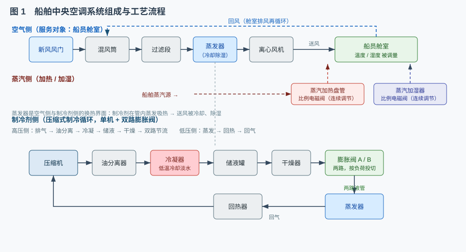
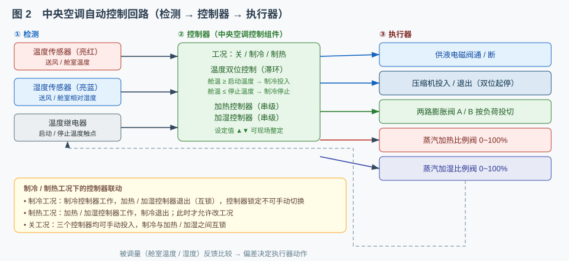
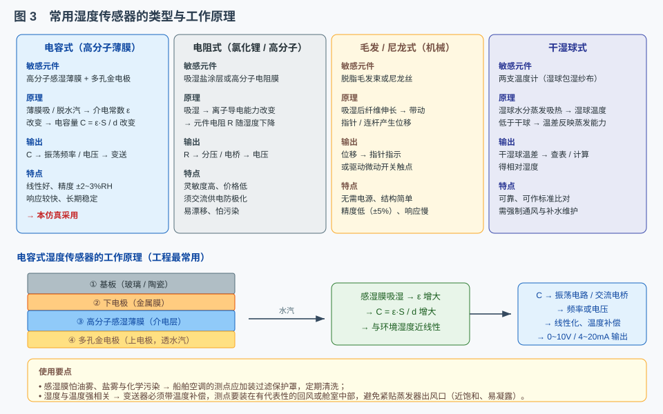
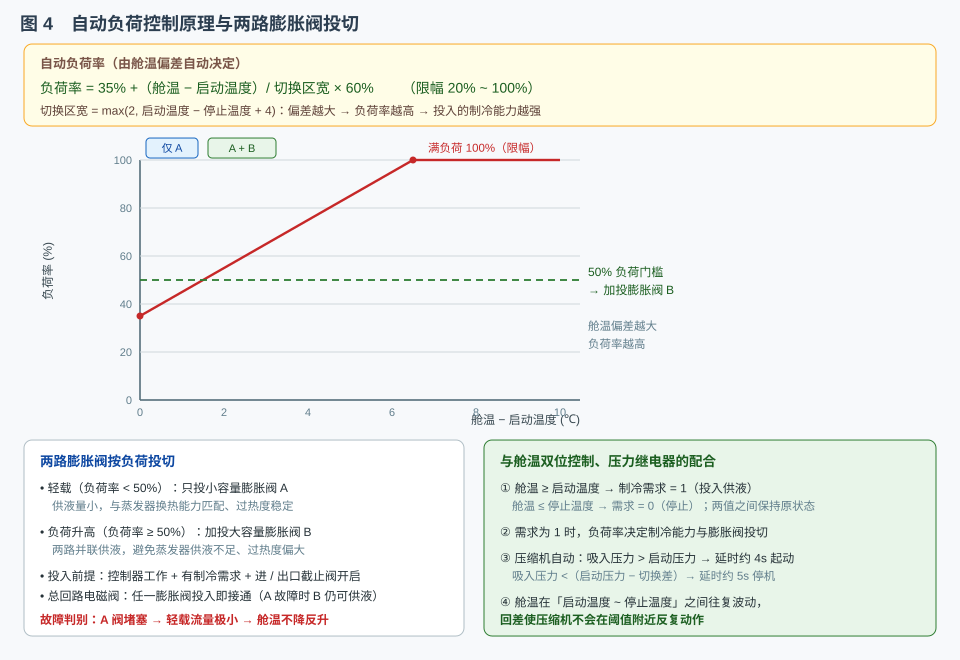

# 空调系统的自动控制、安全保护及故障处理

> 适用对象：船舶轮机 / 大管轮专业　配套仿真：船舶中央空调系统（全空气系统）
> 平台含四条演示流程：① 系统的认识　② 系统的起动　③ 故障判别（蒸发器严重结霜）　④ 安保功能测试。
> 本文重点讲解：**系统的作用和工作原理**、**湿度传感器的类型和工作原理**、**自动负荷控制的工作原理**。

---

## 一、船舶中央空调系统的作用和工作原理

### 1.1 作用

为船员舱室提供**温度、湿度适宜且洁净的送风**，即在夏季**降温除湿**、冬季**加热加湿**，并按比例掺入新风以保证通风换气与空气洁净。中央空调是"全空气系统"——**被调对象是舱室空气而非某个设备**，温度与湿度只能通过调节送风参数间接控制。

### 1.2 系统组成（图 1）

- **空气侧**：新风风门 + 回风风门 → **混风筒**（新风与回风按比例混合）→ 过滤段 → **蒸发器（冷却盘管）** → 离心风机 → 送风 → 船员舱室；舱室回风一部分再循环回混风筒。
- **制冷剂侧**（压缩式制冷）：压缩机 → 油分离器 → 冷凝器（由低温冷却淡水冷却）→ 储液罐 → 干燥器 → **膨胀阀 A / B 两路并联** → 蒸发器 → 回热器 → 回气 → 压缩机。制冷剂在蒸发器内**汽化吸热**，把流过的空气冷却。
- **蒸汽侧**：蒸汽加热盘管与蒸汽加湿器，各由一只**比例电磁阀**连续调节蒸汽量。
- **控制与安保**：中央空调控制组件（工况 / 负荷 / 温度设定）、温度与湿度传感器、温度继电器、压缩机操作台、安全保护与报警面板。

### 1.3 降温除湿（制冷）的工作原理（图 2）

系统按 **检测 → 控制器 → 执行器 → 被调量反馈** 的闭环工作：

1. **检测**：温度传感器测送风 / 舱室温度，湿度传感器测相对湿度，温度继电器给出启动 / 停止触点；
2. **控制**：采用**双位控制**——舱温 **≥ 启动温度**（如 24℃）时产生制冷需求，供液电磁阀通电、压缩机投入；舱温 **≤ 停止温度**（如 22℃）时需求消失、制冷停止。两值之差即**切换差（回差）**，防止执行器频繁动作；
3. **执行**：供液电磁阀通断、压缩机起停、两路膨胀阀按负荷投切、蒸汽比例阀调节开度；
4. **反馈**：舱温、舱湿变化再被传感器拾取，形成循环。

**除湿**是"顺带"完成的：蒸发器管壁温度低于空气露点，水蒸气在翅片上凝结析出，因此送风相对湿度随运行时间逐渐下降（本仿真由 70% 降至约 50% 后稳定）。

**控制器联动**：制冷工况下加热 / 加湿控制器自动退出并**锁定**；制热工况相反；只有"关"工况才可手动投入，且制冷与加热 / 加湿**互锁**——与实际空调的"工况选择"逻辑一致。

### 1.4 安全保护与故障处理

- **排出压力过高**：冷却水中断 → 冷凝压力升高 → 超限并延时约 3s → 压缩机保护停机报警，须**复位**后才能重起；
- **滑油液位（压力）过低**：锁存停机报警；
- **淡水压力低、油分液位高**：只报警不停机；
- **故障判别**：以**蒸发器严重结霜**为例——供液电磁阀与两路膨胀阀均已投入、蒸发压力正常，但霜层热阻使换热严重恶化，制冷量只剩约 1/6，舱温下降特别慢（正常约 0.15℃/s，结霜后仅约 0.02℃/s）。另有**蒸汽加热阀不动作**：制热时控制器输出正常但阀门不开，舱温不上升。

---

## 二、湿度传感器的类型和工作原理

空气湿度用**相对湿度（%RH）**表示，即空气中水蒸气分压力与该温度下饱和水蒸气压力之比。常用传感器有四类：

| 类型 | 敏感元件 | 工作原理 | 输出 |
|------|----------|----------|------|
| **电容式** | 高分子感湿薄膜 + 多孔金电极 | 吸 / 脱水汽 → 介电常数 ε 变 → 电容 C = ε·S/d 变 | C → 频率 / 电压（4~20mA、0~10V） |
| **电阻式** | 氯化锂或高分子电阻膜 | 吸湿 → 离子导电能力变 → 电阻变 | R → 分压 / 电桥电压 |
| **毛发 / 尼龙式** | 脱脂毛发、尼龙丝 | 吸湿伸长 → 带动指针或微动开关 | 位移（机械指示 / 触点） |
| **干湿球式** | 干球 + 包湿纱布的湿球温度计 | 湿球蒸发吸热 → 干湿球温差反映蒸发能力 | 温差 → 查表得相对湿度 |

**电容式**精度高（约 ±2~3%RH）、线性好、响应快、长期稳定，是暖通空调工程最常用的类型（本仿真即采用）。其结构为四层：基板 → 下电极 → **高分子感湿薄膜** → **多孔金电极**。水汽经多孔金电极被薄膜吸收，电容量随湿度近似线性增大，再由振荡电路 / 交流电桥转换为频率或电压，经**线性化与温度补偿**后变送输出。

**使用要点**：感湿膜怕油雾、盐雾与化学污染，测点须加过滤保护罩并定期清洗；变送器必须带温度补偿；测点选在有代表性的回风或舱室中部，**不可紧贴蒸发器出风口**（近饱和、易凝露）。

---

## 三、自动负荷控制的工作原理

"负荷"指制冷系统当时需要承担的**制冷量大小**。舱温偏离设定越多，热负荷越大，压缩机与蒸发器就要承担更大的制冷量——这正是自动负荷控制要解决的问题。

**1. 负荷率由舱温偏差决定**

> 负荷率 = 35% +（舱温 − 启动温度）/ 切换区宽 × 60%，限幅 20% ~ 100%
> （切换区宽 = max(2, 启动温度 − 停止温度 + 4)）

偏差越大 → 负荷率越高；达到 100% 即限幅为满负荷。负荷率决定系统投入的"制冷能力档位"。

**2. 两路膨胀阀按负荷投切**

蒸发器供液由**两路并联的膨胀阀 A / B** 完成：

- 轻载（负荷率 < 50%）：只投 A，供液量小，与蒸发器换热能力匹配、过热度稳定；
- 负荷升高（负荷率 ≥ 50%）：**加投 B**，两路并联供液，避免蒸发器供液不足、吸气过热度偏大；
- 投入前提：控制器工作 + 有制冷需求 + 压缩机进 / 出口截止阀开启；总回路电磁阀"任一阀投入即接通"，故 A 路堵塞时 B 路仍可单独供液（但轻载流量极小，表现为制冷失效）。

**3. 与舱温双位控制、压力继电器的配合**

- 舱温 ≥ 启动温度 → 制冷需求为 1；舱温 ≤ 停止温度 → 需求为 0；两值之间**保持原状态**（回差 / 滞后）；
- 需求为 1 时，负荷率决定制冷能力与膨胀阀投切；
- 压缩机置于**自动**时由吸入压力继电器控制起停：入口压力高于启动压力 → 延时约 4s 起动；低于（启动压力 − 切换差）→ 延时约 5s 停机。

三者配合的结果是：舱温在"启动温度 ~ 停止温度"之间**往复波动**，压缩机既不频繁起停，也不会长期空转，兼顾舒适性与经济性。

---

## 四、操作与判别要点

1. **起动顺序**：开各路截止阀 → 开新风 / 回风风门并起动风机 → 投控制器、选工况与负荷 → 压缩机自动投入；
2. **故障判别**：先看现象（舱温、压力、报警），再区分**换热故障**（蒸发器结霜、供液不足）与**执行器故障**（蒸汽阀不动作）、**压缩故障**（压力、油位、保护动作），最后用故障界面复现与排除；
3. **保护停机后**须先"重置系统"复位、查明原因，方可重新起动。
