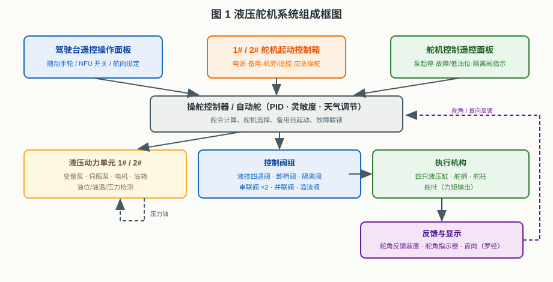
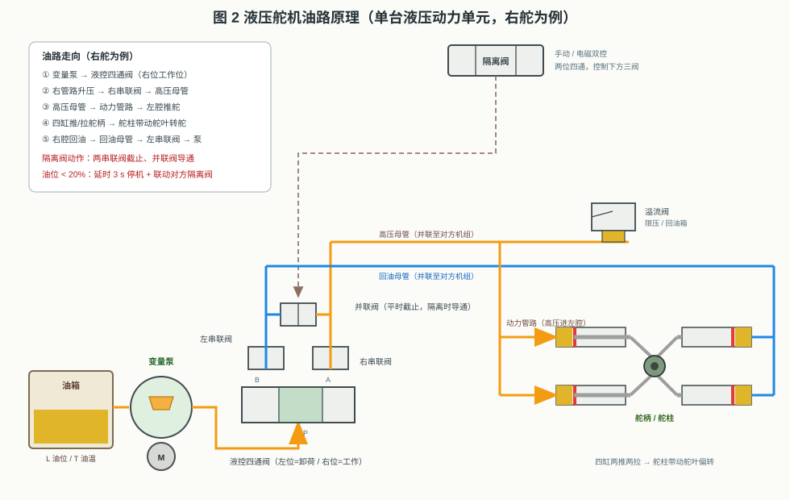
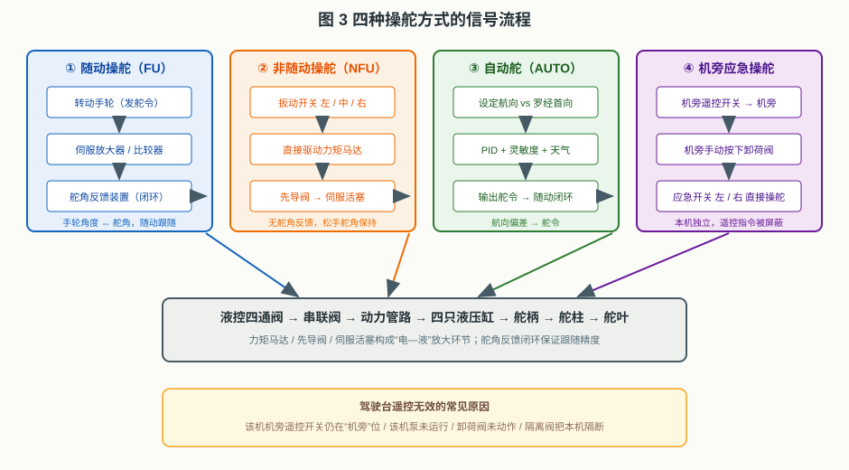
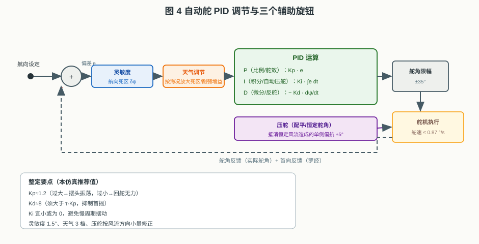
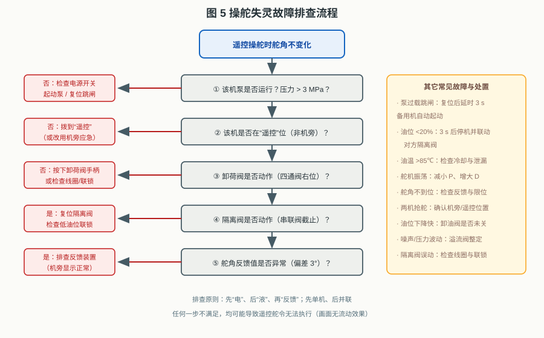

# 舵机控制的操作程序及故障处理

> 本文配合本仿真软件使用：第 1 页为“舵机远程遥控操作”（状态显示仪、遥控操作面板、舵机控制遥控面板），第 2 页为“船舶液压舵机系统与机旁控制”（液压系统图、1#/2# 机旁起动控制箱）。阅读时建议同步打开软件，按文中顺序操作对照。

## 一、液压舵机系统的组成

船舶液压舵机是把驾驶台的操舵电信号放大成足够大的转舵力矩、并驱动舵叶偏转的执行系统。按功能可划分为**操作层、控制层、液压层与执行层**四个层次。

**1. 操作层（人机接口）**

- **驾驶台遥控操作面板**：随动操舵手轮、非随动（NFU）操舵开关、航向设定与显示、模式选择旋钮（手动/自动/NFU）、舵机选择旋钮（NO.1/NO.2）、舵角指示器（DMU）。
- **1# / 2# 舵机起动控制箱（机旁）**：每台机组一套，三行布置——第一行电源开关、电源指示灯、故障跳闸指示灯；第二行备用开关（带就绪指示）、起动按钮、停止按钮（均带灯）；第三行机旁遥控选择开关、应急操舵开关。
- **舵机控制遥控面板**：两台机组泵的起动/停止按钮、泵故障与油位极低指示灯、1#/2# 隔离阀动作指示灯、试灯与复位按钮。

**2. 控制层**

操舵控制器（自动舵）完成四件事：把操舵指令换算成舵令；按 PID 与辅助调节旋钮修正舵令；决定指令发给哪一台舵机（开关指向优先、未运行自动转备用）；实施故障联锁（泵跳闸、油位极低、反馈故障）。

**3. 液压层（本仿真中每台机组一套，1#/2# 完全对称）**

- **液压动力单元**：油箱（含油位、油温检测）、变量泵、伺服泵、驱动电机、补油单向阀与小油箱、溢流阀。
- **控制阀组**：液控四通阀（决定左右管路哪一侧为高压）、卸荷阀（手动/电磁双控，控制四通阀是否切到工作位）、隔离阀（手动/电磁双控两位四通阀，控制本机两只串联阀与并联阀）、两只串联阀（本机与并联母管之间的隔断阀）、并联阀（把本机左右管路桥接）、溢流阀（限制系统最高压力）。

**4. 执行层与反馈**

四只液压缸分上下两排、左右各一，活塞杆通过铰点与舵柄两端相连；舵柄套装在舵柱上，舵柱带动舵叶。舵角反馈装置把实际舵角送回控制器，舵角指示器与首向（罗经）信号供驾驶台显示。

**5. 舵设备的基本概念与规范要求**

理解舵机之前先明确几个常用量：

- **舵角**：舵叶平面与船体中纵剖面的夹角，左舵为“P（Port）”、右舵为“S（Starboard）”，最大舵角一般为 35°；
- **舵速**：单位时间内舵角的变化量，本仿真取 0.87 °/s，即满舵约需 40 s，接近实船“28 s 内由一舷 35° 转至另一舷 30°”的量级；
- **舵效**：单位舵角产生的转船力矩，与航速平方、舵叶面积近似成正比，所以低速时“同样的舵角、转船明显变慢”，这也是进出港、靠离泊时要提前用舵的原因；
- **转舵力矩**：舵叶上水动力对舵杆形成的力矩，由液压缸推力克服；航速越高、舵角越大，所需力矩越大，因此液压系统必须保留足够的压力裕量。

按 SOLAS 与船级社规范的要求，舵机应满足“主操舵装置 + 辅助（备用）操舵装置”的配置原则：主操舵装置应能在最大航速下把舵从一舷 35° 转至另一舷 30°；一台动力设备失效时，另一台应能在 45 s 内完成同样的转舵动作。本仿真设置两台完全独立的液压动力单元（1#/2#），正是这一“双套、互为备用”原则的体现：任一机组的电源、泵、隔离阀均可独立投切，一台故障时另一台可自动或手动接管，保证船舶不至于完全失去操舵能力。

## 二、液压舵机系统的工作原理

**1. 压力油的产生与走向**

变量泵由电机驱动，从油箱吸油后输出压力油。压力油进入**液控四通阀**：四通阀处于**右位（工作位）**时，把压力油送入“右管路”，左管路与回油相通；处于**左位（卸荷位）**时，压力油经阀内两下接口直接短路回油箱，舵机不动作。四通阀能否切到右位，取决于**卸荷阀**是否动作（手动按下手柄、线圈得电或遥控系统自动得电三者之一）。

**2. 串联阀、并联阀与隔离阀的作用**

从四通阀出来的左右管路，各自经一只**串联阀**向上接到“并联母管”；两只串联阀之间还跨接一只**并联阀**。于是：

- 两台机组的**右管路**通过互连管路并成一条“高压母管”，**左管路**并成一条“回油母管”，这就是两套动力单元的并联供电；
- 串联阀导通时，本机才能向母管送油或从母管回油；串联阀截止时，本机与母管隔断；
- 并联阀平时截止，当本机隔离阀动作时**自动导通**，把本机左右管路桥接，使该机自成回路（用于隔离检修或单机应急）。

**隔离阀**是控制“本机是否参与并联”的枢纽：它动作时，本机两只串联阀同时截止，并联阀导通，本机动力油不再穿过串联阀进入对方动力管路；未接到舵令的机组保持四通阀左位，泵处于卸荷循环状态。

**阀位与油流的关系**（以 1# 机为例，2# 机完全对称）：

| 阀件 | 正常并联位 | 动作（隔离）位 | 对油流的影响 |
|---|---|---|---|
| 液控四通阀 | 左位（卸荷循环） | 右位（工作） | 左位时压力油短路回油，舵机不动；右位时压力油送入右（或左）管路 |
| 卸荷阀 | 未按下、线圈失电 | 按下或线圈得电 | 决定四通阀能否从左位切到右位；机旁位必须手动按下 |
| 隔离阀 | 未动作 | 手动/线圈/自动动作 | 同时带动本机两只串联阀截止、并联阀导通 |
| 串联阀（×2） | 导通 | 截止 | 截止时本机与并联母管隔断，油流不得穿过 |
| 并联阀 | 截止 | 导通 | 导通时把本机左右管路桥接，形成本机自成回路 |

**3. 补油、溢流与压力保护**

变量泵吸油侧设有补油单向阀与小油箱：系统内漏或油缸容积变化造成的油量不足，由单向阀从小油箱（及其后的主油箱）补入，反向则截止，避免压力油倒流。溢流阀并联在压力油路上，限定系统最高压力；当操舵遇到硬限位、舵叶被卡或两机压力叠加时，多余油量经溢流阀回油箱，既保护泵与管路，也避免电机过载跳闸。演示中若发现压力长时间顶在溢流压力，应检查舵角是否已到机械限位、隔离阀是否误动。

**4. 四缸驱动舵柄**

左右两侧高压油经动力管路分别送到四只液压缸。以右舵为例：下排两缸活塞同向右移、上排两缸活塞同向左移（两侧对称布置），两只活塞杆推动舵柄绕舵柱回转，舵柱带动舵叶偏转；另一组液压缸排油经动力管路、串联阀、左管路回到四通阀，再回泵入口。由于四缸“两推两拉”，在有限行程内可获得较大的转舵力矩，且左右对称、受力均衡。

**5. 反馈闭环**

舵柄转角即舵角，由反馈装置送回控制器。随动与自动模式下，控制器不断比较“舵令”与“实际舵角”，偏差大于死区就继续驱动；偏差进入死区后停止，从而把舵稳定在指令角度上。NFU 与机旁应急模式下不使用舵角反馈闭环，松手后舵角保持。

**6. 液压油、油位与油温的管理**

液压油既是传力介质，也是润滑与散热介质，其状态直接决定舵机能否可靠工作。本仿真在油箱上设置两只截止阀：**注油阀**打开时液位以约 10 %/min 上升，**卸油阀**打开时以约 2 %/s 下降，用于演示补油与漏油场景；同时用 10 px 的 **L（液位）/T（油温）**标签实时显示数值，液位保留 1 位小数。

- **油位**：正常应在 60%~90%。低于 20% 时系统判定“油位极低”，延时 3 s 自动停泵，并联动**对方机组隔离阀动作**，把缺油机与并联母管隔断，防止空气被吸入管路造成失压、气蚀与舵机爬行；
- **油温**：正常运行在 35~85 ℃。运行时按约 +1 ℃/3 s 上升、停机后按约 −1 ℃/2 s 下降。油温过低黏度大、吸油困难、压力建立慢；油温过高黏度下降、内漏增大、油液氧化变质，密封件加速老化；
- **油质**：应保持清洁、无水、无乳化。滤器堵塞会造成吸油不足、噪声与压力波动，应定期清洗或更换滤芯；补油时必须经滤油机并排气。

实操中判断“油路是否真的通了”有一个简单办法：舵令存在且泵在运行时，管路上会出现沿油流方向的动态箭头；箭头从泵口开始、到用油点结束，方向随操舵方向反转，中位或串联阀截止时不流动。若舵角在变而管路没有流动显示，说明有旁通或反馈异常；若管路有流动而舵角不变，则多半是舵角已到限位或机械卡阻。

## 三、驾驶台的三种操舵模式

**1. 随动操舵（FU / 手动）**

转动手轮，手轮角度经换算得到舵令（本仿真满舵 35° 对应手轮 ±315°），随动系统驱动舵机跟随，舵角指示随之变化。特点是“手轮转到哪、舵就到哪”，并带 0.5° 左右的舵角死区，避免舵机在小偏差上反复动作。

操作要点：模式选择旋钮置于“手动”→ 转动手轮 → 观察舵角指示；回中手轮，舵叶回零。

**2. 非随动操舵（NFU）**

扳动 NFU 开关（左/中/右），开关直接驱动力矩马达与先导阀，伺服活塞偏移，舵角按舵速（本仿真 0.87°/s）持续偏转；松开开关自动回中，舵角**保持**在当前位置。NFU 不构成舵角闭环，适合应急或需要“点动”微调舵角的场合。

**3. 自动舵（AUTO）**

设定航向后，控制器比较“设定航向”与罗经首向，得到航向偏差，经 PID 运算输出舵令，再由随动系统执行。自动舵的作用是**把船稳定在设定航向上**，而不是“转到某个舵角”。

**4. 三种模式的共同约束**

- 舵令一律限幅 ±35°，实际舵角同样硬限位 ±35°（应急操舵也不例外）；
- 舵机选择旋钮决定舵令发给哪台机组：开关指向某台，指令优先发该台；该台未运行则自动转给运行中的备用机；
- 某台机组处于“机旁”位时，遥控系统视其不可用，即使该机泵在运行，遥控面板对应指示灯也不亮。

## 四、机旁应急操舵

当遥控系统失效（失电、反馈故障、通信中断）时，可在机旁直接操舵。本仿真的机旁应急流程为：

1. 合上该机起动控制箱**电源开关**，必要时把**备用开关**打到“开”；
2. 按下**起动**按钮起动机组泵，观察压力建立；
3. 把**机旁遥控选择开关**从“遥控”拨到“**机旁**”——此后遥控指令被屏蔽；
4. **手动按下该机卸荷阀**（四通阀切到右位、油路投入；机旁位不会自动切阀）；
5. 扳动**应急操舵开关**（左转舵/右转舵）操舵，松手后舵角保持；
6. 恢复遥控时，先把选择开关拨回“遥控”，再释放应急操舵，系统自动释放应急状态。

应急操舵松手后，伺服活塞与先导阀回到中位，但**舵角不会自动回零**，这是应急操舵与随动操舵最重要的区别。

## 五、自动舵的 PID 与三个辅助旋钮

**1. 比例（P）——舵效**

舵令与航向偏差成正比：偏差越大，打舵越多。P 过小回舵无力、航向长期偏着；P 过大则船首左右摆头、频繁操舵。本仿真推荐的 P 值约为 1.2（每 1° 偏差约 1.2° 舵）。

**2. 积分（I）——消除稳态偏差（自动压舵）**

把航向偏差随时间的累积量乘系数叠加到舵令上，可以消除恒定风、流造成的“总是偏一点”的现象。I 过大会产生慢周期摆动（积分饱和），因此一般取很小的值，必要时为 0。

**3. 微分（D）——反舵（阻尼）**

用首向角速度（转首快慢）反向压舵，相当于“提前回舵”，抑制摆头。稳定判据近似为 `Kd > τ·Kp`（τ 为首向响应时间常数，本仿真约 6 s），所以 D 值通常明显大于 P 值，本仿真推荐 8 左右。

**4. 灵敏度调节（航向死区）**

设定“航向偏差超过多少度才动舵”。死区大 → 舵机动作少、省舵省能，但航向保持粗糙；死区小 → 航向精确，但舵机频繁动作、磨损与能耗增加。灵敏度是**航向**死区，不要与舵角死区（随动系统定位死区）混淆。

**5. 天气调节（海况调节）**

风浪大时船首持续受扰动，若一味追着修正会长时间满舵摆动。天气调节按档位**自动放大航向死区、削弱增益**，使重海况下舵动作变小、更平缓。它本质是“抗扰动、省舵”的自动整定，与灵敏度是“基准值 + 修正量”的关系。

**6. 压舵（配平 / 恒定舵角）**

当存在恒定横风、横流或单侧负载时，船会持续向一侧偏航。压舵就是人为（或自动）给一个小的恒定舵角（一般 ±5° 内）抵消这种偏航，使平均舵角回到零附近，减少长期单侧受力。

**7. 现场整定的先后顺序**

自动舵的整定有经验的次序：**先死区、再比例、后微分、最后压舵**。

1. 把灵敏度（航向死区）放到中等偏大（约 1.5°），让舵机先“动得少一点”，避免一开始就跟着小扰动频繁打舵；
2. 逐步增大比例（P），直到船舶在静水中能较快回到设定航向、且不出现明显过冲；
3. 若船首出现周期性摆头，减小 P、增大 D（每个“回舵”动作提前一点），本仿真中 D 宜明显大于 P；
4. 积分（I）默认取 0 或极小值；只有在“始终偏一侧 1°~2°”时，才小量加入；
5. 最后按风流方向用压舵把平均舵角配平，并据海况把天气调节拨到相应档位。

**8. 使用自动舵的注意事项**

- 进出港、狭水道、能见度不良、密集渔区、锚泊与靠离泊时**必须改用手动（随动）操舵**，自动舵只能作为开阔水域的辅助；
- 大舵角避让、船舶密集交会、主机变速或倒车时，应先转手动，防止自动舵“追不上”或反向打舵；
- 换用自动舵前应确认罗经首向稳定、舵角反馈正常，切换后观察一个完整周期（约 1 min）的舵角摆动幅度；
- 值班中要定期核对“设定航向—罗经首向—实际舵角”三者是否一致，出现持续单侧压舵要检查风流与压舵量。

## 六、仿真操作要点

1. **开机**：第 2 页合上两台机组的电源开关 → 备用开关打到“开”（就绪时旋钮背景亮黄）→ 机旁遥控开关拨到“遥控”→ 选择 1# 并按下“起动”，压力建立。
2. **驾驶台操舵**：第 1 页把模式旋到“手动”，转动手轮；或旋到“NFU”用开关点动；或旋到“自动”并设定航向。
3. **观察要点**：舵角指示、舵柄转角、四缸活塞位置三者应同步；有舵令且泵在运行时，管路上会出现流动方向键，方向随操舵方向反转。
4. **机旁应急**：按第四节顺序操作，注意“机旁位必须手动按下卸荷阀”。
5. **故障复现与排除**：通过工具栏“故障设置”勾选/取消；处理完成后用“复位”清除跳闸与联锁标志。

## 七、常见故障及排除方法

| 故障现象 | 可能原因 | 排除方法 |
|---|---|---|
| 遥控转舵无反应，画面无流动 | 该机泵未运行 / 电源未合 | 检查电源开关、起动泵、复位跳闸 |
| 同上，泵在运行 | 该机仍在“机旁”位 | 把机旁遥控开关拨到“遥控” |
| 同上，已在遥控位 | 卸荷阀未动作，四通阀在左位 | 按下卸荷阀或检查线圈/联锁 |
| 只有一台能操舵 | 另一台隔离阀动作、串联阀截止 | 复位隔离阀；检查低油位联锁 |
| 泵运行但压力建立慢 | 油位不足、吸油不畅、内漏 | 注油阀补油；检查补油单向阀 |
| 舵角到不了指令值 | 反馈装置故障（偏差 3°）、限位、油压低 | 对比机旁真实舵角；检查反馈线 |
| 舵机持续摆头/振荡 | P 过大、D 过小、死区过小 | 减小 P、增大 D、适当增大灵敏度 |
| 长时间单侧压舵 | 恒定风流、压舵未配平 | 使用压舵/自动配平修正 |
| 泵频繁跳闸 | 过载、油温过高、滤器堵塞 | 查电流、油温（>85℃报警）、清洗滤器 |
| 油位快速下降 | 卸油阀未关、外漏 | 关闭卸油阀、检查管路与接头 |
| 油位低于 20% | 泄漏或长期未补油 | 系统 3 s 后自动停机并联动对方隔离阀，需补油后复位 |
| 一台跳闸后无备用投入 | 备用开关未打“开”或备用机未供电 | 备用开关打“开”、合上备用机电源，跳闸后延时 3 s 自起动 |

**排查原则**：先“电”（电源、模式、机旁/遥控位置）→ 后“液”（泵、卸荷阀、隔离阀、油位油温）→ 再“反馈”（反馈装置、指示器）。任何一环不满足，遥控舵令都无法执行。

## 八、舵机试验与日常维护

**1. 开航前的舵机试验**

按惯例与规范要求，开航前 12 h 内应进行舵机试验，本仿真可完整复现以下项目：

1. 分别用 1#、2# 机组做主操舵试验，从一舷 35° 转至另一舷 30°，观察转舵时间、压力与噪声；
2. 试验遥控系统：驾驶台手轮、NFU 开关、自动舵三种方式各动作一次；
3. 试验机旁应急操舵：确认机旁遥控开关能有效屏蔽驾驶台指令，应急开关能正常转舵；
4. 核对舵角指示器与机旁机械舵角指示是否一致（本仿真中反馈故障时可差 3°，正是用来训练这一核对习惯）；
5. 检查驾驶台与舵机舱之间的通信（声力电话/对讲）是否畅通，报警（失压、低油位、油温高、跳闸）是否有效；
6. 确认两台机组的电源、备用开关状态与“双套互为备用”的要求一致。

**2. 日常维护要点**

- **油**：每班查看液位与油温，及时补油、放残；按周期取样化验，超过换油指标及时更换；
- **滤**：定期清洗吸油滤器与压力滤器，清洗后必须排气；
- **密**：检查油缸活塞杆、阀块接合面、管接头有无渗漏，渗漏既浪费油也降低舵效；
- **电**：检查电机绝缘、接线端子紧固、限位与反馈电位器（或同步机）的零位与线性度；
- **机**：舵杆轴承、舵柄销、铰点定期润滑；检查机械限位块与缓冲装置是否完好；
- **演**：按周期组织应急操舵演习，确保值班人员能在驾驶台失效时迅速转到机旁操作。

**3. 记录与交接**

每次试验与故障处理都应记录：时间、机组、现象、压力/油位/油温/电流数值、采取的措施与结果。交接班时把“哪台在运行、哪台备用、隔离阀状态、有无未消除的报警”交代清楚，避免下一班误以为两台都在备用状态。

## 九、典型故障分析

**案例 1：1# 泵过载跳闸**

现象：1# 泵停转、故障跳闸灯亮、系统失压、舵机失去动力。
处理：确认备用开关已打“开”、2# 已供电；跳闸后约 **3 s**，2# 备用机组自动起动，操舵能力恢复；随后在故障设置界面取消故障并复位，跳闸灯熄灭。

**案例 2：油位极低联锁**

现象：油箱液位低于 20%，延时 3 s 后本机泵自动停机，同时**对方机组隔离阀自动动作**（线圈变红、阀位切换），把故障机与并联母管隔断。
处理：关闭卸油阀，用注油阀补油（约 10%/min）；液位恢复后复位，隔离阀返回。

**案例 3：舵角反馈装置故障**

现象：遥控面板舵角显示比实际多 3°，随动/自动操舵时实际舵角总比指令少 3°就停，机旁舵角指示正常。
处理：以机旁指示为准判断真实舵角；更换/校正反馈装置后复位。此时可临时改用机旁应急操舵。

## 十、思考与练习

1. 为什么隔离阀动作后，本机动力油不能再进入对方动力管路？两只串联阀与并联阀各起什么作用？
2. 机旁应急操舵为什么必须手动按下卸荷阀？如果不按会出现什么现象？
3. 自动舵出现 20 s 周期、±4° 的摆头，应优先调整哪个参数？为什么？
4. 灵敏度与天气调节有什么区别？重海况下应如何配合使用？
5. 一台泵跳闸后备用机 3 s 才起动，这 3 s 内舵机为什么仍可能短时失控？如何减小影响？
