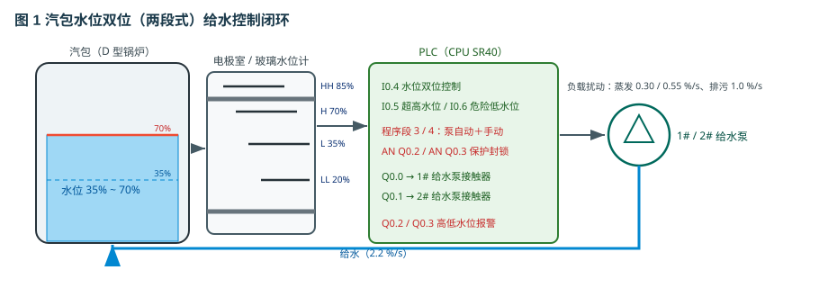
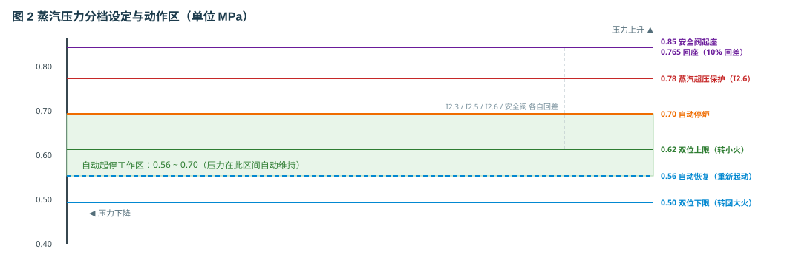
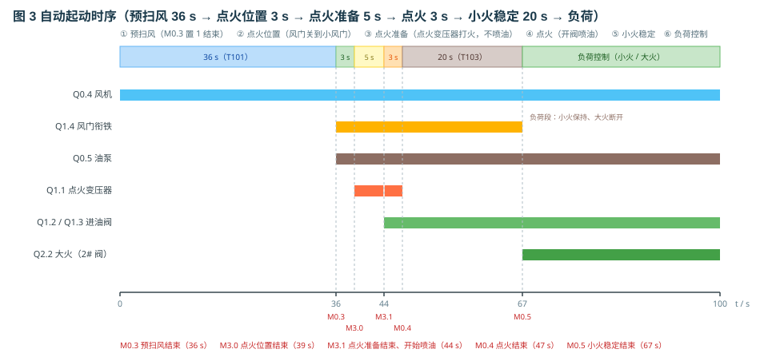
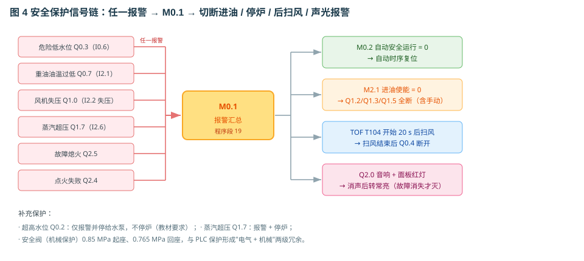

# 辅锅炉控制系统安全保护的操作程序及故障处理

> 适用工程：`lab_10/syy26_boiler2`（辅锅炉 PLC 控制仿真）
> 依据教材：图 6-3-18（机旁操纵台）、图 6-3-19（外部接线图）、图 6-3-20~22（梯形图）
> 编写日期：2026-11

---

## 0. 系统总览

### 0.1 被控对象

本工程以一台**D 型立式水管锅炉**为对象，蒸发量 1500 kg/h、工作压力 0.7 MPa、全自动（PLC）控制。锅炉本体由汽包（上部穹顶 + 筒体）、立式水管束、燃烧室（炉膛）、烟囱、燃烧器、点火变压器、紫外光电管、排污管路等组成；辅助系统包括重油系统（重油柜/轻油柜 → 手动三通阀 → 双支路油泵 → 重油加热器 → 总电磁阀 → 二路电磁阀）、给水系统（锅炉供水箱 → 出口截止阀 → 双支路给水泵 → 单向阀 → 汇合 → 锅炉进水截止阀）、送风系统（送风机 → 风门 → 燃烧器进风口）。

被控量有三个：

| 被控量 | 传感器 | 执行机构 | 控制方式 |
|--------|--------|----------|----------|
| 汽包水位 | 4 只水位电极（HH/H/L/LL）+ 液位继电器 | 1#/2# 给水泵 | 双位（两段式） |
| 蒸汽压力 | 3 只压力继电器 + 蒸汽压力表 | 燃烧器大小火（1#/2# 电磁阀）+ 自动起停 | 双位 + 起停 |
| 重油温度 | 油温继电器 | 重油加热器（电加热） | 双位 |

### 0.2 PLC 硬件与 I/O 分配

CPU 为 S7-200 SMART SR40（I0.0~I2.7 / Q0.0~Q1.7），加一块 EM DQ08（Q2.0~Q2.7）。

**输入（I）**

| 地址 | 器件 | 类型 | 说明 |
|------|------|------|------|
| I0.0 | 1# 水泵自动 | 开关 | 1# 给水泵选择开关左档 |
| I0.1 | 1# 水泵手动 | 开关 | 1# 给水泵选择开关右档 |
| I0.2 | 2# 水泵自动 | 开关 | 2# 给水泵选择开关左档 |
| I0.3 | 2# 水泵手动 | 开关 | 2# 给水泵选择开关右档 |
| I0.4 | 水位双位控制 | 继电器触点 | 液位继电器，低于下限闭合 |
| I0.5 | 超高水位 | 电极 | HH 电极（85%）|
| I0.6 | 危险低水位 | 电极 | LL 电极（20%）|
| I0.7 | 燃烧准备 | 按钮 | 脉冲信号 |
| I1.0 | 燃烧停止 | 按钮 | 脉冲信号 |
| I1.1~I1.5 | 燃烧选择·自动/扫风/点火/小火/大火 | 旋钮 | 六档旋钮的 5 个位置 |
| I1.6 / I1.7 | 1#/2# 油泵选择 | 旋钮 | 三档旋钮的左右两档 |
| I2.0 | 消声 | 按钮 | 脉冲信号 |
| I2.1 | 油温继电器 | 继电器触点 | 油温 < 90 ℃ 时闭合 |
| I2.2 | 风压检测开关 | 继电器触点 | 风压正常闭合 |
| I2.3 | 锅炉自动停机 | 继电器触点 | 自动起停压力继电器（达上限动作）|
| I2.4 | 火焰监视 | 继电器触点 | 紫外光电管输出，有火闭合 |
| I2.5 | 压力双位控制 | 继电器触点 | 大小火转换压力继电器（达上限动作）|
| I2.6 | 蒸汽超压 | 继电器触点 | 超压继电器（≥0.78 MPa 动作）|

**输出（Q）**

| 地址 | 器件 | 说明 |
|------|------|------|
| Q0.0 / Q0.1 | KM1 / KM2 | 1# / 2# 给水泵接触器 |
| Q0.2 / Q0.3 | — | 超高水位 / 危险低水位报警灯 |
| Q0.4 | KM3 | 送风机接触器 |
| Q0.5 / Q0.6 | KM4 / KM5 | 1# / 2# 油泵接触器 |
| Q0.7 | — | 油温过低指示灯 |
| Q1.0 | — | 风机失压指示灯 |
| Q1.1 | KA1 | 点火变压器 |
| Q1.2 | KA2 | 总燃油阀（总电磁阀）|
| Q1.3 | KA3 | 1# 燃油阀（1# 电磁阀）|
| Q1.4 | KA4 | 风门衔铁（风门电磁铁）|
| Q1.5 | KA5 | 2# 燃油阀（2# 电磁阀，大火）|
| Q1.6 | — | 火焰信号指示灯 |
| Q1.7 | — | 蒸汽超压指示灯 |
| Q2.0 | — | 音响报警（蜂鸣器）|
| Q2.1 | — | 起动就绪灯 |
| Q2.2 | — | 大火运行灯 |
| Q2.3 | — | 小火运行灯 |
| Q2.4 | — | 点火失败灯 |
| Q2.5 | — | 故障熄火灯 |

**内部标志（M）**

| 地址 | 含义 |
|------|------|
| M0.0 | 风压正常中间位（风机压力检测）|
| M0.1 | 报警汇总 |
| M0.2 | 自动安全运行信号 |
| M0.3 | 预扫风结束 |
| M0.4 | 点火结束 |
| M0.5 | 小火稳定结束 |
| M1.0~M1.6 | 六路消声记忆（水位低/油温低/风机失压/超压/熄火/点火失败/水位高）|
| M2.0 | 油泵运行 |
| M2.1 | 进油使能（总阀 + 1# 阀）|
| M3.0 | 点火位置结束 |
| M3.1 | 点火准备结束 |
| M3.2 | 火焰曾建立记忆 |

**定时器（T，100 ms 时基）**

| 编号 | 设定 | 用途 |
|------|------|------|
| T101 | 360（36 s）| 自动预扫风 |
| T102 | 30（3 s）| 自动点火（喷油）窗口 |
| T103 | 200（20 s）| 小火稳定 |
| T104 | 200（20 s）| 后扫风（TOF 断电延时）|
| T105 | 50（5 s）| 手动点火超时（点火失败）|
| T106 | 80（8 s）| 点火监视 |
| T107 | 30（3 s）| 手动点火变压器通电时间 |
| T108 | 200（20 s）| 风压检测起始延时 |
| T109 | 30（3 s）| 自动点火位置 |
| T110 | 50（5 s）| 自动点火准备 |

### 0.3 过程模型参数（用于仿真量的物理解释）

| 参数 | 数值 | 说明 |
|------|------|------|
| 给水流量 `pumpRate` | 2.2 %/s | 水泵运行时的补水速率 |
| 蒸发量 小火/大火 | 0.30 / 0.55 %/s | 燃烧带来的水位下降 |
| 排污放水 | 1.0 %/s | 排污截止阀导通时 |
| 小火/大火产热 | 0.0030 / 0.0045 MPa/s | 升压能力 |
| 用汽负荷（50% 旋钮）| 0.0036 MPa/s | 由负荷旋钮 0~100% 折算 |
| 压力各档 | 0.50 / 0.56 / 0.62 / 0.70 / 0.78 / 0.85 | 见第 2 章 |
| 水位电极 | HH 85 / H 70 / L 35 / LL 20 % | 电极整定值 |

---

### 0.4 术语约定

| 术语 | 含义 |
|------|------|
| 双位控制（两段式）| 执行机构只有"开/停"两种状态，靠上下两个设定值切换 |
| 回差（滞环、死区）| 动作值与复位值之差，用于防止设定点附近频繁动作 |
| 预扫风 | 点火前用空气吹扫炉膛与烟道，排除残油与可燃气 |
| 后扫风 | 停炉后继续吹扫 20 s，把残油与可燃气抽走 |
| 点火位置 | 风门关到小开度（12°）的点火预备位置 |
| 点火准备 | 风门已到位、点火变压器打火，但尚未喷油的阶段 |
| 点火监视时间 | 开始喷油后允许"无火"的最长时间（本系统 8 s）|
| 失效安全（fail-safe）| 元件/回路失效时，系统自动进入安全侧（断油、停炉）|
| 起座/回座压力 | 安全阀开启压力与重新关闭压力（本系统 0.85 / 0.765 MPa）|
| 报警汇总 | 把多路报警并联成一个标志位（M0.1），统一触发停炉流程 |
| 消声记忆 | 每路报警的独立"已消声"标志（M1.x），报警消失后自动复位 |
| 冷炉 | 锅炉长期停用后炉膛与受热面处于常温的状态，不允许直接上大火 |

## 1. 锅炉水位控制原理



### 1.1 为什么汽包水位必须控制

汽包（锅筒）是锅炉的汽水分离与储能元件：其下部是饱和水，上部是饱和蒸汽。水位过高会带来两个后果——**蒸汽带水**（蒸汽湿度增大，进入过热器/汽轮机造成结垢、水击、叶片冲蚀），严重时**满水**使蒸汽管道产生巨大水击；水位过低则更危险——**管束缺水**导致水冷壁/对流管束局部过热、爆管，甚至引发炉膛爆炸事故。因此水位必须严格控制在规定范围内，本系统正常水位带为 **35%~70%**。

水位控制本质上是一个"物质平衡"问题：

```
Δ(水位) ∝ ∫(给水量 − 蒸发量 − 排污量) dt
```

给水量由给水泵决定，蒸发量由燃烧负荷决定，排污量由排污阀决定。三者中只有给水量可以快速、连续地调节，因此**水位控制 = 用给水去追蒸发与排污的变化**。

### 1.2 双位（两段式）控制及回差

工程上中小型辅锅炉多采用**双位控制**而非连续 PID，原因是：

1. 给水泵是定速泵，流量不可连续调节，只能"开/停"；
2. 双位控制只需 1 个液位开关（或一对电极），无需变送器与调节器；
3. 汽包容积大，本身是储能元件，短时的给水断续不会引起水位剧烈波动。

双位控制的关键是**回差（滞环）**：如果只用单一设定点（例如 50%）比较，水位在 50% 附近时水泵会频繁启停（"打摆子"），接触器与电机寿命骤降。因此设置两个设定点：

```
水位 < 下限（35%） → 继电器闭合（I0.4=1）→ 启动给水泵
水位 > 上限（70%） → 继电器断开（I0.4=0）→ 停止给水泵
35% ~ 70% 之间     → 保持原状态（记忆）
```

这就是"两段式/双位式"控制。回差 = 70% − 35% = 35%，属较大的回差，靠汽包蓄水量来平抑波动。

### 1.3 本系统的三层水位监测

本工程同时画出了三层水位信号，教学上可对照"由粗到细"：

| 层次 | 器件 | 整定值 | 用途 |
|------|------|--------|------|
| 调节 | 液位继电器（连通管取压）| 35% / 70% | 正常的给水自动控制（I0.4）|
| 报警 | 电极 H（70%）/ L（35%）| 70% / 35% | 面板"水位过高/过低"信号 |
| 保护 | 电极 HH（85%）/ LL（20%）| 85% / 20% | Q0.2 停泵报警 / Q0.3 停炉保护 |

汽包两侧的**电极室**（4 只电极 HH/H/L/LL）与右侧的**玻璃水位计**通过上下两根连通管与汽包相连，利用**连通器原理**保持与汽包同一水位——这是真实的液位测量方式：电极靠水的导电性判断浸没与否，玻璃水位计则直接目视。仿真中三者共用同一个 `level` 值，故画面上的水面高度始终一致。

### 1.4 给水泵的控制逻辑（程序段 3、4）

以 1# 给水泵（Q0.0）为例，其语句表为：

```
LD I0.0         ①选择开关在"自动"
A  I0.4         ②液位继电器闭合（水位低于 35%）
LD I0.1         ③或选择开关在"手动"
OLD             （②与③并联）
AN Q0.2         ④且未超高水位（防溢流）
=  Q0.0         ⑤驱动 1# 给水泵接触器
```

逻辑表达式：

```
Q0.0 = [ (I0.0 · I0.4) + I0.1 ] · Q0.2'
```

三点值得强调：

1. **"自动"是断续运行**：只有在自动档 **且** 液位继电器闭合时才启泵，水位升到 70% 以上继电器断开即停泵；
2. **"手动"是连续运行**：只要开关打到手动位（I0.1=1），水泵就连续运行，用于起动前补水、排污后补水或试泵；
3. **只有超高水位才封锁给水**：`AN Q0.2` 串在最后，水位达到 HH（85%）时强制停泵，防止溢流。**危险低水位（Q0.3）不停泵**——它只负责"停炉"：此时正需要继续补水把水位拉回来，若连泵也停掉，水位永远升不上去、报警永远复位不了，系统会死锁（本工程已按此修正教材原图）。

2# 泵（程序段 4）逻辑完全相同，只是输入换成 I0.2/I0.3、输出换成 Q0.1。两台泵互为备用，但**同一时刻只应投入一台**（另一台打到"停止"），以免两台泵同时运行导致给水过快、水位冲高。

### 1.5 水位异常时的保护行为

| 工况 | 触发 | 动作 |
|------|------|------|
| 水位 ≤ 35%（L 电极） | I0.4 闭合 | 自动启动给水泵（调节）|
| 水位 ≥ 70%（H 电极） | I0.4 断开 | 停止给水泵（调节）|
| 水位 ≥ 85%（HH 电极） | I0.5=1 → Q0.2=1 | **报警灯亮 + 强制停泵**（防溢流），但不停炉 |
| 水位 ≤ 20%（LL 电极） | I0.6=1 → Q0.3=1 | **报警灯亮 + 停炉**（危险低水位），给水泵**仍可补水**以便恢复 |

注意"水位过高只报警不停炉"符合教材要求：水位高可以靠排污或等待蒸发解决，而**水位过低必须停炉**，否则管束会因缺水而过热损坏。

### 1.6 水位参数整定与调试要点

操纵台右键 →「参数设置」里可在线修改 4 个水位电极的整定值（HH/H/L/LL）。改动后：

- PLC 输入阈值（`cfg.levelHighSet` / `levelLowSet` / `levelOverHigh` / `levelDangerLow`）立即生效；
- 系统图中电极室 4 根电极的长度、端头位置**实时重画**，与新的百分比一一对应；
- 液位继电器（I0.4）的上下限同步改变。

调试建议：HH 与 H、L 与 LL 之间保持 10%~15% 的间隔，避免电极动作过于接近；H 与 L 之间（即调节带）不宜小于 20%，否则水泵启停过于频繁。

---

## 2. 锅炉蒸汽压力控制原理



### 2.1 压力形成的物理过程

汽包压力取决于"产热"与"用汽"的平衡：

```
dp/dt = 产热速率 − 用汽速率
产热速率：小火 0.0030 MPa/s，大火 0.0045 MPa/s（火焰建立后）
用汽速率：由负荷旋钮决定，0~100% 对应 0~0.0051 MPa/s（分段线性）
```

本工程把用汽量设计成两个"平衡点"，使负荷率有明确的物理含义：

| 负荷旋钮 | 用汽量 MPa/s | 与小火平衡？ | 与大火平衡？ |
|----------|-------------|-------------|-------------|
| 0 % | 0 | 压力快升 | 压力快升 |
| 10 % | 0.0010 | 升 0.0020 | 升 0.0035 |
| **30 %** | **0.0030** | **平衡（0）** | 升 0.0015 |
| 50 % | 0.0036 | 降 0.0006 | 升 0.0009 |
| **80 %** | **0.0045** | 降 0.0015 | **平衡（0）** |
| 100 % | 0.0051 | 降 0.0021 | 降 0.0006 |

即：**30% 负荷下小火刚好维持压力，80% 负荷下大火刚好维持压力**。用汽量还叠加 ±25%、周期约 232 s 的缓慢正弦波动，模拟用户用汽的不均匀，因此压力曲线不会是一条直线，而是小幅波动。

另外，**蒸汽主截止阀关闭时实际负荷为 0**（锅炉"憋压"），压力只升不降——这正是演示"停汽→压力飞升→保护动作"的好场景。

### 2.2 大小火双位控制（I2.5）

压力升高时，若一直大火，压力很快冲到跳停；一直小火又跟不上负荷。因此设置**大小火双位**：

```
压力 ≥ 0.62 MPa（双位上限）→ I2.5 = 1 → 关 2# 电磁阀（Q1.5）、转小火
压力 ≤ 0.50 MPa（双位下限）→ I2.5 = 0 → 允许开 2# 电磁阀、转大火
0.50 ~ 0.62 之间 → 保持（回差 0.12 MPa）
```

Q1.5（2# 燃油阀）与 Q2.2（大火运行灯）的自动支路为：

```
Q1.5 = [ Q0.4 · I1.1 · I2.5' · M0.5 ] + [ Q0.4 · I1.5 ]
        └── 自动：风机运行、自动档、压力未到上限、小火已稳定 ──┘  └ 手动：旋钮在"大火"
```

注意 `M0.5` 表示"小火已稳定 20 s"，即**自动方式下必须先经过小火稳定段才允许转大火**，这是为了保护炉膛——不允许冷炉直接上大火。

### 2.3 自动起停控制（I2.3）

当锅炉处于"自动"且负荷很小时，压力会一路升高，因此需要**自动停炉**：

```
压力 ≥ 0.70 MPa（自动停炉）→ I2.3 = 1 → 程序段 6 的 M0.2 断开 → 自动时序复位、停炉
压力 ≤ 0.56 MPa（自动恢复）→ I2.3 = 0 → 允许重新自动起动
回差 0.14 MPa
```

为什么停炉后不立即复起？因为停炉后压力不会瞬间下降（汽包蓄热大），如果单点比较会"停了又起、起了又停"。0.14 MPa 的回差给了一个明确的恢复窗口。

### 2.4 超压保护（I2.6）与安全阀

PLC 的电气保护终究可能失效，因此设两级后备：

1. **蒸汽超压继电器（I2.6，0.78 MPa）**：Q1.7 报警灯亮，同时进入报警汇总 M0.1 → 停炉；
2. **安全阀（机械保护，0.85 MPa 起座）**：压力超过 0.85 MPa 时阀瓣被顶开，蒸汽直接排空，把汽包压力**钳制在 0.85 MPa**；压力回落到 0.85×0.9 = **0.765 MPa** 时回座关闭（10% 回差），避免在设定点附近频繁启闭。

> 教学要点：安全阀是"最后一道防线"，正常运行不应动作。若演示中安全阀起跳，说明 I2.3（自动停炉）与 I2.6（超压保护）都被绕过了——本系统可用第 4.5 节的"接地屏蔽"实验来复现。

### 2.5 压力参数的在线整定

操纵台参数设置里可调 6 个压力值（双位上/下限、自动停炉、自动恢复、超压保护、安全阀）。整定时应保证：

```
双位下限(0.50) < 自动恢复(0.56) < 双位上限(0.62) < 自动停炉(0.70) < 超压(0.78) < 安全阀(0.85)
```

若把某一档设得颠倒（如自动停炉高于超压），就会出现"先超压报警再停炉"的异常时序，可作为一个"错误整定"的反面案例讲解。

---

## 3. 锅炉起动时序分析



### 3.1 完整时序一览

自动起动分为六个阶段，共 67 s 才进入负荷控制（不含升压时间）：

| 阶段 | 时间 | 定时器 | 标志位 | 主要动作 |
|------|------|--------|--------|----------|
| ① 预扫风 | 36 s | T101 | M0.3（结束时置 1）| 风机运行、风门全开，把炉膛与烟道内残油、可燃气排净 |
| ② 点火位置 | 3 s | T109 | M3.0 | 风门衔铁 Q1.4 通电 → 挡板关到"小风门"（12°），油泵可运行但电磁阀不开 |
| ③ 点火准备 | 5 s | T110 | M3.1 | 点火变压器 Q1.1 通电打火（肉眼可见电弧），**仍不喷油** |
| ④ 点火 | 3 s | T102 | M0.4 | 总电磁阀 Q1.2 + 1# 电磁阀 Q1.3 打开喷油，火焰建立；3 s 后点火变压器断电 |
| ⑤ 小火稳定 | 20 s | T103 | M0.5 | 单油头小火燃烧，确认火焰稳定 |
| ⑥ 负荷控制 | 持续 | — | — | 按压力自动在大小火之间切换 |

对应的语句表（程序段 12）：

```
LD Q0.4         风机运行
A  I1.1         旋钮在"自动"
A  M0.2         自动安全运行
TON T101, 360   → 预扫风 36 s
LD T101 = M0.3  → 预扫风结束

LD Q0.4 · I1.1 · M0.3   TON T109, 30 = M3.0   → 点火位置 3 s
LD Q0.4 · I1.1 · M3.0   TON T110, 50 = M3.1   → 点火准备 5 s
LD M3.1                 TON T102, 30 = M0.4   → 点火 3 s
LD M0.4                 TON T103, 200 = M0.5  → 小火稳定 20 s
```

### 3.2 为什么必须有"预扫风"

炉膛是一个准密闭空间。上一次停炉时，喷嘴、阀门和炉膛底部会残留少量重油和可燃气。如果直接点火，一旦局部积聚到爆炸极限，**点火瞬间就会爆燃（炉膛爆炸）**——这是锅炉最严重的事故之一。

预扫风的作用就是"用空气把炉膛换一遍气"，把残油雾、可燃气稀释并排出烟囱。36 s 是经验值：按炉膛容积与风机风量估算，一般要求换气 3~5 次。仿真中风机运行 1.5 s 后风压建立（`airPressure > 0.6`），风压不合格则**不允许点火**（`fuelIn` 条件中含 `airOk`）。

### 3.3 为什么增加"点火位置"和"点火准备"

传统教材的起动是"扫风→点火"，点火瞬间同时完成"风门关小 + 打火 + 喷油"三件事。实际运行中这三件事有先后顺序，因此本工程把点火拆成两小段：

1. **点火位置（3 s）**：先把风门从"全开 60°"关到"点火位 12°"。风门关小是为了降低炉膛过量空气、提高点火区温度，让火焰容易建立。此时油泵已可运行，但**电磁阀全部关闭，不喷油**。
2. **点火准备（5 s）**：点火变压器通电，电极间持续打火，建立稳定的点火电弧。**仍然不喷油**。

这样做的意义：

- 避免"油先到、火没到"造成的**炉膛积油**（一旦延迟点火就会爆燃）；
- 让学生看清"风门先动、再打火、最后喷油"的因果关系；
- 与真实燃烧器程控器（如 LAL/LFL 系列）的时序一致：预吹扫 → 点火位 → 点火变压器 → 开阀 → 火焰确认。

### 3.4 各阶段输出状态表

| 输出 | ①预扫风 | ②点火位置 | ③点火准备 | ④点火 | ⑤小火稳定 | ⑥大火 |
|------|---------|-----------|-----------|-------|-----------|-------|
| Q0.4 风机 | ● | ● | ● | ● | ● | ● |
| Q1.4 风门衔铁 | ○ | ●（小风门）| ● | ● | ● | ○（大火全开）|
| Q0.5/0.6 油泵 | ○ | ● | ● | ● | ● | ● |
| Q1.1 点火变压器 | ○ | ○ | **●** | ●（3 s 后断）| ○ | ○ |
| Q1.2 总阀 | ○ | ○ | ○ | **●** | ● | ● |
| Q1.3 1# 阀 | ○ | ○ | ○ | **●** | ● | ● |
| Q1.5 2# 阀 | ○ | ○ | ○ | ○ | ○ | ● |
| Q2.1 就绪灯 | ● | ● | ● | ● | ● | ● |
| 阶段指示 | 预扫风 | 点火位置 | 点火准备 | 点火 | 火焰稳定 | 负荷控制 |

### 3.5 停炉时序与后扫风

停炉有两个入口：**按"燃烧停止"按钮（I1.0）** 或 **自动起停压力继电器动作（I2.3）**。两者都会使 Q2.1 或 M0.2 断开，随后：

```
Q2.1(或 M0.2) 断开 → M2.1 进油使能 = 0 → Q1.2/Q1.3/Q1.5 立即断开（停油）
                   → T104（TOF 20 s）开始计时，风机继续运行 = 后扫风
                   → 20 s 后 T104 触点断开 → Q0.4 断开 → 风机停 → 阶段显示"停炉"
```

后扫风 20 s 的作用与预扫风相同：把停炉瞬间残留在炉膛内的油雾、可燃气抽走，避免再次点火时爆燃，也避免残油在高温炉膛内结焦。

---

## 4. 安全保护功能及测试方法



### 4.1 保护一览

| # | 保护名称 | 检测元件 | 动作值 | 报警输出 | 是否停炉 |
|---|----------|----------|--------|----------|----------|
| 1 | 危险低水位 | LL 电极 | ≤ 20 % | Q0.3 | **是** |
| 2 | 超高水位 | HH 电极 | ≥ 85 % | Q0.2 | 否（仅停泵）|
| 3 | 蒸汽超压 | 超压继电器 | ≥ 0.78 MPa | Q1.7 | 是 |
| 4 | 故障熄火 | 紫外光电管 | 运行中失去火焰信号 | Q2.5 | 是 |
| 5 | 点火失败 | 点火监视 T106 | 点火 8 s 内无火焰 | Q2.4 | 是 |
| 6 | 风机失压 | 风压继电器 | 风机运行 20 s 仍无风压 | Q1.0 | 是 |
| 7 | 油温过低 | 油温继电器 | < 90 ℃ | Q0.7 | 否（但点不着火）|
| 8 | 安全阀（机械）| 弹簧式安全阀 | ≥ 0.85 MPa 起座 | 阀体变红 | 卸放超压 |

### 4.2 保护动作链

所有电气保护最终都汇聚到 **M0.1 报警汇总**（程序段 19）：

```
M0.1 = Q0.3 + Q0.7 + Q1.0 + Q1.7 + Q2.5 + Q2.4
```

M0.1 = 1 时同时发生四件事：

1. **M0.2 自动安全运行 = 0**（程序段 6）→ 自动时序（T101~T110）全部复位；
2. **M2.1 进油使能 = 0**（程序段 11，`AN M0.1`）→ **无论自动还是手动档位，Q1.2/Q1.3/Q1.5 立即断开**，切断进油；
3. **T104 开始 20 s 后扫风**，扫风结束后 Q0.4 断开；
4. **Q2.0 音响 + 面板红灯**（程序段 20）动作。

> 这就是所谓"安全停炉"：先断油、再扫风、最后停机，顺序不可颠倒。若先停风机再断油，炉膛内会积存未燃尽油雾，反而制造爆炸隐患。

### 4.3 消声与指示灯

按下"消声"按钮（I2.0）：

- 音响停止（Q2.0 断电）；
- **对应报警灯的闪烁转为常亮**（M1.0~M1.6 逐路记忆）；
- 一旦该报警消失，其记忆位自动复位，灯随之熄灭。

消声只是"闭掉声音"，**不解除保护、不停炉**——这一点务必讲清，避免学员误以为"消声 = 复位"。真正的复位手段是「燃烧停止」按钮或排查故障本身。

### 4.4 四种可注入故障及测试步骤

本工程故障设置界面提供 4 种故障：

| 故障 | 内部标志 | 现象 | 复位方式 |
|------|----------|------|----------|
| **火焰监视器故障** | `flameSensor` | 起动时→点火失败 Q2.4；运行时→故障熄火 Q2.5 | 取消勾选/修复 |
| **风门卡死** | `damperStuck` | 风压只到 0.45（合格 0.6）→ 20 s 后 Q1.0 风机失压停炉；风压不合格也不许点火 | 取消勾选 |
| **重油加热器故障** | `oilTempLowFault` | 油温降到 90 ℃ 以下 → Q0.7 报警，且点不着火 | 取消勾选 |
| **压力继电器故障** | `overPressure` | I2.3 恒为 0 → 0.70 MPa 不停炉 → 0.78 MPa 由超压继电器保护 | 取消勾选 |

**测试方法（推荐顺序）**

1. **点火失败试验**：先把锅炉开到负荷控制，投入「火焰监视器故障」→ 观察火焰熄灭、Q2.5 亮、进油切断、后扫风 20 s 后风机停。若在**起动阶段**投入，则表现为 Q2.4 点火失败（T106 8 s）。
2. **风门卡死试验**：投入「风门卡死」后重新起动 → 观察风压建立不起来（I2.2 不闭合）→ 20 s 后 Q1.0 报风机失压。也可以先正常运行再投入，风机运行中失压同样报警。
3. **油温过低试验**：投入「重油加热器故障」→ 油温从 115 ℃ 缓降到 90 ℃ 以下 → Q0.7 报警；此时试图点火会点不着。
4. **压力继电器失效试验**：投入「压力继电器故障」→ 压力升过 0.70 MPa 不停炉 → 升到 0.78 MPa 时 Q1.7 超压停炉。若同时把 I2.6 端子接地屏蔽，则压力继续升到 0.85 MPa，由安全阀起跳卸放。
5. **危险低水位试验**：把 1# 给水泵打到"停止"，打开排污口截止阀（水位 −1 %/s），观察水位降到 20% → Q0.3 报警停炉。

### 4.5 接地屏蔽试验（安全阀验证）

第 2 页提供了 PE 接地符号。用导线把 CPU 的 **I2.3**（自动停机）与 **I2.6**（蒸汽超压）端子分别接到 PE，等于把这些输入**短接到 0**：

- PLC 永远读不到"停机"与"超压"信号 → 0.70 MPa 不停炉、0.78 MPa 不报警；
- 压力持续上升到 0.85 MPa → **安全阀起座**（阀体三角变红、蒸汽卸放），压力被钳在 0.85 MPa；
- 断油/停炉后压力回落到 0.765 MPa 时安全阀回座。

这条试验完整演示了"**电气保护失效 → 机械保护兜底**"的层级设计思想。

---

## 5. 手动操作流程

### 5.1 面板元件

第 1 页右侧是机旁操纵台：

- **第一行**：总电源（断开/合上）、油泵控制（1#泵 / 停止 / 2#泵）、1# 给水泵（自动/停止/手动）、2# 给水泵（自动/停止/手动）；
- **第二行**：燃烧控制六档旋钮（自动 / 停止 / 扫风 / 点火 / 小火 / 大火）+ 三个按钮（燃烧准备/起动、燃烧停止、消声）；
- **状态区**：三列指示灯（燃烧器安全停炉 / 燃烧器操作程序 / 运行状态）+ 水位与汽压柱状图。

旋钮操作规则：点**右半区**顺时针一档，点**左半区**逆时针一档，两端不循环。

### 5.2 手动起动步骤

| 步 | 操作 | 现象/验证 |
|----|------|-----------|
| 1 | 总电源 → 合上 | 控制回路得电 |
| 2 | 油泵控制 → 1#泵（I1.6） | 为起动就绪做准备 |
| 3 | 1# 给水泵 → **手动**，待水位 ≥ 60% 后 → **自动** | 手动档水泵连续运行补水（2.2 %/s）|
| 4 | 按「燃烧准备」（I0.7） | **起动就绪灯 Q2.1 亮**并自锁 |
| 5 | 燃烧控制 → **扫风**（I1.2） | 风机运行，插板全开，预扫风；操作程序列显示"预扫风" |
| 6 | 燃烧控制 → **点火**（I1.3） | 点火变压器打火 3 s（T107）、总阀与 1# 阀打开喷油、火焰建立；显示"点火" |
| 7 | 火焰稳定后 → **小火**（I1.4） | 点火变压器断电，小火燃烧；操作程序列先显示"火焰稳定"，18 s 后转"负荷控制" |
| 8 | 需要高负荷 → **大火**（I1.5） | 2# 电磁阀打开、双油头、风门全开；Q2.2 大火灯亮 |
| 9 | 停炉：按「燃烧停止」（I1.0） | 断油 → 后扫风 20 s → 风机停 → 显示"停炉" |

**关键理解**：

- 第 4 步若不起作用，请检查**油泵选择开关**是否已打到 1#/2#——程序段 5 要求 `(I1.6 + I1.7) · I1.0'` 才允许自锁；
- 手动方式不会走自动定时器，所以阶段显示由**旋钮位置 + 停留时间**判定：小火停留 18 s 后显示"负荷控制"，此后小火/大火互切始终保持"负荷控制"；从小火或大火退回"扫风"则显示"后扫风"（吹扫残油）。

### 5.3 手动方式的适用场合

- **调试与磨合**：逐档验证风机、点火变压器、电磁阀、风门动作是否正常；
- **故障处理**：自动时序卡在某一步时，用手动逐档推进定位问题；
- **教学演示**：让学员理解每个执行元件由哪个 Q 点驱动。

手动方式的缺点是**没有保护时序**（例如不会自动判断火焰是否在 3 s 内建立），因此除调试外，正常运行应使用自动方式。

---

## 6. 自动操作流程

### 6.1 一键起动

工具栏「起动系统」会自动完成：合总电源 → 选 1# 油泵 → 给水泵打到自动 → 按燃烧准备 → 燃烧控制旋钮转到"自动"，并把仿真倍率固定为 **1×**，便于观察完整时序。

也可手工完成同样步骤（流程 1 的第 1~4 步）。

### 6.2 自动时序各阶段

| 阶段 | 时长 | 观察点 |
|------|------|--------|
| 预扫风 | 36 s | 风机运行、风门全开、面板"预扫风" |
| 点火位置 | 3 s | 风门衔铁动作，挡板关到小风门，线圈变红 |
| 点火准备 | 5 s | 点火电极间出现**跳动的电弧**（外层光晕 + 白色锯齿）|
| 点火 | 3 s | 总阀/1# 阀打开，火焰建立，火焰灯亮 |
| 小火稳定 | 20 s | 单油头小火，风门保持小开度 |
| 负荷控制 | — | 压力到 0.62 转小火、到 0.50 转大火 |

### 6.3 自动停炉与自动恢复

- 压力升到 **0.70 MPa** → 自动停炉 → 断油 → 后扫风 20 s → 风机停；
- 压力降到 **0.56 MPa** → 允许重新自动起动（若旋钮仍在"自动"且 Q2.1 仍闭合，则自动重新走一遍预扫风→点火时序）。

### 6.4 自动/手动切换注意事项

1. 由自动切手动前，建议先按「燃烧停止」回到安全状态，避免"带着火"切换档位；
2. 手动切回自动时，必须重新按「燃烧准备」，因为 Q2.1 可能已因停止而断开；
3. 任何方式下，只要有报警（M0.1=1），进油都会被强制切断——这是最高优先级。

---

## 7. 逐行解析 PLC 控制程序

程序共 27 段（另加 13a），采用语句表（STL）编写，可在 CPU 组件右键 →「程序编辑器」查看与修改。下面逐段给出语句表、逻辑表达式与工程解释。

> 约定：`A`=与，`O`=或，`AN`=与非，`LD`=装入（开始一个新支路），`OLD`=或块，`ALD`=与块，`=`=输出线圈，`TON`=接通延时，`TOF`=断开延时，`S/R`=置位/复位。

### 程序段 1：超高水位判定

```
LD I0.5
=  Q0.2
```

`Q0.2 = I0.5`

HH 电极（85%）浸没 → I0.5=1 → 超高水位报警灯亮。这个信号同时参与程序段 3/4 的停泵封锁。

### 程序段 2：危险低水位判定

```
LD I0.6
=  Q0.3
```

`Q0.3 = I0.6`

LL 电极（20%）露出水面 → I0.6=1 → 危险低水位报警灯亮。该信号还会：进入报警汇总（段 19）→ 停炉；但**不封锁给水泵**（否则水位无法回升，报警永远复位不了）。

### 程序段 3：1# 给水泵运行控制

```
LD I0.0
A  I0.4
LD I0.1
OLD
AN Q0.2        ← 仅在超高水位时封锁（防溢流）
=  Q0.0
```

`Q0.0 = [(I0.0·I0.4) + I0.1] · Q0.2'`

- `I0.0·I0.4`：自动档 + 液位继电器闭合（水位低于 35%）→ 间歇补水
- `+ I0.1`：手动档 → 连续补水
- `· Q0.2'`：超高水位时**强制停泵**防溢流；危险低水位（Q0.3）只停炉、**不停泵**，以便把水位补回来

### 程序段 4：2# 给水泵运行控制

```
LD I0.2
A  I0.4
LD I0.3
OLD
AN Q0.2        ← 仅在超高水位时封锁（防溢流）
=  Q0.1
```

与段 3 完全对称，用于 2# 泵。两台泵共用同一个液位继电器 I0.4，因此**不应同时投入两台自动泵**，否则水位会冲高。

### 程序段 5：燃烧起动就绪与停止（自锁）

```
LD I1.6        ← 油泵选择 1#
O  I1.7        ← 或 2#
AN I1.0        ← 且未按停止
LD I0.7        ← 燃烧准备按钮
O  Q2.1        ← 或自锁
ALD            ← 两组相与
=  Q2.1
```

`Q2.1 = (I1.6 + I1.7) · I1.0' · (I0.7 + Q2.1)`

这是典型的**起-保-停**（启动优先、按钮自锁）电路：

- 前提：必须选好一台油泵（否则按准备无效——这是学员最常遇到的"按了没反应"）；
- `I0.7 + Q2.1` 构成自锁，按一下准备即保持；
- `AN I1.0` 是停止优先，任何时刻按停止都能断开。

### 程序段 6：自动安全运行信号组合 / 后扫风 / 风机运行

```
LD Q2.1 · I1.1 · I2.3' · M0.1'  → TOF T104, 200     （后扫风 20 s）
LD Q2.1 · I1.1 · I2.3' · M0.1'  → M0.2               （自动安全运行）
[同一条件] + (Q2.1·T104) + (Q2.1·I1.2) + (Q2.1·I1.3) + (Q2.1·I1.4) + (Q2.1·I1.5)
   · Q1.0' → Q0.4                                     （风机）
```

- **M0.2**：自动方式的安全运行信号，是整个自动时序的总开关。压力到 0.70（I2.3=1）或有任何报警（M0.1=1）都会使它归零，从而复位的全部自动定时器；
- **T104 是 TOF（断电延时）**：M0.2 保持时它一直"闭合"；M0.2 一断就开始 20 s 倒计时，计时期间 `Q2.1·T104` 仍能驱动风机 → 这就是"后扫风"；
- **Q0.4 的六个并联支路**：自动运行、后扫风、扫风档、点火档、小火档、大火档。即**无论自动还是手动，只要旋钮不在"停止/自动待机"，风机就运行**；
- 末端的 `AN Q1.0` 是**风机失压自锁停机**：一旦判为失压，风机立即停（避免继续吹）。

### 程序段 7：风机压力检测开始时间（20 s）

```
LD I1.2        ← 扫风档
O  I1.1        ← 或自动档
A  Q2.1        ← 且已就绪
A  Q0.4        ← 且风机确实在运行
TON T108, 200
```

T108 的意义是"给风压建立留出 20 s 宽限期"。注意这里加了 `A Q0.4`（本项目修正）：**只有风机实际运行时才计时**。若不加以限制，自动停炉后 Q2.1 仍保持、风机已停，风压为 0，20 s 后会误报"风机失压"。

### 程序段 8：风机失压检测

```
LD T108 + I1.3 + I1.4 + I1.5 + Q1.0  · I2.2 → M0.0
LD T108 + I1.3 + I1.4 + I1.5 + Q1.0  · M0.0' · I1.0' · Q2.1 → Q1.0
```

- **M0.0**：只要"已过 20 s 宽限"且"风压接点闭合（I2.2=1）"，M0.0=1 表示风压正常；
- **Q1.0（风机失压）**：风压不正常且未按停止且已就绪 → 置位并自锁（`O Q1.0`），直到按停止（I1.0）或断开 Q2.1 才复位。

这里用"中间位 M0.0 + 反逻辑"的写法，是为了让 `Q1.0` 只在一个扫描周期内判断一次，避免风压瞬时抖动造成误报。

### 程序段 9：手动点火变压器运行时间（3 s）

```
LD I1.3        ← 旋钮在"点火"
TON T107, 30
```

手动点火时，点火变压器只通电 3 s（由 T107 限时），防止长时间打火烧蚀电极。

### 程序段 10：手动点火失败时间判定（5 s）

```
LD I1.3 · I1.6'（火焰信号为 0）· Q2.1
TON T105, 50
```

手动点火 5 s 仍无火焰 → T105 动作 → 进入段 16 报"点火失败"。

### 程序段 11：燃烧时序控制（本项目最复杂的一段）

这段一次性给出风门、油泵、点火变压器、三个电磁阀和大小火指示灯的逻辑，分组看更清楚：

**① 风门衔铁 Q1.4**

```
Q1.4 = (Q0.4·I1.1·M0.3·Q1.5') + (Q0.4·I1.3) + (Q0.4·I1.4)
```

- 自动：风机运行 + 自动档 + 预扫风结束（M0.3）+ 未转大火（Q1.5'）→ 通电，风门关小；
- 手动：点火档或小火档 → 通电（关小风门）；
- 大火时 Q1.5=1 使自动支路断开 → 风门回到全开。

**② 油泵 M2.0**

```
M2.0 = (Q0.4·I1.1·M0.3·M0.1') + (Q0.4·I1.3·T105') + (Q0.4·I1.4) + (Q0.4·I1.5)
Q0.5 = M2.0 · I1.6      （1# 油泵）
Q0.6 = M2.0 · I1.7      （2# 油泵）
```

油泵在预扫风结束后就启动（比喷油早），保证开阀瞬间即有油压。

**③ 进油使能 M2.1（关键）**

```
M2.1 = { (Q0.4·I1.1·M0.2·M3.1) + (Q0.4·I1.3·T105') + (Q0.4·I1.4) + (Q0.4·I1.5) } · M0.1'
Q1.2 = M2.1   （总电磁阀）
Q1.3 = M2.1   （1# 电磁阀）
```

- 自动支路要求 `M3.1`（点火准备结束）——**喷油必须等打火完成**；
- 末端的 `· M0.1'` 是本项目的重要修正：**任一报警都切断进油，手动档位也不例外**。早期版本手动支路没有报警联锁，出现"安全停炉报警了却还在喷油"的错误现象。

**④ 点火变压器 Q1.1**

```
Q1.1 = (Q0.4·I1.1·M3.0·M3.1')            ← 自动：点火准备阶段打火
     + (Q0.4·I1.1·M2.1·M0.4'·T105')      ← 自动：点火窗口（3 s 内保持）
     + (Q0.4·I1.3·T107')                 ← 手动：仅"点火"档的 3 s
```

三段并联缺一不可。若第二段缺少 `·I1.1`，手动小火/大火时（M2.1=1、M0.4=0）变压器会一直通电——这也是本项目修正过的缺陷。

**⑤ 大火输出 Q1.5 / Q2.2**

```
Q1.5 = (Q0.4·I1.1·I2.5'·M0.5) + (Q0.4·I1.5)
Q2.2 = 同上
```

自动支路的 `M0.5`（小火稳定 20 s）保证冷炉不能直接上大火；手动支路 `I1.5` 让旋钮在大火位时直接打开 2# 阀（已修正过的"手动大火不动作"问题）。

**⑥ 小火指示灯 Q2.3**

```
Q2.3 = (Q0.4·I1.1·M0.4·Q2.2') + (Q0.4·I1.4)
```

自动：点火结束且未转大火 → 小火灯亮；手动：小火档亮。

### 程序段 12：起动时序（预扫风 / 点火位置 / 点火准备 / 点火 / 小火稳定）

```
T101(360) → M0.3        预扫风 36 s
T109(30)  → M3.0        点火位置 3 s
T110(50)  → M3.1        点火准备 5 s
T102(30)  → M0.4        点火 3 s
T103(200) → M0.5        小火稳定 20 s
```

每个定时器的输入都串了"前置标志"，形成**链式步进**：前一步未完成，后一步的定时器不会启动。整个链条由 M0.2 总开关控制，报警即复位。

### 程序段 13：火焰信号判定

```
LD I2.4
=  Q1.6
```

紫外光电管输出直接映射到火焰信号指示灯 Q1.6，同时 Q1.6 参与段 14/15/16 的熄火与点火失败判断。

### 程序段 13a：火焰曾建立记忆（本项目新增）

```
LD Q1.6
S  M3.2, 1      出现火焰 → 置位
LD I1.0
O  I0.7
R  M3.2, 1      停止或重新燃烧准备 → 复位
```

**为什么需要它**：区分"起动时没点着"与"运行中熄灭"。若无此位，"点火结束 3 s 后仍无火"会被立刻判成故障熄火（Q2.5），而真正的"点火失败"（T106 8 s）反而后到。有了 M3.2，只有**曾经建立过火焰**才允许判故障熄火。

### 程序段 14：故障熄火指示

```
Q2.5 = [ (Q1.3·M0.4·M3.2) + (Q1.5·I1.4) + (Q1.5·I1.5) + Q2.5 ] · Q1.6' · I1.0'
```

条件：正在喷油（自动点火结束 / 手动小火或大火）且**曾经有火**，现在火焰信号消失 → 置位自锁 → 切断进油、后扫风、停炉。按停止（I1.0）可复位。

### 程序段 15：点火监视时间设定（8 s）

```
LD M3.1 · Q1.6'
TON T106, 80
```

从"点火准备结束（开始喷油）"起，8 s 内必须有火焰，否则 T106 动作。

### 程序段 16：点火失败指示

```
Q2.4 = (T106 + Q2.4 + T105) · I1.0'
```

自动方式由 T106（8 s）触发，手动方式由 T105（5 s）触发，Q2.4 自锁保持，按停止复位。

### 程序段 17：重油油温过低判定

```
LD I2.1
=  Q0.7
```

油温继电器（<90 ℃ 闭合）→ 油温过低报警灯亮。该信号同时使模型判定"重油雾化不良、无法建立火焰"。

### 程序段 18：蒸汽压力过高判定

```
LD I2.6
=  Q1.7
```

超压继电器（≥0.78 MPa）→ 超压报警灯亮，并经 M0.1 停炉。

### 程序段 19：报警信号组合

```
M0.1 = Q0.3 + Q0.7 + Q1.0 + Q1.7 + Q2.5 + Q2.4
```

六路报警并联成 M0.1。它是"安全停炉"的总阀门：**切进油、复位自动时序、启动后扫风、响铃**，全部由它触发。

注意 **Q0.2（超高水位）不在其中**——水位过高只报警不停炉，符合教材要求。

### 程序段 20：音响报警

```
Q2.0 = (Q0.3·M1.0') + (Q0.7·M1.1') + (Q1.0·M1.2') + (Q1.7·M1.3')
     + (Q2.5·M1.4') + (Q2.4·M1.5') + (Q0.2·M1.6')
```

每一路报警都串了各自的"消声记忆位 M1.x'"。按下消声后 M1.x=1，该路音响被切除，但灯仍亮（转为常亮），实现"消声不消灯"。

### 程序段 21~27：七路消声记忆

```
M1.0 = (I2.0 + M1.0) · Q0.3     水位过低消声
M1.1 = (I2.0 + M1.1) · Q0.7     油温过低消声
M1.2 = (I2.0 + M1.2) · Q1.0     风机失压消声
M1.3 = (I2.0 + M1.3) · Q1.7     蒸汽超压消声
M1.4 = (I2.0 + M1.4) · Q2.5     故障熄火消声
M1.5 = (I2.0 + M1.5) · Q2.4     点火失败消声
M1.6 = (I2.0 + M1.6) · Q0.2     超高水位消声
```

结构完全一致：`记忆 = (消声按钮 + 自锁) · 该报警`。**报警消失时记忆位随之复位**，下次报警又会重新响铃，避免"消过一次就永远不响"的隐患。

---

## 8. 典型故障案例分析

下面三个案例都可在仿真中完整复现，建议作为课堂讨论题使用：先让学生根据现象推断故障点，再在仿真里验证。

### 案例一：起动过程中"点火失败"与"故障熄火"混淆

**现象**：按下起动后，预扫风、点火位置、点火准备都正常，点火阶段结束后炉膛没有火焰，面板却先亮"熄火保护"而不是"点火失败"。

**分析**：故障熄火（Q2.5）的判据之一是 `Q1.3（1# 阀）· M0.4（点火结束）`。点火结束（T102 3 s）之后如果仍无火焰，这条支路立即成立，于是 3 s 就报熄火；而真正的"点火失败"要等监视时间 T106（8 s）才动作。两者时间上错开，先到的自然是熄火。

**处理**：增加"火焰曾建立"记忆位 M3.2（程序段 13a），把故障熄火的判据改为 `Q1.3 · M0.4 · M3.2`。这样：

- 从未建立过火焰 → M3.2=0 → 故障熄火不成立 → 8 s 后报**点火失败**；
- 建立过火焰又熄灭 → M3.2=1 → 立即报**故障熄火**。

**延伸**：这正是现场火检（Flame Scanner）与程控器的典型分工——**点火失败**属于"起动程序未走完"，**熄火保护**属于"运行中失去火焰"，两者的报警代码与处置流程完全不同。

### 案例二：手动方式下"安全停炉"了却还在喷油

**现象**：手动小火运行中投入"火焰监视器故障"，面板"安全停炉"灯亮起，但炉膛仍在喷油，点火变压器也在持续打火。

**分析**：进油使能 M2.1 的手动支路（`Q0.4·I1.3`、`Q0.4·I1.4`、`Q0.4·I1.5`）当时没有串报警联锁，所以 M0.1=1 只是复位了自动时序，手动支路照旧得电。同理，点火变压器 Q1.1 的第二支路只受 `M0.4`（自动点火结束）约束，手动方式下 M0.4 恒为 0，变压器就一直通电。

**处理**：

1. M2.1 的或块之后统一加 `AN M0.1`，**任何报警都切断进油**（自动、手动一律适用）；
2. Q1.1 改为三段并联：自动点火准备段、自动点火窗口段、**手动仅"点火"档的 T107 3 s 段**。

**延伸**：安全联锁必须"**与运行方式无关**"。凡是"某档位下保护不生效"的设计，都是重大隐患——这也是安全仪表系统（SIS）要求独立于基本控制系统的原因。

### 案例三：安全阀为什么会在 0.85 MPa 才动作

**现象**：把 I2.3、I2.6 端子接到 PE 后，压力升到 0.70 MPa 不停炉、0.78 MPa 不报警，一直升到 0.85 MPa 时安全阀动作，阀体变红并"嘶嘶"卸放，压力停在 0.85 MPa 不再上升。

**分析**：

- I2.3 被短接到 0 → 程序段 6 的 `AN I2.3` 永远满足 → 自动安全运行信号不消失 → 不停炉；
- I2.6 被短接到 0 → 程序段 18 的 `Q1.7` 不动作 → M0.1 不成立；
- 于是压力只剩机械保护：安全阀 0.85 MPa 起座，把多余蒸汽排空，压力被钳制在设定值。

**延伸**：这就是"**保护层级**"的概念——电气保护（PLC + 继电器）→ 机械保护（安全阀、易熔塞）→ 泄放装置。任何一层都可能失效，所以关键保护必须冗余，且**后一级的定值必须高于前一级**，否则前一级永远不会动作。

**讨论题**：如果把安全阀定值设成 0.80 MPa（低于超压保护 0.78？接近），会出现什么问题？

---

## 9. 仿真操作速查

| 目标 | 操作路径 |
|------|----------|
| 观察完整起动时序 | 工具栏「起动系统」（自动 1× 速率）|
| 逐段慢放 | 工具栏「5 点步进」或「单步演示」|
| 查看 I/O 电平 | 第 2 页外部接线图 / CPU 端子 |
| 查看 M、T 内部位 | 第 2 页 PLC 内部位监视表 |
| 修改 PLC 程序 | 第 2 页 CPU 右键 → 程序编辑器 → 修改 → 下载 |
| 在线监控梯形图 | 上位机（第 2 页）→ 查找设备 → 连接 → 上传 → 监控 |
| 注入故障 | 工具栏「故障设置」（4 种）|
| 改水位/压力/时间整定 | 第 1 页操纵台右键 → 参数设置 |
| 复现安全阀动作 | 第 2 页把 I2.3、I2.6 接到 PE → 起动锅炉 |
| 复现危险低水位 | 1# 泵打"停止" + 打开排污截止阀 |
| 复现憋压 | 关闭蒸汽主截止阀（负荷变 0，压力只升不降）|

### 10.1 一页纸流程（考试/实操考核用）

**自动运行**：合电源 → 油泵 1# → 给水泵手动补水至 60% → 转自动 → 燃烧准备 → 旋钮自动 → 等 67 s 进入负荷控制 → 按负荷调旋钮 → 停炉按"燃烧停止"。

**手动运行**：合电源 → 油泵 1# → 补水 → 燃烧准备 → 扫风 → 点火 → 小火 → 大火 → 停炉按"燃烧停止"。

**保护试验**：正常运行 → 注入故障（或断火焰接线/开排污阀）→ 观察报警与停炉 → 消声 → 排除故障 → 按"燃烧停止"复位 → 重新起动恢复运行。

---

## 10. 结语

辅锅炉的 PLC 控制看似只有"水位"和"压力"两个闭环，实则包含了过程控制中最典型的几类问题：

1. **双位控制与回差**——如何用最简单的开关量实现稳定控制；
2. **时序控制**——预扫风、点火位置、点火准备、后扫风，本质上都是"安全时序"，顺序错一步就可能爆燃；
3. **安全联锁**——报警汇总、断油优先、后扫风兜底，体现了"失效安全（fail-safe）"原则；
4. **保护分层**——PLC 保护、继电器保护、机械安全阀，层层设防；
5. **程序的可维护性**——本项目在原始教材梯形图基础上修正了若干缺陷（手动大火、报警切油、点火变压器长通、风压误报等），每一次修正都对应一条真实的工程经验。

建议学员不要只满足于"能把锅炉点着"，而要能做到：**看着面板现象，说出是哪一段程序在起作用；看着一段程序，说出它会带来什么现象。** 这才是 PLC 控制课程真正要建立的能力。

---

## 11. 附录

### 8.1 常见问题排查

| 现象 | 可能原因 | 处理 |
|------|----------|------|
| 按"燃烧准备"就绪灯不亮 | ①未合总电源；②油泵选择开关在"停止"（段 5 要求 I1.6/I1.7）| 合电源、选 1# 或 2# 油泵 |
| 旋钮转"自动"后风机不转 | Q2.1 未闭合；或风机失压 Q1.0 自锁 | 先按准备；按停止复位 Q1.0 |
| 起动过程中报"熄火"而不是"点火失败" | 火焰曾建立位 M3.2 逻辑（旧版无 13a）| 现版已修正；确认程序含 13a |
| 手动大火不动作 | 段 11 的 M0.5 约束（旧版把 M0.5 串在公共路径）| 现版已改为只约束自动支路 |
| 停炉待机时误报风机失压 | 段 7 未串 `A Q0.4` | 现版已加 |
| 安全停炉报警但仍在喷油 | 段 11 的 M2.1 缺 `AN M0.1` | 现版已加 |
| 水位显示与玻璃水位计不一致 | 两者用了不同的量程映射 | 现版统一按电极室量程 |

### 8.2 仿真与现场的区别

| 项目 | 仿真 | 现场 |
|------|------|------|
| 水位/压力 | 一阶过程模型（%/s、MPa/s）| 分布式参数、受燃烧与负荷强烈耦合 |
| 火焰 | 布尔信号 + 视觉动画 | 紫外光电管（UV）火检，含脏污、老化 |
| 保护 | 布尔联锁 + 安全阀钳位 | 继电器/安全阀实物，有机械惯性 |
| 时间 | 可按倍率加速（1~20×）| 实时 |

### 8.3 教学建议（课时分配参考）

| 内容 | 建议课时 | 配套操作 |
|------|----------|----------|
| 第 1 章 水位控制 | 2 | 改电极整定值，观察泵启停与报警 |
| 第 2 章 压力控制 | 3 | 调负荷旋钮、关蒸汽阀看憋压、接地屏蔽看安全阀 |
| 第 3 章 起动时序 | 2 | 用 5 点步进/自动演示逐段观察 |
| 第 4 章 安全保护 | 4 | 4 种故障逐一注入 + 低水位试验 |
| 第 5/6 章 手动/自动流程 | 3 | 按流程 1、2 完整走一遍 |
| 第 7 章 程序解析 | 4 | 在 CPU 程序编辑器里对照修改、下载、观察 |

### 8.4 文件索引

| 文件 | 内容 |
|------|------|
| `project/sys_dgdq5-3.js` | 组件布局、PLC 程序（BOILER_PROGRAM）、故障表、操作流程 |
| `tools/BoilerSolver.js` | 过程模型（水位/压力/油温/风压/火焰）、参数配置、阶段判定 |
| `components/BoilerSystemDiagram.js` | 系统图（汽包、电极室、玻璃水位计、燃油/给水/送风系统）|
| `components/BoilerLocalPanel.js` | 机旁操纵台（开关、按钮、指示灯、参数设置）|
| `components/BoilerWiringDiagram.js` | 外部接线图（I/O 实时状态）|
| `components/PlcInternalMonitor.js` | PLC 内部位监视表（M / T）|
| `docs-img/boiler-*.svg` | 本文档插图（water-level / pressure / sequence / safety）|

---

> 本文档以仿真工程的实际代码为准编写。若你修改了 PLC 程序或参数，请同步更新第 7 章的语句表与第 0.3 节的参数表。

---
