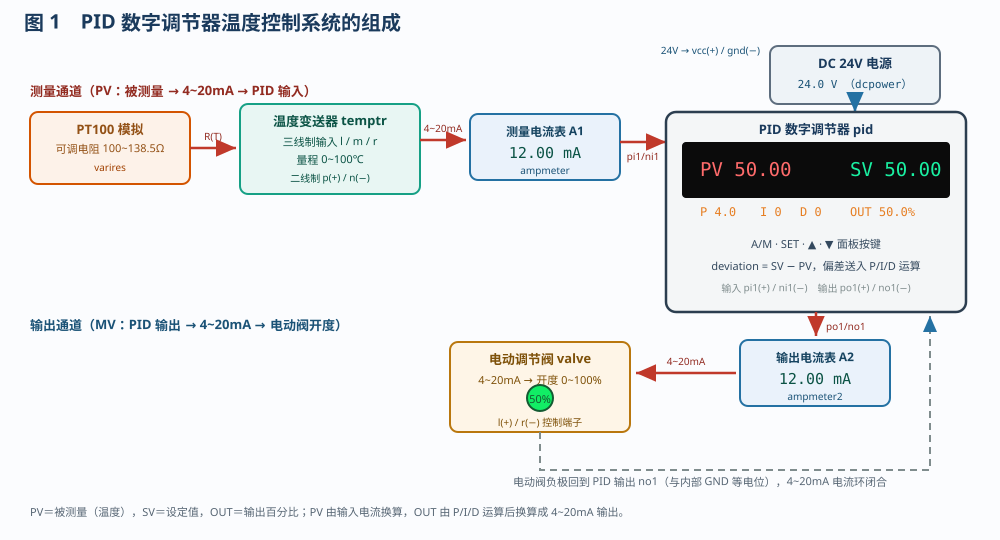
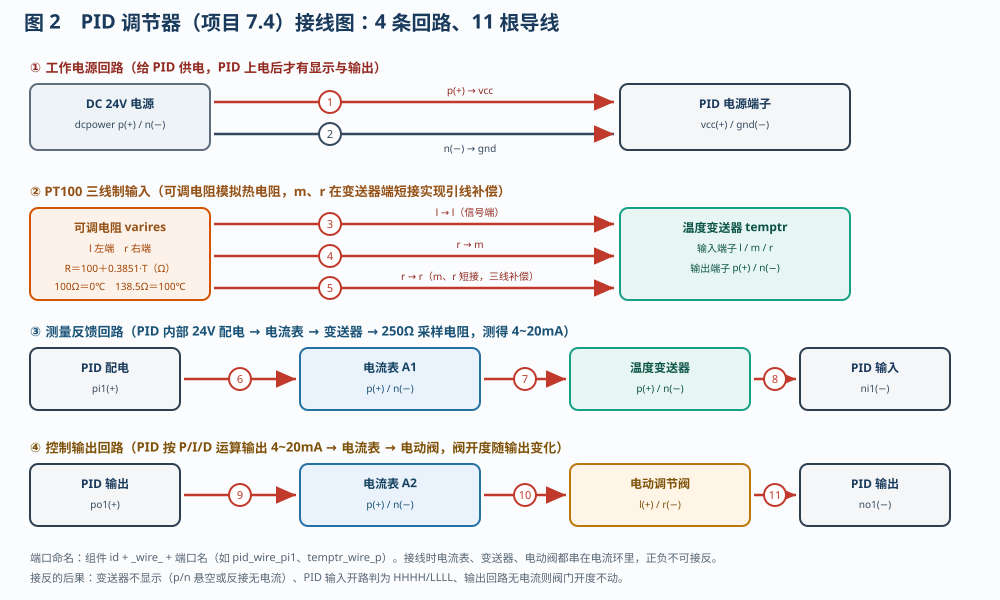
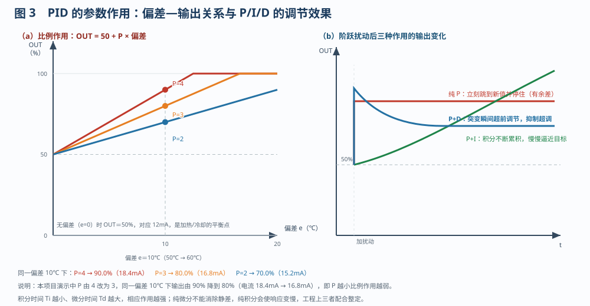

# PID数字调节器的接线和参数调整

> 适用对象：船舶电气 / 自动化专业　项目 7.4
> 配套仿真含两条流程：**PID 调节器接线及功能（8 步）** 与 **PID 调节器的参数调节（10 步）**，
> 对应平台的「自动演示 / 单步演示 / 演练 / 评估」四种模式。

---

## 一、项目概述

PID 数字调节器把传感器送来的**测量值 PV** 与面板设定的**目标值 SV** 相减得到偏差，
再按**比例 P、积分 I、微分 D** 三种规律运算，输出 4~20mA 标准电流去推动执行器（本项目的电动调节阀），
使 PV 向 SV 靠拢。

本项目用一只**可调电阻模拟 PT100 热电阻**，经温度变送器变成 4~20mA 送入 PID；
PID 的输出再经电流表驱动电动阀。任务分两步：先把四条回路的 11 根线接对，
再在偏差不变的条件下逐个改 P、I、D，看输出电流怎样变化——**接线是基础，参数是灵魂**。

---

## 二、系统组成

| 元件 | 代号 | 作用与关键参数 |
|------|------|----------------|
| PID 数字调节器 | `pid` | 被检对象；PV/SV 双显示，A/M、SET、▲、▼ 面板按键；输入 pi1/ni1，输出 po1/no1；量程 0~100℃，SV=60℃ |
| 温度变送器 | `temptr` | PT100 三线制输入 l/m/r，二线制 4~20mA 输出 p/n，量程 0~100℃ |
| 可调电阻 | `varires` | 模拟 PT100；R = 100＋0.3851·T（Ω），100Ω 对应 0℃、138.5Ω 对应 100℃ |
| 测量电流表 A1 | `ampmeter` | 串在 PV 回路，读 4~20mA 测量电流 |
| 输出电流表 A2 | `ampmeter2` | 串在 MV 回路，读 4~20mA 输出电流 |
| 电动调节阀 | `valve` | 接受 4~20mA，开度 0~100%（4mA＝全关、20mA＝全开） |
| 24V 直流电源 | `dcpower` | 给 PID 供电；电源键控制通断 |

---

## 三、接线：四条回路

| 回路 | 从 | 到 | 说明 |
|------|----|----|------|
| ① 工作电源 | 24V p(+) / n(−) | PID vcc / gnd | 上电后 PID 才有显示与输出 |
| ② PT100 输入 | 可调电阻 l / r / r | 变送器 l / m / r | 三线制：m、r 在变送器端短接，用于补偿引线电阻 |
| ③ 测量回路 | PID pi1 → A1 → 变送器 p / n → PID ni1 | — | 组成 4~20mA 电流环，PID 内部 250Ω 采样 |
| ④ 输出回路 | PID po1 → A2 → 阀 l / r → PID no1 | — | 输出电流驱动电动阀，开度随电流变化 |

要点：**电流表必须串在环里**（不能并联），**变送器 p/n、阀 l/r 不能接反**；
接反或漏接时，变送器不显示（p/n 悬空无电流）、PID 输入判开路显示 `HHHH`/`LLLL`，输出回路无电流则阀门不动。

---

## 四、信号换算

- PT100：$R = 100 + 0.3851\,T$，如 50℃ → 119.25Ω，60℃ → 123.11Ω。
- 变送器输出：$I = 4 + 16\times\dfrac{T - 0}{100}$（mA），50℃ → 12mA，60℃ → 13.6mA。
- PID 测量：$PV = 0 + \dfrac{I - 4}{16}\times(100 - 0)$（℃），与电阻温度一致。
- PID 输出：$OUT = 50 + P\cdot e + \dfrac{1}{T_i}\int e\,dt + T_d\dfrac{de}{dt}$，再换算成 4~20mA：
  $I_{out} = 4 + 16\times\dfrac{OUT}{100}$，如 OUT=50% → 12mA、OUT=90% → 18.4mA。

注意区分两个"12mA"：**测量电流** 12mA 表示 50℃，**输出电流** 12mA 表示 OUT=50%，二者含义完全不同。

---

## 五、PID 参数的作用

| 参数 | 作用 | 变化方向 | 本项目实例 |
|------|------|----------|------------|
| 比例 P（比例带 PB） | 按偏差大小成比例输出，决定"反应有多猛" | P 越大（PB 越小）越灵敏 | P 由 4→3，偏差 10℃ 时输出由 90%→80%，电流 18.4→16.8mA |
| 积分 I（积分时间 Ti） | 对偏差累积，专门消除静差 | Ti 越小积分越强 | Ti=20s，输出不再停在 80%，开始持续上升 |
| 微分 D（微分时间 Td） | 按偏差变化率超前调节，抑制超调 | Td 越大微分越强 | Td=5s，偏差不变时不动作，突变瞬间才"抢"一下 |

比例带 PB 与比例系数 $K_p$ 互为倒数：PB 是"输出变化 100% 所需的偏差范围"，带子越窄越激进，调小 PB 与调大 Kp 方向一致。

---

## 六、操作流程

### 6.1 接线及功能（项目 7.4-1，8 步）

1. 24V 电源 p/n → PID vcc/gnd；
2. 按电源键接通 24V；
3. 可调电阻 l/r/r → 变送器 l/m/r（三线制）；
4. 测量回路：pi1 → A1 → 变送器 p/n → ni1（此时 0℃ 显示 4.00mA）；
5. 输出回路：po1 → A2 → 阀 l/r → no1（PV 偏低，OUT 到上限 20mA，阀门全开）；
6. 概念题：SV 是设定值、PV 是测量值；
7. 电阻改 119.25Ω → 50℃，测量电流 12.00mA，PID 的 PV 显示 50.0；
8. 按 A/M 切手动，用 ▲/▼ 把 OUT 调到 60%，输出电流 13.6mA，阀门开 60%。

### 6.2 参数调节（项目 7.4-2，10 步）

1. 自动接线、通电；2. A/M 切自动，PV<SV 输出升到上限；
3. 电阻 123.11Ω → 60℃，PV=SV，OUT 回 50%（12mA）；
4. 电阻 119.25Ω → 50℃，偏差 10℃，比例作用使 OUT 跃变到 90%（18.4mA）；
5. 比例 P 改 3，输出回落到 80%（16.8mA）；
6. 积分 Ti=20s，观察输出开始持续上升（消除静差的过程）；
7. 积分概念题；8. 微分 Td=5s；
9. 微分概念题；10. 比例带/比例系数辨析题。

---

## 七、注意事项

- 改参数一律走组件「参数设置」界面，改完点**保存**；面板按键 A/M 只切换手动/自动，▲/▼ 在自动模式改 SV、在手动模式改 OUT。
- 手动（MAN）时 PID 保持当前 OUT 不动，是观察"输出电流—阀门开度"对应关系最方便的状态。
- 先接线、后通电；拆线前先断电，避免开着 24V 插拔导致读数跳变。
- 积分作用会让输出"自己往上爬"，这是正常的累积过程；若要观察静态的比例关系，应先把 I、D 置 0。

---

## 八、思考题（对应流程中的 4 道题）

1. **SV 与 PV**：SV 是希望达到的目标温度，PV 是传感器实测温度，二者之差即偏差。
2. **积分 I**：专门消除静差；Ti 越小积分速度越快、作用越强，但过小会振荡。
3. **微分 D**：按偏差变化率超前调节，减小超调；对噪声敏感，不能消除静差。
4. **比例带与比例系数**：PB 调小或 Kp 调大，都会让控制作用更灵敏、更剧烈（二者互为倒数）。
