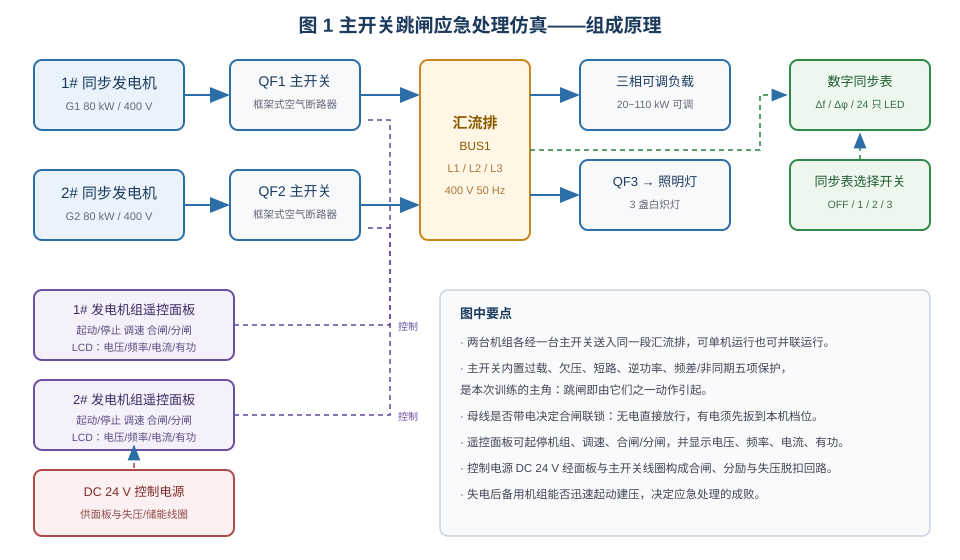
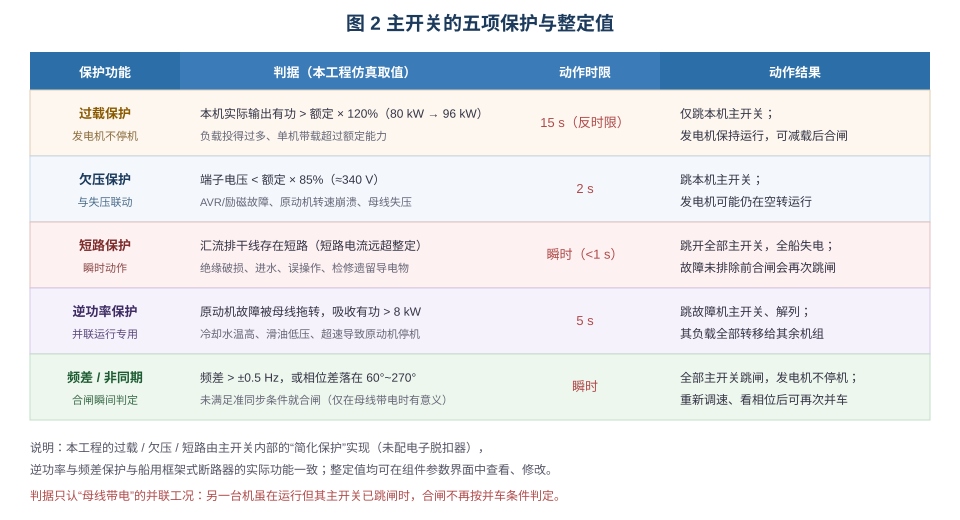
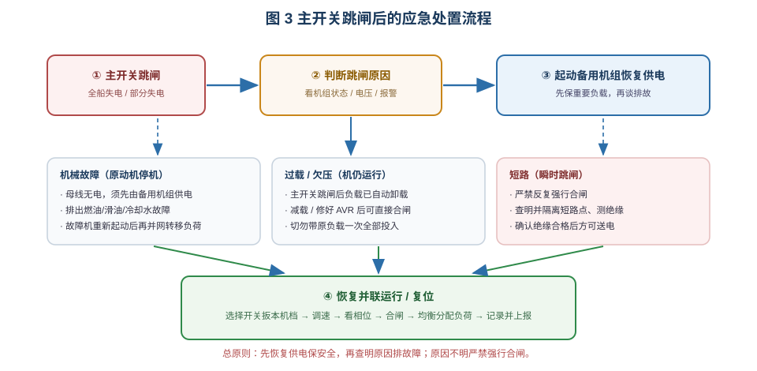
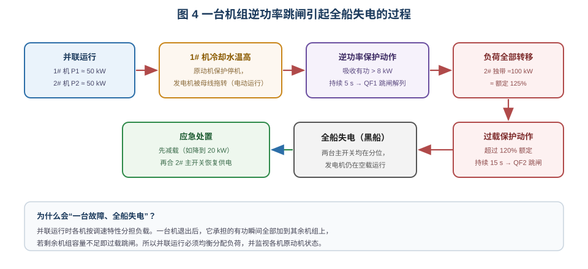

# 主开关跳闸的应急处理

> 适用于船舶电气 / 轮机专业的"船舶电站运行与故障应急"实训。
> 学习目标：① 说清船用主开关（框架式空气断路器）的过载、欠压、短路、逆功率、频差/非同期五类保护；
> ② 会按现象判断跳闸原因；③ 能按"先恢复供电、后排故障"的原则完成应急处置；
> ④ 能解释一台机逆功率跳闸为何会连带全船失电。

## 一、装置组成

仿真台架是一套双机双主开关的船舶电站：1#、2# 同步发电机（各 80 kW / 400 V / 50 Hz）分别经
船用框架式空气断路器 QF1、QF2 送入同一段汇流排 BUS1；汇流排经 QF3 带三盏照明灯，并接一台
三相可调负载（默认 20 kW，可在参数界面改为 110 kW 等）。

两台机组各配一块**发电机组遥控面板**：遥控起动/停止、调速旋钮、合闸/分闸按钮，LCD 显示电压、
频率、电流、有功与功率因数。控制电源为 DC 24 V，供主开关的失压脱扣线圈、储能电机与合闸/分励线圈。

**数字同步表**接在汇流排 A 相与"待并机 A 相"之间，**选择开关**（OFF / 1 / 2 / 3）决定接入哪台待并机。
母线**无电**时合闸联锁直接放行；母线**有电**时必须把选择开关扳到本机档位，联锁才允许合闸——
这一机制强制操作者先看同步表再合闸。

## 二、主开关为什么会跳闸

| 保护 | 本工程整定 | 典型动作结果 |
|---|---|---|
| 过载 | > 额定 120%（96 kW）持续 15 s | 只跳主开关，发电机不停机 |
| 欠压 | < 额定 85% 持续 2 s | 跳主开关，发电机可能仍在空转 |
| 短路 | 瞬时 | 全部主开关跳闸，全船失电 |
| 逆功率 | 吸收有功 > 8 kW 持续 5 s | 故障机解列，负荷转移给其余机组 |
| 频差/非同期 | 频差 > ±0.5 Hz 或相位 60°~270° | 合闸瞬间全部主开关跳闸 |

判断跳闸原因，主要看**跳闸后发电机的状态**：发电机停机、母线无电 → 多为原动机机械故障；
发电机仍在运行、电压正常 → 多为过载或分励/保护动作；发电机在运行但电压明显偏低 → AVR 或励磁故障；
跳闸瞬间伴随冲击、且发生在并车合闸之后 → 非同期/频差保护。

## 三、应急处置的基本流程

**总原则：先恢复供电保障船舶安全，再查明原因排除故障；原因不明严禁强行合闸。**

1. **确认现象**：主开关分位、母线电压为零、照明熄灭、机组状态指示灯与 LCD 读数。
2. **判断原因**：按上节"发电机状态"快速分类，必要时查看故障报警。
3. **恢复供电**：起动备用机组（或另一台机组），建压后合闸，优先接通重要负载。
4. **排除故障**：机械故障查出燃油/滑油/冷却水问题；欠压检查 AVR 与励磁；短路必须隔离故障点、
   测量绝缘合格后方可送电。
5. **恢复并联**：故障机修复后重新起动 → 选择开关扳本机档 → 调速使频差 0.1~0.3 Hz →
   相位进入允许区时合闸 → 均衡分配负荷。

## 四、四类典型跳闸的处置要点

- **机械故障（冷却水温高、滑油低压、超速）**：原动机保护停机，母线失压引起主开关欠压跳闸。
  母线已无电，跳闸机组合闸也没有电源，**必须先由备用机组供电**，故障排除后该机才能重新并网。
- **过载**：主开关跳闸只切断负载回路，发电机仍在额定转速运行，跳闸后负载自动卸载，
  **可以直接合闸**；但应先把大负载减下来再投入，否则会再次过载。
- **欠压**：发电机多仍在运行而电压不足，此时合闸等于把低电压送到全船，应先由另一台机供电，
  修好 AVR 后再并网。
- **干线短路**：短路电流极大，保护瞬时动作。**严禁反复强行合闸**，必须查明短路原因
  （绝缘破损、进水、误操作、检修遗留物）、隔离并确认绝缘后方可送电。若因保护选择性配合不当
  造成上级主开关误跳、扩大停电范围，应先恢复非故障段供电，再隔离故障支路排故。

## 五、逆功率为何会连带全船失电

并网运行的发电机，原动机失去动力后转子失去驱动转矩，同步发电机在电网上变成**同步电动机**运行，
从电网吸收有功，即**逆功率**（有功为负）。若不切除，电网会拖着柴油机反转，极易损坏机械。
本工程逆功率达 8 kW 持续 5 s 即跳闸解列。

危险在于**负荷转移**：两台机各带约 50 kW，故障机解列后它承担的 50 kW 瞬间全部加到另一台机上，
该机接近或超过 120% 额定，过载保护延时 15 s 跳闸，于是**全船失电**。这解释了运行中必须
均衡分配负载、监视原动机状态的原因，也说明应急恢复时要先减载、再合闸。

## 六、操作与自测

- 工具栏「自动接线」接好主回路与控制回路（本电路 68 根导线，允许瞬时接线）；
  「故障设置」中勾选故障并「应用设置」生效；参数（负载功率等）在组件右键「参数设置」中修改，
  改完必须点「保存」。
- 任务下拉框提供 5 个练习：机械故障、过载、逆功率、欠压、短路各一条应急处理流程。

**自测**：① 过载跳闸与机械故障跳闸，处置上最大的区别是什么？② 欠压跳闸后能否直接合闸？
③ 一台机逆功率跳闸后，另一台机为什么也会跳？④ 干线短路跳闸后，为什么严禁强行合闸？
