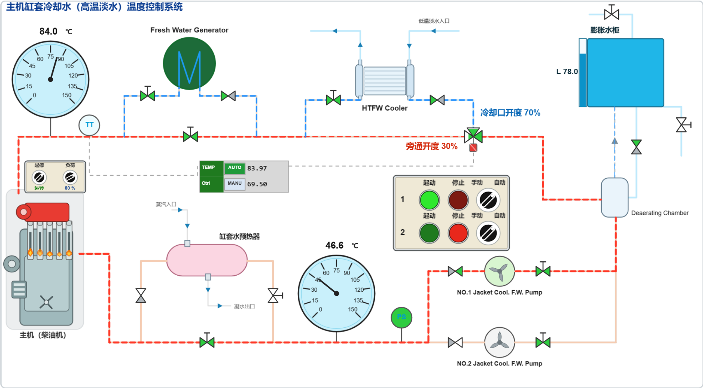
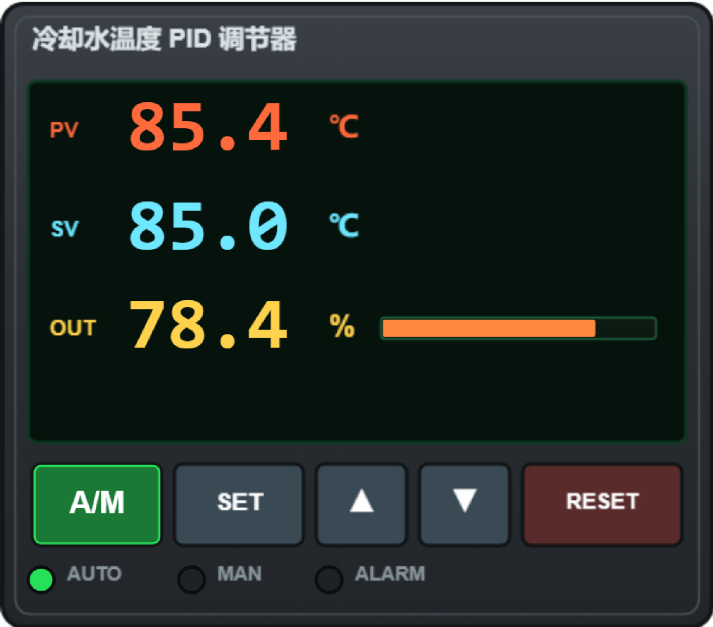

# 冷却水温度控制系统的功能测试

> 工程：船用主机缸套冷却水温度控制仿真（内部工程编号 lab_10 / syy51_ljzdh83）
> 画面上有两台设备：左侧 MIMIC 系统图（`mimic`）与右侧 LDCL 温度 PID 调节器（`ldcl`）。

主机约 30 % 的热量由**缸套淡水（高温冷却水）**带走。温度过高会使缸套、缸头热应力增大、滑油膜变薄；过低则产生低温腐蚀、热效率下降。因此必须把缸套水出口温度稳定在设定值（默认 **85 ℃**）附近，本系统就是完成这一任务的“检测—比较—执行”闭环。

## 一、系统组成与各组件作用

| 组件 | 图中标识 | 作用 |
|---|---|---|
| 主机（柴油机） | 左下角机体 | 热源。机体内部曲轴转动、缸内火焰闪烁表示运转；顶部控制盒有**起停开关**（停车/运转，默认停车）与**负荷旋钮**（0～110 %，每档 10 %，起动默认 50 %） |
| TT 温度变送器 | `TT` 圆标 | 测缸套水出口温度，作为调节器的测量值 PV；故障时读数变成 `***`，自动调节被切除 |
| 1#、2# 高温冷却淡水泵 | 右下两只泵 | 提供循环动力，一用一备。每台有**方式旋钮**（手动/自动）、起动/停止按钮与运行指示灯（运行=亮绿） |
| PS 水流开关 | `PS` 圆标 | 监视冷却水是否建立。压力正常闭合时**圆内填绿**，压力低断开时不填充 |
| 高温淡水冷却器 | `HTFW Cooler` | 壳管式换热器，缸套水在此被低温淡水（LTFW，右上进、左上出）冷却 |
| 三通调节阀 | 管路上三三角阀 | 控制手段。**左=旁通口、上=冷却口、右=合流口**（合流口始终 100 %）。三角按开度由阀芯向外填充 |
| 除气柜 / 膨胀水柜 | `Deaerating Chamber` / `膨胀水柜` | 分离缸套水中的空气与蒸汽；容纳膨胀量、补水与放气，玻璃液位计动态显示液位 |
| 缸套水预热器 | 粉色筒体 | 冷机起动前用蒸汽预热、低负荷时保温 |
| 造水机 | 绿色 `M` 圆标 | 用缸套水余热加热海水制淡，同时带走部分热量 |
| LDCL 温度 PID 调节器 | 右侧面板 | 核心控制器：采集 TT、按设定值调节三通阀冷却口开度 |
| TEMP / Ctrl 显示窗 | MIMIC 中部 | 与调节器联动：TEMP 行显示 TT 实测值（AUTO 绿底＝调节器在自动），Ctrl 行显示调节器输出百分比 |

调节器面板（5 个按键）：**A/M**（自动⇄手动，整键切换，底色绿=自动、琥珀=手动）、**SET**、**▲**、**▼**、**RESET**；下方三只指示灯 `AUTO` / `MAN` / `ALARM`；液晶屏显示 PV（测量）、SV（设定）、OUT（输出）与**底部报警信息行**（亮绿色）。

## 二、控制原理

**调节手段**：三通阀的冷却口开度 = 调节器输出 OUT（限幅 2～98 %，即冷却口最多开到 98 %）。

- 冷却口开度 ↑ → 更多缸套水经冷却器 → 出口温度 ↓；
- 冷却口开度 ↓ → 更多水走旁通 → 出口温度 ↑。

负荷与所需开度的对应关系（设计标定）：50 % 负荷约需 **32 %**，64 % 约 **49 %**，**80 % 约 70 %**，100 % 约 **98 %**（刚好用满可调上限）；**超过 100 % 负荷时即使冷却口全开，温度仍会继续上升**。

**水泵自动逻辑**：方式旋钮打到“自动”后，PS 检测到压力低 → 延时 3 s 发出自动起动信号 → 起动一台、另一台备用；运行泵故障或吸入阀关闭 → 压力跌落 → PS 断开 → 再延时 3 s 把信号转给备用泵。

**主机联锁**：PS 未闭合时，起停开关即使转到“运转”，柴油机也不起动（开关可正常搬动）；压力建立后自动起动。冷却水压力低持续 **20 s** 才触发主机保护停车，柴油机停机状态下不触发。

## 三、PID 参数变化对调节过程的影响

长按 **SET** 进入三级菜单：`L0 主界面 →（长按 SET）L1 参数组 →（短按 SET）L2 参数 → ▲/▼ 改值 → 短按 SET 保存 → 长按 SET 返回`。参数组依次为 `P-I-D`、`ALARM`、`RANGE`、`SYS`。

| 参数 | 默认 | 可调 | 对调节过程的影响 |
|---|---|---|---|
| **P** 比例带 | 6.0 ℃ | 1～30 ℃ | 增大 → 同样偏差下输出变化小，动作迟缓、**余差大、恢复慢**；减小 → 输出变化剧烈，出现**超调与振荡**，过小会等幅摆动 |
| **I** 积分时间 | 40 s | 5～300 s | 增大 → 消除余差慢、过程平稳；减小 → 消差快但**易超调/振荡** |
| **DB** 死区 | 0.4 ℃ | 0～5 ℃ | 偏差在死区内不动作，减少执行机构频繁动作，但会留下小静差。本仿真的死区在程序中按固定 0.25 ℃ 处理，改 DB 曲线变化不明显，演示整定效果以调 P、I 为主 |
| **SV** 设定值 | 85.0 ℃ | 60～95 ℃ | ▲/▼ 每次 ±0.5 ℃；设定值改变后温度按新值重新稳定 |
| **L / H / HH** 报警限 | 55 / 95 / 98 ℃ | L：0～120 ℃；H / HH：0～130 ℃ | 报警门限，可用于报警功能试验 |

主界面（L0）里 ▲/▼ 在 **AUTO** 时改设定值 SV，在 **MANU** 时直接改冷却口开度（手动给定，每按一次 ±2 %）。

**典型试验**：80 % 负荷、温度稳定 85 ℃ 时，把 P 由 6 改到 12 —— 温度回到设定值的过程变慢、波动减小；改到 2 —— 输出大幅摆动、温度出现明显等幅振荡。把 I 由 40 s 改到 5 s，消差加快但超调增大。

## 四、报警与联锁

| 编码 | 名称 | 条件 | 处理 |
|---|---|---|---|
| A 10 | 缸套水温度**高高** | 实测 > HH（98 ℃） | 立即减负荷，检查冷却水泵、冷却器与调节阀 |
| A 11 | 缸套水温度**高** | 实测 > H（95 ℃） | 同上 |
| A 12 | 缸套水温度**低** | 实测 < L（55 ℃） | 关小冷却口或投预热器 |
| A 21 | 冷却水泵出口压力低 | 有泵运行且压力 < 1.8 bar | 切备用泵，查吸入阀 |
| A 31 | 膨胀水柜液位低 | 液位 < 20 % | 查漏、补水 |

所有报警 3 s 确认、条件消失自动复位；`RESET` 只做“确认”（消音），不消除报警本身。

## 五、功能测试项目

1. **系统的组成与认识**（19 步）：依次识别 MIMIC 各设备、三通调节阀、PS、泵面板、调节器面板与 A/M 键、报警复位。
2. **手动操作**（4 步）：手动起动 1 号泵 → 起动柴油机观察温度上升 → 手动把冷却口开到 **70 %** 观察温度下降 → 关到 **50 %** 观察温度回升。
3. **自动控制**（7 步）：两台泵置“自动”观察 1 号泵自动起动 → 起动柴油机 → 调节器打“自动”观察调节过程 → 负荷加到 **80 %** 观察温度上升、PID 调节、重新稳定 → 设定值改到 **80 ℃** 观察跟随 → 长按 SET 把 P 改为 7 → 进入 ALARM 组依次查看 L、H、HH 报警值。
