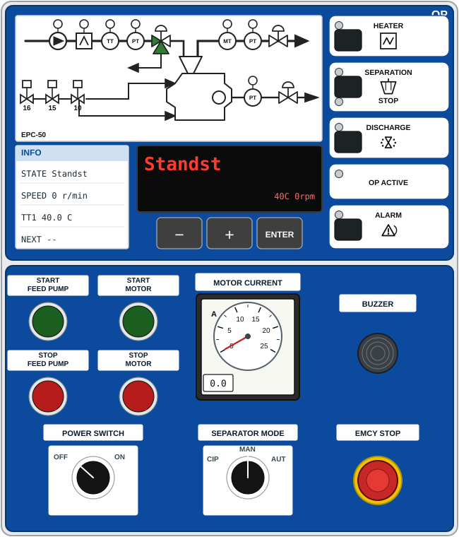
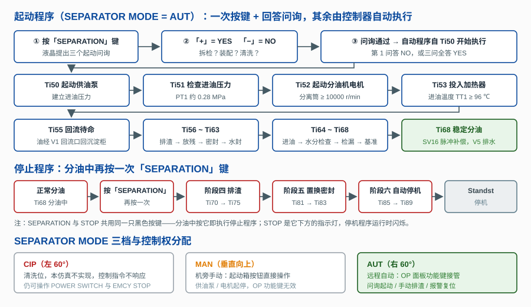

# 分油机自动控制系统的功能测试

> 船舶 S 936 型分油机 + **Alfa Laval EPC-50 控制器**（OP 操作面板 + 电机起动控制箱）仿真教学工程。
> 工程为**单页仿真**：画布同屏只有 EPC-50 控制器与分油机系统模拟图两台设备（等高并列）。

## 一、EPC-50 控制器是什么

EPC-50 是 Alfa Laval 为 S / P 型分油机配套的电子程序控制器（1999 年推出，2010 年停产，
现已被 EPC-70 取代）。一套 EPC-50 系统由三部分组成：

| 单元 | 作用 |
|------|------|
| **OP 操作面板**（Front Module 前端模块） | 装在集控室操作台：流程图状态灯、INFO 信息区、液晶显示器、−/+/ENTER 软键、右侧功能键与指示灯 |
| **I/O 单元** | 采集 PT/TT/MT/转速/振动信号，驱动 SV1/SV4/SV5/SV10/SV15/SV16 等电磁阀与 V1/V4/V5 |
| **电机起动控制箱** | 供油泵与电机的起停按钮、电机电流表、SEPARATOR MODE 与 POWER SWITCH 旋转开关、蜂鸣器、应急停止 |

本工程把 **OP 操作面板与电机起动控制箱合并为一个仿真组件**（控制器类与分油机求解器都打包在本
HTML 页面内），控制逻辑参照后继机型 EPC-60，通过 Ti 定时器驱动全部分离程序。

## 二、OP 操作面板

- **流程图（左上）**：共 7 只指示灯——自左至右为供油泵运行、加热器投入、TT1 进油温度、PT1 进油压力、
  MT 净油水分、PT4 净油出口压力，流程图右下另有 1 只 PT5 排水压力灯。前两只为运行指示（运行亮绿），
  5 只传感器指示灯正常为白色，对应传感器故障时转红（TT1→A05、PT1→A17、MT→A11、PT4→A03、PT5→A16）。
  流程图左下角的 **16 / 15 / 10** 三个小方块是工作水电磁阀：16＝SV16（密封/补偿水）、15＝SV15（开启水）、
  10＝SV10（水封/置换水）。
- **INFO 信息区（左下）**：四行依次为状态 STATE、分离筒转速 SPEED、TT1 进油温度 TT1、到下次排渣的剩余时间 NEXT。
- **液晶显示器**：黑底红字。停机 `Standst`、起动 `Start`、起动序列 `Startseq`、回流待命 `Recirc`、
  分油 `Separat`、排渣 `Discharg`、停机 `Stop`；右侧小字显示当前 Ti 定时器与剩余时间。
- **− / + / ENTER 软键**：菜单中移动光标与增减参数值；起动问询画面中「+」答 YES、「−」答 NO，
  按 ENTER 确认。按 ENTER 进入主菜单（参数设置 / 时间设置 / 报警记录 / 操作信息 / 返回主画面）。
- **功能区（右侧 5 个白框）**：四只黑色按键 **HEATER**（加热器投切）、**SEPARATION**（起动/分离，
  与其下方的 STOP 指示灯共用同一只按键）、**DISCHARGE**（手动排渣）、**ALARM**（报警确认与复位）；
  两只指示灯 **OP ACTIVE**（面板激活：主电源合上且无报警时亮绿）与 **STOP**（停机程序运行时闪烁）。
  每只键/灯旁各带一只状态灯。面板「操作信息」页把起动键记作 SEPARATOR、把投入记作 OPERATIVE。

## 三、电机起动控制箱

- **START FEED PUMP / STOP FEED PUMP**：供油泵起停（带运行指示环）。
- **START MOTOR / STOP MOTOR**：分油机电机起停（STOP MOTOR 走正常停机程序，不硬切电机）。
- **MOTOR CURRENT**：0～25 A 电流表，18 A 以上为过载红区；正常分油电流约 14 A。
- **SEPARATOR MODE**：三档 —— 左 60° CIP（清洗位，本仿真不实现）、垂直向上 MAN（机旁手动）、右 60° AUT（远程自动）。
- **POWER SWITCH**：OFF / ON，合闸时主回路与 EPC-50 面板同时得电。
- **BUZZER**：报警时鸣响，按一下确认报警。
- **EMCY STOP**：应急停止，按下后电机、供油泵、加热器与各电磁阀全部断电。

## 四、控制逻辑

### 4.1 控制权分配

| SEPARATOR MODE | 控制权 | 可用操作 |
|----------------|--------|----------|
| CIP（左 60°） | 无 | 清洗位，本仿真不实现；仅 POWER SWITCH 与 EMCY STOP 可用 |
| MAN（垂直向上） | 机旁手动 | 起动箱四只按钮；OP 功能键无效 |
| AUT（右 60°） | EPC-50 远程自动 | OP 面板功能键；起动箱按钮无效 |

### 4.2 起动（AUT 方式：一次按键 + 回答问询，其余自动执行）

AUT 位下按 **SEPARATION** 键，液晶屏提出三个起动问询：
**Bowl dismantled?（分离筒是否已拆检）→ Assembled per manual?（是否按手册装配）→ Bowl cleaned?（分离筒是否已清洗）**，
用「+」答 YES、「−」答 NO。**第 1 问答 NO，或三问全答 YES**，问询即通过，控制器随即**自动从 Ti50 开始执行**：

**Ti50 起动供油泵 → Ti51 检查进油压力 → Ti52 起动分油机电机（≥10000 r/min）→ Ti53 投入加热器（≥96 ℃）
→ Ti55 回流待命 → Ti56～Ti63 排渣、放残、密封、水封 → Ti64～Ti68 进油、含水量检查、检漏、水分基准**，
进入 Ti68 后稳定分油（密封水由 SV16 脉冲补偿，含水量高时 V5 自动排水）。

若第 1 问答 YES 而后两问中有 NO，表示拆检后未按手册装配或未清洗，需执行校准起动（Bowl calibration），
本仿真不实现该程序，控制器返回 `Standst`。

MAN 位下改为机旁操作：按 **SEPARATION** 完成三问后屏幕出现 `Start Separator`，再按起动箱
**START MOTOR**，转速达到 10000 r/min 后回到面板按 **SEPARATION** 投入分离程序。

### 4.3 停机

分油中**再按一次「SEPARATION」键**（分离与停止共用同一只按键，STOP 是它下方的指示灯）：
**阶段四 排渣（Ti70～Ti75）→ 阶段五 置换与密封（Ti81～Ti83）→ 阶段六 自动停机（Ti85 停电机 → Ti86 降速
→ Ti87 停泵 → Ti89 静止）**，液晶屏最终回到 `Standst`。

## 五、仿真操作

1. 在系统模拟图上打开沉淀柜出口阀、回流阀、蒸汽截止阀、控制空气进口阀、工作水进口阀。
2. 在 EPC-50 控制器上把 POWER SWITCH 合闸 **ON**，SEPARATOR MODE 顺时针打到 **AUT**。
3. 按 **SEPARATION** → 液晶屏出现三个起动问询 → 用「+」「−」回答 → 控制器自动从 Ti50 逐级执行，
   液晶屏逐条显示 Ti 步骤，进入 Ti68 后稳定分油。
4. 手动排渣按 **DISCHARGE**；停机在分油中再按一次 **SEPARATION**；报警按 **ALARM** 或点击蜂鸣器确认。
5. 工具栏「故障设置」可注入分离筒密封失效、水分传感器故障、分油温度低、振动高、
   排渣失败、工作水压力低、电机过载七种故障，观察报警与自动停机。

## 六、教学流程（工作流面板）

| 流程 | 步数 | 内容 |
|------|------|------|
| 1. 分油机系统的认识 | 23 步 | 认识系统模拟图：SV1/V1/SV4/V5/SV10/SV15/SV16、PT1/PT4/PT5/TT1/MT/ST 与分离原理 |
| 2. EPC-50 控制器的认识 | 19 步 | 逐件识别 OP 面板与电机起动控制箱上的 36 个可点击部件 |
| 3. 分油机的起动和停机 | 7 步 | 完整走一遍开阀 → 上电 → 远程接管 → 问询起动 → 手动排渣 → 停机 |

故障处理练习用工具栏「故障设置」注入上述七种故障，配合第 3 条流程观察报警与自动停机。
