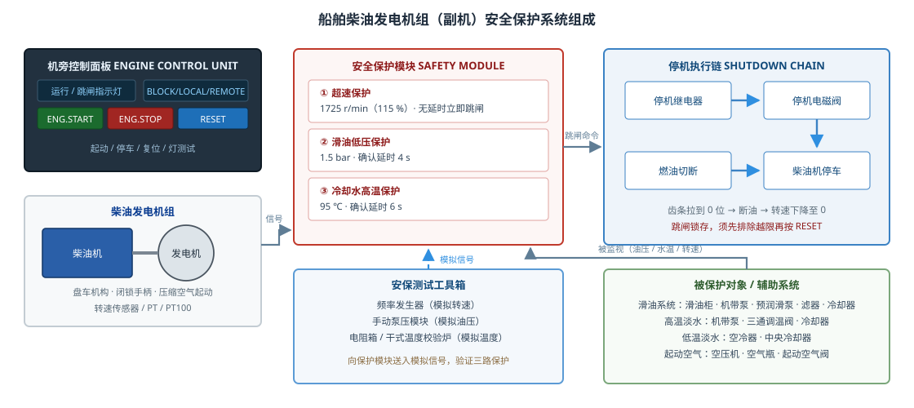
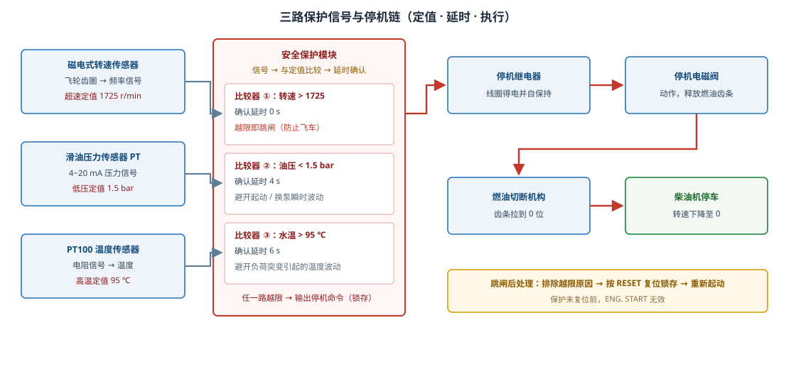
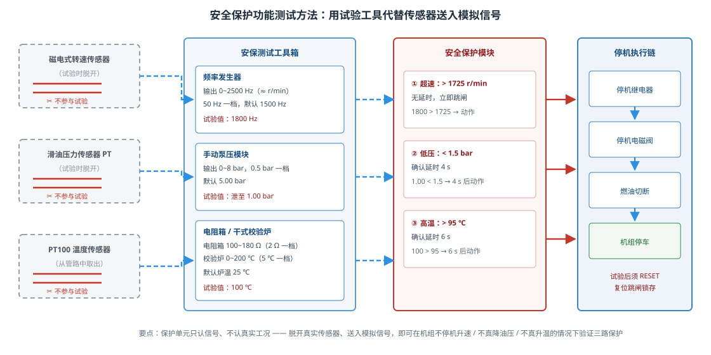
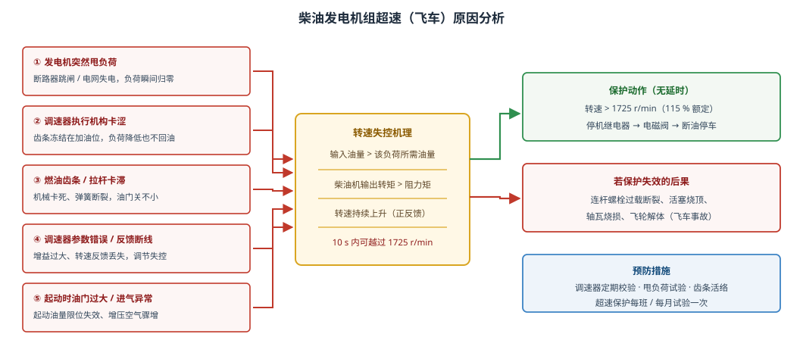
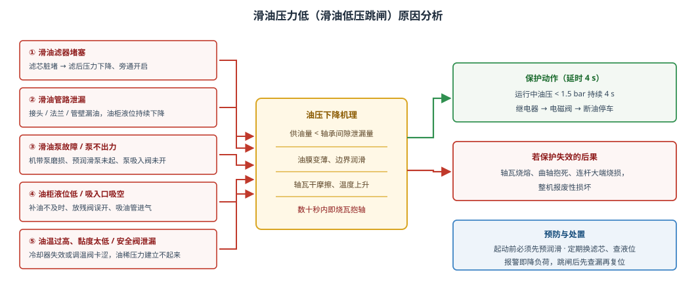
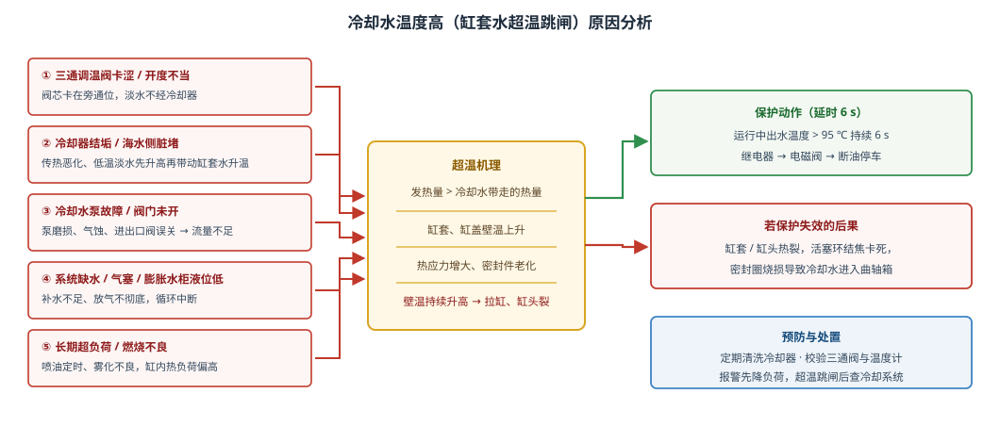

# 副机安全保护的功能测试

船舶柴油发电机组（俗称“副机”）是船舶电站的核心设备，一旦在运行中发生超速、滑油低压或冷却水超温，轻则烧瓦拉缸，重则整机报废甚至起火。因此每台副机都装有一套**独立于调速系统的安全保护装置**，并规定必须定期做**功能试验**，确认三路保护“测得准、动作快、停得下”。本文结合仿真平台，介绍这套保护系统的组成、试验方法和三类常见故障的成因。

## 一、安全保护系统由什么组成

系统由四部分组成：

1. **机旁控制面板**——指示灯（运行、准备起动、超速跳闸、滑油低压跳闸、冷却水高温跳闸等）、控制方式旋钮（BLOCK / LOCAL / REMOTE）、ENG. START / ENG. STOP / RESET / 灯测试按钮。
2. **安全保护模块**——三路信号各自与定值比较，越限并经确认延时后输出停机命令，同时点亮对应跳闸灯并**锁存**。
3. **停机执行链**——停机继电器 → 停机电磁阀 → 燃油切断机构（把齿条拉到 0 位）→ 柴油机停车。
4. **被保护对象与辅助系统**——柴油发电机组本体、滑油系统、高温／低温淡水系统、起动空气系统。

其中“传感器—保护模块—执行链”构成一个完整的**检测、判断、执行**闭环，任何一环失效，保护都形同虚设，这正是必须做功能试验的原因。

还需要强调：安全保护与调速器是**两套彼此独立的系统**。调速器负责“把转速稳住”，是连续调节；安全保护负责“出事就停车”，是开关量动作，两者不共用执行元件。安全保护模块自带稳压电源与比较电路，即使调速器失灵、控制电脑死机，它仍能独立把机组停下来。船上把这种独立性称为“保护不受调节系统牵连”，也是检验保护系统时首先确认的内容。

保护功能一般分两级：**报警级**和**跳闸级**。报警级只发信号提醒值班人员（滑油压力低于 2.0 bar、冷却水温度高于 90 ℃），条件消失后自动消除；跳闸级直接停机并锁存。试验时通常先看报警是否先于跳闸出现，再看跳闸动作值与动作时间，两者都要记录。

## 二、三路保护的定值与动作顺序

| 保护项目 | 传感器 | 定值 | 确认延时 |
|---|---|---|---|
| 超速保护 | 磁电式转速传感器（飞轮齿圈） | 1725 r/min（额定 1500 的 115 %） | **0 s，立即跳闸** |
| 滑油低压保护 | 滑油压力传感器 PT | 1.5 bar | 4 s |
| 冷却水高温保护 | PT100 温度传感器 | 95 ℃ | 6 s |

延时设置各有道理：超速发展极快，几秒之内就可能飞车，因此**不留延时**；滑油压力在起动、换泵瞬间本来就有波动，用 4 s 确认可避免误跳；冷却水温度惯性大，负荷突变时会出现短时波动，取 6 s 更稳妥。

保护动作后是**锁存**的：即使越限条件消失，跳闸灯仍亮、机组仍不能起动。必须先排除越限原因，再按 **RESET** 复位，停机继电器、电磁阀和燃油切断才释放，机组恢复备用。这条规则能防止“故障还在、人却强行再起动”。

**报警值与跳闸值不重合**，这是有意设计的：

| 项目 | 报警值 | 跳闸值 |
|---|---|---|
| 滑油压力 | 2.0 bar | 1.5 bar |
| 冷却水温度 | 90 ℃ | 95 ℃ |
| 转速 | — | 1725 r/min |

先报警给值班人员留出降负荷、切换、查漏的处理时间，只有处理不及时才走到跳闸。此外，滑油低压与冷却水高温两路还带“机组转速 > 700 r/min”的闭锁条件——停机状态油压本来就为零、水温也不高，若不加闭锁就会一开机就误跳，这是试验时必须在运行状态下做的原因。

面板上的**灯测试**按钮可让全部指示灯同时闪亮，用来在起动前检查灯泡、线路是否完好；灯不亮，保护动作了也不知道，同样属于保护系统故障。

## 三、安全保护功能的测试方法

**核心思路：保护单元只认信号，不认真实工况。** 因此试验时把真实传感器脱开，用安保测试工具箱向保护单元送入一个可调、可控的模拟信号，让机组在**不必真的超速、不必真的失压、不必真的超温**的情况下验证保护功能是否完好。这正是“功能试验”与“真实故障”的区别：前者可控、可重复、不损伤设备。

### 3.1 超速保护试验

1. 脱开转速传感器接线，把**频率发生器**接入保护单元（输出默认 1500 Hz，对应 1500 r/min）。
2. 起动预润滑泵，起动柴油发电机组，确认转速 1500 r/min、运行正常。
3. 把频率逐档升到 **1800 Hz**（≈1800 r/min，超过定值 1725 r/min）。
4. 观察：超速保护**立即**动作 → 跳闸灯亮 → 停机链动作 → 机组停车。
5. 把频率降回 1500 Hz，切除频率发生器、恢复传感器接线，按 **RESET** 复位。

### 3.2 滑油低压保护试验

1. 把手动泵的管路接到滑油压力传感器，泵压模块接入（输出 5.00 bar）。
2. 起动预润滑泵并起动机组。
3. 把泵压逐档**缓慢泄到 1.00 bar**（低于定值 1.5 bar）。
4. 观察：约 **4 s** 后滑油低压保护动作、跳闸停机。
5. 泵压升回 5 bar，拆下手动泵管路、恢复传感器原取压，按 RESET 复位。

### 3.3 冷却水高温保护试验

1. 把 PT100 从冷却水管路中取出，放入**干式温度校验炉**（也可改接电阻箱，用电阻值模拟温度）。
2. 起动预润滑泵并起动机组。
3. 炉温逐档升到 **100 ℃**（高于定值 95 ℃）。
4. 观察：约 **6 s** 后冷却水高温保护动作、跳闸停机。
5. 炉温降回 45 ℃，把 PT100 装回管路，按 RESET 复位。

### 3.4 试验注意事项

- 试验必须在**机组运行状态**下进行（滑油低压、冷却水高温两路都带“转速 > 700 r/min”的闭锁条件），否则测不出真实动作时间。
- 试验前确认调速器、燃油齿条活络，**随时可以人工停车**；试验中一旦出现异常立即按紧急停车。
- 三路试验**逐路进行**，做完一路恢复一路，避免多路同时跳闸难以判断。
- 试验结束必须核对：工具已切除、传感器已恢复、保护已复位、机组可正常起动并带负荷。试验记录应写明动作值与动作时间。

按船舶管理要求，保护装置一般**每月至少做一次模拟试验**，坞修或长期停用后投运前、更换传感器或保护模块后、以及发生跳闸故障处理完毕后，都要追加一次。记录内容包括：试验日期、机组编号、各路动作值、动作时间、试验人。若动作时间明显大于规定值（例如滑油低压超过 6 s 才跳），说明保护模块的延时电路或传感器响应变慢，应拆检更换，而不是“能跳就算合格”。

常见错误有三种：一是**只升信号不复位**，做完试验直接起动，结果机组起不来；二是**工具没切除**就恢复运行，真实工况被模拟信号长期顶替，等于保护被“旁路”，非常危险；三是**只在停机状态试**，因闭锁条件不满足，怎么试都不动作，误判为保护失效。

## 四、超速原因分析

柴油机的转速取决于“供油量—负荷”的平衡。调速器的作用就是根据转速偏差自动增减油量，使转速稳定在 1500 r/min。一旦这个闭环被破坏，转速就会持续上升：

- **发电机突然甩负荷**：断路器跳闸或电网失电，负荷瞬间归零，而油量来不及回小，转速飞升。这是最常见的超速起因。
- **调速器执行机构卡涩**：齿条冻结在加油位置，负荷降低后油门不能回调，转速不断上升。仿真中设置该故障后减小负荷给定，约 10 s 即越过 1725 r/min。
- **燃油齿条／拉杆卡滞、弹簧断裂**：机械上就关不小油，属于典型“油门关不掉”。
- **调速器参数错误或转速反馈断线**：调节器失去依据，增益过大时产生振荡甚至失控。
- **起动时油量限位失效、进气异常**：起动油量过大或增压空气骤增，也会把转速顶上去。

超速的危害是**指数级**的：转速升高，往复惯性力按平方增长，连杆螺栓、活塞、轴瓦迅速过载，最终可能发生飞轮解体、机体破裂的“飞车”事故。所以超速保护定值最低（115 % 额定）、动作最快（无延时），并且不允许被随意切除。

## 五、滑油压力低原因分析

滑油压力是轴瓦油膜存在的唯一保证。压力低于 1.5 bar 时，油膜变薄、进入边界润滑，轴瓦温度急剧升高，几十秒内就可能烧瓦抱轴。常见原因：

- **滑油滤器堵塞**：滤芯脏堵后滤后压力下降，旁通阀开启还会把脏油直接送进轴承。仿真中滤器堵塞故障约 30 s 使油压降到 1.5 bar 以下。
- **滑油管路泄漏**：接头、法兰、管壁漏油，压力下降的同时**滑油柜液位持续降低**，这是判断泄漏最直接的旁证；泄漏量大时约 60 s 触发低压跳闸。
- **滑油泵故障**：机带泵磨损、预润滑泵未起动、泵吸入阀未开，都会导致“泵不出力”。
- **油柜液位低、吸入口吸空**：补油不及时、放残阀误开、吸油管进气，泵打的是油气混合物，压力建立不起来。
- **油温过高、黏度太低或安全阀泄漏**：油稀后泄漏量增大，安全阀整定值偏低也会让压力上不去。

处置原则：报警（2.0 bar）即降负荷检查，跳闸后**先查漏、补油、换滤芯**，确认油压正常再复位起动，切不可反复强行起动。

## 六、冷却水温度高原因分析

缸套冷却水带走柴油机约 25 %～30 % 的燃烧热量，出水温度一般控制在 70～80 ℃。超过 95 ℃ 时，缸套、缸头壁温过高，热应力增大，密封圈老化，继续运行会拉缸、缸头裂纹。常见原因：

- **三通调温阀卡涩或开度不当**：阀芯卡在旁通位，淡水不经过冷却器直接回机，出水温度随负荷升高而升高。
- **冷却器结垢／海水侧脏堵**：传热能力下降，先是低温淡水温度升高，继而带动缸套水温度上升，最终超温。
- **冷却水泵故障、阀门未开**：泵磨损、气蚀或进出口阀误关，流量不足，热量带不走。
- **系统缺水、气塞、膨胀水柜液位低**：补水不足或放气不彻底，循环中断，局部过热。
- **长期超负荷、燃烧不良**：喷油定时或雾化不良使缸内热负荷偏高。

冷却水温度惯性大，从异常到超温往往需要一段时间，因此定值确认延时取 6 s；但这并不意味着可以拖延处理——报警（90 ℃）出现时就应查冷却器、三通阀和泵的运行状态。

## 七、仿真平台操作要点

本仿真平台把上述内容做成了 5 个操作流程，可按顺序练习：

| 流程 | 内容 | 关键判据 |
|---|---|---|
| 1. 机组与安全保护系统的认识 | 识别面板、三路传感器、保护卡片、停机链、试验工具 | 能指认 20 个部件 |
| 2. 机旁手动起动与运行监视 | 盘车脱开 → LOCAL → 预润滑 → 起动 → 监视 → 停车 | 转速 1500 r/min、油压 > 2.5 bar、400 V/50 Hz |
| 3. 超速保护的功能测试 | 频率发生器 1800 Hz | 立即跳闸（无延时） |
| 4. 滑油压力低保护的功能测试 | 泵压模块泄至 1.00 bar | 4 s 后跳闸 |
| 5. 冷却水温高保护的功能测试 | 校验炉升至 100 ℃ | 6 s 后跳闸 |

操作时注意两点：其一，**起动前必须先起预润滑泵**，油压建立（> 1.0 bar）后 ENG. START 才有效；其二，**每次跳闸后都要先排除越限、再按 RESET**，否则机组无法重新起动。另外，机组模型曲轴箱左上角设有**负荷调节旋钮**（0～100 %，默认 50 %），配合“调速器执行机构卡涩”故障，可复现“降负荷 → 油门不回调 → 转速上升 → 超速跳闸”的完整过程，这是理解超速机理最直观的练习。

## 八、小结

副机安全保护是“最后一道防线”，它的可靠性完全依赖定期功能试验。试验的关键在于理解三点：**一是信号可模拟**——脱开真实传感器、用频率发生器／泵压模块／校验炉送入模拟信号；**二是定值有讲究**——超速无延时、滑油低压 4 s、冷却水高温 6 s；**三是动作必锁存**——排除原因后必须 RESET 才能重新起动。掌握这套方法，再结合对超速、低压、超温成因的分析，才能在实船上既做得好试验，也判断得准故障。
