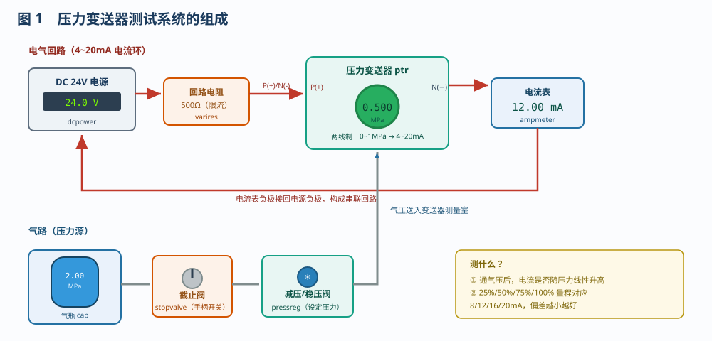
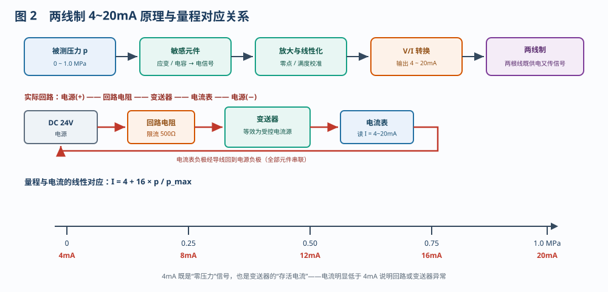
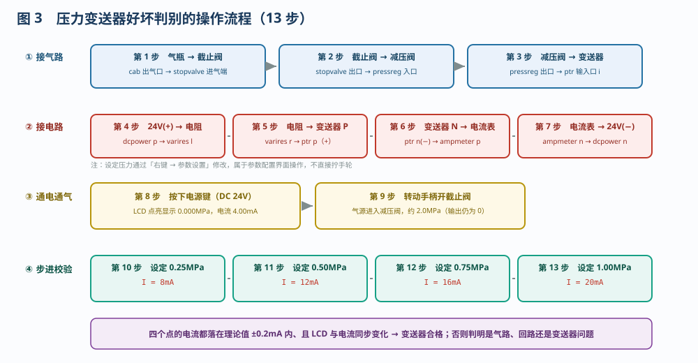
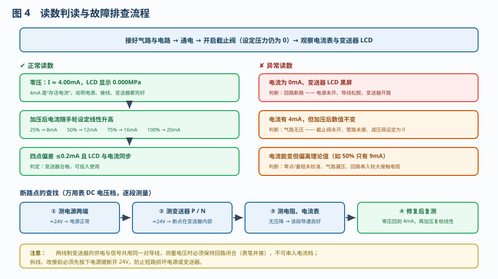

# 压力变送器的测试

> 适用对象：船舶电气 / 自动化专业　项目 7.1.2　压力变送器的测试
> 配套仿真含一条流程：**压力变送器好坏的判别（13 步）**，与平台"自动演示 / 单步演示 / 演练 / 评估"四种模式一一对应，可先看演示、再动手演练。

---

## 一、项目概述

压力变送器把管路压力转换成标准电流信号送入监控系统，它的好坏直接决定压力显示与保护动作是否可信。船用两线制压力变送器的输出是 **4～20mA**：4mA 对应量程下限（零点）、20mA 对应量程上限，中间严格线性。

本项目的任务是用最简单的台架——**24V 电源 + 回路电阻 + 电流表 + 气瓶/截止阀/减压阀**——给一只 0～1.0MPa 的变送器"做体检"：先接气路、再接电路，然后从零点开始逐点加压，用电流表读数判断它是否合格。

---

## 二、系统组成

| 元件 | 代号 | 作用与关键参数 |
|------|------|----------------|
| 直流电源 | `dcpower` | 24V，面板电源键控制通断，LCD 显示输出电压 |
| 回路电阻 | `varires` | 500Ω 限流电阻，限制回路最大电流、保护变送器 |
| 压力变送器 | `ptr` | 两线制，0～1.0MPa → 4～20mA；P(+) 为电源正端、N(−) 为信号回端，LCD 显示压力 |
| 电流表 | `ampmeter` | 量程 0～20mA，串在回路中直接读出 4～20mA |
| 气瓶 | `cab` | 压力源，约 2.0MPa |
| 截止阀 | `stopvalve` | 转动手柄控制气源通断 |
| 减压/稳压阀 | `pressreg` | 输出压力 = min(输入压力, 设定压力)，设定压力在「参数设置」中修改 |

> 减压阀的**设定压力**就是加在变送器上的"标准压力"，它是判断读数是否正确的唯一基准。

---

## 三、两线制 4～20mA 原理

变送器内部把压力经敏感元件、放大与线性化处理后，由 V/I 转换电路变成电流输出：

**I = 4 + 16 × p / pmax**（mA）

- 0MPa → 4mA，0.25MPa → 8mA，0.50MPa → 12mA，0.75MPa → 16mA，1.0MPa → 20mA；
- 供电与信号共用同一对导线，**电流大小就是信号**，所以回路里任何一处断开，电流都会立刻归零；
- 4mA 是"存活电流"：它同时证明电源、导线、变送器三者都完好。

---

## 四、操作流程（13 步）

### 4.1 接气路（第 1～3 步）

按 **气瓶 → 截止阀 → 减压阀 → 变送器输入口** 的顺序逐段接管。气路必须先接完再通气，避免带压接管。

### 4.2 接电路（第 4～7 步）

按 **24V(+) → 回路电阻 → 变送器 P(+) → 变送器 N(−) → 电流表 → 24V(−)** 接成串联回路。注意变送器是**串联元件**，不是并联；P、N 两端不可接反接错，更不可把电流表并联在电源上。

### 4.3 通电、通气（第 8～9 步）

按下电源键，变送器 LCD 点亮并显示 **0.000MPa**，电流表应指 **4.00mA**；再转动截止阀手柄送入气压，减压阀的输入显示约 2.0MPa，输出仍为 0（设定压力未加）。

### 4.4 步进校验（第 10～13 步）

| 步 | 通过「参数设置」把设定压力改为 | 理论电流 | LCD 应显示 |
|---|------------------------------|---------|-----------|
| 10 | 0.25MPa | 8mA | 0.250MPa |
| 11 | 0.50MPa | 12mA | 0.500MPa |
| 12 | 0.75MPa | 16mA | 0.750MPa |
| 13 | 1.00MPa | 20mA | 1.000MPa |

每改一次压力，都要**等读数稳定**再记录。四点偏差均不超过 ±0.2mA、且 LCD 数值与电流同步变化，即可判定变送器合格。

> 工具栏「5 点步进」可按 0.25→0.5→0.75→1.0→0 自动循环切换设定压力，便于快速复核五个点。

---

## 五、读数判读与故障处理

| 读数现象 | 判断 | 原因与处理 |
|---------|------|-----------|
| 零压 4.00mA，加压后线性升高 | 正常 | 四点复核偏差 ≤0.2mA 即可投用 |
| **0mA**、LCD 黑屏 | 回路断路 | 电源未开、导线松脱、变送器内部开路；用 DC 电压档逐段测电压定位 |
| 有 4mA，**加压后数值不变** | 气路无压 | 截止阀未开、管路未接、减压阀设定为 0 |
| 电流能变但**偏离理论值** | 零点/量程偏差或漏压 | 重新校准零点与满度，检查各接口是否漏气、端子是否拧紧 |
| 电流 >20.5mA 或 <3.8mA | 变送器/LCD 报故障 | 检查供电与量程设置，必要时换表 |

在「故障设置」中勾选 **压力变送器开路（断路）** 并应用，可复现"电流归零 + LCD 黑屏"的典型故障；取消勾选即修复。

---

## 六、操作要点

1. **先接线、后通电**，任何拆改接线前必须先按下电源键断开 24V；
2. **变送器串联、电流表串联**，严禁把电流表并联在电源两端；
3. **先零压、后加压**：确认 4mA 零点正常，再逐点加压；
4. **压力值与电流要成对记录**，否则无法判断是否线性；
5. **读数要等稳定**：气路充压、电路滤波都需要时间，读数跳动时不要下结论；
6. **判断分工况**：4mA 有、加压不变 → 查气路；0mA → 查电路；能变但偏差大 → 查校准与漏压。

---

## 七、思考与练习

1. 一变送器量程为 0～1.0MPa，测得回路电流 14mA，此时压力约为多少？
2. 为什么两线制变送器断线后电流会变成 0mA？这与"低于 4mA 判故障"是否一致？
3. 电流表读数稳定在 4mA，把减压阀设定压力从 0 改到 0.5MPa 后读数仍是 4mA，可能是什么原因？
4. 四点校验中 25%、75% 两点正常，50% 点偏低 0.9mA，是否说明变送器不合格？应如何处理？
5. 用万用表 DC 电压档如何快速判断断路点在电源侧还是变送器内部？

---

*本文档依据本工程仿真的 13 步操作流程编写，与「自动演示」步骤一一对应，可作为压力变送器校验与故障判断的实训参考。*
