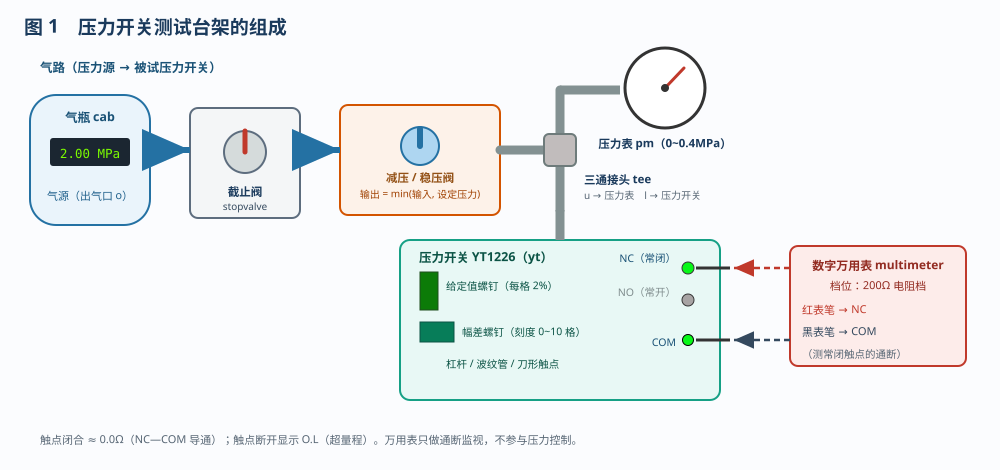
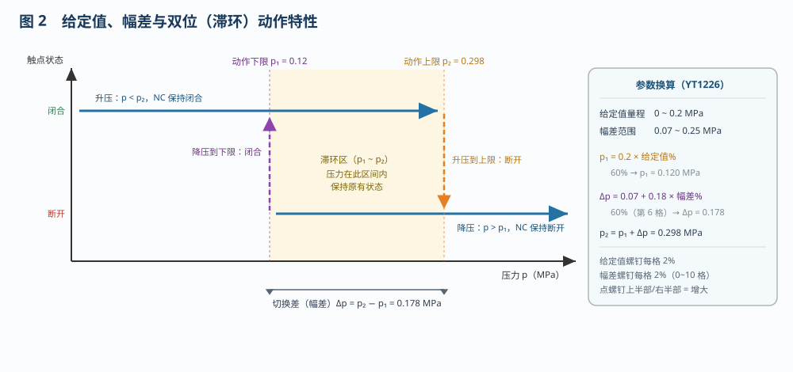
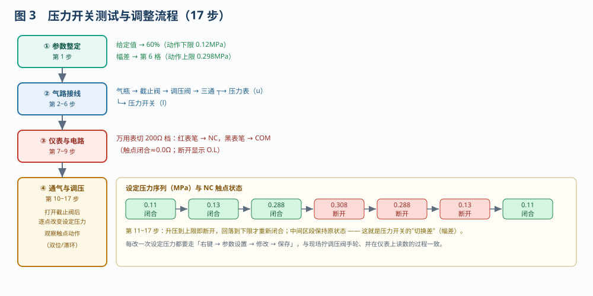

# 压力开关的功能测试和参数调整

> 适用对象：船舶电气 / 自动化专业　项目 7.2
> 配套仿真含一条流程：**压力开关测操作和调整（17 步）**，与平台"自动演示 / 单步演示 / 演练 / 评估"四种模式对应，可先看演示、再动手演练。

---

## 一、项目概述

压力开关（压力继电器）是把**管路压力**转换成**触点通断**的两位式控制元件，广泛用于滑油/燃油/冷却水系统的低压保护与泵的自动启停。它没有模拟量输出，只有"闭合 / 断开"两个状态，因此判断其好坏的办法很直接：**给它加压，看触点在规定的压力点上是否动作**。

本项目的任务是用一套最简单的台架——**气瓶 + 截止阀 + 减压阀 + 压力表 + 万用表**——对 YT1226 型压力开关做两件事：先把**给定值（动作下限）**和**幅差（切换差）**整定到规定值，再逐点加压、减压，验证它的双位动作特性是否正确。

---

## 二、系统组成

| 元件 | 代号 | 作用与关键参数 |
|------|------|----------------|
| 压力开关 | `yt` | 被检对象，YT1226；给定值范围 0~0.2MPa，幅差范围 0.07~0.25MPa；触点 NC / NO / COM |
| 压力表 | `pm` | 量程 0~0.4MPa，直观显示加在压力开关上的压力 |
| 三通接头 | `tee` | 把调压后的压力分送给压力表与压力开关 |
| 减压/稳压阀 | `pressreg` | 输出压力 = min(输入压力, 设定压力)；设定压力在「参数设置」中修改 |
| 截止阀 | `stopvalve` | 点击手柄通断气源，接管时必须先关 |
| 气瓶 | `cab` | 气源，约 2.0MPa（远高于整定值，保证调压阀能正常工作） |
| 数字万用表 | `multimeter` | 200Ω 电阻档，测 NC—COM 之间通断（闭合≈0.0Ω，断开显示 O.L） |

> 调压阀的**设定压力**就是加在压力开关上的"标准压力"，是判断触点该不该动作的唯一依据。

---

## 三、参数含义与动作特性

**给定值螺钉**决定动作下限 p₁，**幅差螺钉**决定动作上限与下限之差 Δp：

- 动作下限　p₁ = 0.2 × 给定值%　（给定值 60% → **0.12MPa**）
- 动作上限　p₂ = p₁ + Δp，Δp = 0.07 + 0.18 × 幅差%　（幅差第 6 格即 60% → Δp = 0.178，p₂ = **0.298MPa**）

动作规律（两位式 + 滞环）：

| 压力变化 | 触点状态 |
|----------|----------|
| 升压，p > p₂ | 继电器释放，**NC 断开、NO 闭合** |
| 降压，p 在 p₁ 与 p₂ 之间 | **保持**原状态，不反复动作 |
| 降压，p < p₁ | 继电器励磁，**NC 闭合** |

这就是"切换差"（幅差）的作用：避免压力在某一值附近轻微波动时触点频繁抖动。幅差调得过小，触点抖动、泵频繁启停；调得过大，则压力偏差大、保护迟钝。

---

## 四、操作流程（17 步）

### 4.1 整定参数（第 1 步）

点**给定值螺钉上半部**把给定值由 50% 调到 60%（每格 2%），点**幅差螺钉右半部**把幅差调到第 6 格。调整后可在刻度牌上直接读出给定值与幅差格数，连锁得到 p₁ = 0.12MPa、p₂ = 0.298MPa。

### 4.2 接气路（第 2~6 步）

按 **气瓶 → 截止阀 → 调压阀 → 三通 ┬→ 压力表（u 口）　└→ 压力开关（l 口）** 逐段接管。**接管过程中截止阀必须关闭**，带压接管会有冲击、也看不清是否接牢。

### 4.3 准备仪表、接电路（第 7~9 步）

调出万用表并旋到 **200Ω 电阻档**，红表笔接 **NC**、黑表笔接 **COM**。注意测的是**常闭触点**：压力低时常闭触点是闭合的，万用表应读到接近 0Ω；动作后应显示 O.L。

### 4.4 通气与调压演练（第 10~17 步）

打开截止阀，气源进入调压阀；随后按 0.11 → 0.13 → 0.288 → 0.308 → 0.288 → 0.13 → 0.11MPa 顺序改变设定压力，每改一次都走「**右键调压阀 → 参数设置 → 修改 → 保存**」，并同时读取压力表与万用表：

- 0.11、0.13、0.288MPa → 触点**保持闭合**（0.0Ω）；
- 0.308MPa → 超过上限，触点**断开**（O.L）；
- 回落到 0.288、0.13MPa → 因滞环仍**保持断开**；
- 继续降到 0.11MPa → 低于下限，触点**重新闭合**。

---

## 五、结果判断与常见问题

1. **动作点偏离**：若实测下限与 0.12MPa 相差超过 ±0.01MPa，说明给定值整定不准，应重新微调螺钉。
2. **幅差不对**：升压断开点与降压闭合点之差应≈0.178MPa；偏小多为幅差螺钉格数不对，偏大则可能是幅差弹簧卡滞。
3. **触点不动作或读数乱跳**：检查表笔是否接在 NC/COM（不是 NO）、端子是否拧紧、接管是否漏气。
4. **压力上不去**：检查截止阀是否打开、调压阀设定压力是否真的保存成功（界面点「保存」）。

---

## 六、小结

压力开关的"测试"= 整定 + 验证：先按工艺要求把给定值与幅差调到规定刻度，再用调压阀逐点加/减压，借助压力表看压力、借助万用表看触点，核对**动作下限、动作上限、回差保持**三个特征点是否与计算值一致。掌握这套方法，换任何一种压力开关（不同的量程、幅差范围）都可以照此办理。
