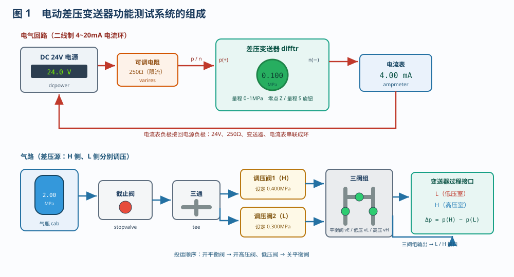
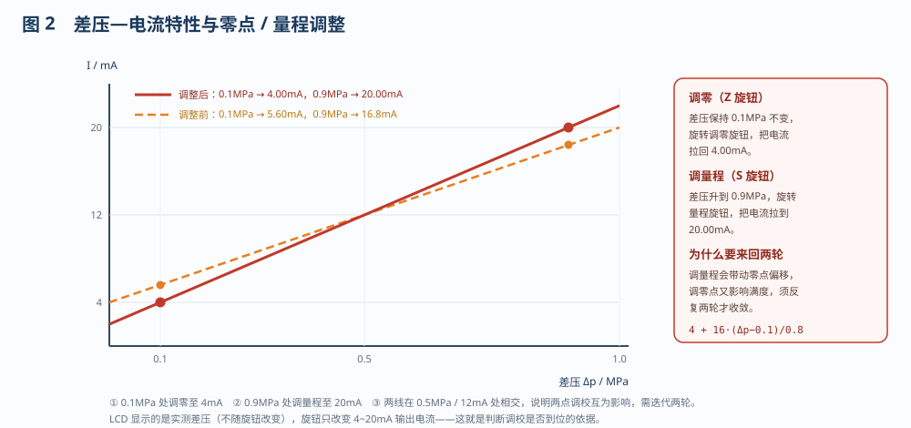
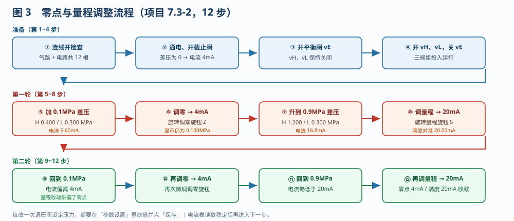

# 差压变送器的功能测试

> 适用对象：船舶电气 / 自动化专业　项目 7.3
> 配套仿真含两条流程：**电动差压变送器的结构、电路、气路连接（6 步）** 与 **零点和量程调整（12 步）**，对应平台的"自动演示 / 单步演示 / 演练 / 评估"四种模式。

---

## 一、项目概述

差压变送器把两个取压口的压力差 **Δp = p(H) − p(L)** 转换成标准 **4~20mA** 电流，供显示仪表、记录仪或控制系统使用。它比普通压力变送器多一个压力室：L（低压室）与 H（高压室）分居膜片两侧，膜片只感受两室之差，因此**单侧受压再高也不会顶坏膜片**——前提是投运、停运时按规程操作三阀组。

本项目的任务分两步：先按图把气路与二线制电路接好，再把差压从 0.1MPa 加到 0.9MPa 逐点核对，用零点（Z）、量程（S）两只旋钮把 **4mA 与 20mA** 整定到位。

---

## 二、系统组成

| 元件 | 代号 | 作用与关键参数 |
|------|------|----------------|
| 差压变送器 | `difftr` | 被检对象；量程 0~1MPa，二线制 p(+) / n(−)；LCD 显示实测差压；面板 Z / S 微调旋钮 |
| 三阀组 | `3valve` | 高压阀 vH、低压阀 vL、平衡阀 vE；用于投运、隔离与"平衡"两室压力 |
| 调压阀1 / 2 | `pressreg` / `pressreg2` | 高压侧、低压侧取压压力源，输出 = min(输入, 设定压力)；设定压力在「参数设置」中修改 |
| 三通接头 | `tee` | 把气瓶压力分成高、低压两条支路 |
| 截止阀 | `stopvalve` | 点击手柄通断气源，接线时必须关闭 |
| 气瓶 | `cab` | 气源 2MPa，远高于调压阀设定值 |
| 24V 电源 | `dcpower` | 二线制回路供电（电源键开关） |
| 可调电阻 | `varires` | 250Ω 限流电阻，限制回路电流并取出电压 |
| 电流表 | `ampmeter` | 0~20mA，直接读 4~20mA 输出 |

---

## 三、测量原理与输出信号

二线制变送器把差压线性转换成回路电流：

$$I = 4 + 16\times\frac{\Delta p - p_{min}}{p_{max}-p_{min}}\quad(\mathrm{mA})$$

本工程量程 0~1MPa，所以未调校时 0.1MPa 对应 **5.6mA**、0.9MPa 对应 **16.8mA**。LCD 显示的是**实测差压**（由 H、L 两室压力算出），而电流表显示的是**回路电流**——两者是"被测量"与"输出量"的关系。

---

## 四、零点与量程为什么调两轮

- **调零**：差压保持在 0.1MPa 不动，旋转 Z 旋钮改变零点偏移，把电流拉回 **4.00mA**；
- **调量程**：差压升到 0.9MPa，旋转 S 旋钮改变放大系数，把电流拉到 **20.00mA**；
- **相互影响**：调量程会同时改变斜率与截距，满度对准后 0.1MPa 处又偏离 4mA；再调零又会轻微影响满度。因此必须按"**调零 → 调量程 → 再调零 → 再调量程**"迭代两轮，误差才收敛到允许范围。

判断依据很直接：**旋钮不改变 LCD 上的差压读数，只改变输出电流**。差压没变而电流被拉回 4mA / 20mA，说明零点 / 量程修正确实生效了。

---

## 五、操作流程

### 5.1 结构、气路与电路连接（项目 7.3-1，6 步）

1. 气瓶 → 截止阀 → 三通接头右端；
2. 三通下端 → 调压阀2 → 三阀组低压端 inl；
3. 三通上端 → 调压阀1 → 三阀组高压端 inh；
4. 三阀组输出 outl / outh → 变送器 L / H 接口；
5. 24V 正极 → 可调电阻 → 变送器 p(+)；
6. 变送器 n(−) → 电流表 → 24V 负极。

接线时截止阀必须关闭。**投运顺序**：开平衡阀 vE → 开高压阀 vH、低压阀 vL → 关平衡阀 vE；停运时反过来，先开平衡阀再关高、低压阀。

### 5.2 零点与量程调整（项目 7.3-2，12 步）

① 连线检查 → ② 通电、开截止阀（差压 0 → 4mA）→ ③ 开平衡阀 → ④ 开 vH、vL 并关 vE 投运 → ⑤ 高压 0.400、低压 0.300MPa（差压 0.1MPa，电流 5.60mA）→ ⑥ 调零至 4mA → ⑦ 高压 1.200MPa（差压 0.9MPa，电流 16.8mA）→ ⑧ 调量程至 20mA → ⑨ 回到 0.1MPa → ⑩ 再调零 → ⑪ 回到 0.9MPa → ⑫ 再调量程至 20mA。

操作要点：调压阀设定压力一律「右键 → 参数设置 → 改值 → 保存」；调零 / 量程旋钮**按住上半部增大、按住下半部减小**，按住即连续微调，松开停止，边调边看电流表。

---

## 六、结果判断与常见问题

1. **通电后电流为 0**：电源未开、回路未闭合，或 p / n 接反（二线制有极性）。
2. **显示 LLLL / 电流低于 3.8mA**：回路开路、接触不良，或 H、L 接反使差压为负。
3. **加差压电流不涨**：三阀组高、低压阀未开或平衡阀未关；调压阀设定压力没保存；支路管路未接通。
4. **零点、量程互相跑**：只调了一轮。按两轮以上迭代，直到 0.1MPa ↔ 4.00mA、0.9MPa ↔ 20.00mA 同时成立。
5. **读数抖动**：调压阀设定值刚改完，等电流表稳定（约 1s）再读。

---

## 七、小结

差压变送器的"功能测试"= **接线 + 投运 + 两点调校**：气路上用两只调压阀造出可控差压，电路上用电流表监视 4~20mA 输出；先以 0.1MPa 定零点、再以 0.9MPa 定满度，往复两轮把两点同时对准。掌握这套方法，换任何量程的差压（压力）变送器，都能按"给标准压力 → 读输出电流 → 修零点/量程"的同一套路完成校验。
