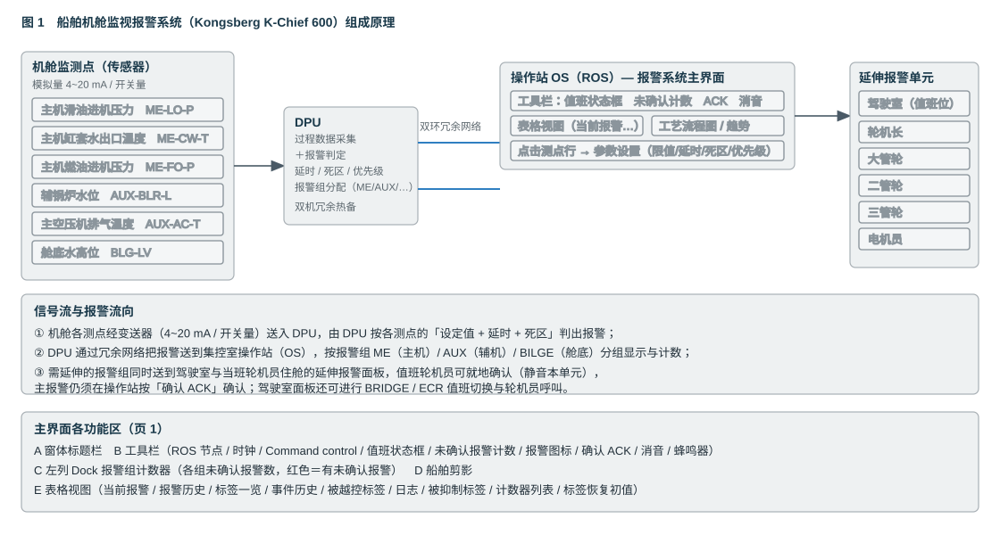
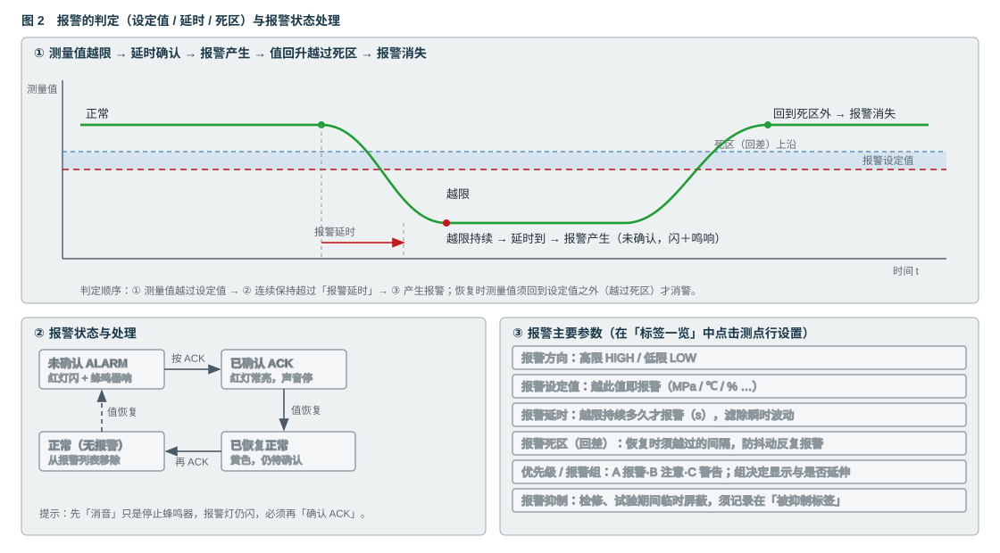
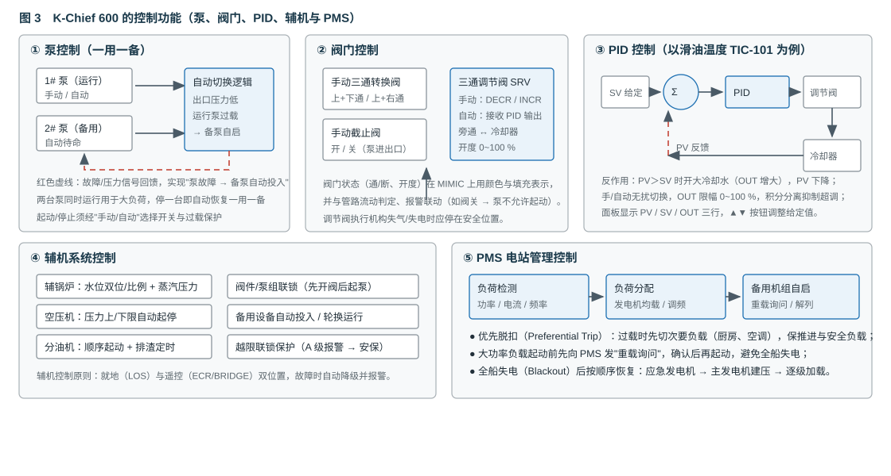
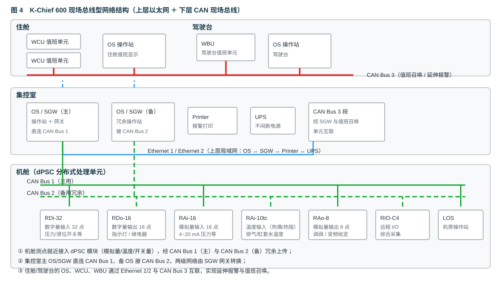
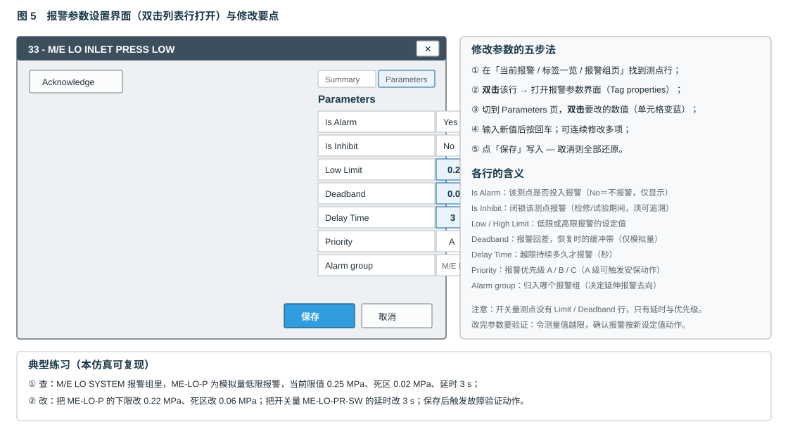

# 掌握船舶机舱监视报警系统的使用

> 对象：Kongsberg **K-Chief 600** 现场总线型机舱监视与报警系统。
> 载体：本仿真工程共 5 页 —— ①报警系统主界面（操作站 OS）②延伸报警单元 ③现场总线型系统结构 ④轮机员安全系统 ⑤主机滑油系统 MIMIC。
> 目标：掌握监视报警的基本原理与参数查询修改方法，理解分组报警、报警闭锁、失职报警，了解控制功能与网络结构。

---

## 一、监视与报警系统的监视与报警功能

### 1.1 监视报警的基本原理

机舱里成百上千个测点（压力、温度、液位、流量、开关量）先由变送器变成标准信号，再送到分布式处理单元 **DPU（dPSC 模块）**。DPU 负责三件事：**采集**（把 4～20 mA / 开关量变成工程量）、**判定**（与设定值比较）、**上传**（把数据和报警送上网络）。操作站只负责显示、确认与参数管理，不直接接传感器，这就是"现场总线型"与"集中式"系统的本质区别。

一个报警是否产生，由**四个要素**决定：

| 要素 | 含义 | 作用 |
|---|---|---|
| 设定值 Limit | 越限门限（低限报警低于该值动作，高限报警高于该值动作） | 决定"多少才算异常" |
| 延时 Delay Time | 越限须持续超过该时间才报警 | 滤掉起动冲击、液面晃动等瞬时波动 |
| 死区 Deadband（回差） | 测量值回到 Limit±死区 范围内才消警 | 防止门限附近"报警—消警"反复抖动 |
| 优先级 Priority | A / B / C 级 | A 级最高，可进一步触发主机安保动作（停车 SHD / 减速 SLD） |

报警产生后进入**状态机**：**未确认（闪烁＋鸣响）→ 按 ACK 已确认（常亮、停响）→ 测量值恢复（RTN，黄色待确认）→ 确认后从当前报警页移入报警历史**。若故障先恢复、之后才确认，历史记录会标记为"⏎ 恢复未确认"，以便事后追溯。**消音（Silence / Sound off）只停声响，不等于确认，也不清除报警**。

### 1.2 参数的设置与查询

查询有两个入口，格式完全相同：**标签一览（Tag summary）** 列出全部测点；点击左列报警组则只列该组测点。每行包含 ID、Tag、Description、Function、Alarm state、Value、Eng unit、Limit、Alarm group。

- **Function 功能号**看报警性质：`PIAL`＝压力低报警、`TIAH`＝温度高报警、`LIAL`＝液位低报警、`XA`＝开关量输入（动作即报警）。
- **Alarm state** 正常显示 `NORMAL`，越限时红色显示报警状态。

修改参数：**双击测点行**打开参数界面（Tag properties），切到 **Parameters** 页，**双击数值单元格**进入编辑，改完按回车，最后点「保存」生效；点「取消」则本次修改全部还原。可一次修改多项，例如同时改低限、死区与延时。

需要强调：参数是"报警是否可信"的基础。设定值定得过高会让真故障不报警，定得过低会造成大量误报，值班人员就会习惯性忽略报警——这比没有报警更危险。

### 1.3 分组报警

系统把测点按设备/系统归入 **19 个报警组**（M/E GENERAL、M/E LO SYSTEM、M/E COOL FW SYS、AUX BOILER、FIRE SYSTEM、MISCELLANEOUS……）。操作站左列（UnDock）逐组显示未确认报警数：

- 有**未确认**报警 → 该组计数亮红并闪烁；
- 已全部确认但故障未排除 → 深红常亮，显示该组报警数；
- 无报警 → 灰色显示 0。

点击某个报警组即可进入**该组的监测/报警列表页**，只看本组测点，便于按系统排查。报警组还决定**延伸报警的去向**：例如 M/E LO SYSTEM 组的报警会同时送到驾驶台与当班轮机员的延伸报警面板。

### 1.4 报警闭锁（Inhibit）

**闭锁**是指临时让某个测点"不产生报警"，用于检修、试验、传感器更换等已知异常期间。要点：

1. 闭锁**不停止采集**，测量值照常显示与记录，只是不判报警；
2. 闭锁必须**可追溯**——所有被闭锁的测点都列在「被闭锁标签 Inhibit tags」页，交班时要逐条交代；
3. 闭锁**不能代替处理故障**。把长期故障测点一闭了之，等于关掉了安全防线，这是体系审核中明确禁止的做法。

注意与**越控（Override）**区分：越控针对的是 A 级的安保动作（Shut Down / Slow Down），在安保延时内按 Operate→Cancel Shut Down 可取消该次停车/减速，并记入「被越控标签」；**报警本身仍然存在，仍需确认**。

### 1.5 失职报警（Repeat）

报警产生后，若值班人员**在设定时间（默认 180 s）内未确认**，或**在值班面板消音后主站仍未确认**，系统判定为"报警无人处置"，在**驾驶台与轮机长值班面板**显示闪烁的 **REPEAT**（失职报警）。

- 失职报警表示"没人管报警"，不是"故障重复发生"；
- 消音只能暂缓声响，**REPEAT 不会消失**；
- 只有**主站按「确认 ACK」**才能清除。

这一功能是值班纪律的技术保障：报警不怕多，最怕没人看。

---

## 二、监视与报警系统的控制功能

监视系统不只是"看"，K-Chief 600 还承担机舱主要辅机的**遥控与自动控制**。

### 2.1 泵控制

滑油泵、冷却水泵、燃油泵普遍采用**一用一备**：一台运行、一台自动待命。控制逻辑包括：

- **自动切换**：运行泵出口压力低、过载跳闸或故障时，备用泵**自动投入**（滑油系统 MIMIC 中 1# 泵跳闸后 2# 泵立即自启，压力保持在 0.45 MPa）；
- **起动联锁**：泵进出口阀未开不允许起动，避免干转；
- **就地/遥控**：机旁 LOS 与集控室 ECR 双位置，机旁优先（转换开关决定控制权）；
- **轮换运行**：长时间运行后可定时轮换，使两台泵磨损均匀。

### 2.2 阀门控制

- **手动三通转换阀**：用于测点选择，如"上下通＝测管路压力 / 上右通＝测手摇泵压力"，阀门位置在 MIMIC 上以三角形填充色表示，并决定 PT-101 与压力开关读到的是哪一路压力；
- **手动截止阀**：泵进出口隔离，关闭时泵不允许起动；
- **三通调节阀（SRV）**：手动方式用 DECR/INCR 增减开度（自复位旋钮，松开即回中位、开度保持）；自动方式接收 PID 输出，改变旁通与冷却器的流量分配。

### 2.3 PID 控制

以滑油温度调节器 TIC-101 为例：面板显示 **PV（实测）/ SV（给定）/ OUT（输出）** 三行。

- **反作用**：PV＞SV 时开大冷却水（OUT 增大），使温度回落；
- **积分分离**：偏差大时只用比例快速响应，偏差小时引入积分消除静差，避免超调；
- **手/自动无扰切换**：切换到自动时以当前 OUT 为起点，避免输出跳变；
- **限幅**：OUT 限制在 0～100 %，对应阀门全关到全开。

负荷变化时（如负荷从 50 % 升到 90 %），不冷却时油温可升到 80 ℃，此时调节器自动把 OUT 开到约 88 %（冷却 88 %、旁通 12 %），把温度稳定在 45 ℃ —— 这就是闭环调节的意义。

### 2.4 辅机系统控制

- **辅锅炉**：水位双位/比例调节、蒸汽压力自动燃烧控制、极低水位与火焰熄灭保护；
- **空压机**：按空气瓶压力上/下限自动起停，高排气温度报警停机；
- **分油机**：顺序起动（先供油泵、后分油机）、排渣定时、振动与出口压力监视；
- **联锁保护**：A 级报警可延伸到主机安保（如滑油低压开关动作 → 5 s 后主机自动停车）。

### 2.5 PMS 电站管理控制

**PMS（Power Management System）**负责全船电力的自动管理：

- **负荷检测与分配**：多台发电机并联时均衡有功/无功，维持频率与电压；
- **备用机组自动起动**：负荷超过设定百分比（如 85 %）自动起动备用机组并合闸，负荷下降后解列停机；
- **重载询问**：大功率负载起动前先询问 PMS，确认电网有余量再允许起动；
- **优先脱扣（Preferential Trip）**：过载时按优先级切除次要负载（厨房、空调、绞缆机），保住推进与安全负载；
- **失电恢复**：全船失电后按应急发电机→主发电机建压→逐级加载的顺序恢复。

---

## 三、系统的网络结构

K-Chief 600 采用**现场总线 + 以太网**相结合的两级结构：**下层用 CAN 总线把机舱各个 DPU 连起来，上层用以太网让各操作站相互通信**。

**下层（现场总线）**

| 模块 | 功能 |
|---|---|
| RDi-32 | 数字量输入 32 点：压力开关、液位开关、各类触点信号 |
| RDo-16 | 数字量输出 16 点：指示灯、继电器、声光报警 |
| RAi-16 | 模拟量输入 16 点：4～20 mA 压力、液位、流量 |
| RAi-10tc | 温度输入：热电偶 / 热阻，测排气温度、缸套水温度 |
| RAo-8 | 模拟量输出 8 点：调节阀开度、变频器给定 |
| RIO-C4 | 远程 I/O，综合采集 |

这些模块挂在 **CAN Bus 1（主用）** 与 **CAN Bus 2（备用冗余，虚线）** 两条总线上：一条故障，另一条自动承担，通信不中断。

**上层（以太网）**

集控室的 **OS/SGW**（操作站＋网关）是两级网络的枢纽：主 OS 直连 CAN Bus 1，备 OS 接 CAN Bus 2，两者互为冗余；**Ethernet 1 / Ethernet 2** 把集控室、住舱、驾驶台的操作站、报警打印机（Printer）、不间断电源（UPS）连成局域网。

**值班召唤与延伸报警**走 **CAN Bus 3**：住舱两台 **WCU（值班单元）**、驾驶台 **WBU** 与集控室 SGW 都挂在这条总线上，实现轮机员呼叫、值班交接与延伸报警指示。

**就地设备**：机舱的 **LOS（机旁操作站）** 供轮机员在设备旁操作与查看，**MOS** 提供就地仪表显示，均挂在 Local CAN 总线上。

可靠性设计：双 CAN 总线、双操作站、UPS 供电、DPU 分散布置（一个模块故障只影响本地少数测点），这是船用系统能在无人值班机舱长期运行的基礎。

---

## 四、监视与报警系统界面的认识

操作站主界面（页 1）分为若干功能区：

1. **窗体标题栏与工具栏**：ROS 节点名、系统时钟、Command control（命令控制）、**值班状态框（ECR watch / At sea）**、**未确认报警计数**、报警图标、**确认 ACK**、**消音**、蜂鸣器、翻页与打印、View / Operate / Tools / System 菜单。
2. **左列 Dock 报警组**：19 个报警组及未确认报警数，点击进入该组界面。
3. **船舶剪影**：全船示意，作为背景与位置参照。
4. **表格视图**：当前报警、报警历史、标签一览、事件历史、被越控标签、日志查看、被闭锁标签、计数器列表、标签恢复初值。
5. **工艺流程图入口**：主机概览、增压器、发电机组、燃油/滑油/冷却水/锅炉等系统的 MIMIC 入口。
6. **趋势与自定义视图**：趋势 1 默认显示滑油进机压力与温度两条曲线（120 s 窗口）；自定义视图 1 用两只半圆仪表盘显示同样两个参数。
7. **弹出界面**：双击列表行打开报警参数界面；点击 ECR watch 打开**值班呼叫对话框**（Engine duty / Engine watch / Call all / Call duty engineer / Accept / Reject）。

此外还有几页专项界面：**主机概览**（4 缸排气温度、TC、安全保护五列指示灯、ME RUN 轴功率）；**发电机组概览**（1#/2#/3#，默认 1# 运行、其余停机，含柴油机—联轴器—发电机与绕组温度）；**现场总线型系统结构**（页 3）；**轮机员安全系统**（页 4）；**主机滑油系统 MIMIC**（页 5，含 PT-101、YT1226 压力继电器、手摇泵与 TIC-101）。

---

## 五、参数查询和修改的具体步骤

以"查改主机滑油进机压力 ME-LO-P 与低压开关 ME-LO-PR-SW"为例：

**步骤 1　进入报警页**
点击工具栏「主页」回到 Home，确认在报警系统主界面。

**步骤 2　选择报警组**
点击左列 **M/E LO SYSTEM**，进入主机滑油系统监测界面，可见 8 个测点。

**步骤 3　查询参数**
读该行的 Function（`PIAL`＝压力低限报警、`XA`＝开关量）、Alarm state（`NORMAL`）、Value（实测值）、Limit（当前报警限）。可得：ME-LO-P 为**模拟量下限报警**，当前限值 0.25 MPa、死区 0.02 MPa、延时 3 s；ME-LO-PR-SW 为**开关量报警**（动作即报警，无设定值与死区）。

**步骤 4　双击打开参数界面**
双击 **ME-LO-P** 行，弹出 `33 - M/E LO INLET PRESS LOW` 参数界面，切到 **Parameters** 页。

**步骤 5　修改数值**
双击 **Low Limit** 单元格（变蓝）→ 输入 `0.22` → 回车；再双击 **Deadband** → 输入 `0.06` → 回车。开关量测点则改 **Delay Time**：双击 **ME-LO-PR-SW** 行，把 Delay Time 改为 `3`。

**步骤 6　保存**
点击「保存」写入；如点「取消」则全部还原。

**步骤 7　验证**
注入对应故障（工具栏「故障设置」：主机滑油进机压力低 / 滑油低压开关动作），观察报警是否按新参数动作：限值降到 0.22 MPa 后，压力 0.23 MPa 即应报警；开关量延时改为 3 s 后，动作后 3 s 才报出。

**步骤 8　恢复**
试验后用「标签恢复初值（Tags Recovery）」或再次进入参数界面把数值改回，避免影响后续教学与其他报警。

**常见参数一览**

| 参数 | 典型值 | 调整原则 |
|---|---|---|
| Low / High Limit | 0.22～0.25 MPa | 按设备说明书与实测正常值留 10 %～20 % 裕量 |
| Deadband | 0.05～0.06 MPa | 取正常波动的 1～2 倍，过小会抖动、过大会迟钝 |
| Delay Time | 1～5 s（压力）、5～10 s（温度/液位） | 短于设备容忍时间，长于起动冲击时间 |
| Priority | A（安保类）/ B（重要）/ C（一般） | A 级须确认是否联动安保动作 |
| Alarm group | M/E LO SYSTEM 等 | 决定延伸报警去向与交班责任 |

---

## 结语

监视与报警系统的价值不在于"能报警"，而在于**报得准、看得见、有人管、可追溯**：设定值/延时/死区决定"报得准"，分组与延伸报警决定"看得见"，确认、消音与失职报警决定"有人管"，报警历史、被闭锁标签、事件日志决定"可追溯"。把这些参数改对、把报警确认流程走对，才是一名轮机员使用 K-Chief 600 的基本功。
