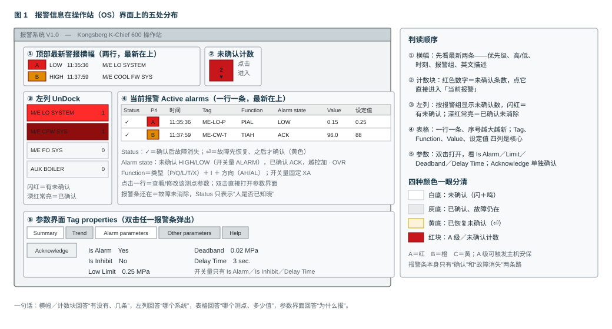
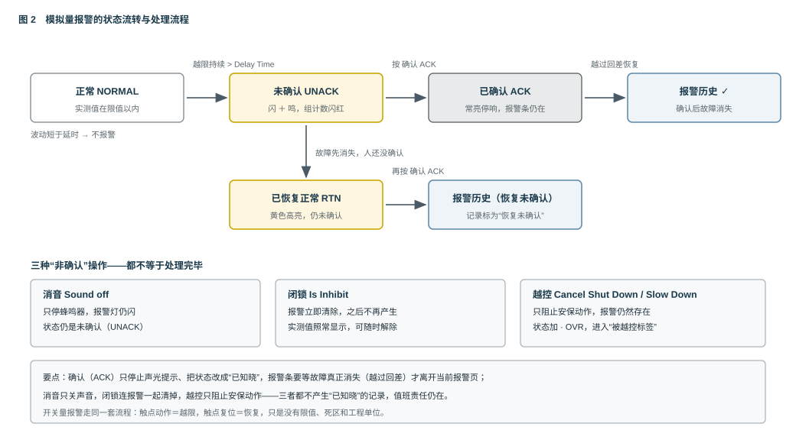
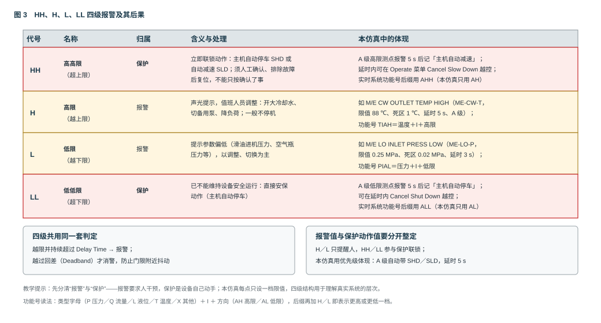
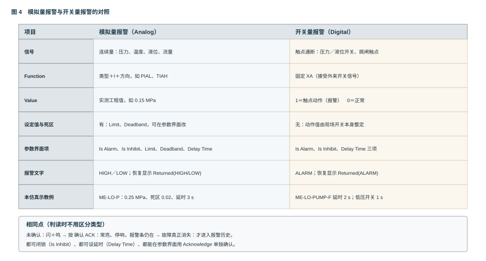

# 掌握船舶机舱监视报警系统的信息查找

> 对象：Kongsberg **K-Chief 600** 机舱监视报警系统，操作站（OS）Home 菜单下的表格视图（Tabular views）。
> 载体：本仿真工程共 5 页 —— ①报警系统主界面（OS）②延伸报警单元 ③现场总线型系统结构 ④轮机员安全系统 ⑤主机滑油系统 MIMIC。
> 目标：分清模拟量与开关量两类报警，掌握信息条各列含义、参数界面各项作用与报警的处理流程。

机舱报警按信号的类型分两种：**模拟量报警**（温度、压力、液位、流量等连续量越过限值）与
**开关量报警**（压力开关、液位开关、泵故障跳闸触点等只有"动作/正常"两种状态的信号）。
两者的信息条格式、参数界面项与恢复方式不同，判读报警时必须先分清类型。

---

## 一、模拟量报警

### 1. 软件中报警信息的分布

| 位置 | 显示内容 |
|---|---|
| 顶部**最新警报横幅**（两行，最新在上） | 优先级块 `A/B/C` ｜ `HIGH`/`LOW` ｜ 报警时刻 ｜ 报警组 ｜ 英文报警描述 |
| 横幅右侧红色数字块 | 未确认报警条数，点击直接进入「当前报警」页 |
| 左列 **UnDock** 报警组计数 | 有未确认报警＝亮红/深红闪烁，数字为未确认数；全部已确认但故障未排除＝深红常亮，数字为该组报警条数；无报警＝灰 |
| **当前报警 Active alarms** 信息条 | 一行一条报警，最新在最上（见下表） |
| **报警历史 Alarm history** | 报警消失后的记录：`✓`＝确认后故障消失，`⏎`＝故障先恢复、之后才确认 |

「当前报警」信息条各列含义：

| 列 | 含义 |
|---|---|
| Status | `✓` 已确认 ／ `⏎` 已恢复正常但尚未确认 |
| Pri | 优先级块 `A`（红）/`B`（橙）/`C`（黄）；未确认时 A 块在亮红与深红间闪烁 |
| 时间 | 报警发生的时刻 |
| ID | 报警序号（越大越新） |
| Tag | 测点位号，如 `ME-LO-P`（主机滑油进机压力） |
| Description | 英文报警描述，如 `M/E LO INLET PRESS LOW` |
| Function | 报警功能号，由测量类型（压力 `P`／流量 `Q`／液位 `L`／温度 `T`／其余 `X`）＋ `I` ＋ 报警方向（`AH` 高限／`AL` 低限）组成，如 `PIAL`＝压力低报警、`TIAH`＝温度高报警 |
| Alarm state | 未确认显示 `HIGH`／`LOW`，已确认显示 `ACK`，已恢复未确认显示 `Returned(HIGH/LOW)`；被越控的加 `· OVR` |
| Value | 该测点**实测值** |
| Eng unit | 工程单位（MPa、℃、%…） |
| 设定值 | 该报警的**动作限值**（高限或低限） |
| Alarm group | 所属报警组，如 `M/E LO SYSTEM` |

**双击任意一行**弹出 Tag properties 参数界面（标题栏为「编号 — 英文描述」，页签为 Summary / Trend / Alarm parameters / Other parameters / Help），
左侧 `Acknowledge` 单独确认该测点。Alarm parameters 页的模拟量参数项：

| 参数 | 含义 |
|---|---|
| Is Alarm | 该测点是否投入报警（No＝不报警） |
| Is Inhibit | 是否闭锁该报警：闭锁后报警立即清除且不再产生，但实测值照常显示，随时可解除 |
| High Limit / Low Limit | 高限／低限设定值，实测值越过它才可能报警。界面按测点方向只显示其中一个：低限测点显示 `Low Limit`，高限测点显示 `High Limit` |
| Deadband | 回差（死区）。低限 0.25 + 回差 0.02：低于 0.25 报警，回升到 0.27 以上才消警；高限 88 ℃ + 回差 1 ℃：高于 88 ℃ 报警，降到 87 ℃ 以下才消警 |
| Delay Time | 越限须**持续**超过该时间才报警，防止参数瞬时波动误报 |

### 2. 报警状态与处理流程

1. 实测值越过限值并持续超过 **Delay Time** → 产生报警，状态**未确认**（Priority 块与横幅闪烁、蜂鸣器鸣响、报警组计数闪红）。
2. 按工具栏「确认 ACK」（或参数界面的 Acknowledge）→ 状态**已确认**：闪烁停止、显示 `✓`（该条报警**仍然存在**，只是人已知晓）。
3. 故障排除、实测值回升并越过回差 → 已确认的报警**自动消失**并进入报警历史；
   若故障先恢复而未确认，则显示黄色 `⏎ Returned(…)`，待确认后才进历史。

> 要点：**确认 ≠ 消除**。确认只停止声光提示，报警要等参数真正恢复正常才消失。

### 3. HH、H、L、LL 四种情况

真实机舱监视系统中，每个模拟量测点通常设两道限值、上下各一组，共四级报警：

| 代号 | 名称 | 含义与处理 | 本仿真中的体现 |
|---|---|---|---|
| **HH** | 高高限（超上限） | 参数已危及设备安全，属**保护**范畴：立即联锁动作（主机自动停车 SHD 或自动减速 SLD），并须人工确认、排除故障后复位 | 高限测点设 A 级即带安保动作：报警 5 s 后记「主机自动减速」，可在延时内 `Cancel Slow Down` 越控；实时系统功能号后缀用 `AHH`（本仿真只显示 `AH`） |
| **H** | 高限 | 超过正常上限，属**报警**范畴：声光提示，值班人员调整（开大冷却水、切换备用泵、降低负荷），一般不停机 | 高限测点如 `ME-CW-T` 缸套水出口温度（88 ℃、A 级，带减速）、`ME-LO-T` 滑油进机温度（55 ℃、B 级，只报警），功能号 `TIAH` |
| **L** | 低限 | 低于正常下限，属**报警**范畴：提示参数偏低（如滑油进机压力低、空气瓶压力低） | 低限测点如 `PIAL` `ME-LO-P`，限值 0.25 MPa、延时 3 s |
| **LL** | 低低限（超下限） | 已不能维持设备安全运行，属**保护**范畴：直接安保动作（主机自动停车） | 低限测点设 A 级即带停车：报警 5 s 后记「主机自动停车」，可 `Cancel Shut Down` 越控；功能号后缀用 `ALL`（本仿真只显示 `AL`） |

四级共用同一套判定：**越限 + 持续超过延时 → 报警；越过回差 → 消警**。
区别在于后果——`H`／`L` 只报警提醒，`HH`／`LL` 参与保护联锁（停车/减速），
这也是教学中"报警值"与"保护动作值"必须分开整定的原因。

---

## 二、开关量报警

### 1. 信号特点

开关量测点接的是**触点**：压力开关、液位开关、温度开关、泵运行/故障触点、安全保护触点等，
只有两种状态——**动作（1）＝报警**、**正常（0）**。它没有"设定值"和"死区"这两个概念，
因为动作值由现场的开关本身整定好了。

### 2. 软件中显示的信息

| 位置 | 开关量的表现 |
|---|---|
| 信息条 Tag | 测点位号，如 `ME-LO-PUMP-F`（主滑油泵故障） |
| 信息条 Function | 固定为 **`XA`**，表示接受外来开关信号 |
| 信息条 Value | **`1`**＝触点已动作（即报警）／**`0`**＝正常 |
| 信息条「设定值」「Eng unit」 | **空白**（开关量没有限值与单位） |
| 信息条 Alarm state | 未确认显示 `ALARM`，已确认显示 `ACK` |
| 参数界面 | 只有 **Is Alarm**、**Is Inhibit**、**Delay Time** 三项，**没有** High/Low Limit 与 Deadband |
| 报警历史 | 保留发生/消失时刻，Value 已回到 `0`，状态记 `ACK` |

### 3. 判定与处理流程

1. 触点动作（1）并**持续超过 Delay Time**（示教用 2 s；滑油低压开关 1 s）→ 产生报警（未确认，闪＋鸣）。
2. 确认（Acknowledge 或「确认 ACK」）→ 状态 `ACK`，报警条仍在。
3. 触点复位（0）→ 已确认的报警自动消失并进入报警历史；未确认的显示 `Returned(ALARM)`。

**示教例：主滑油泵故障跳闸（`ME-LO-PUMP-F`，A 级，延时 2 s）**

- 故障设置后触点动作，2 s 后报警条出现 `ME-LO-PUMP-F ／ XA ／ Value 1 ／ ALARM`；
- 主机滑油系统 MIMIC（第 5 页）联动：运行泵置过载跳闸，**备用泵自动投入**；
- 确认并复位故障后，过载标志清除、备泵继续运行，报警条从「当前报警」消失，
  到「报警历史」中可见该记录 `Value = 0`、`Alarm state = ACK`。

### 4. 与模拟量报警的对照

| 项目 | 模拟量报警 | 开关量报警 |
|---|---|---|
| 信号 | 连续量（压力、温度、液位、流量） | 触点通断（开关、跳闸、保护触点） |
| Function | 类型前缀 + `I` + `AH`/`AL`（如 `PIAL`） | 固定 `XA` |
| Value | 实测工程值（如 0.15 MPa） | `1` 动作 / `0` 正常 |
| 设定值、死区 | 有（Limit、Deadband，可在参数界面改） | 无（由现场开关整定） |
| 参数界面 | Is Alarm、Is Inhibit、Limit、Deadband、Delay Time | Is Alarm、Is Inhibit、Delay Time |
| 报警文字 | `HIGH` / `LOW` | `ALARM` |
| 相同点 | 未确认闪烁鸣响 → 确认后常亮 → 故障真正消失才进历史；都可闭锁、都可设延时 | 同左 |

---

## 结语

查报警的顺序是固定的：**横幅看最新两条 → 计数块看有没有漏 → 左列定位系统 → 表格逐列读值 → 双击看参数与趋势**。
判读时只要抓住三件事——**什么测点（Tag）、越了哪一边（Function / Alarm state）、偏离多少（Value 对比设定值）**，
就能判断该先通知谁、要不要切备用泵、是否已在安保动作倒计时里。
记住两条底线：**确认不等于消除**，**消音不等于确认**。
