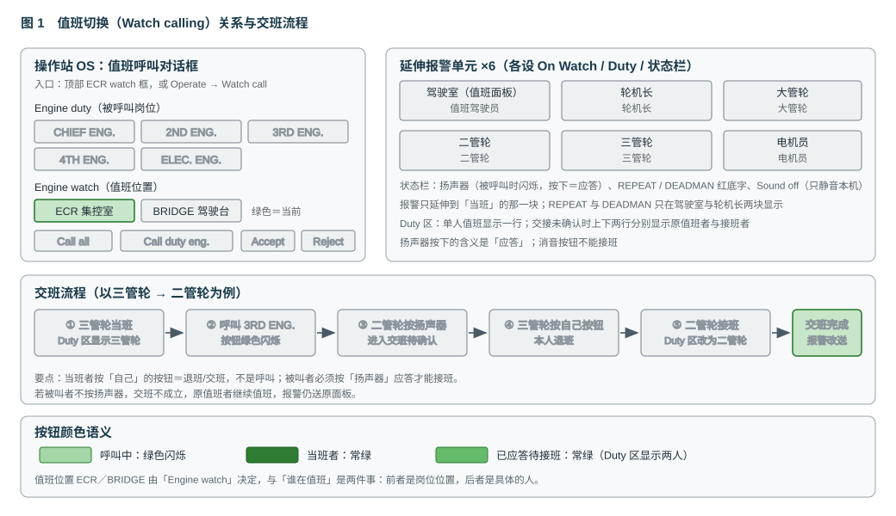
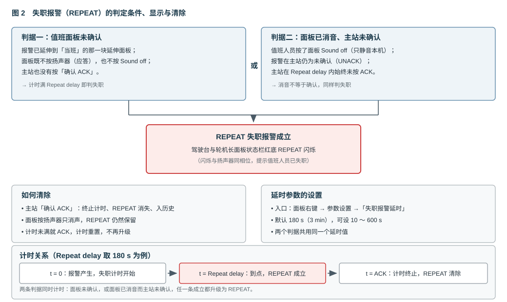
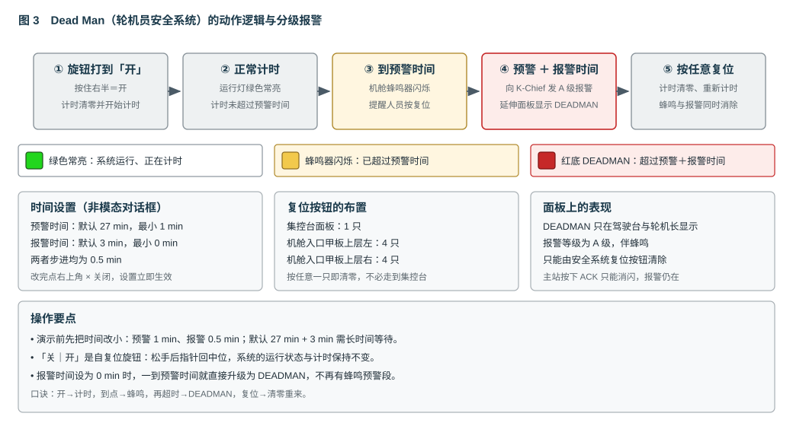

# 掌握船舶机舱监视报警系统的功能测试

本仿真以 Kongsberg **K-Chief 600** 机舱监视报警系统为原型，共 5 个页面：报警系统主界面（操作站 OS）、延伸报警单元、现场总线型系统结构、轮机员安全系统、主机滑油系统 MIMIC。以下按三个内容说明其功能与操作。

---

## 一、值班切换系统的操作

值班切换用来确定「谁在值班」：机舱报警只延伸到**当班轮机员**的延伸报警面板。系统由操作站 OS 上的**值班呼叫对话框（Watch calling）**与 6 块**延伸报警单元**面板（驾驶台、轮机长、大管轮、二管轮、三管轮、电机员）组成。

| 部件 | 作用 |
|---|---|
| 顶部 `ECR watch` 框（或 Operate→Watch call） | 调出/收起值班呼叫对话框 |
| Engine duty 五个按钮 | CHIEF ENG.（轮机长）、2ND ENG.（大管轮）、3RD ENG.（二管轮）、4TH ENG.（三管轮）、ELEC. ENG.（电机员） |
| Engine watch：ECR / BRIDGE | 选择值班位置（集控室 / 驾驶台），绿色为当前 |
| 面板状态栏扬声器 | 被呼叫时闪烁，**按下＝应答**（消声按钮只静音，不能接班） |

**按钮颜色**：呼叫中＝绿色闪烁；当班者＝常绿；已应答待接班＝常绿。

**操作步骤**

1. 在报警系统页点 `ECR watch`，调出值班呼叫对话框。
2. 点「4TH ENG.」发起呼叫，按钮转为绿色闪烁，三管轮面板状态栏扬声器同步闪烁。
3. 三管轮在值班系统界面按下闪烁的扬声器应答。此时无人值班，因此**直接成为当班轮机员**，面板 Duty 区显示其岗位名。
4. 回报警系统页点「3RD ENG.」呼叫二管轮接班。
5. 二管轮按下扬声器应答，进入**交班待确认**：值班面板 Duty 区上下两行同时显示原值班者与接班者。
6. 再由三管轮（原值班者）按自己的「4TH ENG.」按钮，三管轮解除值班，**二管轮接班**，交接完成。

> 要点：当班者按**自己**的按钮＝退班/交班，不是呼叫；被叫者必须按**扬声器**才能接班。

---

## 二、失职报警功能的验证

**功能**：报警产生后，若值班面板在设定时间内既不确认、也不到主站确认，系统判定值班人员「失职」，在驾驶台与轮机长面板给出重复报警（REPEAT），防止报警被长期忽略。

**判据与显示**

- 报警产生后，值班面板在「失职报警延时」内未确认；或面板已消音、主站在该延时内仍未确认 → 触发失职报警。
- 显示：**驾驶台与轮机长**面板状态栏红底 `REPEAT` 闪烁（与扬声器同相位）；按扬声器只能消声，`REPEAT` 保留。
- 清除：只有主站点「确认 ACK」才终止失职计时并清除 `REPEAT`。
- 延时默认 **180 s（3 min）**，可在面板上**右键 → 参数设置 →「失职报警延时 Repeat delay」**（10～600 s）修改。

**操作步骤**

1. 右键报警系统面板 → 参数设置，把失职报警延时由 3 min 改为 **30 s** 并保存。
2. 点 `ECR watch` 调出对话框，点「4TH ENG.」呼叫三管轮。
3. 切到值班系统界面，三管轮按扬声器应答，进入三管轮值班状态。
4. 在「故障设置」中勾选**主机缸套冷却水出口温度高**（报警限 88 ℃、报警延时 5 s）并应用，报警延伸到三管轮面板（红色报警区 + Sound off）。
5. 三管轮按面板 **Sound off** 消声，但**不在主站确认**；此时主站报警仍闪烁。
6. 30 s 延时到，驾驶台与轮机长面板状态栏出现闪烁的 `REPEAT`——失职报警成立。
7. 到报警系统界面点「确认 ACK」，报警被确认，`REPEAT` 消失。

> 结论：面板消音只是「本机静音」，必须由主站确认才算处理完毕，否则将升级为失职报警。

---

## 三、轮机员安全系统的功能和操作

**功能**：Dead Man（轮机员安全）系统用于防止轮机员在机舱或集控台发生意外而无人知晓。系统每隔固定时间要求人员手动复位一次，超时即分级报警。

**组成**（三块面板：机舱入口甲板上层左、集控台、机舱入口甲板上层右）

| 部件 | 作用 |
|---|---|
| 关\|开 自复位旋钮 | **按住**右半＝开（启动并清零计时）、左半＝关；松手指针回中位，系统状态保持 |
| 系统运行指示灯 | 绿色常亮＝系统计时中 |
| 复位按钮 | 集控台 1 只、左右面板各 4 只，按任意一只即清零计时 |
| 蜂鸣器 | 超过预警时间后闪烁报警 |
| 时间设置 | 设定预警时间（最小 1 min）与报警时间（最小 0 min），步进 0.5 min |

**动作逻辑**

1. 旋钮打到「开」→ 计时清零并开始正向计时。
2. 预警时间内按任一复位按钮 → 计时清零，重新开始。
3. 超过**预警时间** → 机舱蜂鸣器闪烁，提醒复位。
4. 超过**预警时间 + 报警时间** → 向 K-Chief 发出 **A 级 DEADMAN 报警**，驾驶台与轮机长面板显示 `DEADMAN` 并鸣响；该报警**只能由安全系统的复位按钮清除**（主站 ACK 只能消闪）。

**操作步骤**

1. 进入轮机员安全系统页，在集控台把旋钮按到「开」（右半），系统运行灯亮、开始计时。
2. 点「时间设置」弹出设置界面（非模态，点右上角 × 关闭）；预警时间改为 **1 min**、报警时间改为 **0.5 min**。
3. 按集控台「复位」按钮，计时清零后重新计时。
4. 等 1 min 预警时间到，机舱蜂鸣器闪烁报警，此时**不复位**。
5. 切到报警系统界面，再等 30 s，主站触发 `DEADMAN` 报警。
6. 回到轮机员安全系统页按「复位」，蜂鸣器与 `DEADMAN` 报警同时消除，计时重新开始。

> 注意：时间设置对话框为非模态，不会自动关闭；调试演示时务必先把预警/报警时间改小，否则默认 27 min + 3 min 需长时间等待。

