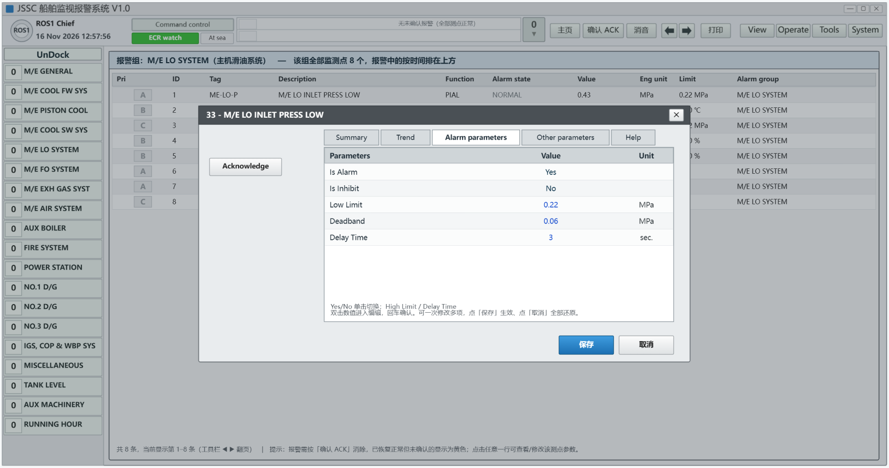
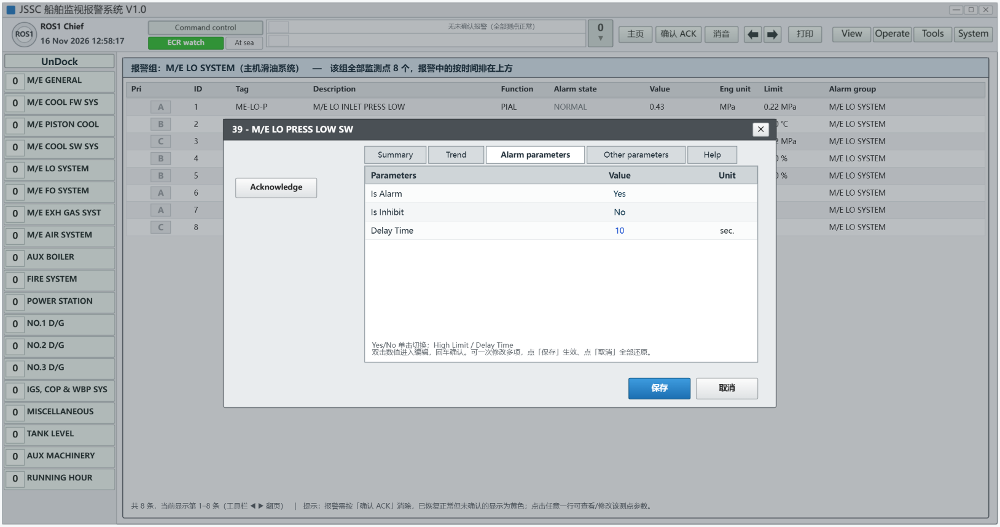
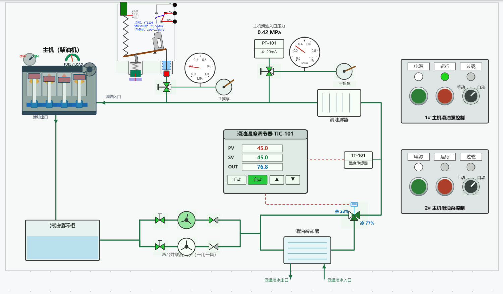
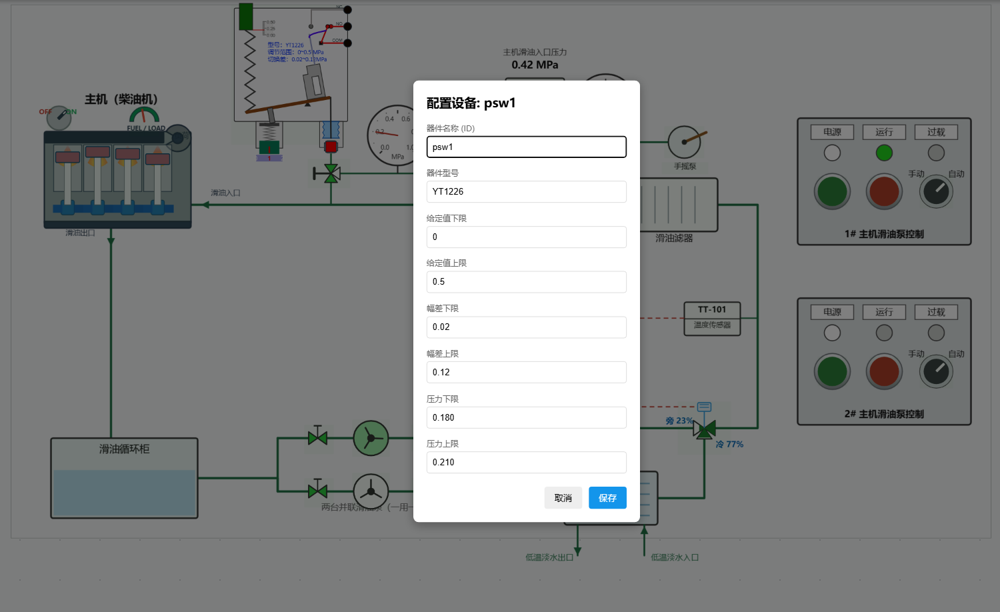

# 掌握船舶机舱监视报警系统的参数设置

本仿真以 Kongsberg **K-Chief 600** 机舱监视报警系统为原型。本文只讲两件事：**模拟量参数的修改与测试方法**、**开关量参数的修改与测试方法**。

---

## 一、模拟量参数的修改和测试方法

### 1. 调到参数界面

1. 第 1 页（报警系统主界面）左列点击报警组 **M/E LO SYSTEM**（主机滑油系统），右侧列出该组全部 8 个监测点；
2. **双击**测点信息条（如 `ME-LO-P 主机滑油进机压力`），弹出 **Tag properties** 参数界面；
3. 在 **Alarm parameters** 页修改参数（图 1）：测点原本是 **0.25 MPa／回差 0.02 MPa／延时 3 s**，本例把下限改成 **0.22 MPa**、回差改成 **0.06 MPa**，延时仍取 3 s。

| 参数 | 含义 | 原始值 | 本例改后 |
|---|---|---|---|
| Is Alarm | 该测点是否参与报警 | Yes | Yes（不变） |
| Is Inhibit | 是否闭锁（屏蔽报警，不影响实测值） | No | No（不变） |
| Low Limit | 报警下限（动作值） | 0.25 MPa | **0.22 MPa** |
| Deadband | 报警回差（死区） | 0.02 MPa | **0.06 MPa** |
| Delay Time | 越限需持续多久才报警 | 3 s | 3 s（不变） |

**改法**：Yes/No 单击即切换；数值项**双击**数值单元格进入编辑，输入后回车确认。可一次改多项，点 **保存** 生效，点 **取消** 全部还原。

### 2. 动作值与回差的判据

- **报警产生**：实测值低于 `Low Limit`（0.22 MPa），且连续超过 `Delay Time`（3 s）；
- **报警消除**：实测值回升到 `Low Limit + Deadband` = **0.28 MPa** 以上；
- **回差的作用**：实测值停在 0.22～0.28 之间时保持原状态，避免压力在设定值附近抖动造成报警反复出现／消失。

### 3. 测试方法（用 MIMIC 图模拟过程信号）

1. 切到第 5 页 **主机滑油系统 MIMIC**，点击 PT-101 下方的**三通转换阀手柄**，把压力传感器测量管路从主管路转到**手摇泵**；
2. 点手摇泵的 **−** 键（每点一次 −0.01 MPa）把压力降到 **0.21 MPa**；
3. 回到第 1 页，等 3 s 延时后：报警横幅出现该报警，未确认报警计数为 1，该行 A 级红色闪烁；
4. 再回 MIMIC 图点 **+** 键把压力升到 **0.29 MPa**（越过 0.28 MPa）；
5. 回到第 1 页：报警转为 **已恢复正常（未确认）**（黄色，行前显示 ⏎）；
6. 点工具栏 **确认 ACK**：报警从当前报警中消失，转入 **Alarm history**（报警历史）。

| 手摇泵压力 | 测量结果 |
|---|---|
| 0.30 → 0.21 MPa（< 下限 0.22） | 3 s 后报警（未确认，闪+鸣） |
| 0.25 MPa（回差带内） | 保持原状态，不消警 |
| 0.29 MPa（> 0.28 = 下限+回差） | 报警恢复正常，待确认 |
| 按「确认 ACK」 | 报警清除，记入报警历史 |

---

## 二、开关量参数的修改和测试方法

### 1. 开关量参数界面只有三项

双击 `ME-LO-PR-SW 滑油低压开关` 的信息条，可见开关量测点的参数界面**只有 Is Alarm、Is Inhibit、Delay Time**，没有设定值与回差（图 2）——因为开关量是触点信号，`Function` 固定为 `XA`，`Value` 只有 **1（动作即报警）／0（正常）** 两种。

把 **Delay Time 由 1 s 改为 10 s**：触点动作后必须持续 10 s 才报警，用于躲过触点瞬时抖动造成的误报。

### 2. 动作值与复位值在一次元件上调整

开关量本身没有设定值，动作值取决于采集它的**一次元件**——主机滑油入口处的 **YT1226 压力继电器**（MIMIC 图上方的机件，图 3）。

- 在压力继电器上**点右键 → 参数设置**，界面上可读 **压力下限 0.180 MPa（报警动作值）** 与 **压力上限 0.210 MPa（报警复位值）**（图 4）；
- 这两个是**算出来**的结果值，随螺钉位置变化，换算用的是配置界面上的四个量程框：
  - `压力下限 = 给定值下限 0 + （给定值上限 0.5 − 给定值下限 0）× 给定值 %`，即给定值 30 % → 0.15 MPa，36 % → 0.18 MPa；
  - `幅差 = 幅差下限 0.02 + （幅差上限 0.12 − 幅差下限 0.02）× 幅差 %`，即幅差 30 % → 0.05 MPa，10 % → 0.03 MPa；
  - `压力上限 = 压力下限 + 幅差` → 0.18 + 0.03 = **0.21 MPa**。
- 真正的调整靠机身两颗螺钉（**每格 2 %**），配置界面只是把结果读出来，看完点「取消」关闭——改配置框不等于调螺钉：
  - **给定值螺钉** 顺时针 3 格：30 % → 36 % ⇒ 下限 0.15 → **0.18 MPa**；
  - **幅差螺钉** 逆时针 10 格：30 % → 10 % ⇒ 幅差 0.05 → **0.03 MPa**，上限随之落到 **0.21 MPa**。

### 3. 测试方法

1. 点压力继电器下方的**三通转换阀**，把测量管路接到该侧的**手摇泵**；
2. 点 **−** 键把压力降到 **0.17 MPa**（低于下限 0.18）→ NC 触点闭合，开关量动作 = 1；
3. 回到第 1 页，等 **10 s** 延时后该测点报警（未确认）；
4. 回 MIMIC 图点 **+** 键把压力升到 **0.22 MPa**（高于上限 0.21）→ 触点复位，开关量 = 0；
5. 回到第 1 页，报警恢复正常，点 **确认 ACK** 复位并记入报警历史。

> 若把压力停在 0.18～0.21 MPa 之间（如 0.20 MPa），触点**保持原状态**——这就是幅差（回差）的作用。

### 4. 两类测点对照

| 项目 | 模拟量（ME-LO-P） | 开关量（ME-LO-PR-SW） |
|---|---|---|
| 参数界面 | 设定值 + 回差 + 延时 | 只有延时（无设定值、无回差） |
| 动作判据 | 实测值越限并持续延时 | 触点动作（=1）并持续延时 |
| 复位判据 | 越过「下限 + 回差」 | 触点复位（=0） |
| 实测值显示 | 工程量，如 0.43 MPa（随过程波动） | 1 / 0 |

> 两种操作流程可在界面工具栏「请选择操作项目…」中选择 **1. 模拟量参数的修改** 与 **2. 开关量参数的修改**，用「自动演示／单步演示／演练／评估」模式逐步练习。
