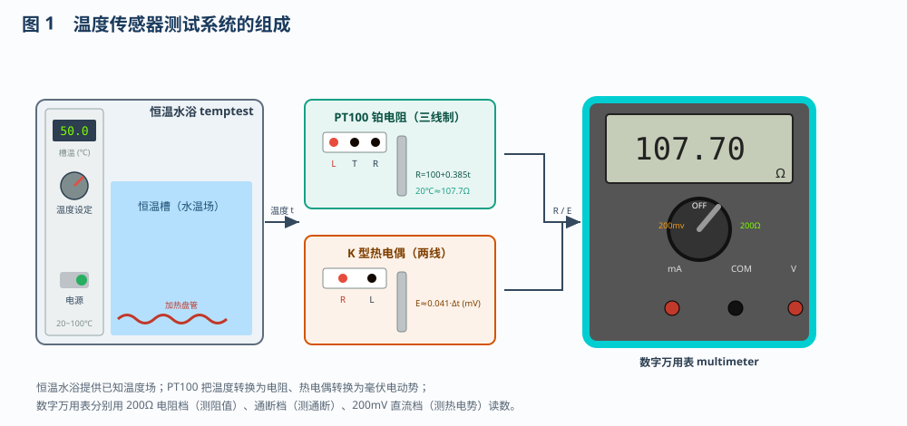
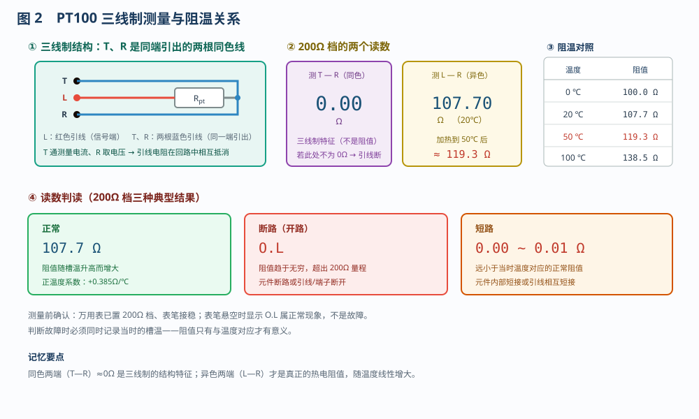
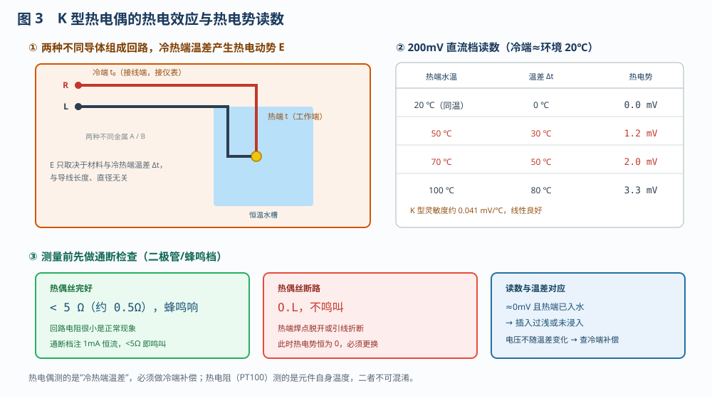
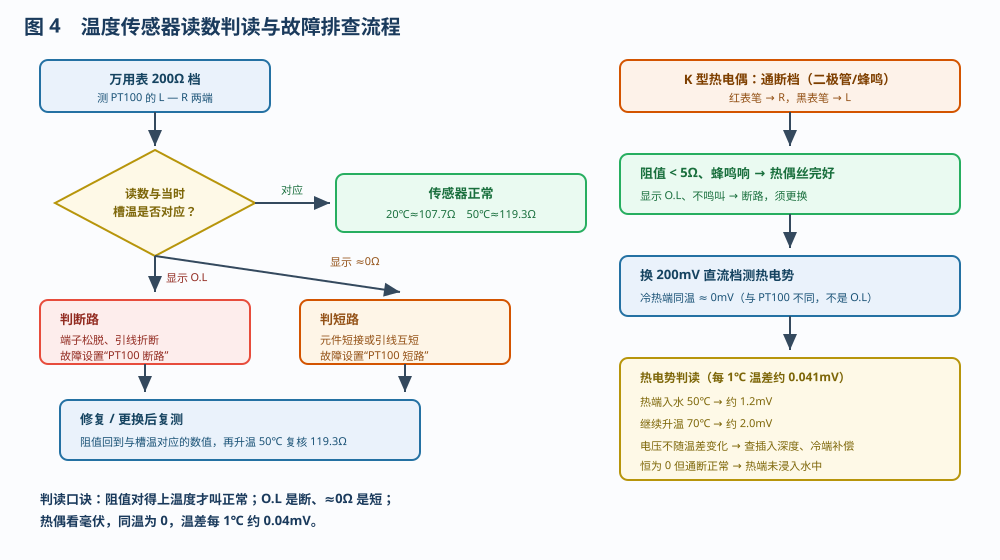

# 温度传感器的测试

> 适用对象：船舶电气 / 自动化专业　项目 7.1.1　温度传感器的测试
> 配套仿真含两条流程：**流程 1　PT100 温度传感器的测试（9 步）**、**流程 2　K 型热电偶的测试（6 步）**，
> 与平台"自动演示 / 单步演示 / 演练 / 评估"四种模式一一对应，可先看演示、再动手演练。

---

## 一、项目概述

温度是船舶机舱最基本的运行参数之一。温度传感器把温度转换成电参量后送仪表或监控系统，因此**传感器的好坏直接决定测温是否可信**。本项目的任务是用数字万用表对两种最常用的温度传感器做"体检"：

- **PT100 铂热电阻**：把温度转换为**电阻**，用万用表电阻档测量；
- **K 型热电偶**：把温差转换为**毫伏电动势**，用通断档和直流毫伏档测量。

通过两条流程，掌握"**先看结构（三线制）→ 再测通断 → 最后测特征值 → 用已知温度复核**"的检测方法，并能区分**正常 / 断路 / 短路**三种典型状态。

---

## 二、系统组成

| 元件 | 代号 | 作用与关键参数 |
|------|------|----------------|
| 恒温水浴 | `temptest` | 提供已知温度场（20～100℃）。旋钮设定温度、电源开关控制加热，LCD 显示实时槽温 |
| PT100 铂电阻 | `pt` | 三线制，L 为红色引线，T、R 为两根蓝色引线（同一端引出） |
| K 型热电偶 | `tc` | 两线：R 为正极、L 为负极；热端为测量端，冷端接仪表 |
| 数字万用表 | `multimeter` | 200Ω 电阻档测阻值、通断（二极管）档测通断、200mV 直流档测热电势 |

> 温度场是判断读数是否正常的**唯一基准**，所以每一步都要记录当时的槽温。

---

## 三、流程 1：PT100 温度传感器的测试（9 步）

### 3.1 测量原理

PT100 的阻值随温度线性增大：**R = 100 + 0.385 t**，0℃ 为 100Ω、20℃ 约 107.7Ω、50℃ 约 119.3Ω、100℃ 约 138.5Ω。三线制把同一端引出两根同色线（T、R）：仪表测 L—R 时，两根引线的电阻在回路中相互抵消，避免叠加到热电阻上造成正误差。因此：

- 测 **T—R（同色两端）≈ 0Ω**，这是三线制的结构特征，不是阻值；
- 测 **L—R（异色两端）= 当时温度对应的真实阻值**。

### 3.2 操作步骤

| 步 | 操作 | 正常现象 |
|---|------|---------|
| 1 | 从「选择仪表」调出万用表，旋钮拨到 200Ω 档 | 表笔未接显示 O.L |
| 2 | 红表笔接 T 端、黑表笔接 R 端，测同色两端 | 约 0.00Ω |
| 3 | 红表笔改接 L 端，测不同色两端（20℃） | 约 107.7Ω |
| 4 | 在「故障设置」中勾选「PT100 断路」并应用 | 读数溢出，显示 O.L |
| 5 | 取消勾选并应用，修复故障 | 恢复到约 107.7Ω |
| 6 | 勾选「PT100 短路」并应用 | 读数约 0.01Ω |
| 7 | 取消勾选并应用，修复故障 | 恢复到约 107.7Ω |
| 8 | 把探头插入恒温水槽 | 探头浸入水中 |
| 9 | 旋钮设定 50℃、合上电源加热 | 槽温升到 50℃，读数升至约 119.3Ω |

> 第 8、9 步是本项目的重点：**同一只传感器，温度变了阻值就变**。读数不随温度变化，说明探头没有真正浸入水中或传感器已损坏。

---

## 四、流程 2：K 型热电偶的测试（6 步）

### 4.1 测量原理

两种不同金属焊接成闭合回路，当**热端（测量端）与冷端（接线端）存在温差**时产生热电动势，这一现象称为**塞贝克效应**。K 型热电偶的灵敏度约 **0.041 mV/℃**，热电势只与材料和温差有关，与导线长短粗细无关。因此：

- 冷热端同温时热电势为 **0mV**；
- 热端插入 50℃ 水中（冷端约 20℃），温差 30℃ → 约 **1.2mV**；
- 升温到 70℃（温差 50℃）→ 约 **2.0mV**。

由于热电势只反映温差，仪表必须做**冷端温度补偿**才能显示出真实温度。

### 4.2 操作步骤

| 步 | 操作 | 正常现象 |
|---|------|---------|
| 1 | 万用表旋钮拨到通断（二极管/蜂鸣）档 | — |
| 2 | 红表笔接 R、黑表笔接 L，测热偶丝通断 | 阻值 <5Ω、蜂鸣器响 |
| 3 | 旋钮拨到 200mV 直流档 | 冷热端同温，约 0.0mV |
| 4 | 把热电偶探头插入恒温水槽 | 热端浸入水中 |
| 5 | 旋钮设定 50℃、合上电源加热 | 槽温 50℃，热电势约 1.2mV |
| 6 | 继续升温到 70℃ | 热电势增至约 2.0mV |

> 通断检查必须放在加温之前：热偶丝一旦断路，热电势恒为 0，容易误判成"没有温差"。

---

## 五、读数判读与故障处理

| 读数 | 判断 | 原因与处理 |
|------|------|-----------|
| 与槽温对应的阻值（107.7Ω / 119.3Ω） | 正常 | 可继续升温复核线性 |
| **O.L**（溢出） | 断路 | 元件断路、引线折断或端子松脱；修复/更换后复测 |
| **≈0Ω**（远小于正常值） | 短路 | 元件内部短接或引线互短；修复/更换后复测 |
| 热偶读数恒为 0mV 且通断正常 | 热端未浸入 | 检查插入深度，确认热端在水中 |
| 热偶电压不随温差变化 | 冷端补偿异常 | 检查仪表冷端补偿设置 |

> 提示：万用表表笔悬空时电阻档显示 O.L 属于正常现象，判断前务必确认表笔已接稳。

---

## 六、操作要点

1. **先断电源、后拆接线**，测电阻必须断开加热电源，禁止带电插拔表笔；
2. **先通断、后测值**：先确认回路完整，再测阻值或热电势；
3. **三线制不接错**：T、R 是同一端的同色线，接错会引入引线电阻误差；
4. **读数要与温度对应**：测阻值时同时记录槽温，否则无法判断正常与否；
5. **换件后要复核**：修复后复测阻值，再升温 50℃ 验证读数变化；
6. **热电阻与热电偶原理不同**：前者测自身温度（电阻），后者测温差（毫伏），不可混用判断标准。

---

## 七、思考与练习

1. PT100 在 0℃、20℃、50℃ 时的阻值各是多少？为什么测量时要同时记录水温？
2. 三线制中 T、R 两根同色线之间为什么会测量出约 0Ω？它对减小测量误差有什么作用？
3. 万用表电阻档测 PT100 显示 O.L 与显示 0.01Ω，分别说明什么故障？应如何处理？
4. 热电偶热端插入 50℃ 水中，冷端为 20℃，热电势约为多少毫伏？若插入深度不够会出现什么现象？
5. 为什么热电偶必须做冷端补偿，而 PT100 不需要？

---

*本文档依据本工程仿真平台的两条操作流程编写，与「自动演示」步骤一一对应，可作为温度传感器检测与故障判断的实训参考。*
