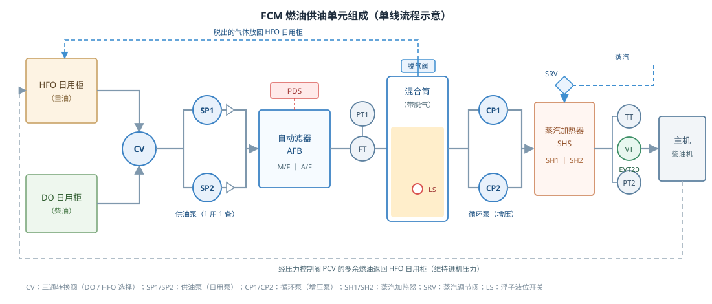
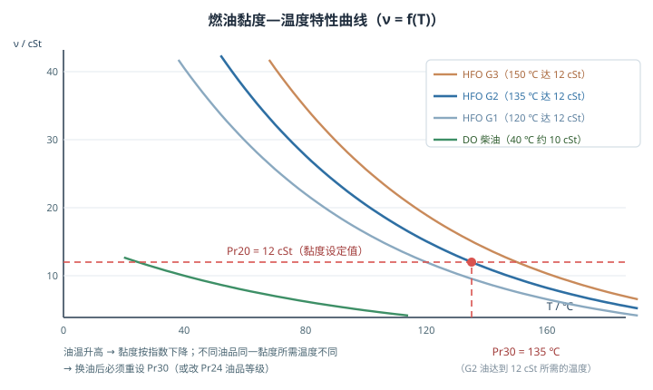
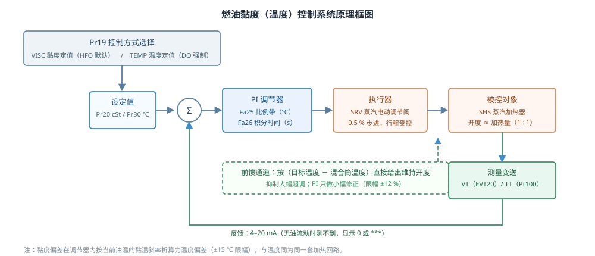
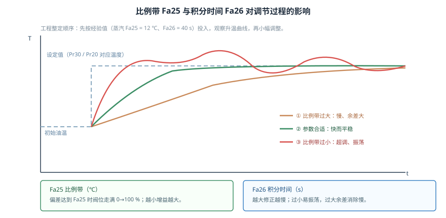
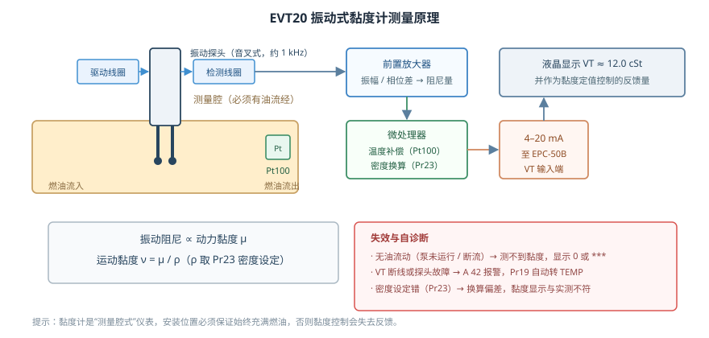
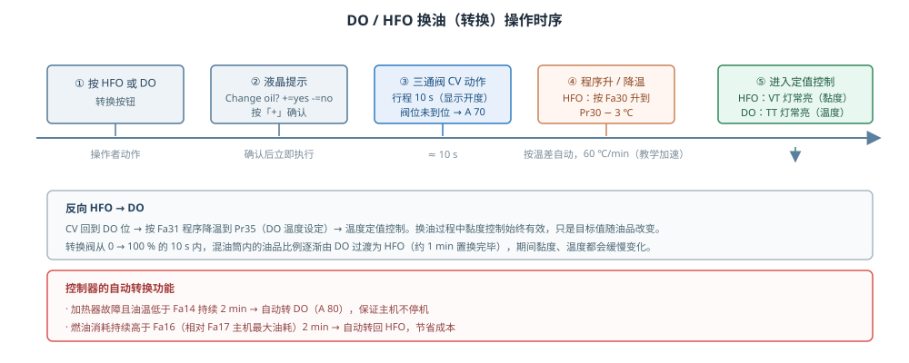
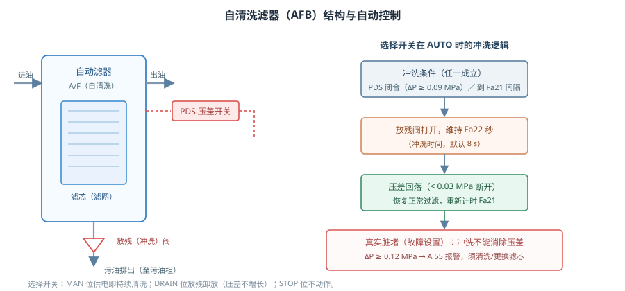
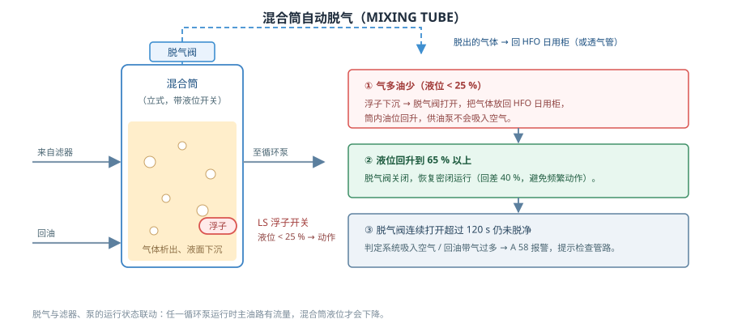

# 燃油黏度自动控制系统的功能测试

本工程按教材第六章第二节《燃油供油单元自动控制系统》搭建 FCM 燃油供油单元与 EPC-50B 控制器，
用于训练供油单元的组成识别、黏度（温度）自动控制、DO / HFO 转换、油泵运行与备用、
自清洗滤器与脱气自动控制，以及重要参数的查看与修改。画面单页同屏：上方为供油单元 P&ID，
下方为 EPC-50B 控制器（左为 OP 操作面板，右为油泵与加热控制箱）。

## 一、供油单元的组成

燃油供油单元是主机燃油系统的"最后一道工序"：把日用柜里的重油或柴油升压、过滤、
除去气体、加热到合适黏度，再按所需的压力和黏度送进主机高压油泵。

| 设备 | 代号 | 作用 |
|---|---|---|
| 重油 / 柴油日用柜 | HFO / DO TANK | 储存当天要用的燃油，柜内自带加热与保温 |
| 三通转换阀 | CV | 选择由 HFO 柜或 DO 柜向系统供油，换油时动作 |
| 供油泵（日用泵） | SP1 / SP2 | 从日用柜抽油，升压后经滤器送入混合筒，出口带单向阀，防止倒流与互为旁通 |
| 自动滤器 | AFB（M/F、A/F） | 滤除机械杂质；A/F 可不停油反冲洗，出口带压差开关 PDS |
| 流量 / 压力变送器 | FT / PT1 | 监视供油流量与供油泵出口压力 |
| 带脱气的混合筒 | MIXING TUBE | 缓冲容积、稳定压力、让气泡上浮并由脱气阀排出，内设浮子开关 LS |
| 循环泵（增压泵） | CP1 / CP2 | 把混合筒的油升压送进加热器，再送往主机，出口压力 PT2 |
| 蒸汽加热器 | SH1 / SH2 | 用蒸汽把燃油加热到所需温度，进汽量由蒸汽调节阀 SRV 控制 |
| 出口仪表 | PT2 / TT / VT | 测量进机压力、加热器出口温度与黏度（EVT20），是控制的反馈量 |
| 压力控制阀 | PCV | 维持进机压力恒定，多余燃油经回油管返回 HFO 日用柜 |

两台供油泵、两台循环泵都是"一用一备"并联布置（各带单向阀），任一台故障或出口压力不足时
备用泵自动投入，主机供油不中断。两台加热器同样的并联思路：SH1 与 SH2 各有燃油截止阀与
蒸汽截止阀，开几台、由哪台换热，决定总加热量。

为什么分成供油泵与循环泵两级？供油泵负责"从柜里取油"，只需克服滤器与管路阻力；
循环泵负责"把油以稳定压力送进主机"，进机压力要求高（PT2 约 0.9 MPa）。两级之间用混合筒
隔开，混合筒既缓冲了供油泵的脉动，也让两级的流量可以独立变化——主机负荷变化时，
循环泵的流量跟着变，而供油泵只按筒内液位断续运行，不必频繁调节。每台泵出口的单向阀
则是为了"备用泵不倒转、运行泵不向停运泵倒流"，这是并联泵组能自动切换的前提。

控制器 EPC-50B 由两大部分组成：**OP 操作面板**（流程图、INFO 信息区、黑底液晶、
−/+/ENTER 三键、START-STOP / HFO / DO / PROCESS INFO / OP ACTIVE / ALARM 六张白卡）与
**油泵与加热控制箱**（四台泵的 MAN / STOP / EPC / REM 选择开关与 MAIN SWITCH、自动滤器的
MAN / STOP / AUTO 选择开关、调节阀 MAN / EPC、DECR / INCR 增减旋钮、HEATING TRACING 0 / 1）。
控制器面板常带电，各泵由自身 MAIN SWITCH 送电；泵选择开关打 **EPC** 后，起动、停止、
切换备用全部由控制器按参数自动完成。

## 二、燃油黏度控制系统的工作原理

### 2.1 为什么控制的是黏度而不是温度

燃油进机前必须雾化良好，雾化质量取决于**黏度**（一般要求 12 cSt 左右）。而黏度与温度是
一条指数曲线关系：温度越高黏度越低，且**不同油品在同一条曲线上位置不同**——
同样 12 cSt，G1 油约 120 ℃、G2 油约 135 ℃、G3 油约 150 ℃（图 2）。柴油则是一条单独的曲线。

因此"控温度"只是间接手段：只要换了油品，同一温度对应的黏度就变了。EPC-50B 的做法是
**优先控黏度**：直接测量加热器出口黏度，用它闭环调节加热量；温度只作为程序升温阶段的
目标值，以及黏度传感器故障时的后备控制量。

### 2.2 两种工作模式（Pr19）

- **VISC 黏度定值控制**（`Pr19 = Visc`，HFO 默认）：设定值为 **Pr20**（cSt）。控制器按当前油温的
  黏温斜率把"黏度偏差"折算成"温度偏差"，再调节加热量；折算量限幅 ±15 ℃，避免油品变化时
  出现大范围温度摆动。
- **TEMP 温度定值控制**（`Pr19 = Temp`）：设定值为温度。**DO 模式强制为 TEMP**，设定值
  **Pr35**（默认 70 ℃）；**HFO + TEMP** 时设定值为 **Pr30**（默认 135 ℃）。

面板上的两只灯直接反映当前模式：稳定运行中 **TT 灯**常亮 = 温度定值控制，**VT 灯**常亮 =
黏度定值控制。换油或程序升 / 降温期间两只灯按"正在过渡"显示：HFO 侧 TT 保持常亮、黏度定值
模式下 VT 闪烁；DO 侧 TT 闪烁。转入黏度控制后 VT 灯转为稳定常亮，这是"换油完成"最直观的标志。

两种模式的切换要注意三点：① 切换只在**控制算法层面**换设定值与反馈量，加热回路、
调节阀、泵的运行都不变，因此切换可以随时进行，不会中断供油；② 从黏度控制切到温度控制
时，温度设定值应取"当前黏度对应的温度"（即 Pr30），否则会出现大幅升降温；
③ VT 故障时控制器强制转 TEMP 只是应急手段，报警仍需处理，否则主机燃油品质失去监视。

### 2.3 调节过程：前馈 + 小增益修正

燃油加热是一个大惯性、大滞后的环节（加热器热惯性约 25 s，混合筒更大）。若只用普通 PI，
升温慢、超调大。本系统采用：

1. **前馈（主通道）**：按"目标温度 − 混合筒温度"直接算出维持该温度所需的阀位，
   相当于先给出一个大致正确的开度，避免慢慢"试"；
2. **小增益修正（辅助）**：偏差超出死区（温度定值 ±1.0 ℃；黏度定值按黏温斜率折算后
   等效 ±0.5 ℃）后，按 **Fa25 比例带**折算的比例增益缓慢修正阀位，修正量限幅 ±12 %，
   消除余差而不会引起振荡；
3. **执行器限速**：SRV 是电动调节阀，开度只能按 0.5 % 步进变化，不会突变；
   加热量由蒸汽阀开度 1 : 1 给出（开度 100 % 约对应 100 ℃ 温升）。

于是"升温—进入死区—稳定保持"的过程是平滑的：程序升温阶段按 **Fa30**（HFO，默认 60 ℃/min）
或 **Fa31**（DO / 降温）走设定曲线，到达 Pr30 − 3 ℃ 后自动转入定值调节，再由黏度闭环
把黏度稳定在 Pr20。

一个完整的自动控温过程大致是这样（仿真时间）：

| 阶段 | 现象 | 历时 |
|---|---|---|
| 按下 START/STOP 并「+」确认 | 泵按 Pr1 / Pr2 起动，PT1 约 0.6 MPa、PT2 约 0.9 MPa | 10~20 s |
| DO 温度定值 | 出口油温由筒温升到 Pr35（70 ℃），TT 灯亮 | 约 20 s |
| 按换油按钮 +「+」 | CV 从 DO 位走到 HFO 位，流程图显示开度 | 10 s |
| 程序升温 | 按 Fa30 从 70 ℃ 升到 Pr30 − 3 = 132 ℃ | 约 1 min |
| 转黏度定值 | 黏度稳定在 Pr20（12 cSt），VT 灯常亮 | 数十秒内稳定 |

### 2.4 报警与保护

- **A 40 黏度高**：实测黏度 > Pr20 × 1.18，延时 **Fa8**；**A 41 黏度低**：< Pr20 × 0.82。
- **A 42 VT 故障**：黏度信号失效，液晶显示 `***`，控制器自动把 Pr19 改为 TEMP
  （提示 W 75"转换控制模式"），先保证主机不停机。
- **A 53 TT 故障**：温度信号失效，同样失去闭环依据，须尽快处理。
- **A 50 / A 51 温度高 / 低**、**A 82 SRV 卡死**、**A 87 电源故障**等按教材表 6-2-3 处理。
- 程序升温斜坡期间，低黏度 / 低温类报警被屏蔽，避免升温途中误报。

常见报警的原因与处理思路如下：

| 报警 | 含义 | 常见原因 | 处理 |
|---|---|---|---|
| A 40 / A 41 | 黏度高 / 低 | 加热量不足或过大、VT 污染、Pr20 设定不当 | 查 SRV 开度与蒸汽压力，必要时重新整定 Fa25 / Fa26 |
| A 42 | VT 故障 | 探头结焦、断线、信号丢失 | 系统自动转温度控制；清洗或更换探头后恢复 Pr19 |
| A 53 | TT 故障 | Pt100 断线、接线松动 | 检查温度通道，必要时按定值手动加热 |
| A 55 | 滤器压差高 | 滤芯真脏堵 | 切 MAN 冲洗无效则换滤芯 |
| A 56 / A 57 | 供油 / 循环压力低 | 泵故障、阀未开、吸入空气 | 查截止阀与泵运行状态，备用泵是否已投入 |
| A 58 | 脱气超时 | 吸入空气过多、回油带气 | 查吸入口密封、日用柜液位与回油管路 |

## 三、黏度计（EVT20）的工作原理

EVT20 是装在加热器出口的**在线振动式黏度计**。它的测量腔里有一根音叉状振动探头，
由驱动线圈以约 1 kHz 的固有频率维持振动；燃油流过时，油的黏度对振动产生阻尼——
**黏度越大，振幅衰减越快、维持振动所需的激励功率越大（相位差也越大）**。仪表把激励量
换算成**动力黏度 μ**，再除以密度 ρ 得到**运动黏度 ν = μ / ρ**（单位 cSt），
密度由参数 **Pr23**（默认 0.99 kg/L）给出。腔内另装 Pt100 测温元件，用于温度补偿与
温度信号输出。

使用要点：

1. **必须有油流经测量腔**。泵未运行或断流时，仪表测不到黏度，液晶显示 0 或 `***`，
   此时黏度控制无法进行——这也是"先起泵、后投控制"的原因；
2. **密度设定必须与油品相符**。Pr23 错，换算出的运动黏度就偏，黏度显示与化验值对不上；
3. 传感器故障（断线、探头污染、结焦）时控制器报 **A 42** 并自动转为温度定值控制，
   属于典型的"失效安全"设计；
4. 输出为标准 **4–20 mA** 信号送 EPC-50B 的 VT 输入端，与 TT 的 Pt100 信号一起参与控制与显示。

安装与维护上还有几点值得注意：

- 黏度计应装在**加热器出口、压力稳定的直管段**，前后留出足够直管，避免涡流与气泡影响测量；
- 探头表面结焦、结漆会明显改变振动阻尼，表现为"黏度显示偏高、越调越热"，应定期拆检清洗；
- 更换油品后除改 Pr30 外，还要同步 **Pr23 密度**与 **Pr24 油品等级**，Pr24 直接决定黏温曲线的
  位置（G1 / G2 / G3 分别对应 120 / 135 / 150 ℃ 达到 12 cSt），Pr23 则影响运动黏度的换算；
- 传感器与导线要做屏蔽与接地，信号线与动力线分开走，否则 4–20 mA 上容易叠加干扰。

## 四、综合控制功能

### 4.1 DO / HFO 切换（换油）

1. 按 OP 面板的 **HFO / DO 转换按钮**（同一个按钮，按当前油品取反）；
2. 液晶显示 `Change oil?`，下面一行 `+=yes  -=no`，按「**+**」确认（按「−」取消）；
3. 三通阀 CV 从当前位走到目标位，**行程 10 s**，面板流程图与液晶同步显示开度；
   阀位没到位则报 **A 70**，本次换油取消、保持原油品；
4. 阀到位后进入**程序升温 / 降温**：转 HFO 时按 Fa30 升温到 **Pr30 − 3 ℃**；
   转 DO 时按 Fa31 降温到 **Pr35**；
5. 温度到位后转换完成：HFO 进入黏度定值控制（VT 灯常亮），DO 进入温度定值控制（TT 灯常亮）。

转换阀动作的 10 s 内，混油筒里油品比例随阀位逐渐变化，约 1 min 置换完毕；
这段时间黏度与温度都会缓慢漂移，属于正常现象。

换油操作有三点经验：① 换油前先把温度/黏度控制投入正常，否则阀动作期间无人调节加热量；
② 转 HFO 时升温和黏度上升同时发生，若黏度长时间偏高（A 40），应检查 Pr30 是否与实际油品相符；
③ 转 DO 时温度下降快、黏度下降也快，程序降温完成后务必确认已转为温度定值（TT 灯常亮），
否则仍按黏度控制会在低温柴油上反复调节。控制器还有两种**自动转换**：
加热器故障且油温低于 **Fa14** 持续 2 min → 自动转 DO（A 80）保证不停机；
燃油消耗持续高于 **Fa16**（相对主机最大油耗 Fa17）2 min → 自动转回 HFO 以节省成本。

### 4.2 自清洗滤器（AFB）自动控制

滤器脏了以后进出口压差升高，由压差开关 **PDS** 反映：ΔP ≥ 0.09 MPa 闭合（流程图变红），
ΔP ≤ 0.03 MPa 断开（回差 0.06 MPa，防止频繁动作）。

- **AUTO 位**：满足"PDS 闭合"或"到达冲洗间隔 **Fa21**"任一条件 → 放残阀打开，
  维持 **Fa22** 秒（默认 8 s）→ 压差回落后恢复过滤，重新计时；
- **MAN 位**：只要供电就持续清洗；**DRAIN 位**：手动放残卸放；**STOP**：不动作；
- 若压差继续升高到 **ΔP ≥ 0.12 MPa**，说明是**真脏堵**（滤芯堵死），冲洗已无效，
  报 **A 55**，须清洗或更换滤芯——仿真中通过"故障设置"里的"自动滤器脏堵"复现。

自动冲洗的意义在于：不停油、不拆滤器就能把滤网表面的污物冲进放残管，减少人工维护。

### 4.3 自动脱气

燃油在升压、节流、加热过程中会析出空气与油气，气泡进入主机高压油泵会造成供油中断。
混合筒利用"容积变大、流速变慢"让气泡上浮，顶上装脱气阀与浮子开关 LS：

- 气多油少 → 液位降到 **25 %** 以下 → LS 动作 → 脱气阀打开，气体放回 HFO 日用柜，
  液位回升；
- 液位回到 **65 %** 以上 → 脱气阀关闭（回差 40 %，避免频繁动作）；
- 脱气阀连续打开 **120 s** 仍未脱净 → 判定吸入空气过多，报 **A 58**。

混合筒液位还参与泵的联锁：液位 ≥ 80 % → 停止发出供油泵起动信号（防止跑油）；
回落到 ≤ 50 % 才恢复；≤ 30 % → 主动发出起动信号（按 Pr1 选泵补油）。
筒内油压由液位高度决定（50 % ≈ 0.45 MPa），与供油泵出口压力是两回事。

### 4.4 油泵运行与备用

泵选择开关打 **EPC** 后，控制器按 **Pr1**（供油泵）与 **Pr2**（循环泵）决定"谁运行、谁备用"：
`1` / `2` 单泵运行，`12` / `21` 一用一备。运行泵故障（A 56 / A 57）、出口压力低于
**Pr11** 经 **Fa9** 延时确认，或泵已停机且压力消失，备用泵在数秒内自动投入；
各泵起动按 **Fa10** 间隔错开，避免同时起动造成电网与管路冲击。

## 五、重要参数解读

下表中**加粗的六项**（Pr1、Pr19、Pr20、Pr30、Fa25、Fa26）是本系统最常用、也最容易设错的参数，
其余为配合使用时需要了解的关联参数。

| 参数 | 名称 | 典型值 | 含义与使用要点 |
|---|---|---|---|
| **Pr1** | 供油泵运行方式 | 12 | `1` 1 号运行 / `2` 2 号运行 / `12` 1 号运行 2 号备用 / `21` 反之。液晶显示 `1(2)`、`2(1)` 表示"运行(备用)"。改 Pr1 会立即重置备用状态，从新的主泵开始 |
| **Pr2** | 循环泵运行方式 | 12 | 同上，只管循环泵组。与 Pr1 配合实现两套泵组的检修轮换 |
| **Pr19** | 控制方式 | Visc | `Visc` 黏度定值（HFO 默认）/ `Temp` 温度定值。DO 模式强制 TEMP；VT 故障时自动转 TEMP |
| **Pr20** | 黏度设定值 | 12 cSt | 黏度控制的设定值；A 40 / A 41 的报警阈值以它为基准（×1.18 / ×0.82） |
| **Pr30** | HFO 目标温度 | 135 ℃ | 与 Pr20 对应：该油品达到设定黏度所需温度；程序升温目标为 Pr30 − 3 ℃。改 Pr24 油品等级会连带更新 |
| **Pr35** | DO 温度设定 | 70 ℃ | 柴油模式的温度定值；反向换油时程序降温的目标 |
| Pr11 | 出口压力下限 | 0.15 MPa | 供油泵出口压力低于此值并经 Fa9 确认 → 备用泵投入 / A 56 |
| Pr23 | 燃油密度设定 | 0.99 kg/L | 供黏度计把动力黏度换算成运动黏度，必须与油品相符 |
| Pr24 | HFO 油品等级 | 2 | 1 / 2 / 3 对应 120 / 135 / 150 ℃ 达到 12 cSt，改变会联动更新 Pr30 |
| Pr32 | HFO 低温限制 | 90 ℃ | 重油温度低于该值报警（A 51），防止低温黏度过高 |
| **Fa25** | 蒸汽比例带 | 12 ℃ | 偏差达到 Fa25 时阀位从全关走到全开，即比例增益 ≈ 100 %/Fa25。**越小越灵敏、越大越平稳** |
| **Fa26** | 蒸汽积分时间 | 40 s | 教材中用于消除余差：越小修正越快、易振荡；越大越稳、余差消除慢。本教学仿真的积分修正按固定系数实现（见第七节），实调时以 Fa25 的作用最明显 |
| Fa21 / Fa22 | 滤器冲洗间隔 / 时间 | 2 min / 8 s | AUTO 位定期冲洗的周期与放残时长 |
| Fa30 / Fa31 | HFO / DO 温升速率 | 60 ℃/min | 程序升（降）温速率，教学仿真为便于观察取得较快 |
| Fa8 / Fa9 | 报警延时 / 压力确认延时 | 30 s / 6 s | 防止瞬时扰动误报警、误投备用泵 |

参数通过 OP 面板查看与修改：主画面按 **ENTER** 进菜单 → 选「参数设置」再按 **ENTER**
进参数页 → 用「+」「−」选参数 → 按 **ENTER** 进入修改模式（数值后出现 `*`）→
用「+」「−」改值 → 再按 **ENTER** 保存（回到菜单）。改完可按「+」选「返回主画面」退出。

理解 Fa25 与 Fa26 的关键是分清两件事：**比例带管"偏差有多大时给多大开度"**，
积分时间管"余差要多久消掉"。例如油温比设定低 6 ℃、Fa25 = 20 ℃ 时，比例作用只要求
约 30 % 的阀位；把 Fa25 改成 6 ℃，同样 6 ℃ 偏差就要求 100 % 阀位——调节更猛，
升温更快，但更容易超调甚至振荡。

参数之间还有联动关系，修改时要一起考虑：

- **Pr20 ↔ Pr30 ↔ Pr24**：Pr20 是"要多少黏度"，Pr30 是"该黏度对应多少温度"，Pr24 决定
  黏温曲线的位置。改 Pr24 会连带把 Pr30 更新为该油品的特征温度；若只改 Pr20 而不改 Pr30，
  程序升温的目标就与实际需要的温度不匹配，转换完成时会出现一段较长的黏度修正过程。
- **Fa25 ↔ Fa26**：比例带决定"反应强度"，积分时间决定"消除余差的耐心"。一般先按经验值
  （Fa25 = 12 ℃、Fa26 = 40 s）投入，若温度长时间回不到设定且阀位已到顶，说明热量不足
  （不是参数问题）；若曲线反复越过设定值，则先加大 Fa25，再加大 Fa26。
- **Fa30 ↔ Pr32**：升温太快时加热器与管路的热应力大，且容易冲过目标温度；Pr32 是重油的
  低温限制，温度低于它按 A 51 报警，因此 Pr30 必须高于 Pr32。

## 六、操作流程

1. **供油单元的组成与 EPC-50B 的认识**：逐项识别 P&ID 设备与面板部件；
2. **供油单元手动操作**：开截止阀、合主开关、泵打 MAN 起泵、调节阀打 MAN 用 DECR / INCR 加热；
3. **供油单元自动控制和换油操作**：开阀上电 → 泵与调节阀投 EPC → START/STOP（+ 确认）→
   泵自动起动、DO 温度定值 70 ℃ → 按换油按钮（+ 确认）→ 程序升温 → 转入黏度定值，VT 灯常亮；
4. **供油单元的故障处理**：正常投运 → 换油到 HFO → 设"1 号供油泵故障"看备用泵投入 →
   设"VT 故障"看自动转温度控制 → 修复故障并复位报警；
5. **重要参数的设置**：起动系统 → 把 Pr2 改为 2(1) → 把 Pr19 由 VISC 改为 TEMP →
   把 Fa25 改为 20 ℃ → 测试题理解比例带含义。

## 七、仿真说明

- 为便于课堂观察，温升速率取 Fa30 / Fa31 = 60 ℃/min（真实装置升温速率远低于此值，
  一般只有每分钟几度），参数含义与报警阈值仍按教材设置；
- 阀位、压力、黏度、液位均为实时计算量：阀门没开、泵没转、没有油流，仪表就读不到值；
- 故障一律在工具栏「故障设置」中勾选/取消，修复故障后还需按 **ALARM** 两次
  （先确认、再清除历史记录），报警灯才会熄灭；
- 报警记录页可用「+」「−」在多条活动报警之间翻页查看；
- 加热量的修正按 Fa25（比例带）折算，积分项在教学仿真中取固定系数（相当于约 20 s 的积分时间），
  因此改 Fa26 曲线变化不明显——课堂上要演示"整定效果"，调 Fa25 最直观；
- 参数页另列 Pr10（泵起动间隔），实际错开起动使用的是程序内部的 Fa10（默认 1 s）。
