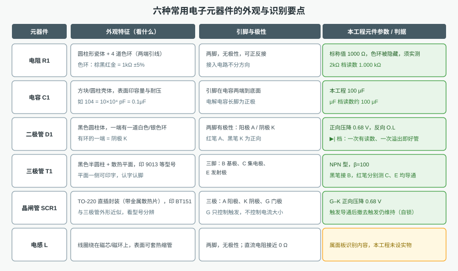
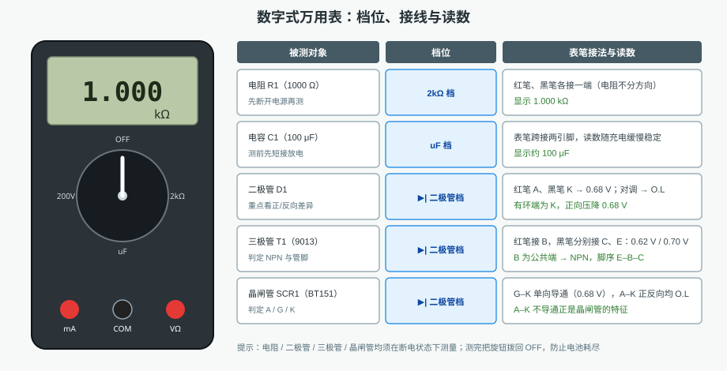
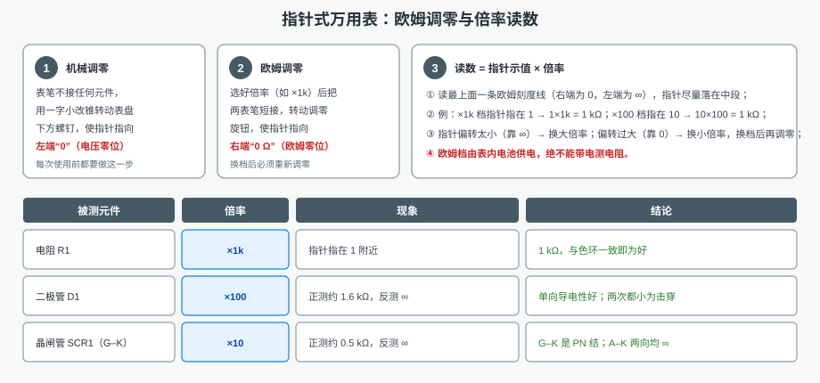
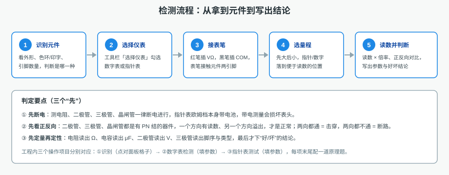

# 电子元器件识别与测试仿真

本工程训练"**认器件 → 选仪表 → 会测量 → 读得出读数**"这条最基本的电工电子技能链。
画布左侧摆着 5 只**真实外形**的元件（电阻、电容、二极管、三极管、晶闸管），
右侧是**电子元器件面板**（6 格实物照片）；工具栏「选择仪表」可调出数字万用表、
指针式万用表、兆欧表等 7 种仪表。全部内容同屏显示，不需要翻页。

元件上的**数值标签默认被隐藏**（`testFlag`），也就是说：想知道它到底是多少，
只能拿表去测——这是本工程全部操作项目的前提。

## 一、六种常用元器件的识别

识别的顺序是固定的三步：**看外形 → 找标识 → 数引脚**。

| 器件 | 关键标识 | 引脚/极性 |
|---|---|---|
| 电阻 | 圆柱体 + 4 道色环 | 两脚无极性，色环读标称值 |
| 电容 | 方块/圆柱壳体，印容量与耐压 | 电解电容长脚为正极 |
| 二极管 | 黑色圆柱 + 一道白色环 | **有环端为阴极 K**，有极性 |
| 三极管 | 半圆柱 + 平面，印 9013 等型号 | B、C、E 三脚 |
| 晶闸管 | TO-220 带散热片，印 BT151 | A（阳极）、K（阴极）、G（门极） |
| 电感 | 线圈绕在磁芯/磁环上 | 两脚无极性，直流电阻≈0Ω |

初学者的典型错误是把**三极管和晶闸管看混**：两者外壳几乎一样，只能靠印字（9013 与 BT151）分辨；
另一个错误是**把二极管的方向搞反**，记住"环 = 阴极 = 电流流出的那一端"即可。

## 二、用数字式万用表检测

数字表的用法可以概括为"**一表笔一档位**"：

1. **插表笔**：红笔插 `VΩ`（第三个插孔），黑笔插 `COM`（中间插孔）。插错孔是第一批故障。
2. **选档位**：测什么选什么档——电阻用 Ω 档（本工程用 **2kΩ** 档读 1.000 kΩ）、
   电容用 `uF` 档、二极管/三极管/晶闸管一律用 **▶|（二极管）档**。
3. **接元件**：两表笔跨接被测元件的两个引脚，读数稳定后再记录。
4. **判好坏**：二极管、三极管、晶闸管必须**正反各测一次**——一正一反才对；
   正反都导通是击穿，正反都不通是断路。

| 被测件 | 档位 | 正常读数 |
|---|---|---|
| R1 | 2kΩ | 1.000 kΩ |
| C1 | uF | 约 100 μF（跨接后要等约 3 s 充电，读数才稳定） |
| D1 | ▶\| | 红笔接 A、黑笔接 K：0.68 V；对调：O.L |
| T1 | ▶\| | **红笔接 B**，黑笔接 C、E：0.62 V / 0.70 V（NPN，脚序 E-B-C） |
| SCR1 | ▶\| | 红笔接 G、黑笔接 K：0.68 V；A–K 两向均 O.L（未触发不导通） |

> 数字表的"红笔 = 内部电源正极"，所以判 NPN 时**红笔接基极 B**、黑笔点 C/E 都有压降；
> 指针表正好相反（黑笔才是内部电池正极），见下一节。

## 三、用指针式万用表测试

指针表比数字表多**两道调零**，这是考核的重点：

1. **机械调零**：表笔空置，转表盘下方螺钉，让指针停在左端电压零位。
2. **欧姆调零**：选好倍率后把两表笔**短接**，转调零旋钮让指针指向右端 `0 Ω`。
   **每换一次倍率都要重新调零**，否则读数系统性偏高或偏低。
3. **读数 = 指针示值 × 倍率**：欧姆刻度是**右小左大、非线性**的，指针要尽量落在中段；
   ×1k 档指在 1 即 1 kΩ，×100 档指在 10 也是 1 kΩ。
4. **指针表欧姆档自带电池**，绝不允许带电测电阻；测完拨回 OFF 或最高电压档。
5. **指针表没有电容档**：测不出容量，只能读电容壳体印字，或改用数字表的 uF 档。

## 四、三个操作项目

| 项目 | 任务 | 考核点 |
|---|---|---|
| 1. 电子元器件的识别 | 在元件面板上依次点出电阻、三极管、晶闸管、电容、二极管 | 能否按外形与印字准确分辨 |
| 2. 用数字式万用表检测元件 | 选表 → 拨档 → 接表笔 → 读数，逐个测出阻值、容量、压降、类型与脚序并填写 | 档位选得对不对、正反向都测了没有 |
| 3. 用指针式万用表测试元件 | 选表 → 换倍率 → **两表笔短接调零** → 接表笔 → 读数，同上填写 | 机械/欧姆两道调零、换档重调、倍率换算 |

两个检测项目的自动演示都是按真实操作顺序走的：**工具栏「选择仪表」→ 勾选仪表 → 表笔逐根接到被
测元件引脚（动画接线）→ 转动档位旋钮 → 等读数稳定 → 再填空**。所以在演示里看到的读数，与练习时
自己动手测到的完全一致（R1 1000 Ω、C1 100 μF、D1 0.68 V/O.L、T1 0.62 V/0.70 V、SCR1 G–K 0.68 V）。
指针表项目额外演示"换档后零点漂移，必须重新短接调零"这一关键动作（不调零时 1 kΩ 会被读成约 1.4 kΩ）。

每个项目末尾配一道原理题，例如"电阻与电容各有什么用途""二极管与三极管各有什么特性"
"晶闸管为什么撤去触发信号仍能维持导通"，用来检查是否真的理解了器件的电气特性。

## 五、常见错误与安全提醒

- **带电测电阻**：数字表会得到乱七八糟的读数，指针表可能烧表头。
- **不调零 / 换档不重调**：指针表读数整体偏移，属于"看起来会、其实不会"。
- **档位选得太小**：超量程显示 `O.L`（或指针甩到底），必须换大档；也别一味用最大档，
  指针偏转太小同样读不准。
- **用万用表电阻档判断三极管类型时接错公共脚**：NPN 的公共端是 **B**（黑笔），
  PNP 反过来，接错会把型号判反。
- 测完把元件放回原位、仪表旋钮回到 OFF，养成"人走表归零"的习惯。
