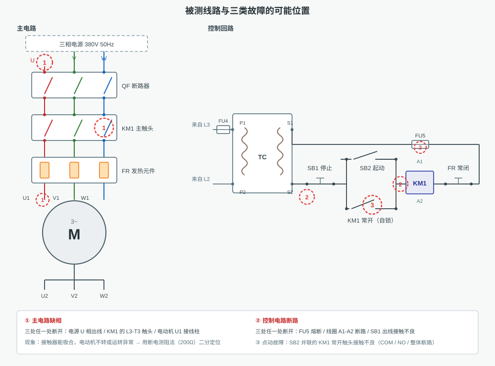
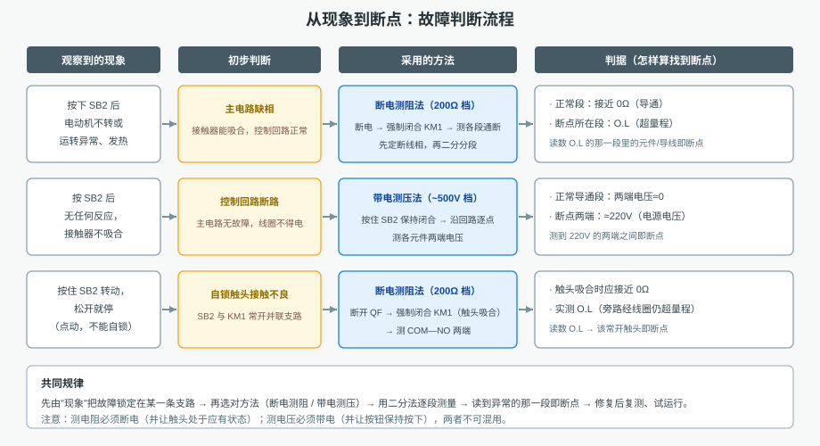
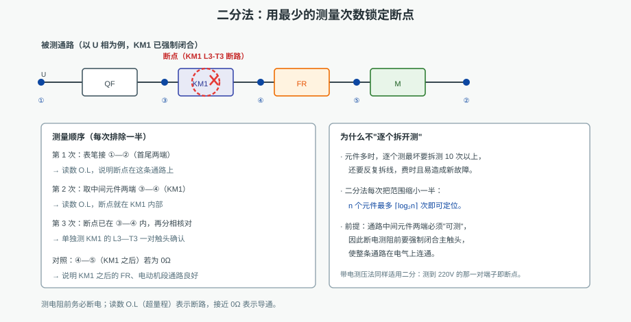
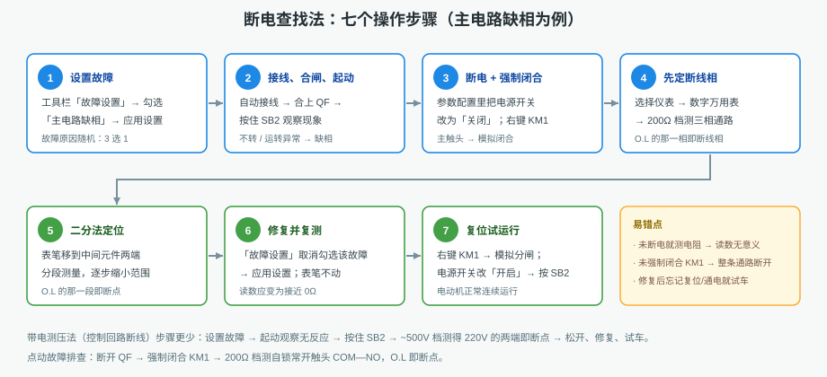

# 电气控制箱故障判断、排查

本工程训练的是**故障诊断**这条技能链：由现象判断故障部位 → 选对测量方法 → 用二分法逐段测量定位断点 →
修复后复测、试运行。被测对象是一条三相笼型异步电动机的连续（自锁）控制线路，右侧配控制箱实物图。
全部元件同屏显示，不需要翻页。

## 一、被测线路与三类故障

主电路：电源 U/V/W → 断路器 **QF** → 接触器主触头 **KM1** → 热继电器发热元件 **FR** → 电动机 **M**。
控制回路：由 L3 经 **FU4** 送控制变压器 **TC**（380/220V），副边依次串联
**SB1**（停止，常闭）→ **SB2**（起动，常开）∥ **KM1 常开辅助触头** → 线圈 **KM1** → **FR 常闭触头** → **FU5**。

| 编号 | 故障 | 现象 | 判断依据 |
|---|---|---|---|
| ① | 主电路缺相 | 按 SB2 后电动机不转或运转异常、发热 | 接触器能吸合，控制回路正常 |
| ② | 控制电路断路 | 按 SB2 毫无反应，接触器不吸合 | 主电路无异常，线圈不得电 |
| ③ | 点动运行故障 | 按住 SB2 转、松开即停 | 自锁支路（SB2 ∥ KM1 常开）不通 |

每个故障都设 3 种可能原因（如缺相可能是 KM1 的 L3-T3 断路、电动机 U1 接线柱接触不良、电源 U 相出线接触不良），
**随机**触发。所以必须靠测量判断，不能凭"一般是哪里"下结论——这是本工程最重要的教学意图。

## 二、两种基本测量方法与判据

**断电测阻法**（万用表电阻档，如 200Ω）：必须**切断电源**，并让触头处于应有状态（测主电路通路时先强制闭合 KM1）。
正常导通的导线与闭合触头接近 **0Ω**；断点所在段读数 **O.L**（超量程）。

**带电测压法**（万用表交流电压档，如 ～500V）：必须**带电**，并让按钮保持按下（如按住 SB2）。回路只有一个断点时回路无电流，
正常导通段两端电压约 **0V**，断点两端一边为 0V、一边为电源电压，故读数约 **220V**（控制变压器副边）。

两条铁律：**测电阻必须断电，测电压必须带电**；两种方法不能混用，否则读数没有意义。

## 三、二分法：最少的测量次数

1. 先测通路**首尾两端**：导通 → 该支路正常；O.L → 断点在此支路内。
2. 取**中间元件**两端分段测量（如 KM1 的 L3-T3）：不通 → 断点在前半段；通 → 断点在后半段。
3. 反复对半缩小范围，`n` 个元件最多 `⌈log₂n⌉` 次即可定位。

比"逐个拆下元件测量"快得多，也不易因反复拆线造成新的接触不良。

## 四、三个操作项目

| 项目 | 要点 |
|---|---|
| 1. 主电路缺相—断电查找法 | 设置故障 → 接线合闸起动观察 → 断电并强制闭合 KM1 → 200Ω 档先定断线相 → 二分定位 → 修复复测 0Ω → 复位通电试车 |
| 2. 控制电路断线—带电查找法 | 设置故障 → 起动无反应 → 按住 SB2 → ～500V 档测得约 220V 的两端即断点 → 松开、修复、试车 |
| 3. 电动机点动—断电查找法 | 设置故障 → 松开即停 → 断开 QF、强制闭合 KM1 → 200Ω 档测自锁触头 COM—NO 为 O.L → 修复后自锁运行 |

辅助操作：工具栏「自动接线」（主回路 14 根 + 控制回路 11 根，共 25 根）、「起动系统」（接线 + 合闸）、
「5 点步进」（接线 → 合闸 → 起动 → 停止 → 分闸）；「选择仪表」调出万用表等仪表；
右键组件可「模拟闭合 / 模拟分闸」「参数配置」（改电源开关、整定值等）。系统初始化**不预接线**。

## 五、易错点

1. 未断电就测电阻——读数是被电源"污染"的，毫无意义。
2. 测主电路通路时未强制闭合 KM1——整条通路本就是断的，测什么都像断点。
3. 带电测压时没有按住 SB2——回路多了一处断点，各处电压都不等于电源电压。
4. 修复后忘记复位 KM1（模拟分闸）或忘记把电源开关改回"开启"，试车仍不转。
5. 只看现象就下结论——同一现象有 3 种可能原因，必须测量确认。

## 六、演示与考核

- **自动演示**：按流程逐个"箭头指向部件/端口 → 执行操作 → 停留观察"，故障设置走「故障设置」界面、
  仪表调出走「选择仪表」界面、电源开关走参数配置界面、表笔接线用动画接线，与手动操作完全一致。
- **单步演示**：每点一次执行一步，便于边讲边做。
- **演练 / 评估**：系统逐步检查接线、档位、表笔位置、读数与修复结果，逐步给出判定。
