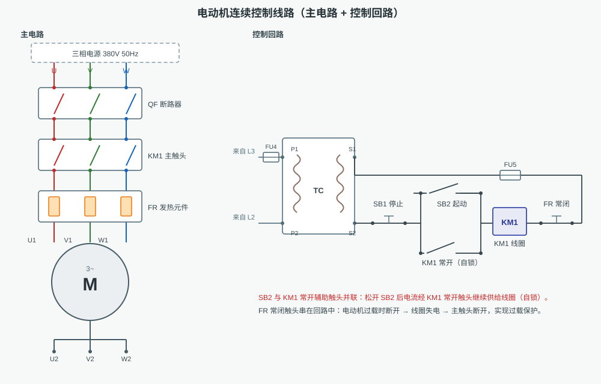
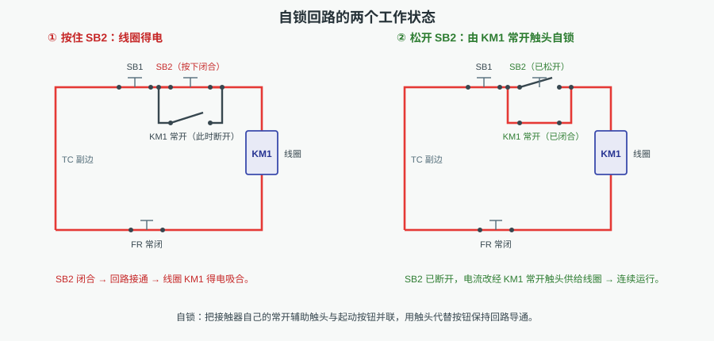
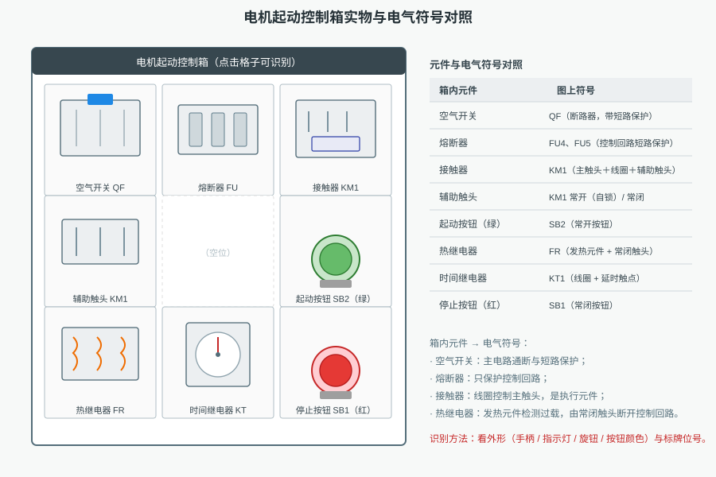
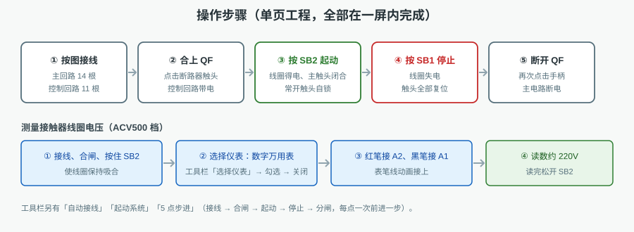
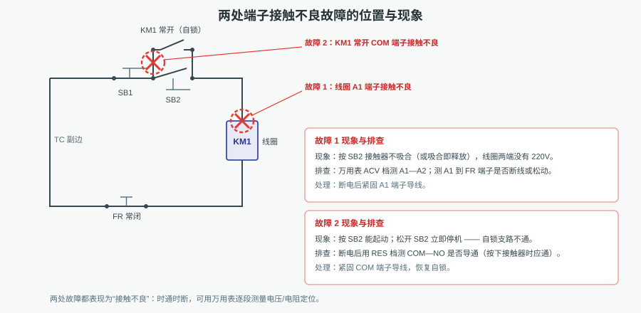

# 电气线路图和控制箱识别

本工程用一张**电动机连续控制（自锁）线路图**和一只**电机起动控制箱实物图**，训练"读图 → 说清逻辑 → 认设备 → 会测量"的完整技能链。全部元件同屏显示，不需要翻页。

## 一、线路的组成

**主电路**把三相 380V/50Hz 电源送到电动机：

| 顺序 | 元件 | 作用 |
|---|---|---|
| 1 | 电源 U/V/W/N | 三相四线电源 |
| 2 | 断路器 QF | 电源开关 + 短路、过载保护 |
| 3 | 接触器主触头 KM1 | 执行元件，接通/断开电动机大电流 |
| 4 | 热继电器发热元件 FR | 串在主回路中检测电动机电流 |
| 5 | 电动机 M | 三相笼型异步电动机，10 kW、1440 r/min |

**控制回路**从主电路 L3 取电，经 FU4 送控制变压器 TC（380/220V）降压后，在副边 s1、s2 之间依次串联：

> s2 → 停止按钮 **SB1**（常闭）→ 起动按钮 **SB2** ∥ 接触器常开辅助触头 **KM1** → 线圈 **KM1** → 热继电器常闭触头 **FR** → 熔断器 **FU5** → s1

其中 SB2 与 KM1 常开辅助触头并联，是自锁环节；FR 常闭触头串在回路末端，是过载保护的执行环节。

## 二、控制逻辑（自锁）

1. 合上 QF，控制回路带电；此时 SB2 断开、KM1 未吸合，线圈不得电。
2. 按住 SB2：回路接通，线圈 KM1 得电 → 主触头闭合（电动机起动）→ 常开辅助触头同时闭合。
3. 松开 SB2：按钮断开，但电流改经已闭合的 KM1 常开辅助触头继续供给线圈 → **电动机连续运行**，这就是自锁。
4. 按下 SB1：控制回路断开，线圈失电 → 主触头、自锁触头全部复位，电动机停转。
5. 电动机过载时：FR 发热元件受热弯曲，推动 FR 常闭触头断开 → 线圈失电 → 主触头断开，实现过载保护。

## 三、控制箱实物识别

控制箱按 3×3 排列九格（中间一格空位），每一格都可点击识别：

| 格子 | 元件 | 图上符号 |
|---|---|---|
| ① | 空气开关 | QF（断路器） |
| ② | 熔断器 | FU4、FU5 |
| ③ | 接触器 | KM1（主触头 + 线圈） |
| ④ | 辅助触头 | KM1 常开（自锁）/ 常闭 |
| ⑤ | — | 空位 |
| ⑥ | 起动按钮（绿） | SB2（常开） |
| ⑦ | 热继电器 | FR（发热元件 + 常闭触头） |
| ⑧ | 时间继电器 | KT1（线圈 + 延时触点） |
| ⑨ | 停止按钮（红） | SB1（常闭） |

识别要点：看**外形**（拨动手柄、三对触头、双金属片、刻度旋钮、按钮颜色）和**位号标牌**，再与线路图上的符号一一对应。

## 四、操作步骤

1. **接线**：主回路 14 根、控制回路 11 根，共 25 根（工具栏「自动接线」可一次完成）。
2. **合上 QF**：点击断路器触头，控制回路带电。
3. **按 SB2 起动**：线圈得电、主触头闭合、常开触头自锁。
4. **按 SB1 停止**：线圈失电、触头全部复位。
5. **断开 QF**：再次点击手柄，主电路断电。

工具栏另有：**起动系统**（自动接线 + 合闸）、**5 点步进**（接线 → 合闸 → 起动 → 停止 → 分闸，每点一次前进一步）、**故障设置**、**选择仪表**、**重置系统**。系统初始化时**不预接线**，需要时再接线。

## 五、测量接触器线圈电压

1. 接线、合闸，并**按住 SB2** 使线圈保持吸合（松开则线圈失电，电压会消失）。
2. 工具栏「选择仪表」→ 勾选**数字万用表** → 关闭。
3. 万用表切到 **交流 500V 档**；红表笔接线圈 **A2**、黑表笔接 **A1**。
4. 读数约 **220V**（仿真约 218～220V），说明控制变压器副边电压与线圈电压正常。

## 六、故障设置与处理

| 故障 | 现象 | 排查 | 处理 |
|---|---|---|---|
| 线圈 A1 端子接触不良 | 按 SB2 不吸合（或吸合即释放），线圈两端无 220V | ACV 档测 A1—A2；查 A1 到 FR 是否断线/松动 | 断电后紧固 A1 端子 |
| 常开 COM 端子接触不良 | 按 SB2 能起动，松开即停机（自锁失效） | 断电，RES 档测 COM—NO（按下接触器时应导通） | 紧固 COM 端子，恢复自锁 |

设置方法：工具栏「故障设置」→ 勾选故障项 → 「应用设置」；修复时取消勾选后同样点「应用设置」。

## 七、演示与考核

任务下拉框提供三个操作项目，配合四种运行模式：

| 项目 | 内容 |
|---|---|
| 1. 读懂电气控制图 | 接线后逐项识别线圈、主触头、辅助触头、断路器、熔断器、热继电器、时间继电器、按钮、控制变压器，含测试题 |
| 2. 解释控制逻辑关系 | 接线合闸 → 按 SB2 观察得电与自锁 → 按 SB1 观察复位，含测试题 |
| 3. 电机控制箱实物识别 | 在控制箱上识别各元件，并测量接触器线圈电压 |

- **自动演示**：按流程逐个"箭头指向 → 执行 → 停留观察"。
- **单步演示**：每点一次执行一步，便于讲解。
- **演练 / 评估**：由系统检查学员的每一步操作是否正确。
