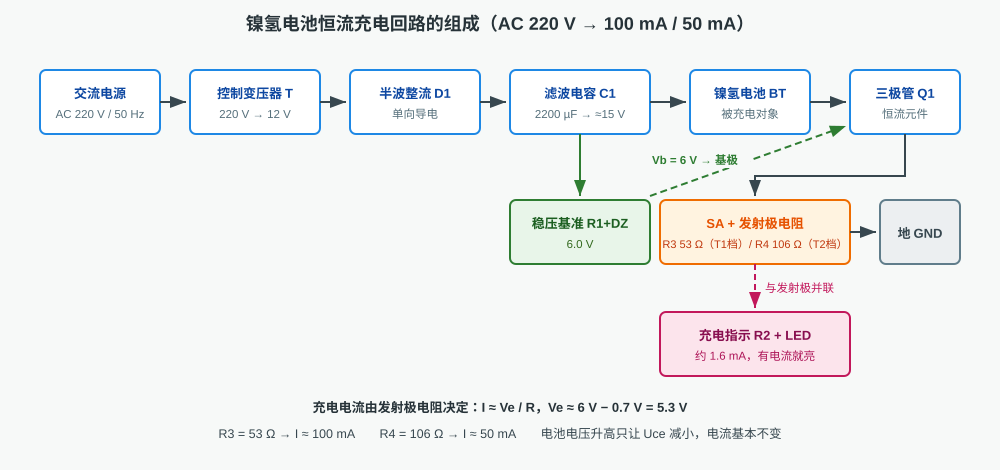
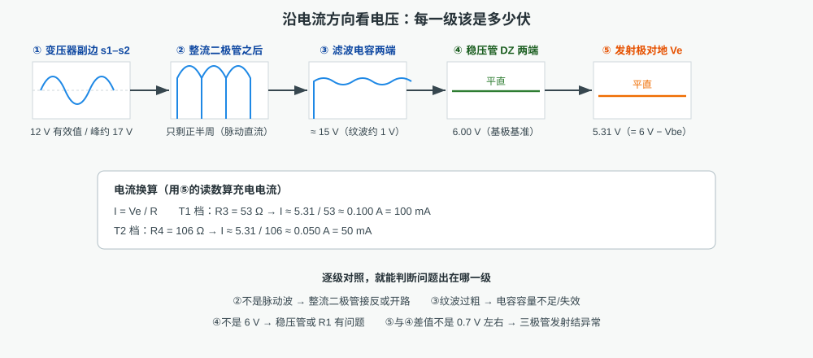
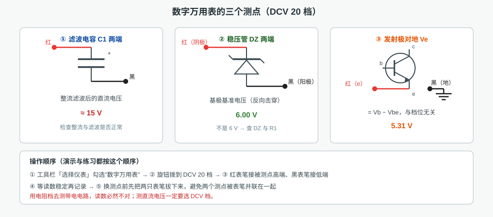
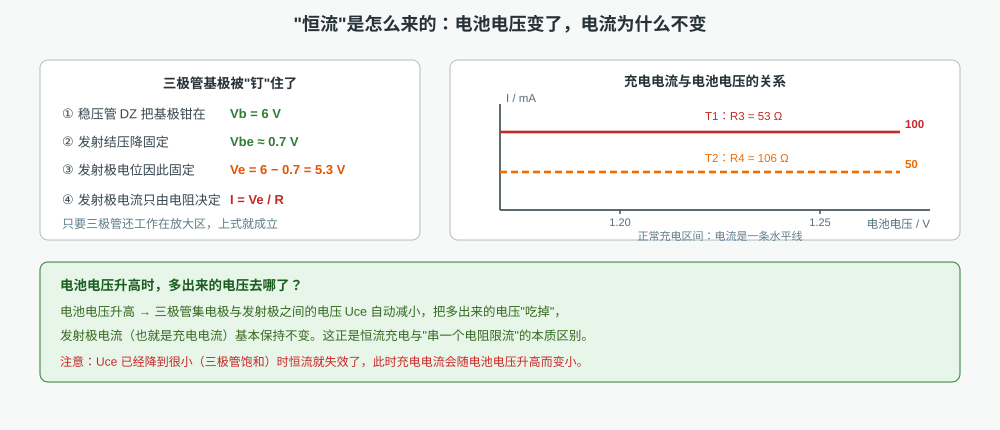

# 电池充电回路仿真

本工程仿真一台**镍氢电池恒流充电器**：把 AC 220 V 市电降压、半波整流、电容滤波，再由稳压管给出 6 V 基准，
最后用三极管接成恒流源，以 **100 mA（T1 档）/ 50 mA（T2 档）** 的恒定电流给镍氢电池充电。
画布上是一条可以真实接线、真实读数的充电回路（左起交流电源、控制变压器、整流二极管、滤波电容、
稳压基准、电池、恒流三极管、档位开关与发射极电阻），工具栏「选择仪表」可调出数字万用表、三路示波器等仪表。
全部内容同屏显示，不需要翻页。

## 一、回路由哪几部分组成

| 环节 | 元件 | 作用 | 本工程数值 |
|---|---|---|---|
| 变压 | 控制变压器 T | 把 220 V 降到安全低电压 | 220 V → 12 V |
| 整流 | 整流二极管 D1 | 单向导电，只让正半周通过 | 半波整流 |
| 滤波 | 电容 C1 | 充电储能，把脉动电压填平 | 2200 µF，≈15 V |
| 稳压基准 | R1 + 稳压管 DZ | 给三极管基极一个不动的电压 | 6.0 V |
| 恒流 | 三极管 Q1 + 发射极电阻 | 电流由发射极电阻决定，与电池电压无关 | R3 = 53 Ω / R4 = 106 Ω |
| 档位 | 开关 SA | 切换发射极电阻，改变充电电流 | T1 = 100 mA，T2 = 50 mA |
| 指示 | R2 + LED | 有充电电流时点亮，指示正在充电 | 约 1.6 mA |
| 负载 | 镍氢电池 BT | 被充电对象 | 100 mAh，SOC 50 % 起充 |

四只"关键件"要记牢：**D1 管整流、C1 管滤波、DZ 管定基准、Q1 管恒流**。接错其中任何一个，回路都不成立。

## 二、沿电流方向看电压

逐级量电压是排查充电器故障最快的办法：

- **变压器副边**应是 12 V 有效值正弦波（峰约 17 V）；
- **整流二极管之后**只剩正半周，是"脉动直流"，频率与电网相同；
- **滤波电容两端**被填平到约 15 V，只留约 1 V 的纹波；纹波过粗说明电容容量不足或失效；
- **稳压管两端**必须是平直的 6.00 V，这是基极基准；
- **发射极对地**应是 5.31 V（= 6 V − 0.7 V），与档位无关。

## 三、用数字万用表测量

演示与练习都按真实操作顺序进行：**「选择仪表」勾选数字万用表 → 旋钮拨到 DCV 20 档 → 红表笔接被测点高端、黑表笔接低端 → 等读数稳定 → 记录**。

| 测点 | 红表笔 | 黑表笔 | 正常读数 |
|---|---|---|---|
| 滤波电容 C1 两端 | C1 正端 | C1 负端 | ≈ 15 V |
| 稳压管 DZ 两端 | DZ 阴极 | DZ 阳极 | 6.00 V |
| 发射极对地 | 三极管 e 极 | 地 | 5.31 V |

换测点前**先把两只表笔拔下来**，否则两个测点会被表笔并联在一起，读数既不像 A 点也不像 B 点。
用电阻档去测带电电路，读数必然不对；测直流电压一定要选 DCV 档。

## 四、"恒流"是怎么来的

基极被稳压管钉在 6 V，发射结压降约 0.7 V，于是发射极电位 Ve ≈ 5.3 V 基本不变，
发射极电流由发射极电阻决定：**I ≈ Ve / R**。

- R3 = 53 Ω → I ≈ 5.3 / 53 ≈ **0.100 A**
- R4 = 106 Ω → I ≈ 5.3 / 106 ≈ **0.050 A**

电池电压从 1.20 V 升到 1.25 V 时，多出来的电压由三极管的管压降 Uce 承担（Uce 自动减小），
充电电流基本不变——这就是**恒流充电**，也是它与"串一个电阻限流"的本质区别。
只有当 Uce 已经小到三极管饱和时，恒流才失效，电流才会随电池电压升高而变小。
所以本电路要求整流滤波后的电压（≈15 V）远高于"电池电压 + Ve"，留足三极管的调节余量。

## 五、两个操作项目

| 项目 | 内容 | 考核点 |
|---|---|---|
| 1. 识别电池充电回路的元器件 | 依次点出变压器、整流二极管、滤波电容、稳压二极管、三极管、充电指示灯、镍氢电池，并完成两道测试题 | 能否按外形与符号认出各元件、说出各自作用 |
| 2. 电池恒流充电电路分析 | 自动接线 → 合闸看指示灯与电池 → 万用表测滤波电压 → 测稳压管 6 V → 测发射极 5.31 V → 填 100 mA → SA 拨到 T2 → 填 50 mA → 电池 SOC 改 0.95 看电流不变 → 测试题 | 会不会选档与接表笔、能不能用读数算出充电电流、能否解释"恒流" |

## 六、注意事项

1. **先接线后上电**：电源键在交流电源面板上，合闸前先确认回路已按图接好。
2. **测量前先选档**：测直流电压用 DCV 20 档；档位选小了读数会溢出（O.L）。
3. **换测点先收线**：拔下旧表笔再移到新测点，避免多点并联。
4. **读数要等稳定**：滤波电容充电需要时间，波形与读数稳定后再记录。
5. **电流是算出来的**：本电路不拆线串表测电流，而是量出 Ve 后用 I = Ve / R 计算，这也是实际检修常用的办法。
