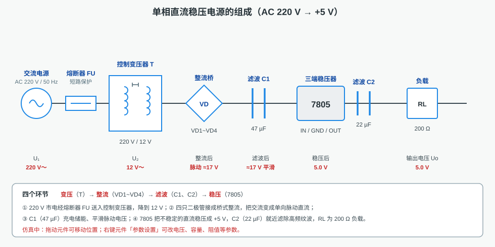
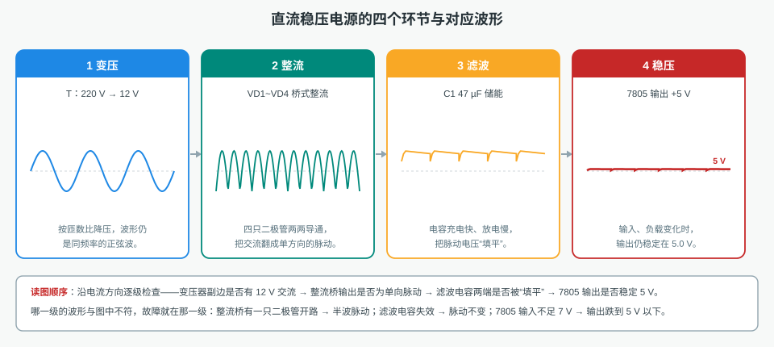
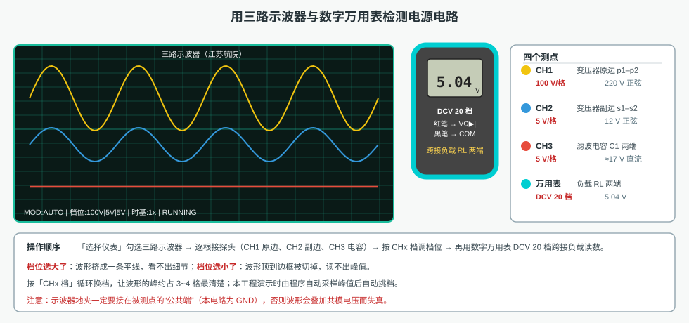
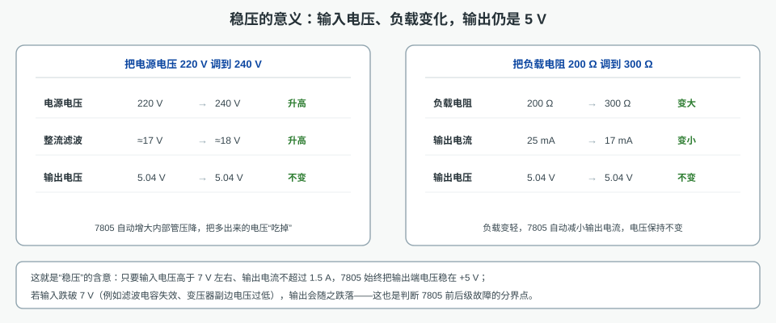

# 电源电路仿真

本工程仿真一台**单相直流稳压电源**：把 AC 220 V 市电，经降压、整流、滤波、稳压，变成稳定的 **+5 V** 直流输出。
画布上是一条可以真实测量、真实读数的电源电路（左侧为交流电源、熔断器、控制变压器、整流桥、滤波电容、7805 与负载），
工具栏「选择仪表」可调出三路示波器、数字万用表等仪表——先接探头看波形，再接表笔读电压，
"四级环节 + 四个测点"就是本工程的全部训练内容。全部内容同屏显示，不需要翻页。

## 一、电源电路的四个环节

| 环节 | 元件 | 作用 | 本工程数值 |
|---|---|---|---|
| 变压 | 控制变压器 T | 把 220 V 降到安全低电压 | 220 V → 12 V |
| 整流 | 整流桥 VD1～VD4 | 利用单向导电性把交流变成单向脉动直流 | 峰约 17 V 的脉动波 |
| 滤波 | C1 47 µF、C2 22 µF | 充电储能，平滑脉动电压 | ≈17 V 接近平滑 |
| 稳压 | 7805 | 输入、负载变化时把输出钉住 | 5.0 V |

C2 紧靠 7805 输出端，负责滤除高频纹波；RL（200 Ω）是负载。四只二极管的接法决定了整流方式：
**两两轮流导通**才是桥式整流，接错一只就变成半波整流，输出脉动立刻变粗。

## 二、逐级看波形

沿电流方向逐级比较波形，是排查电源故障最快的方法：

- **变压器副边应是正弦波**（12 V 有效值，峰约 17 V）；不是正弦，说明变压器或电源本身有问题。
- **整流桥输出应是单方向的脉动波**，频率是输入的两倍；出现半波，说明桥中有一只二极管开路。
- **电容两端应被"填平"**（峰约 17 V），只剩很小的纹波；纹波和整流后一样粗，说明电容失效或容量不足。
- **7805 输出应是平直的 5 V**；若只有十几伏或随负载抖动，说明稳压环节失效。

## 三、用示波器与数字万用表检测

演示与练习都按真实操作顺序进行：**「选择仪表」勾选仪表 → 逐根接探头/表笔（动画接线）→ 按 CHx 档调档位 → 等读数稳定 → 记录**。

| 测点 | 仪表与档位 | 正常读数 |
|---|---|---|
| 变压器原边 p1–p2 | 示波器 CH1，100 V/格 | 220 V 正弦，峰约 311 V |
| 变压器副边 s1–s2 | 示波器 CH2，5 V/格 | 12 V 同相正弦，峰约 17 V |
| 滤波电容 C1 两端 | 示波器 CH3，5 V/格 | ≈17 V 平滑直流 |
| 负载 RL 两端 | 数字万用表 DCV 20 档 | 5.04 V |

档位选择的口诀是"**峰约占 3～4 格**"：档位选大了波形挤成一条线，选小了波形顶到边框被切掉。
本工程自动演示时会先采样峰值，再自动按「CHx 档」挑到合适档位，学员可对着屏幕上的档位标注复核。
示波器的地夹必须接在被测点的公共端（本电路为 GND），否则波形会叠加共模电压而失真。

## 四、验证"稳压"

改参数一律走**参数配置界面**（右键元件 →「参数设置」→ 改值 → 点「保存」），修改后重新观察读数：

- 电源电压 220 V → **240 V**：整流滤波电压跟着升高，万用表读数仍是 **5.04 V**。
- 负载电阻 200 Ω → **300 Ω**：输出电流由 25 mA 降到 17 mA，读数仍是 **5.04 V**。

这就是稳压的含义：7805 自动调整自身的管压降，把输入侧多出来的电压"吃掉"。
只有当输入跌破 7 V 左右（例如滤波电容失效、变压器副边电压过低）时，输出才会跟着跌落——
这条界线，正是判断故障在稳压器之前还是之后的分界点。

## 五、两个操作项目

| 项目 | 内容 | 考核点 |
|---|---|---|
| 1. 识别电源电路中的元器件 | 依次点出控制变压器、整流二极管、三端稳压器、滤波电容、负载电阻，并完成两道测试题 | 能否按外形与符号认出各元件、说出四个环节 |
| 2. 电源电路工作过程分析 | 自动接线 → 合闸 → 示波器看三级波形 → 万用表读输出 → 填 5 V → 改电压 240 V → 改负载 300 Ω → 测试题 | 会不会接探头与选档、能不能用读数证明"输出稳定" |

## 六、注意事项

1. **先接线后上电**：电源键在交流电源面板上，合闸前先确认主电路已按图接好。
2. **测量前先选档**：数字表测直流输出用 DCV 20 档；用电阻档去测带电电路，读数必然不准。
3. **换测点先收线**：探头/表笔移到别的元件前，先把原来的线撤掉，避免多点并联。
4. **读数要等稳定**：滤波电容充电需要时间，波形与读数稳定后再记录数值。
