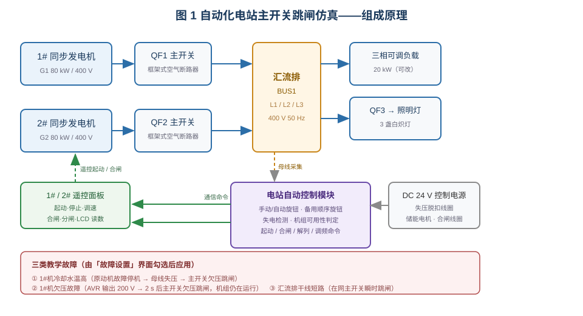
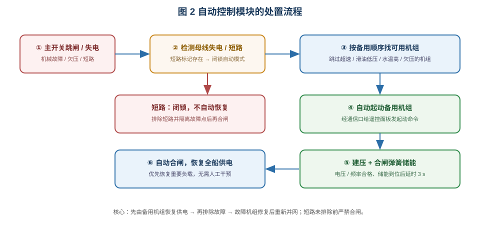

# 自动化电站主开关跳闸的应急处理

> 适用于船舶电气 / 轮机专业的"船舶自动化电站运行与故障应急"实训。
> 学习目标：① 说清自动化电站的失电自动恢复逻辑；② 会判断机械故障、欠压、短路三类跳闸；
> ③ 理解自动电站为什么"跳过故障机组"、为什么"短路期间闭锁"；④ 能按规程完成排故与恢复供电。

## 一、装置组成

仿真台架是一套双机双主开关的船舶电站：1#、2# 同步发电机（各 80 kW / 400 V / 50 Hz）分别经
船用框架式空气断路器 QF1、QF2 送入同一段汇流排 BUS1；汇流排经 QF3 带三盏照明灯，并接一台
三相可调负载（默认 20 kW）。两台机组各配一块**发电机组遥控面板**：遥控起动/停止、调速、
合闸/分闸，LCD 显示电压、频率、电流、有功与功率因数。控制电源 DC 24 V 供主开关的失压脱扣线圈、
储能电机与合闸/分励线圈。

台架的核心是**电站自动控制模块**：它经 24 V 电源供电，用采集口监视汇流排电压，
经通信口向两块遥控面板下发起动、停止、合闸、分闸与调速命令。模块面板上有两个旋钮——
**手动/自动转换旋钮**和**备用机组顺序旋钮**（默认 1-2-3），另有电源、自动、各机组指示灯。

## 二、自动控制模块的处置逻辑

1. **失电检测**：母线无电（无在网机组）持续 3 s，判定"全船失电"。
2. **机组可用性判定**：AVR 欠压故障，或原动机的超速、滑油低压、冷却水温高故障，
   都会把该机组标记为"不可用"。可用性判定是自动选机的前提。
3. **按备用顺序选机**：依旋钮设定的顺序（1-2-3 或 2-1-3）逐台查找，
   **跳过不可用机组**，选第一台可用的机组发起动命令。
4. **自动合闸**：机组运行、端电压与频率建立、合闸弹簧储能完成后，再延时 3 s 发合闸命令；
   母线此时无电，合闸不涉及非同期问题，整个过程无需人工干预。
5. **短路闭锁**：系统中存在短路标记时，自动模式立即闭锁——自动指示灯熄灭，
   既不自动起动机组，也不自动合闸，防止对短路点反复送电、扩大故障。
6. **常规自动控制**：单机在网且负载超过额定 80% 时自动并车；负载低于额定 30% 时自动解列；
   并自动调频、均分负荷（本工程教学主线不涉及）。

## 三、三类典型跳闸与处置

| 故障 | 现象 | 自动电站的处置 |
|---|---|---|
| 原动机机械故障（如冷却水温高） | 原动机保护停机，母线失压，主开关欠压跳闸，全船失电 | 跳过故障机组，自动起动备用机组并合闸恢复 |
| AVR 欠压故障 | 机端电压跌至 200 V，2 s 后主开关欠压跳闸；**发电机仍在运行** | 判定该机不可用，改起备用机组恢复供电 |
| 汇流排干线短路 | 在网主开关短路保护瞬时跳闸，全船失电 | **闭锁自动模式**，不自动恢复；必须排除短路后再合闸 |

处置原则：**先由备用机组恢复供电，再查明并排除故障；故障机组修复后才允许重新并网；
短路未排除前严禁合闸。**

## 四、操作要点

- **自动接线**：点击工具栏「自动接线」，接好主回路、遥控控制回路、自动模块电源与通信、
  母线采集和负载回路（本电路接线较多，采用瞬时接线）。
- **投入自动**：把转换旋钮转到自动档，自动指示灯亮；旋钮在空中一次换一档，可反复点击确认。
- **设置故障**：工具栏「故障设置」勾选故障项后点「应用设置」；排除故障时取消勾选再应用。
- **观察**：自动恢复约需 10~20 s（失电 3 s 判定 + 起动 + 建压储能 3 s），
  期间注意机组指示灯、主开关状态、LCD 读数与自动指示灯的变化。
- **演练**：故障处置步骤结束前不要手动干预，否则自动流程的状态判定会与现象不符。

## 五、小结

自动化电站的价值在于"**失电后自动换机恢复**"：它靠机组状态与母线电压判断"该用哪台机"，
靠通信命令驱动遥控面板完成起动与合闸，靠短路标记实现安全闭锁。
理解这三条，就能解释为何同样全船失电，机械故障与欠压时自动电站会换机恢复，
而短路时却只报警、不送电。
