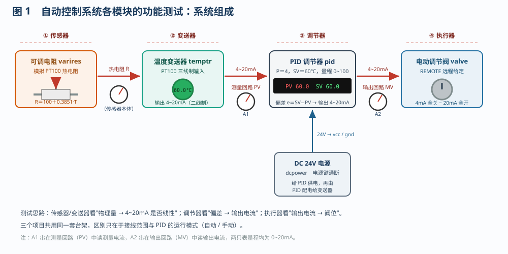
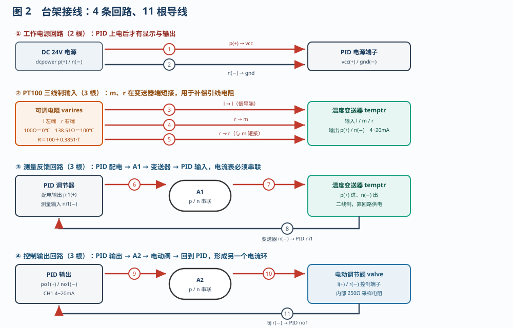
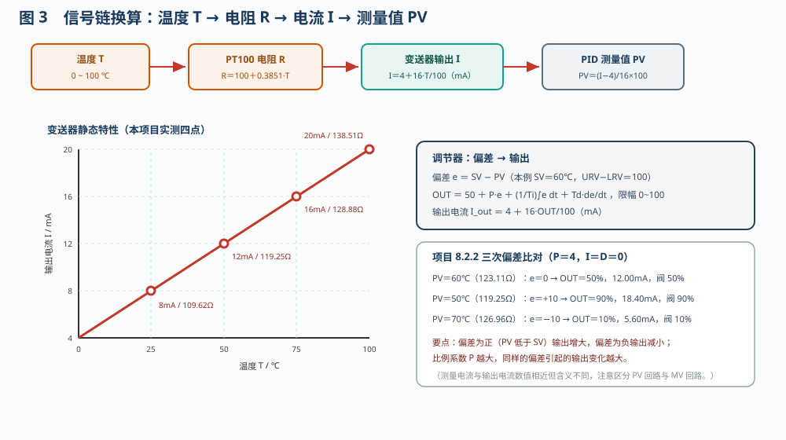
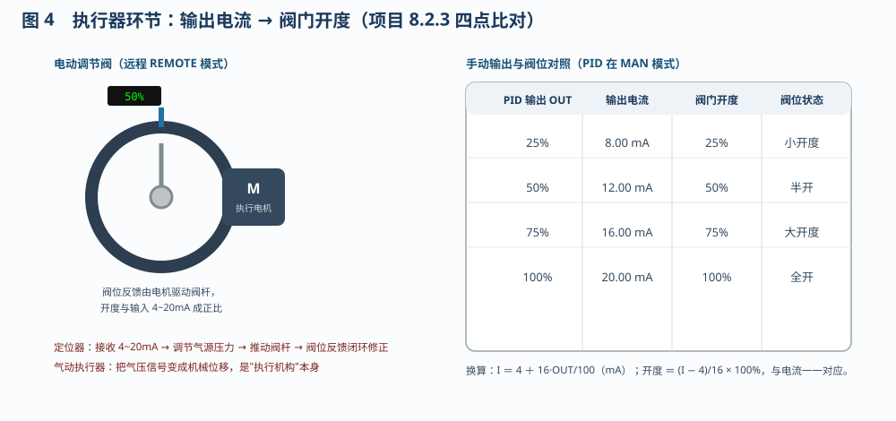

# 自动控制系统各模块的功能测试

> 适用对象：船舶电气 / 自动化专业　项目 8.2（8.2.1 / 8.2.2 / 8.2.3）
> 配套仿真含三条流程：**传感器、变送器的功能及测试（9 步）**、**PID 调节器的功能及测试（9 步）**、
> **执行器的功能及测试（9 步）**，对应平台的「自动演示 / 单步演示 / 演练 / 评估」四种模式。

---

## 一、项目概述

一个自动控制系统由**传感器、变送器、调节器、执行器**四个环节串成闭环：传感器检测被控量，
变送器把检测结果变成标准信号，调节器把测量值与设定值比较后输出控制信号，执行器按控制信号动作，
从而把被控量拉回目标值。

本仿真用**一套台架**完成三组功能测试：用可调电阻模拟 PT100 热电阻模拟温度变化，经温度变送器
变成 4~20mA，送进 PID 数字调节器；调节器的输出经另一只电流表驱动电动调节阀。三个项目只改变
**接线范围**与 **PID 运行模式**，因此可以把"信号在每一段是否准确、线性"逐段量出来。

---

## 二、系统组成

| 元件 | 代号 | 作用与关键参数 |
|------|------|----------------|
| 可调电阻 | `varires` | 模拟 PT100：R＝100＋0.3851·T（Ω），100Ω＝0℃、138.51Ω＝100℃ |
| 温度变送器 | `temptr` | PT100 三线制输入 l/m/r，二线制 4~20mA 输出 p/n，量程 0~100℃ |
| 测量电流表 A1 | `ampmeter` | 串在测量回路（PV），量程 0~20mA |
| PID 数字调节器 | `pid` | PV/SV 双显示，A/M、SET、▲、▼ 面板按键；输入 pi1/ni1，输出 po1/no1；P＝4，SV＝60℃ |
| 输出电流表 A2 | `ampmeter2` | 串在输出回路（MV），量程 0~20mA |
| 电动调节阀 | `valve` | REMOTE 模式接收 4~20mA，开度 0~100%（4mA 全关、20mA 全开） |
| 24V 直流电源 | `dcpower` | 给 PID 供电，再由 PID 内部配电给两线制变送器 |

---

## 三、接线：四条回路、11 根导线

| 回路 | 从 | 到 | 根数 |
|------|----|----|------|
| ① 工作电源 | 24V p(+) / n(−) | PID vcc / gnd | 2 |
| ② PT100 输入 | 可调电阻 l、r、r | 变送器 l、m、r | 3 |
| ③ 测量回路 | PID pi1 → A1 → 变送器 p/n → PID ni1 | — | 3 |
| ④ 输出回路 | PID po1 → A2 → 阀 l/r → PID no1 | — | 3 |

要点：**电流表必须串联**在回路中（不能并联）；变送器 m、r 在变送器端短接，构成三线制引线补偿；
变送器 p/n 任一悬空则不显示（两线制靠回路供电）；输出回路断开则阀门不动。

---

## 四、信号换算

- 热电阻：$R = 100 + 0.3851 T$（25℃→109.62Ω，50℃→119.25Ω，75℃→128.88Ω，100℃→138.51Ω）。
- 变送器：$I = 4 + 16\times\frac{T}{100}$（mA），即 8 / 12 / 16 / 20mA。
- 调节器测量：$PV = \frac{I-4}{16}\times(100-0)$（℃），与热电阻温度一致。
- 调节器输出：$OUT = 50 + P e + \frac{1}{T_i}\int e dt + T_d\frac{de}{dt}$，限幅 0~100%；
  再换算 $I_{out} = 4 + 16\times\frac{OUT}{100}$（mA）。

注意区分两个"12mA"：**测量电流** 12mA 表示 50℃，**输出电流** 12mA 表示 OUT＝50%，含义完全不同。

---

## 五、三个测试项目

### 5.1 传感器、变送器的功能及测试（9 步）

接好①②③三条回路后，在 **AUTO** 模式下依次把阻值改为四个点，读变送器 LCD 与测量电流：

| 温度 | 阻值 | 变送器显示 | 测量电流 | PV |
|------|------|-----------|----------|----|
| 25℃ | 109.62Ω | 25.0℃ | 8.00mA | 25.0 |
| 50℃ | 119.25Ω | 50.0℃ | 12.00mA | 50.0 |
| 75℃ | 128.88Ω | 75.0℃ | 16.00mA | 75.0 |
| 100℃ | 138.51Ω | 100.0℃ | 20.00mA | 100.0 |

四点落在一条直线上，说明传感器—变送器环节的**量程与线性度**合格，且没有零点/量程漂移。

### 5.2 PID 调节器的功能及测试（9 步）

再接④输出回路，AUTO 模式下先看"失衡"，再看"平衡"与"双向偏差"：

1. 0℃ 时 PV≪SV，输出升到上限 100%（20mA），阀门全开；
2. 阻值 123.11Ω→60℃，PV＝SV，偏差为零，OUT 回 50%（12mA，阀 50%）；
3. 119.25Ω→50℃，偏差＋10℃，OUT＝50＋4×10＝90%（18.4mA，阀 90%）；
4. 126.96Ω→70℃，偏差−10℃，OUT＝50−4×10＝10%（5.6mA，阀 10%）。

结论：调节器按**偏差的方向和大小**成比例地改变输出，P 越大，同样偏差引起的输出变化越大。

### 5.3 执行器的功能及测试（9 步）

只接①④两条回路，PID 置 **MAN**（手动），用 ▲/▼ 手动改变输出，观察"输出电流—阀位"的对应：

| OUT | 输出电流 | 阀门开度 |
|-----|----------|----------|
| 25% | 8.00mA | 25% |
| 50% | 12.00mA | 50% |
| 75% | 16.00mA | 75% |
| 100% | 20.00mA | 100% |

阀位与输入电流严格成正比，说明**电气阀门定位器 + 气动执行器**的组合把电信号准确转换成了机械位移；
手动模式下手动给定不随测量值变化，是标定执行器最方便的状态。

---

## 六、操作要点

- **先接线、后通电**：拆线前先断电，避免带电插拔造成读数跳变。
- 改阻值、改 P/I/D 一律走组件右键菜单里的**「参数设置」界面**，改完点**保存**；
  面板上的 A/M 键只切换手动/自动，▲/▼ 在自动模式改 SV、在手动模式改 OUT。
- AUTO 模式下 OUT 由偏差自动决定，不能直接手动"拧"；要观察固定的输出点必须先切 MAN。
- 变送器 LCD 显示的是**输入电阻对应的真实温度**，不受输出钳位影响；回路断开时会显示 `HHHH`/`LLLL`。
- 工具栏「自动接线」一次接好 11 根线；「起动系统」复位台架、接线并通电；「5点步进」按
  25/50/75/100/0 五点循环——手动模式依次给出 25%、50%、75%、100%、0% 的输出，自动模式依次给出
  109.62、119.25、128.88、138.51、100Ω（对应 25、50、75、100、0℃）的阻值，便于快速比对。

---

## 七、思考题（对应流程中的 4 道题）

1. **传感器与变送器**：传感器检测物理量，变送器把它转换成 4~20mA 标准信号，二者缺一不可。
2. **调节器**：把 SV 与 PV 比较，按 PID 规律运算并输出控制信号去驱动执行机构。
3. **气动执行器**：把气压信号转换成机械位移，推动阀杆动作，属执行机构。
4. **电气阀门定位器**：按 4~20mA 输入精确控制阀位并引入阀位反馈，提高精度与响应速度。
