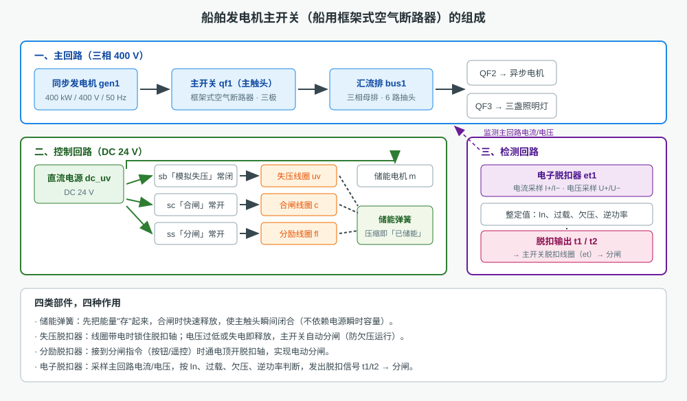
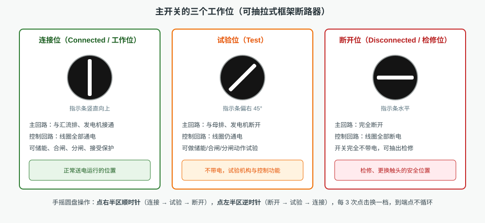
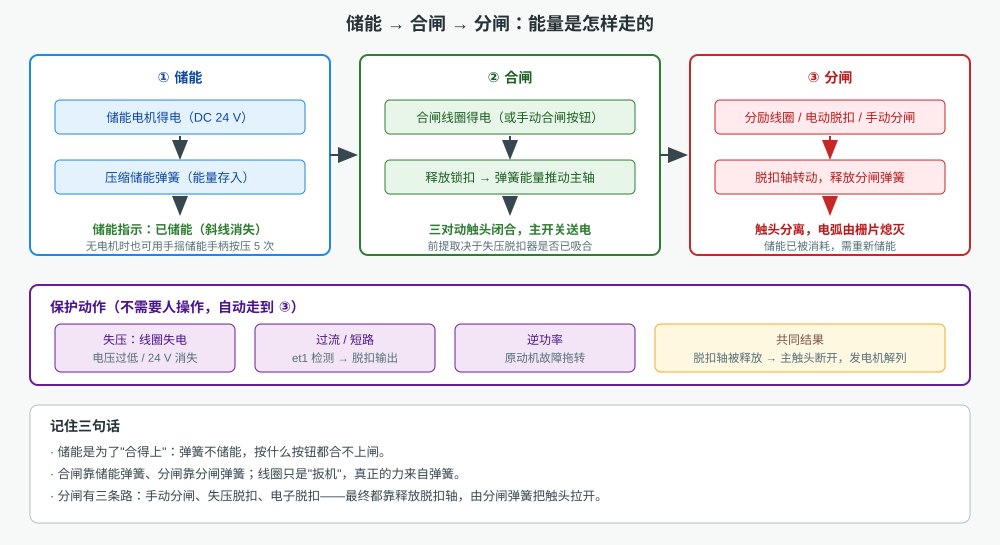
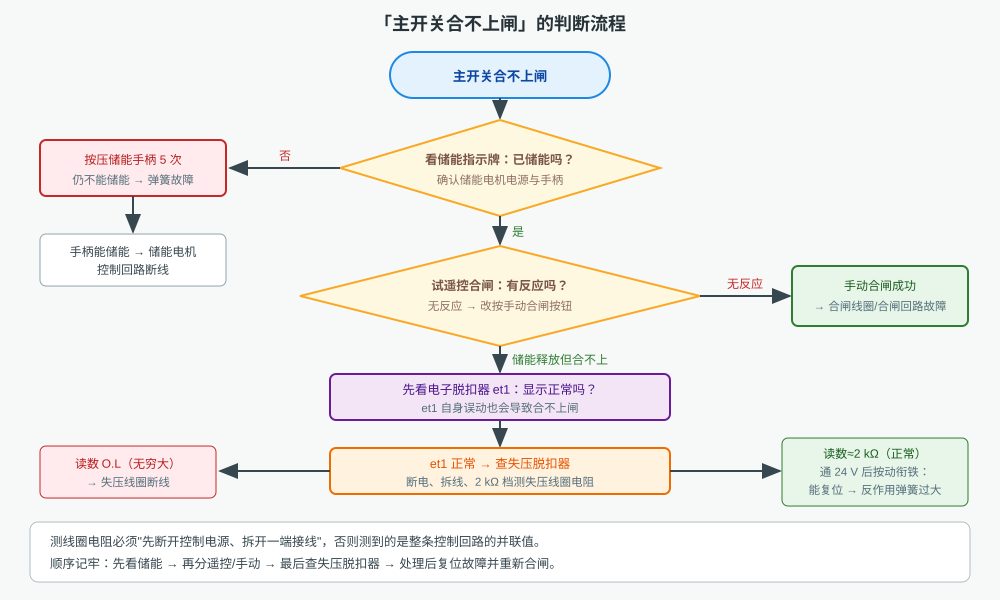

# 船舶发电机主开关仿真

本工程仿真一台**船舶发电机主开关**（船用框架式空气断路器）：同步发电机发出三相 400 V 电压，
经主开关送入汇流排，再由两路馈出开关分别供电给一台异步电机和三盏照明灯。
主开关本身由储能弹簧、合闸线圈、失压脱扣器、分励脱扣器、主触头、辅助触头、分闸弹簧与电子脱扣器组成，
另有 DC 24 V 控制回路与手摇工作位圆盘。画布上可以真实接线、真实操作、真实读数，
工具栏「选择仪表」可调出数字万用表、指针式万用表、手摇兆欧表、示波器等 7 种仪表。全部内容同屏显示，不需要翻页。

## 一、装置由哪几部分组成

| 回路 | 主要元件 | 作用 | 本工程数值 |
|---|---|---|---|
| 主回路 | 同步发电机 `gen1` | 提供三相电源 | 400 kW / 400 V / 50 Hz |
| 主回路 | 主开关 `qf1` 主触头 | 接通、断开主电路 | 三极，带栅片灭弧 |
| 主回路 | 汇流排 `bus1` | 汇流与分配 | 6 路抽头 |
| 馈出 | `QF2` → 异步电机、`QF3` → 照明灯 | 负荷支路 | 电机 10 kW |
| 控制回路 | 直流电源 `dc_uv` | 供给继电器、线圈 | DC 24 V |
| 控制回路 | `sb`（常闭）、`sc`（常开）、`ss`（常开） | 模拟失压 / 合闸 / 分闸指令 | —— |
| 控制回路 | 失压线圈、合闸线圈、分励线圈、储能电机 | 执行元件 | 2000 Ω / 200 Ω / 50 Ω / 200 Ω |
| 检测回路 | 电子脱扣器 `et1` | 电流电压采样、保护脱扣 | In = 100 A |

四类部件四种作用：**储能弹簧存能量**（合闸的动力源）、**失压脱扣器保安全**（失电即分闸）、
**分励脱扣器执行分闸指令**、**电子脱扣器负责保护**（过流、短路、欠压、逆功率）。

## 二、三个工作位

| 工作位 | 主回路 | 控制回路 | 用途 |
|---|---|---|---|
| 连接位（Connected） | 接通 | 全部通电 | 正常送电运行 |
| 试验位（Test） | 断开 | 保持通电 | 不带电做储能/合闸/分闸试验 |
| 断开位（Disconnected） | 断开 | 全部断电 | 完全不带电，抽出检修 |

手摇圆盘：**点右半区顺时针**（连接 → 试验 → 断开），**点左半区逆时针**（断开 → 试验 → 连接），
每点击 3 次换一档，到端点不循环。合闸状态下圆盘被机械闭锁，必须先分闸才能摇动。

## 三、储能、合闸、分闸

1. **储能**：储能电机得电（或手摇储能手柄按压 5 次）把储能弹簧压缩，指示牌显示「已储能」。
2. **合闸**：合闸线圈（或手动合闸按钮）释放锁扣，储能弹簧释放能量推动主轴右移，三对动触头与静触头闭合。
   合闸后储能已被消耗，储能电机会自动重新储能，为下一次合闸做准备。
3. **分闸**：脱扣轴转动，分闸弹簧拉主轴左移，动、静触头分离，电弧在栅片中被拉长熄灭。

注意：**线圈只是"扳机"，真正的力来自弹簧**。所以储能不到位时，按任何按钮都合不上闸；
这也是"合不上闸"故障排查第一步必须看储能指示的原因。

## 四、失压脱扣器与分励脱扣器

- **失压脱扣器**：线圈带电时吸合衔铁，把脱扣轴锁在正常位，主开关才能合闸；
  当控制电压过低或失电时线圈失磁、衔铁释放，脱扣轴跳开，主开关自动分闸。
  仿真里按住「模拟失压」按钮（常闭触点断开）即可让失压线圈失电，松开后恢复。
- **分励脱扣器**：只在接到分闸指令时才通电，通电瞬时顶开脱扣轴完成电动分闸；平时不带电。
- 若合闸成功瞬间电压消失，主开关会"合上又跳开"，这是失压保护在起作用，不是合闸线圈的故障。

## 五、"主开关合不上闸"怎么查

按"先储能、再合闸回路、最后失压脱扣器"的顺序，一步一步缩小范围：

1. **看储能指示**：未储能先手摇储能手柄；手柄摇不动或摇后仍无储能 → **储能弹簧故障**；
   手柄能储能但电机不储能 → **储能电机控制回路断线**。
2. **试遥控合闸**：无反应时改按手动合闸按钮。
   手动能合上 → **合闸线圈（合闸回路）故障**；储能释放但合不上 → 继续第 3 步。
3. **先看电子脱扣器**：`et1` 显示异常说明是脱扣器误动，而不是主开关机构问题。
4. **查失压脱扣器**：断电、拆下线圈一端接线，用万用表 2 kΩ 档测线圈电阻。
   读数 ≈ 2.000 kΩ 为正常；显示 **O.L**（无穷大）说明**线圈断线**。
   线圈正常但通电后衔铁不吸合、用手按压动衔铁能复位 → **反作用弹簧弹力过大**；
   用手按压也无法复位 → **衔铁卡死**。
5. **处理后**：在「故障设置」里取消故障并应用，重新储能、遥控合闸，确认主开关恢复正常。

> 测线圈电阻**必须先断开控制电源、并拆开线圈一端的接线**。直接在回路里测，读到的是整条控制回路的并联值，
> 断线故障也会被别的支路"掩盖"，读不出 O.L。

## 六、操作与测量要点

- **先接线再操作**：点工具栏「自动接线」接好主回路与控制回路，再按发电机机旁「起动」按钮建压。
  未经接线的主开关没有控制电源，失压线圈不吸合，自然合不上闸。
- **用万用表**：走「选择仪表」勾选数字万用表 → 旋钮拨到所需档位 → 点击端口接表笔 → 等读数稳定再记录；
  换测点前先拔表笔，避免两个测点被表笔并联。
- **看现象再下结论**：合闸失败时，先分清是"储能没释放"（合闸回路没动作）还是"储能释放了但没合上"（脱扣轴在脱扣位），
  两者的故障部位完全不同。
- **复位要彻底**：故障排除后必须回到「故障设置」取消勾选并应用，否则主开关仍被故障状态锁住。
