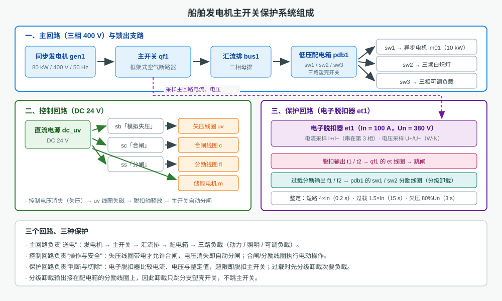
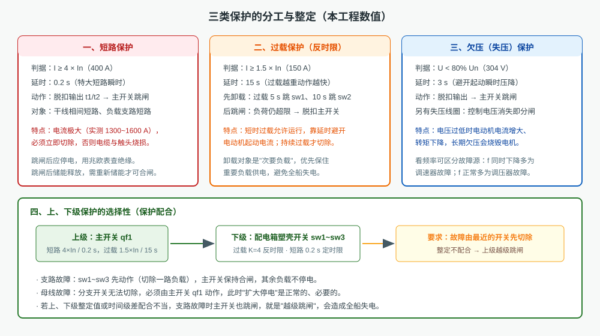
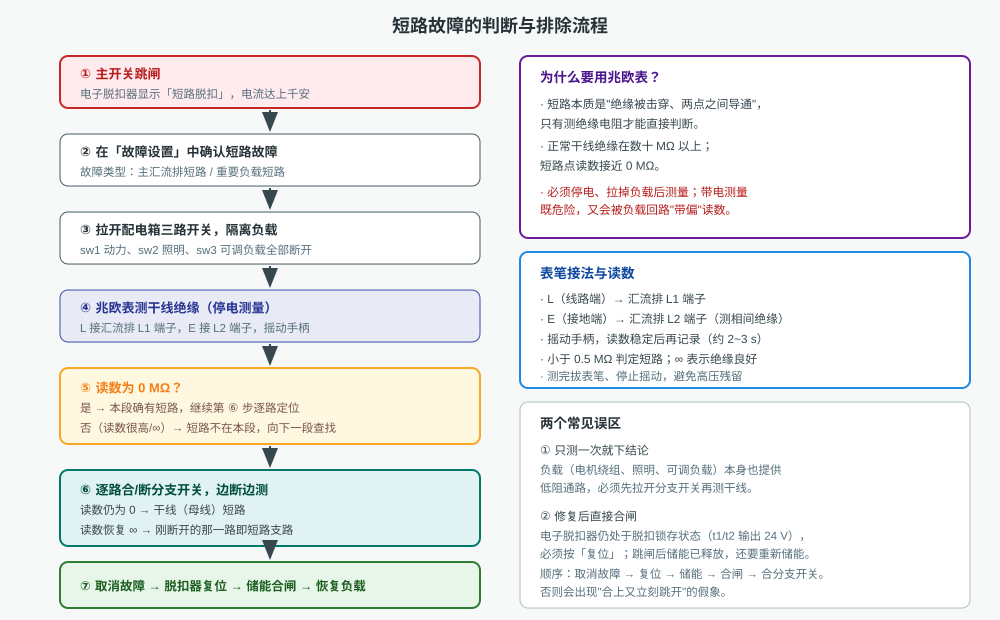
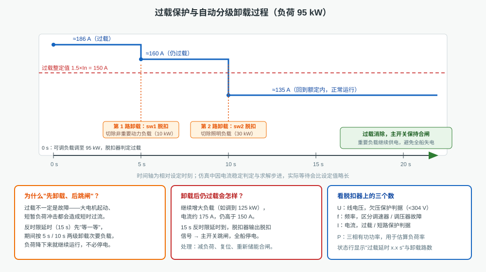

# 船舶发电机主开关保护仿真

本工程仿真一台**船舶发电机主开关（框架式空气断路器）及其保护系统**：同步发电机发出三相 400 V 电压，
经主开关送入汇流排，再由低压配电箱三路馈出——动力（异步电机）、照明（三盏白炽灯）、可调负载。
画布上可以真实接线、操作开关、调参数、保护跳闸、用仪表读数，重点训练
**短路保护、过载保护（自动分级卸载）、失压（欠压）保护**的判断与处理。全部内容同屏显示，无需翻页。

## 一、装置由哪几部分组成

| 回路 | 主要元件 | 作用 | 本工程数值 |
|---|---|---|---|
| 主回路 | 同步发电机 `gen1` | 提供三相电源 | 80 kW / 400 V / 50 Hz |
| 主回路 | 主开关 `qf1` 主触头 | 接通、断开主电路 | 三极，带储能弹簧与脱扣轴 |
| 主回路 | 汇流排 `bus1` | 汇流与分配 | 6 路抽头 |
| 馈出 | 配电箱 `pdb1` → `sw1`/`sw2`/`sw3` | 三路分支开关 | 塑壳开关，带分励脱扣线圈 |
| 控制回路 | 直流电源 `dc_uv`、按钮 `sb`/`sc`/`ss` | 供给操作与保护线圈 | DC 24 V |
| 保护回路 | 电子脱扣器 `et1` | 电流电压采样、保护脱扣 | In = 100 A，Un = 380 V |

控制回路中，**失压线圈带电才允许合闸**，电压消失即自动分闸；合闸线圈、分励线圈只负责执行操作指令。
保护回路的电子脱扣器把采样到的电流、电压与整定值比较，超限就输出脱扣信号使主开关跳闸；
过载时它还有两路分励输出，直接去跳配电箱的分支开关（分级卸载）。

## 二、三类保护如何分工

| 保护 | 判据 | 延时 | 动作对象 |
|---|---|---|---|
| 短路 | I ≥ 4 × In（400 A），特大短路瞬时 | 0.2 s | 脱扣主开关 `qf1` |
| 过载 | I ≥ 1.5 × In（150 A） | 15 s 反时限 | 先分级卸载分支，仍过载才跳主开关 |
| 欠压 | U < 80 % Un（304 V） | 3 s | 脱扣主开关 `qf1` |

选择性的关键：**故障应由离它最近的保护电器先切除**。支路故障让 `sw1`～`sw3` 先动作，主开关保持合闸，
其余负载不停电；母线故障分支开关无能为力，才由主开关动作。整定不配合就会"越级跳闸"，扩大停电范围。

## 三、短路故障怎么判断和排除

1. **看现象**：主开关跳闸，脱扣器显示"短路脱扣"，电流可达上千安（汇流排短路实测约 1500 A，0.7 s 内切除）。
2. **确认故障**：在「故障设置」中确认是"主汇流排短路"还是"重要负载短路"。
3. **停电隔离**：拉开配电箱三路开关，把负载（电机绕组、灯具、可调负载）从干线上摘除。
4. **测绝缘**：走「选择仪表」调出手摇兆欧表，**L 接汇流排 L1 端子、E 接 L2 端子**，摇动摇柄读数。
   正常绝缘在数十 MΩ 以上，**短路时读数接近 0 MΩ**（本工程约 0.0～0.3 MΩ）。
5. **逐路定位**：一边断开分支开关一边测——读数仍为 0 说明短路在干线（母线）；断开某一路后读数恢复 ∞，
   刚断开的这一路就是短路支路。
6. **修复送电**：取消故障 → 脱扣器「复位」（否则 t1/t2 仍输出 24 V，合上就跳）→ 等储能到位（储能电机自动充能）
   → 按合闸按钮 → 合上分支开关。

> 兆欧表必须**停电、断开负载**后测量：负载本身也是低阻通路，不带电、不断开时读数会被"带偏"，
> 既查不出故障，也可能损坏仪表。

## 四、过载保护与自动分级卸载

本工程带 20 kW 可调负载运行时电流约 72 A。把可调负载调到 **95 kW**（总电流约 186 A，超过 150 A）：

- 过载持续 5 s：第 1 路分励输出 → `sw1` 脱扣，切除非重要动力负载，电流降到约 160 A，仍过载；
- 过载持续 10 s：第 2 路分励输出 → `sw2` 脱扣，切除照明负载，电流降到约 135 A，**回到额定范围内**；
- 过载消除，主开关保持合闸，重要负载继续供电。

若继续把负荷加到 **125 kW**（电流约 175 A，卸载后仍超限），15 s 反时限延时到，脱扣器直接跳主开关。
可见"分级卸载"的目的是**用次要负载换全船不停电**，减不掉负荷才停电。

过载与短路的区别：短路是绝缘击穿，电流上千安、必须立即切除；过载是负荷超过额定，电流在 1.5～4 倍之间，
允许短时运行，靠延时与卸载处理。

## 五、失压（欠压）故障的区分

| 故障 | 频率 | 电压 | 说明 |
|---|---|---|---|
| 调速器故障 | ≈ 25 Hz（明显下降） | ≈ 280 V | 原动机转速下降，频率、电压同时降低 |
| 调压器（AVR）故障 | ≈ 50 Hz（正常） | ≈ 200 V | 励磁异常，只有电压降低 |
| 负载短路/大负荷突加 | 基本正常 | 瞬时跌落 | 属于外部原因，切除故障后恢复 |

判断顺序：先看脱扣器液晶上的 **f 与 U**——频率同时下降多为调速器问题，频率正常而电压低多为调压器问题；
再看电流 I 与功率 P，出现大电流、大功率则可能是负荷侧原因。处理后同样要"取消故障 → 复位 → 储能 → 合闸"。

## 六、操作与测量要点

- **先接线再操作**：点「自动接线」接好主回路、控制回路与保护回路，再按机旁「起动」按钮建压。
- **合闸三步**：储能到位 → 失压线圈带电 → 按合闸按钮。任一条件不满足都合不上闸。
- **跳闸后不复位合不上**：电子脱扣器为锁存式，必须先「复位」；跳闸同时释放了储能，需要重新储能。
- **配电箱开关是三态**：合闸位 ON、分闸位 OFF、脱扣位 TRIP。脱扣后第一次点击只回到 OFF，再点一次才合闸。
- **仪表读数要稳定**：用万用表/兆欧表先接线、再看读数，换测点前先拔表笔，避免两个测点被表笔并联。
- **参数要经界面修改**：右键组件 →「参数设置」，改完点「保存」；工作流演示时同样会弹出该界面并高亮保存按钮。

## 七、操作项目

| 项目 | 内容 |
|---|---|
| 1. 发电机短路故障的判断和排除 | 设置汇流排短路与负载短路，用兆欧表测绝缘、逐路定位并恢复送电（13 步） |
| 2. 发电机过载故障的判断和处理 | 95 kW 时观察 5 s/10 s 两级卸载，125 kW 时过载 15 s 跳闸（6 步） |
| 3. 发电机失压（欠压）故障的判断和处理 | 调速器故障与调压器故障的观察、区分与处理（9 步） |

每个项目都按"识别 → 操作 → 观察 → 测试题"组织，可在工具栏选择后用**自动演示 / 单步演示 / 演练 / 评估**运行。
