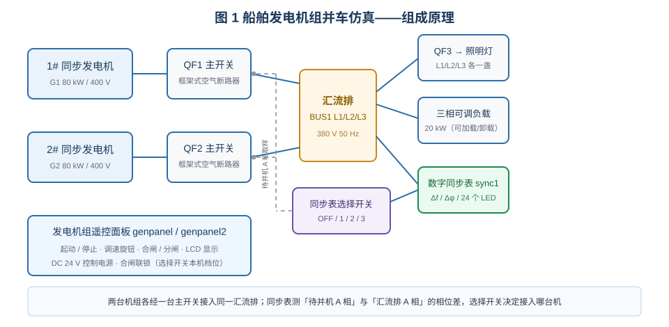
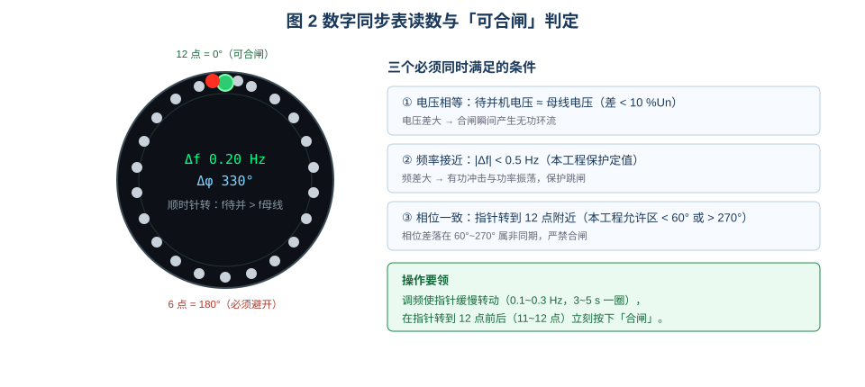
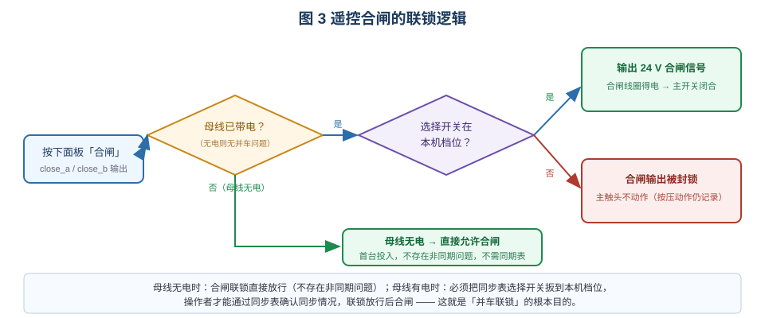
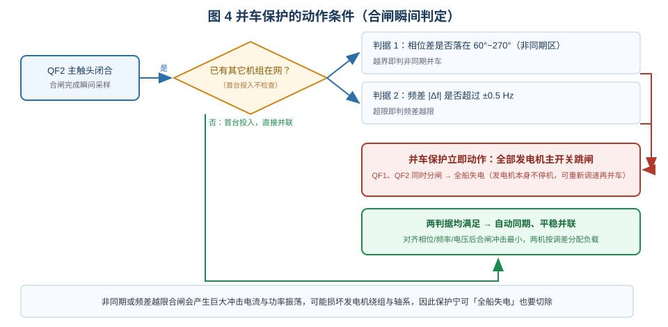
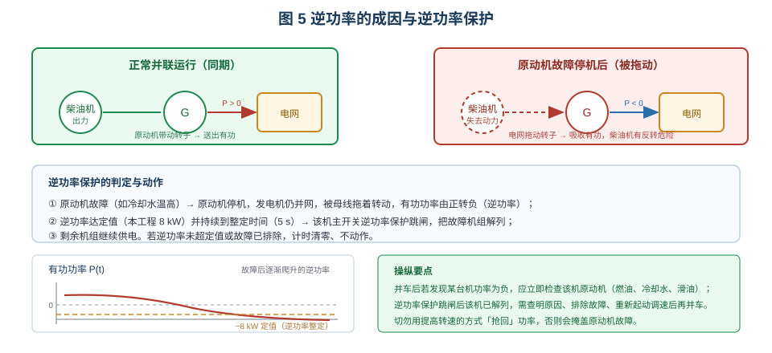

# 船舶发电机组并车操作仿真

> 适用于船舶电气 / 轮机专业的"船舶电站并车操作与保护"实训。
> 学习目标：① 说明准同步并车的三个条件与同步表读法；② 解释遥控合闸联锁的作用；
> ③ 正确完成"起动—调频—并车—负荷转移—解列"全过程；④ 判断并车保护与逆功率保护的动作原因。

## 一、装置组成

仿真台架是一套双机双主开关的船舶电站：1#、2# 同步发电机（各 80 kW / 400 V / 50 Hz）分别经
船用框架式空气断路器 QF1、QF2 送入同一段汇流排 BUS1；汇流排经 QF3 带三盏照明灯，并接一台
20 kW 三相可调负载。两台机组各配一块**发电机组遥控面板**（起动/停止、调速旋钮、合闸/分闸、
LCD 显示电压/频率/电流/有功/功率因数），控制电源为 DC 24 V。

**数字同步表**接在汇流排 A 相与"待并机 A 相"之间，**同步表选择开关**（OFF / 1 / 2 / 3）决定接入
哪台待并机。同步表 24 个 LED 组成圆环，**12 点表示相位差 0°**，待并机频率高时顺时针转、低时逆时针转，
中央同时显示频差 Δf 与相位差 Δφ。

## 二、准同步并车的三个条件

| 条件 | 允许值（本工程） | 不满足的后果 |
|---|---|---|
| 电压相等 | 差值 < 10 %Un | 合闸瞬间产生无功环流 |
| 频率接近 | \|Δf\| < 0.5 Hz | 产生有功冲击与功率振荡，并车保护跳闸 |
| 相位一致 | 允许区 < 60° 或 > 270° | 产生巨大合闸冲击电流，可能损伤绕组与轴系 |

操作要领：**先调频使指针缓慢转动**（频差 0.1~0.3 Hz，3~5 s 转一圈），再在指针转到 **11~12 点**
（约 315°~345°）时按下"合闸"，合闸瞬间即完成同期。频差调得太大，指针转得太快，根本来不及合闸。

## 三、合闸联锁：为什么必须扳到本机档

遥控面板的合闸输出受**联锁**控制：母线**无电**时（首台投入）不存在并车问题，联锁直接放行；
母线**有电**时，必须先把同步表选择开关扳到**本机档位**，联锁才允许合闸。这样做的意义不是"多一道手续"，
而是强制操作者**通过同步表确认同步条件后再合闸**——选择开关不在本机档，同步表根本读不到该机，
联锁用"看得见同步表"作为合闸的前提。

## 四、并车保护

主开关在**合闸完成瞬间**采样同步表的相位差与频差（前提是已有其它机组在网）：相位差落在
**60°~270°（非同期区）**或频差超过 **±0.5 Hz**，即判为危险并车，**全部发电机主开关同时跳闸**
（全船失电）。注意：保护只切主回路，**发电机本身不停机**，查明原因、重新调速后可直接再次并车。

## 五、逆功率保护

并网运行的发电机，若原动机失去动力（如冷却水温高停机），转子失去驱动转矩，同步发电机在电网上
变成**同步电动机**运行，从电网吸收有功，即**逆功率**（有功为负）。此时若不切除，电网会拖着柴油机
反转运转，极易造成机械损坏。

本工程的逆功率保护：逆功率达 **8 kW** 并持续 **5 s** → 该机主开关跳闸、故障机组解列，
其余机组继续供电。

## 六、并联运行中的功率调节

并车后两台机的**功率分配**由调速器的频率设定差决定，而**电网频率**由两台机设定的平均值决定，
两者近似正交：

- 只想**转移负荷**（如把 2# 从 20 kW 降到 3 kW）：增 1# 油门、减 2# 油门，两机设定**对向**变化；
- 只想**调整电网频率**（回到 50 Hz）：两机设定**同向**平移，频差不变，功率分配不变。

这正是"负荷转移"与"调频"两步操作要分开做的原因。

## 七、操作项目一览

| 项目 | 主要内容 |
|---|---|
| 1. 认识船舶主配电装置 | 识别两台发电机组、两只主开关的储能弹簧/合闸线圈/失压脱扣器、遥控面板、同步表、选择开关、汇流排、可调负载 |
| 2. 遥控合闸与并车联锁 | 电网无电直接合闸；选择开关未到位时合闸被封锁；转本机档、调频、相位合适后并车 |
| 3. 并车保护 | 频差 > 0.5 Hz 合闸 → 全船跳闸；微频差下相位落入非同期区合闸 → 全船跳闸 |
| 4. 并联功率分配与逆功率保护 | 减小/增大油门看功率转移；投入 20 kW 负载微调至 5 kW；设置"2# 发电机冷却水温度高"→ 逆功率 → 延时跳闸 |
| 5. 准同步并车、负荷转移、解列 | 调频 +0.2 Hz、指针到 11 点合闸、功率均分、突加 20 kW、转移至 3 kW 并回 50 Hz、解列停机 |

## 八、常见错误与思考

1. **不看同步表直接合闸**：联锁会封锁，或触发并车保护全船失电。
2. **频差调得过大**：指针转太快，合不上闸；勉强合闸即频差越限跳闸。
3. **并车后忽略功率表**：某台机长期逆功率运行会损坏原动机。
4. **"提转速抢功率"**：逆功率的根因在原动机，提高转速只会掩盖故障。
5. 思考：为什么首台投入不需要同期检查？为什么并车保护动作后发电机不停机？
