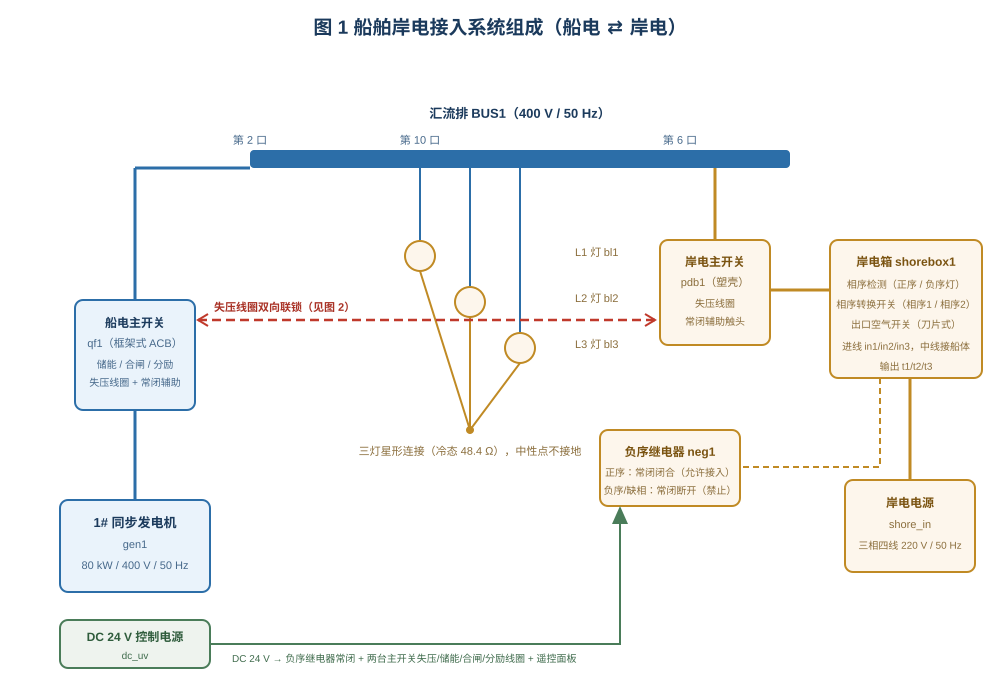
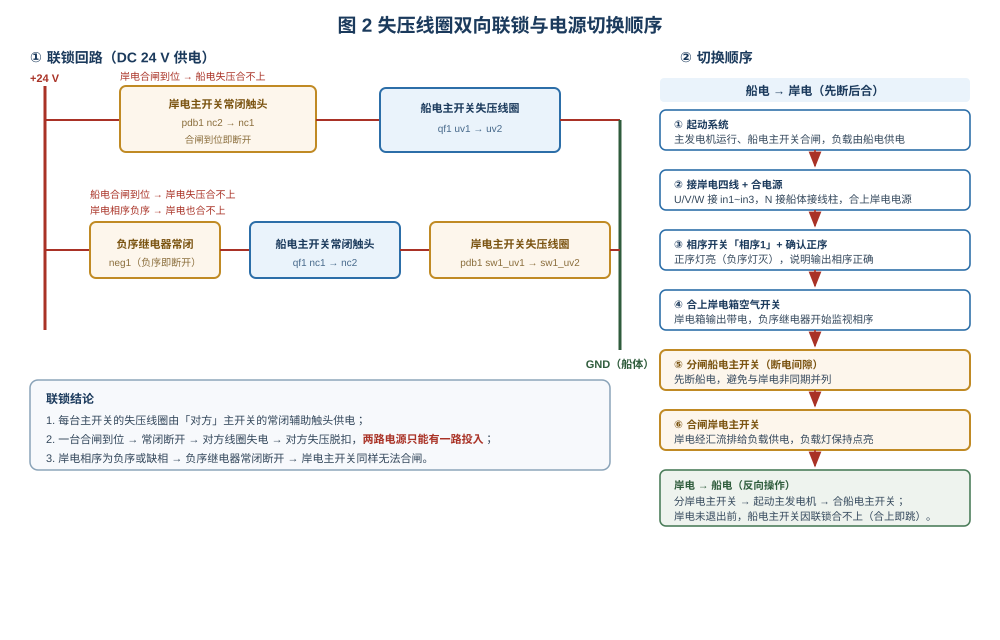

# 船舶岸电接入仿真

> 适用于船舶电气 / 轮机专业的"船舶岸电接入与双电源切换"实训。
> 学习目标：① 说清岸电接入系统的组成与相序监视环节；② 会用失压线圈联锁解释"岸电与船电只能有一台合闸"；
> ③ 会按"先断后合"的顺序完成船电 ⇄ 岸电两次切换；④ 会判断岸电相序接反（负序）时的现象与处理。

## 一、装置组成

台架是一套"船电 + 岸电"双电源系统。船电侧由 1# 同步发电机 `gen1`（80 kW / 400 V / 50 Hz）
经船电主开关 `qf1`（船用框架式空气断路器：储能弹簧、合闸/分励/失压线圈、常闭辅助触头）
送入汇流排 `bus1`；汇流排第 10 口带三盏**星形连接**的白炽灯 `bl1`/`bl2`/`bl3`（冷态 48.4 Ω）
作为负载，中性点不接地——这就是船舶"船体作为接地参考"的电网特点。

岸电侧由三相四线电源 `shore_in`（220 V）经**岸电箱 `shorebox1`** 送入**岸电主开关 `pdb1`**
（塑壳断路器），再上汇流排第 6 口。岸电箱里依次是：

- **相序指示灯**：正序灯（绿）/ 负序灯（红），由进线线电压实时判定；
- **相序转换开关**：「相序1 / OFF / 相序2」三档，可在箱内对调两相，用于把负序纠正为正序；
- **出口空气开关**（刀片式断路器）：箱内的总开关，分闸后输出失电；
- **中线接线柱**：岸电电源 N 接船体，使岸电中性点与船电中性点等电位。

**负序继电器 `neg1`** 的进线取自岸电箱输出 t1/t2/t3，其常闭触点串入岸电主开关的失压线圈
回路——相序正确才允许岸电投入，这是本系统"防错相"的关键。

## 二、电气联锁（核心）

两台主开关的**失压脱扣线圈由对方主开关的常闭辅助触头供电**，再加一道负序继电器常闭触点：

| 线圈 | 供电路径 |
|---|---|
| 船电主开关失压线圈 | `dc_uv`+ → 岸电主开关常闭 `nc2→nc1` → `qf1 uv1→uv2` → 接地 |
| 岸电主开关失压线圈 | `dc_uv`+ → 负序继电器常闭 `nc2→nc1` → 船电主开关常闭 `nc1→nc2` → `pdb1 sw1_uv1→uv2` → 接地 |

由此得到三条结论：

1. 任一台主开关**合闸到位**，其常闭触头即断开 → 对方失压线圈失电 → 对方**失压脱扣**，
   合不上或合上即跳；因此两路电源**只能有一路投入**，从电气上杜绝非同期并列。
2. 岸电相序为**负序或缺相**时，负序继电器常闭触点断开 → 岸电主开关同样合不上，
   与船电侧无关，属于"岸电自身不能接入"。
3. 该联锁是**电气联锁**而非机械联锁：先分闸的一方才把自己的常闭触头重新闭合，
   另一方才有条件合闸——这正是"先断后合"顺序的由来。

> 注意：船电主开关的**储能电机**由 24 V 直接供电，不受联锁影响；合闸失败后只需重新储能，
> 待对方分闸、失压线圈重新得电，即可正常合闸。

## 三、切换顺序

**船电 → 岸电**：起动系统（船电供电）→ 接岸电四线（U/V/W 接 in1～in3、N 接船体）→
合岸电电源 → 相序开关打「相序1」并确认正序灯亮 → 合岸电箱空气开关 → **先分船电主开关** →
**再合岸电主开关**。整个过程中负载灯短时熄灭，随后由岸电重新点亮。

**岸电 → 船电**：分闸岸电主开关 → 起动 1# 机组并建压 → 合船电主开关。
若岸电尚未退出就试图合船电主开关，会因联锁**合不上（合上即失压跳闸）**，这不是故障，
而是设计好的保护。

## 四、操作要点与常见问题

| 现象 | 原因 | 处理 |
|---|---|---|
| 岸电箱负序灯亮、正序灯灭 | 岸电进线相序接反 | 用相序转换开关切到另一档（相序1 ⇄ 相序2），或对调任两根进线 |
| 岸电主开关合不上 / 合上即跳 | 岸电相序负序、负序继电器常闭断开；或箱内空开未合、电源未接通 | 先确认正序灯亮、空开已合，再合闸 |
| 船电主开关合不上 | 岸电主开关还在合闸位（联锁） | 先分岸电主开关，待 24 V 失压线圈得电后再合 |
| 合闸无反应 | 储能未到位 | 等储能电机把弹簧储满（约数秒）后重新按「合闸」 |
| 箱内空开合上又跳 | 进线失电或相序开关在 OFF 位 | 检查岸电电源与相序开关位置 |

**操作提示**：岸电箱两个旋钮/开关都是"点一次一个动作"——相序开关点左/上/右三个方向分别
对应「相序1 / OFF / 相序2」，合闸、分闸是两个独立按钮；岸电主开关点击手柄即可合/分，
跳闸位先点一下复位再合闸。

## 五、小结

岸电接入的关键不是"能不能送电"，而是"**敢不敢让它和船电碰面**"：相序监视（负序继电器）
解决"岸电能不能进"，失压线圈联锁解决"两路会不会同时进"。把这两条记住，
切换顺序（先断后合、先分后合）自然就推得出来，也就能解释现场"为什么合不上、为什么灯不亮"。
