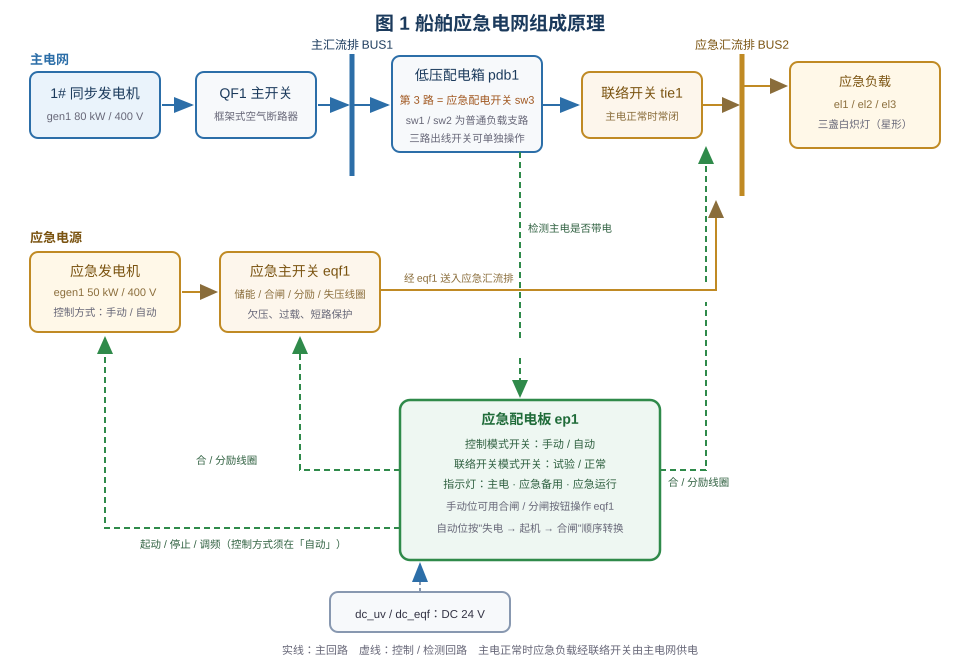
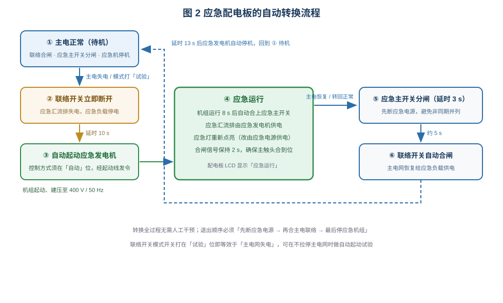

# 船舶应急发电机系统仿真

> 适用于船舶电气 / 轮机专业的"船舶应急电网与应急发电机"实训。
> 学习目标：① 说清应急电网的组成与"主电—应急"转换关系；② 会在机旁手动起停应急发电机；
> ③ 会用应急配电板的「试验」位做自动起动试验；④ 理解自动投入与自动退出的先后顺序。

## 一、装置组成

台架是一套"主电网 + 应急电网"双电网系统。主电网由 1# 同步发电机 `gen1`（80 kW / 400 V /
50 Hz）经主开关 `qf1`（船用框架式空气断路器：储能弹簧、合闸/分励/失压线圈）送入主汇流排
BUS1；主汇流排经低压配电箱 `pdb1` 的**第 3 路（应急配电开关 sw3）** → 联络开关 `tie1` →
应急汇流排 BUS2。应急电源是应急发电机 `egen1`（50 kW），经应急主开关 `eqf1` 接入 BUS2。
应急负载为三盏星形连接的白炽灯 `el1`/`el2`/`el3`。

由此可见两点：**平时应急负载并不"闲置"**——主电正常时它经联络开关由主电网供电，只有主电
失电后才改由应急发电机供电；**应急主开关与联络开关都受应急配电板 `ep1` 的线圈控制**，
不能像普通断路器那样随手合分（手动位时可用配电板上的合闸/分闸按钮操作应急主开关）。

应急配电板是全台架的核心，面板上有：

- **控制模式开关**（手动 / 自动）：自动位由状态机自动完成转换，手动位只执行人工指令；
- **联络开关模式开关**（试验 / 正常）：打在试验位即强制联络开关断开，等效于"主电网失电"，
  可在不拉停主电网的情况下做应急发电机自动起动试验；
- **检测口**：接 `pdb1` 第 3 路出口，用于判断主电是否带电；
- **输出口**：联络开关合/分励、应急主开关合/分励、应急机组起动/停止/调频；
- **指示灯与 LCD**：主电有电、应急备用、应急运行，以及主电电压、机组频率/电压、模式与阶段。

## 二、自动转换逻辑

1. **待机**：检测口有电（峰值 > 120 V）→ 联络开关保持合闸、应急主开关分闸、应急机组停机。
2. **失电判定**：检测口失压，或模式开关打到「试验」→ 联络开关**立即断开**，应急汇流排失电。
3. **延时起动**：断开后 **10 s** 经起动线向机组发起动命令（机组控制方式必须在「自动」位，
   手动位只认机旁按钮）。
4. **延时合闸**：机组运行、电压与频率建立后 **8 s** 发出应急主开关合闸命令，合闸信号保持
   **2 s** 确保主触头合到位；此时 BUS2 由应急发电机供电，应急灯重新点亮。
5. **自动退出**：主电恢复（或模式转回「正常」）→ **3 s** 后应急主开关分闸 → 合上联络开关
   → 再延时后应急机组自动停机，回到待机。全过程约 13 s。

退出顺序"**先断应急电源 → 再合主电联络 → 最后停机组**"不可颠倒：先分应急主开关让应急
汇流排失电，再合联络开关恢复主电，可避免两个电源非同期并列；若顺序颠倒，轻则合闸冲击，
重则并车保护动作跳闸。

## 三、典型工况与故障

| 工况 / 故障 | 现象 | 处置要点 |
|---|---|---|
| 手动起动测试 | 控制方式打「手动」，机旁「起动」后机组建压 400 V / 50 Hz | 机组只在手动位响应机旁起停；测完打回「自动」 |
| 自动起动试验 | 联络开关转「试验」：联络断开 → 10 s 起机 → 8 s 合应急主开关 → 应急灯亮 | 观察配电板 LCD 阶段与三只指示灯变化 |
| 应急发电机超速 | 原动机保护停机，故障未清除前起动即停 | 断开故障后重新起动 |
| 调压器（AVR）建压不足 | 线电压约 200 V，应急主开关欠压保护 2 s 后跳闸 | 应急供电失败，需先排除调压器故障 |
| 应急主开关储能弹簧失效 | 合闸弹簧储不满，应急主开关无法合闸 | 应急投入失败，停机检查储能机构 |
| 应急主开关脱扣轴卡死 | 合闸后无法分闸，自动退出时断不开应急供电 | 严禁强行操作，按机械卡涩处理 |

主开关 `qf1`、`eqf1` 内置简化保护：欠压（< 额定 ×85% 持续 2 s）、过载、干线短路（瞬时）。

## 四、操作要点

- **自动接线**：工具栏「自动接线」接好主回路、应急负载、联络与应急配电板的检测/控制回路
  （本电路接线较多，采用瞬时接线）。
- **起动系统**：一键接线、复位并起动 1# 机组，储能到位后按遥控面板「合闸」给主电网供电。
- **应急配电板**：两个旋钮均"点一次换一档"，点右半区顺时针、点左半区逆时针；手动位可用
  合闸/分闸按钮直接操作应急主开关。
- **故障设置**：工具栏「故障设置」勾选后「应用设置」生效；复位流程会自动取消已勾选的故障。
- **演练**：自动转换期间（约 10～30 s）不要手动干预，否则状态判定与现象会不一致。

## 五、小结

应急电网的价值在于"**主电一失、应急即上**"：它靠检测主电电压判断该不该投入，靠固定的
延时顺序（断开联络 → 起机 → 建压 → 合闸）保证不把两个电源并列；主电恢复后又按相反顺序
退出。掌握"谁先动、谁后动、为什么这个顺序"，就掌握了应急配电板的使用与排故要点。
