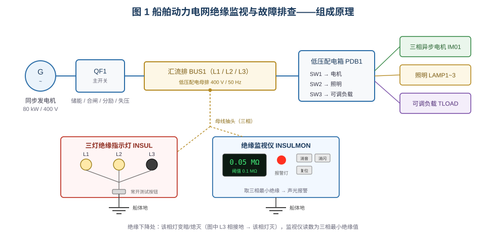
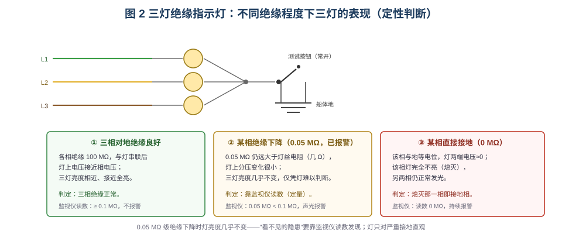
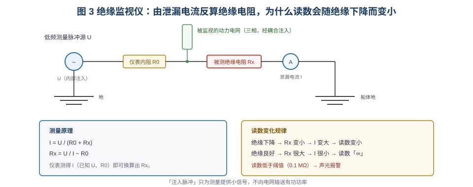
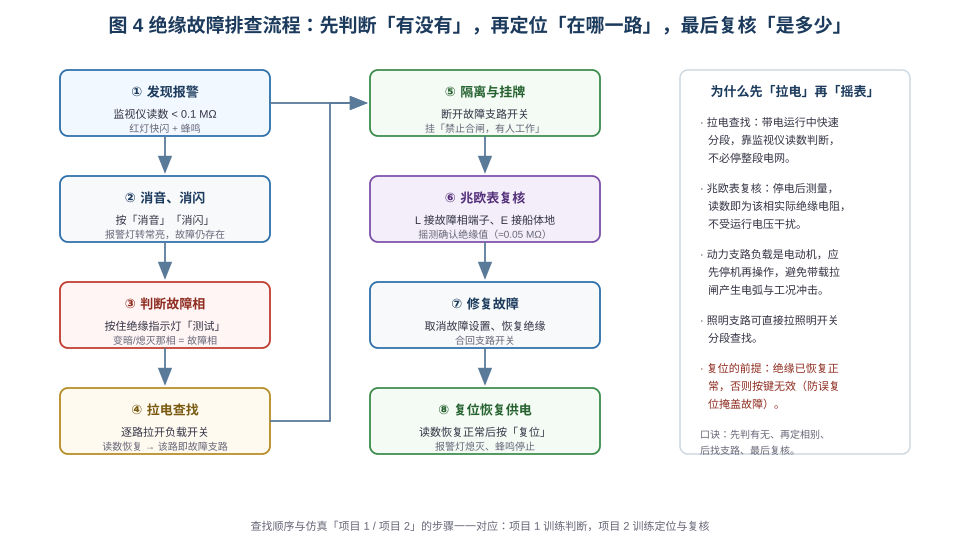

# 船舶电网绝缘监视与故障排查仿真

> 适用于船舶电气 / 轮机专业的"船舶电力网绝缘监测"实训。
> 学习目标：① 说明三灯绝缘指示灯与绝缘监视仪的工作原理；② 由读数与灯亮度判断"有无绝缘故障、哪一相故障"；
> ③ 用拉电查找法定位故障支路；④ 用兆欧表停电复核绝缘值并正确复位。

## 一、装置组成



船舶动力电网为**中性点不接地（IT）系统**，单相对地绝缘下降不会立即形成短路，因此必须靠
**绝缘监测装置**发现，否则长期运行会发展为相间短路或触电事故。本仿真台架由三部分组成：

| 部分 | 设备 | 作用 |
|---|---|---|
| 电源与配电 | 同步发电机 `G`（80 kW / 400 V / 50 Hz）、主开关 `QF1`、汇流排 `BUS1`、低压配电箱 `PDB1` 三路馈出 | 模拟船舶动力电网 |
| 负载 | 三相异步电机、三盏照明灯、三相可调负载 | 提供动力 / 照明 / 可调三类支路 |
| 绝缘监测 | 三灯绝缘指示灯、绝缘监视仪 | 判断故障相、给出量化读数并声光报警 |

两台监测装置接在**母线同一抽头**上，测得的是全电网的对地绝缘；它们功能互补：
**指示灯定性、监视仪定量**。

## 二、三灯绝缘指示灯：灯亮度说明了什么



三只灯分别接 L1、L2、L3，星点经面板上的**常开「测试」按钮**接船体地。平时按钮断开，灯不构成回路；
**按住按钮**后，三灯经星点接地，形成"相电压—灯—地"的通路。此时每只灯与**该相对地绝缘电阻**串联分压：

- 绝缘良好（如 100 MΩ）时，绝缘电阻远大于灯丝电阻，灯上几乎承担全部相电压 → **三灯明亮且亮度相近**；
- 某相绝缘下降（如 0.05 MΩ）时，绝缘电阻**仍远大于灯丝电阻**（几 Ω 量级），灯上分压变化很小 →
  **三灯亮度几乎不变**，仅凭灯难以判断。这正是需要绝缘监视仪的原因：**读数能发现"看得见灯却看不见的隐患"**；
- 某相绝缘继续下降至 kΩ 级时，该相灯开始明显变暗；
- 某相直接接地（0 MΩ）时，该相与地等电位，灯两端电压≈0 → **该相灯熄灭**，另两相仍亮。

因此提示灯的用法是：**"熄灭"直指接地相，"变暗"对应严重绝缘下降，而 0.05 MΩ 级隐患必须看监视仪读数**。
测试按钮必须"按住观察"，松开即恢复三灯正常显示。

## 三、绝缘监视仪：读数为什么会随绝缘下降而变小



监视仪向电网**注入一个低频测量小信号**（不输送有功功率），测量回路为
"仪表内阻 R0 + 被测绝缘电阻 Rx"的串联通路：

```
I = U / (R0 + Rx)      →      Rx = U / I − R0
```

绝缘下降 → Rx 变小 → 泄漏电流 I 变大 → **仪表换算出的读数变小**；绝缘良好时 Rx 极大、I 极小，
读数显示"∞"。读数低于整定阈值（本台 0.1 MΩ）即**红灯快闪 + 蜂鸣**报警。面板三键的作用：

| 按键 | 作用 | 注意 |
|---|---|---|
| 消音 | 停止蜂鸣 | 故障仍存在，红灯继续闪 |
| 消闪 | 红灯转常亮 | 表示"报警已被确认"，故障未消除 |
| 复位 | 熄灭红灯、解除锁存 | **仅在绝缘恢复正常后有效**，防止误复位掩盖故障 |

## 四、故障排查流程



1. **发现报警**：监视仪读数低于阈值，声光报警；先记录读数大小。
2. **消音、消闪**：确认报警，避免蜂鸣干扰后续操作；此时故障仍在。
3. **判断故障相**：按住绝缘指示灯测试按钮，看哪一相变暗/熄灭。
4. **拉电查找定位支路**：依次拉开配电箱各路负载开关，**读数恢复的那一路即故障支路**；
   未恢复则继续拉下一路，逐级缩小范围。
5. **隔离挂牌**：断开故障支路并挂"禁止合闸，有人工作"检修牌。
6. **兆欧表停电复核**：L 端接故障负载的故障相端子、E 端接船体地，摇动手柄读取绝缘电阻，
   确认与监视仪判断一致（如 0.05 MΩ）。
7. **修复**：消除绝缘缺陷（仿真中由"故障设置"取消），合回支路开关。
8. **复位恢复供电**：读数恢复正常后按「复位」，报警灯熄灭、蜂鸣停止。

> 注意：照明支路可直接拉照明开关分段查找；**动力支路负载是电动机，应先停机再操作**，
> 避免带载拉闸产生电弧和工况冲击。

## 五、仿真操作要点

- 工具栏「自动接线」完成主回路、控制回路与绝缘检测回路接线；按发电机机旁「起动」建压，
  按压主开关储能手柄（或等储能电机自动储能）后按「合闸」，再合上配电箱三路开关。
- 「故障设置」可设置**动力电网绝缘低（0.05 MΩ）**与**动力电网接地（0 MΩ）**，每次随机选取
  一路负载的一相，便于反复训练判断。
- 「项目 1 用仪表确认动力电网绝缘故障」：练习读数判断、消音消闪、按压测试按钮判断故障相
  （绝缘低时三灯亮度不变；接地时该相熄灭）。
- 「项目 2 电网绝缘故障的查找」：练习拉电查找法、挂检修牌、调出手摇兆欧表（L/E 接线）复核，
  最后修复复位。
- 右键组件可打开参数界面，修改各负载各相绝缘值、监视仪报警阈值；修改后须点「保存」。

## 六、思考题

1. 为什么中性点不接地系统中，单相绝缘下降不会立即跳闸？这对船舶安全有什么风险？
2. 绝缘监视仪读数 0.05 MΩ 与 0 MΩ 分别对应什么故障程度？三灯表现有何不同？
3. 拉电查找时，为什么"读数恢复"就说明故障在该支路？若全部拉完仍不恢复，应考虑什么？
4. 为什么复位按钮在绝缘未恢复时无效？若强行复位会带来什么后果？
