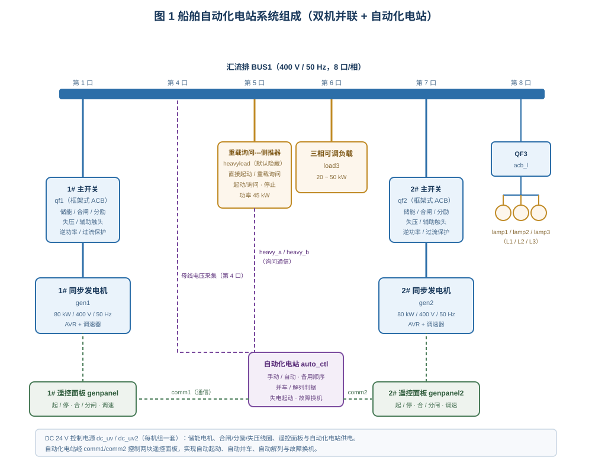
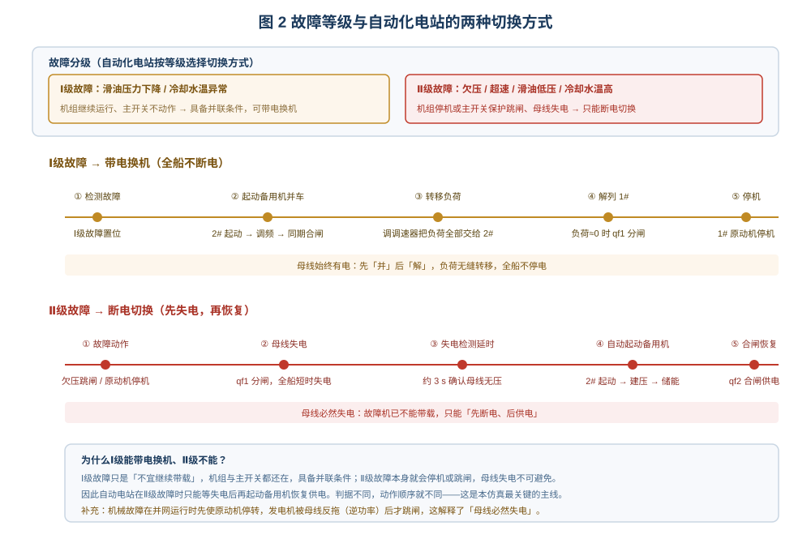
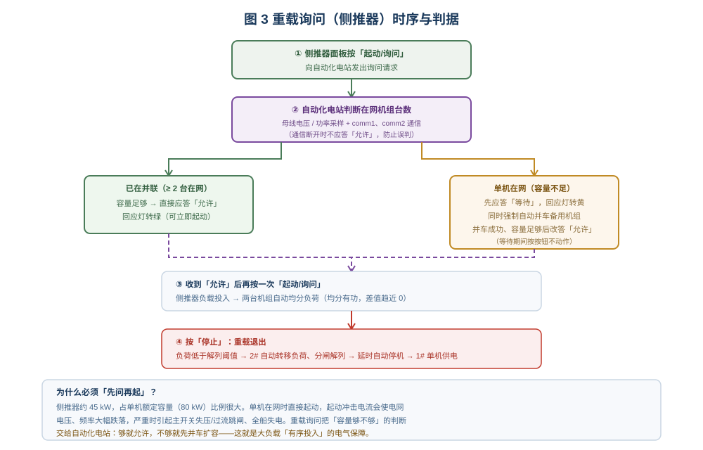

# 船舶自动化电站仿真

> 适用于船舶电气 / 轮机专业的"自动化电站与重载询问"实训。
> 学习目标：① 说清自动化电站的组成与信号通路；② 会用"负荷—容量"判据解释自动并车/自动解列；
> ③ 会区分Ⅰ级故障（带电换机）与Ⅱ级故障（断电切换）并说明原因；
> ④ 会用重载询问的"等待—允许"机制解释大负载为何不能直接起动。

## 一、装置组成

台架是一套**双机并联**的船用电站。1#、2# 同步发电机组 `gen1`/`gen2`（各 80 kW / 400 V / 50 Hz）
分别经**船用框架式空气断路器** `qf1`/`qf2` 送入汇流排 `bus1`（8 口/相）。每台机组配一块
**遥控面板** `genpanel`/`genpanel2`（起、停、合闸、分闸、调速，以及通信口）。

**船舶电站自动控制模块 `auto_ctl`** 是整套系统的"大脑"，它只有三组接口：

- **母线采集**（`bus_a`/`bus_b`，取自汇流排第 4 口）：判断母线是否有电、电压频率是否正常；
- **24 V 电源**（`p24_p`/`p24_n`）：模块自身工作电源；
- **通信**（`comm1`↔1# 面板、`comm2`↔2# 面板）：把"起动/停机/合闸/分闸/调速"指令发给面板执行。

负荷侧：汇流排第 6 口接**三相可调负载** `load3`；第 5 口接**重载询问---侧推器** `heavyload`
（默认隐藏，勾选工具栏「重载询问面板」调出，并自动接好三相线与两根通信线）；第 8 口经 QF3
带三盏白炽灯作馈出支路。控制电源 `dc_uv`/`dc_uv2` 为各机组的储能、合闸、分励、失压线圈供电。

## 二、自动化电站的运行判据

| 功能 | 判据 | 动作 |
|---|---|---|
| 失电自动起动 | 自动位 + 母线无压 | 延时约 3 s 起动首台机组 → 建压储能 → 自动合闸 |
| 自动并车 | 总负荷 > `parallelKw`（单机额定的 60%，约 48 kW） | 起动备用机 → 调频 → 同期合闸 |
| 自动均分负荷 | 两机并联 | 调调速器使两机有功趋于相等 |
| 自动解列 | 总负荷 < `decoupleKw`（28%）延时约 20 s | 转移负荷 → 分闸 → 延时约 30 s 停机 |
| 带电换机 | Ⅰ级故障（机组仍运行） | 并车 → 转移负荷 → 解列 → 停机 |
| 断电切换 | Ⅱ级故障（跳闸或停机） | 母线失电 → 起动备用机 → 合闸恢复 |

加入**延时**是为了躲过负荷瞬时波动，避免机组频繁起停——这是自动电站与"简单阈值控制"的关键差别。

## 三、自动并车与自动解列

1. 起动系统：1# 单机运行、主开关合闸，向汇流排供电（三盏灯亮）。
2. 把自动化电站的「手动/自动」旋钮打到**自动**位，自动灯 `led-auto` 点亮。
3. 把负载功率改为 **50 kW** 并投入：负荷超过并车阈值 → 2# 自动起动、自动同期合闸，
   两机功率迅速趋于相等（各约 25 kW）。
4. 退出负载：总负荷低于解列阈值 → 2# 自动转移负荷、自动分闸，延时后自动停机，
   1# 单机继续供电。

> 观察要点：2# 起动的瞬间，母线电压频率应有轻微下降后回稳；合闸瞬间无冲击电流，
> 说明"同期"条件（电压、频率、相位一致）已满足——这就是自动并车与"盲目合闸"的本质区别。

## 四、两种故障切换

| 项目 | Ⅰ级故障 | Ⅱ级故障 |
|---|---|---|
| 典型故障 | 滑油压力下降、冷却水温度异常 | 欠压、超速、滑油低压、冷却水温高 |
| 机组与主开关 | 机组继续运行、主开关不动作 | 机组停机或主开关保护跳闸 |
| 母线 | **不断电** | **必然失电** |
| 自动电站动作 | 先并车备用机 → 转移负荷 → 解列 → 故障机停机 | 失电检测 → 起动备用机 → 建压储能 → 合闸恢复 |
| 教学结论 | 具备并联条件，可"先并后解" | 不具备并联条件，只能"先断电、后供电" |

Ⅱ级故障中，机械故障（超速/滑油低压/冷却水温高）在并网运行时会先使原动机停转，发电机被母线
反拖成电动机运行（逆功率），再由逆功率保护跳闸——这也是"母线必然失电"的物理解释。

## 五、重载询问

1. 勾选工具栏「重载询问面板」，侧推器面板显示并自动接线；选择开关打到「重载询问」档。
2. 按「起动/询问」：单机在网 → 回应灯**黄**（等待），电站同时强制自动并车 2#。
3. 并车成功、容量足够 → 回应灯**绿**（允许）。
4. **再按一次**按钮，侧推器负载才投入，两机自动均分负荷。
5. 按「停止」：负载退出 → 负荷低于解列阈值 → 2# 自动解列停机，1# 单机供电。

关键：**"允许"是负载起动的必要条件**。若在"等待"期间连按按钮，面板不会动作——这不是失灵，
而是联锁保护。

## 六、操作要点与常见问题

| 现象 | 原因 | 处理 |
|---|---|---|
| 自动灯不亮、电站不动作 | 旋钮仍在手动位；或 `auto_ctl` 无 24 V / 通信线未接 | 打到自动位，检查 24 V 与 comm1/comm2 |
| 2# 不起动 | 通信线未接、故障未清除、母线与采集线未接 | 补接 comm2 与母线采集线；排除故障 |
| 2# 起动但合不上闸 | 同期条件未满足（频率/相位差过大） | 等待自动调频调压完成，不要人工强合 |
| 负载加到 50 kW 仍不并车 | 负载未真正投入（只改了功率未按「加载」） | 改完参数点「保存」，再按「加载」 |
| 按询问按钮无反应 | 面板不在「重载询问」档，或通信 heavy_a/heavy_b 未接 | 切到询问档；重新勾选「重载询问面板」补线 |
| Ⅰ级故障后全船失电 | 故障等级判断错误（实际是Ⅱ级故障） | Ⅱ级故障不可能带电换机，改用断电切换流程理解 |

## 七、小结

自动化电站的全部动作都来自两条判据：**"负荷与容量"决定增开还是停用机组**，
**"母线是否有电"决定延时起动合闸**；故障时再按**等级**决定是"带电换机"还是"断电切换"。
把这两条判据 + 一条故障分级记住，先后顺序、灯色变化、以及"为什么合不上/为什么不动作"都能自己推出来。
