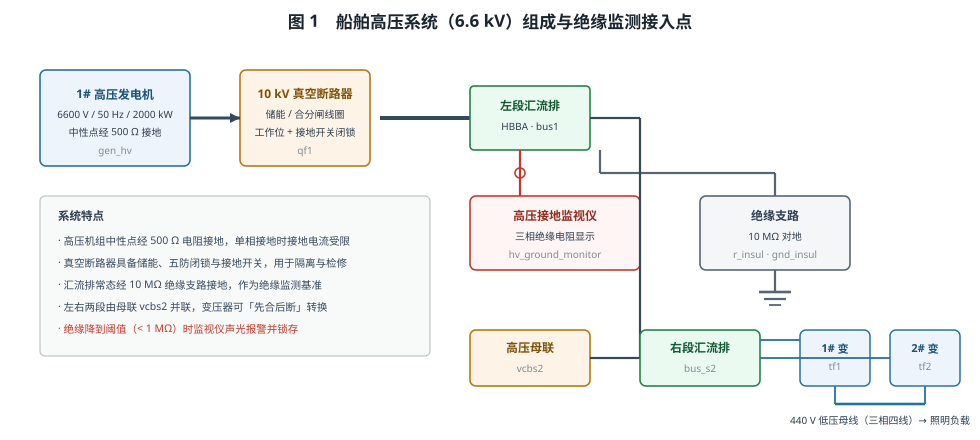
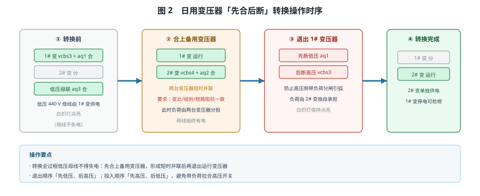
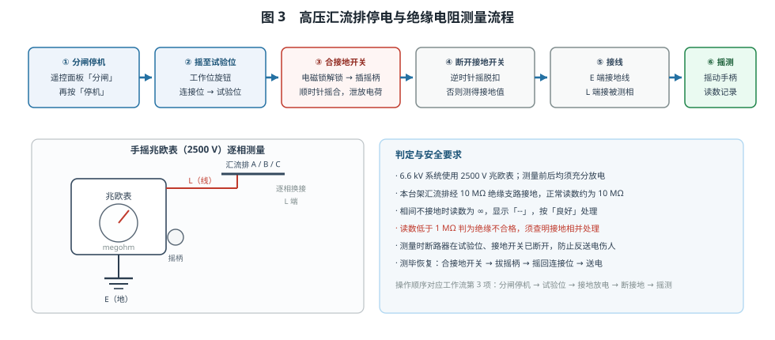
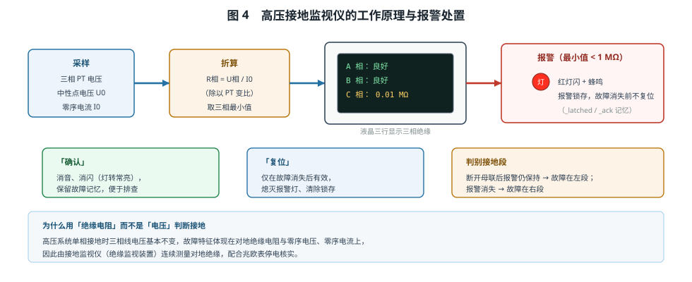

# 船舶高压系统操作和绝缘监测

## 一、系统构成

本工程按船舶 6.6 kV 高压配电装置的典型结构搭建（图 1）：

- **1# 高压发电机**（6600 V / 50 Hz / 2000 kW）三相出线经 **10 kV 真空断路器 qf1** 送入**左段汇流排 HBBA**；
  发电机中性点经 500 Ω 电阻接地，单相接地时接地电流被限制在允许范围内。
- **真空断路器**具备储能电机、合闸/分励/失压线圈与完整的手动操作面板：合分闸按钮及防护盖、工作位转换旋钮
  （连接位 / 试验位 / 检修位）、接地开关摇柄孔与电磁锁、柜门，构成"五防"闭锁。
- **微机综合保护装置 prot1** 经 CT（出口、入口、中性点）与 PT 采样，实现差动、速断、过载、接地、欠压、逆功率保护。
- **高压接地监视仪**接汇流排第 4 口，连续监测三相对地绝缘；第 5 口经 **10 MΩ 绝缘支路**接地，作为绝缘基准。
- 左段经**母联断路器 vcbs2** 与**右段汇流排**并联；右段带高压负载、2# 简化机组，并经两台 6600/440 V
  变压器 `tf1`/`tf2` 与空气开关 `aq1`/`aq2`/`aq3` 向两段 440 V 低压母线供电（白炽灯作馈出指示）。

## 二、起动与并网供电

1. **自动接线**：接好主回路、24 V 控制回路（储能电机、合闸、分闸、失压线圈）、遥控面板与保护装置采样线。
2. **起动建压**：按住遥控面板「起动」，机组升速建压，观察电压升至额定（约 6600 V 线电压）、频率稳定在 50 Hz。
3. **合闸供电**：待断路器储能到位后按住「合闸」，主触头闭合，汇流排带电。
4. **并联供电**：合上母联 `vcbs2`，两段汇流排并联，右段负载具备投运条件。

**并网条件**：电压幅值相等、频率相等、相位（相序）一致，且断路器已储能。任一条件不满足，合闸瞬间将产生
很大的冲击电流与机械应力，可能引发保护跳闸甚至损坏机组。

## 三、日用变压器的转换

转换使用"**先合后断**"（图 2）：

1. 合上 2# 变压器高压断路器 `vcbs4`、低压空气开关 `aq2`，与运行中的 1# 变压器形成**短时并联**；
2. 确认负荷已转移后，**先断低压侧 `aq1`、后断高压侧 `vcbs3`**，退出 1# 变压器；
3. 全程 440 V 母线不失电，白炽灯保持点亮。

并联运行必须满足：变比相等、联结组别相同、短路阻抗百分比相等、相位一致，否则会产生环流或负荷分配不均。
退出顺序"先低压、后高压"可避免高压侧带负荷分闸引弧；投入顺序则相反。

## 四、停电与绝缘电阻测量

高压设备测绝缘必须严格执行"**停电—验电—放电—测量—再放电**"（图 3）：

1. 遥控「分闸」并「停机」，使汇流排停电；
2. 把工作位由**连接位**摇到**试验位**（合闸状态时机械闭锁，摇不动——防带负荷拉合隔离）；
3. 点电磁锁解锁，插入摇柄顺时针摇动，**合上接地开关**：泄放电缆与设备电容上的剩余电荷，同时防止误送电、反送电；
4. 逆时针摇脱扣**断开接地开关**（否则测得的是接地电阻）；
5. 调出 2500 V 手摇兆欧表，**E 端接地、L 端接被测相**，逐相测量 A/B/C 对地绝缘并记录；
6. 测毕充分放电，恢复接地开关、拔出摇柄、摇回连接位，再送电。

本台架汇流排经 10 MΩ 支路接地，正常读数约 **10 MΩ**；相间不接地时读数为 ∞（显示"--"）；读数低于 **1 MΩ**
判为绝缘不合格，须查明接地相后处理。

## 五、绝缘监测与单相接地判别

高压系统发生单相接地时，三相线电压几乎不变，故障特征体现在**对地绝缘电阻下降、中性点位移电压与零序电流上升**，
因此靠接地监视仪（绝缘监视装置）连续监视，而不是看电压表（图 4）。

- **正常**：三相绝缘读数处于 MΩ 级，无报警；
- **接地**：受影响相绝缘降至阈值以下（&lt; 1 MΩ），红灯闪烁 + 蜂鸣器鸣叫，并**锁存**故障记忆；
- **确认**：消音消闪，灯转常亮，保留故障记忆便于排查；
- **复位**：仅当故障消失后有效，熄灭报警灯；
- **判别接地区段**：断开母联后报警仍保持 → 故障在左段；报警消失 → 故障在右段。

## 六、仿真操作项目（工具栏任务下拉框）

| 项目 | 训练要点 |
|---|---|
| 1. 高压发电机起动与并网供电操作 | 遥控起停与合分闸、储能、建压判据、母联并联、并网条件 |
| 2. 日用变压器的转换操作 | 先合后断、并联条件、先低压后高压退出 |
| 3. 高压汇流排停电与绝缘电阻测量 | 工作位转换、接地开关五防、兆欧表接线与读数判定 |
| 4. 汇流排绝缘监测与单相接地判别 | 监视仪读数、报警确认与复位、故障界面设置/修复 |

全部步骤在自动演示中逐个"箭头指向目标 → 立即执行 → 停留观察"，按钮、旋钮、摇柄均为模拟真实点击；
故障设置走故障界面、兆欧表走「选择仪表」界面，避免跳过操作过程。

## 七、思考题

1. 为什么高压系统单相接地时三相线电压变化很小，却必须立即处理？
2. 变压器转换时若不满足并联条件而强行并联，会出现什么现象？
3. 测绝缘前合接地开关、测前又必须断开接地开关，两者是否矛盾？为什么？
4. 接地监视仪报警被"确认"后灯转常亮，此时能否认为故障已消除？
