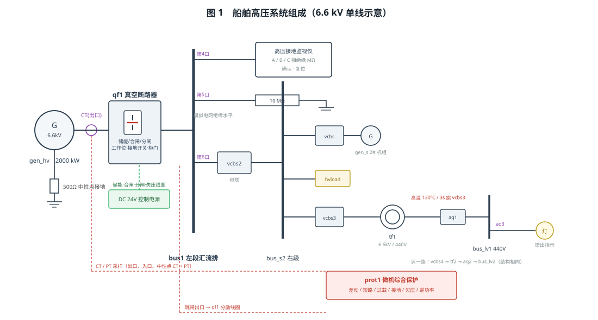
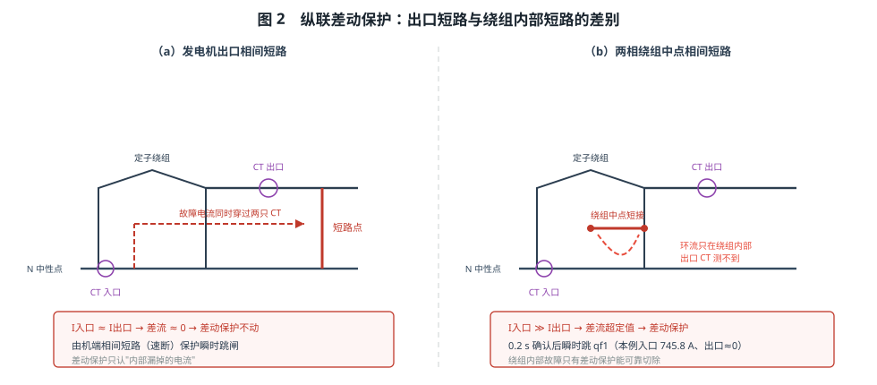
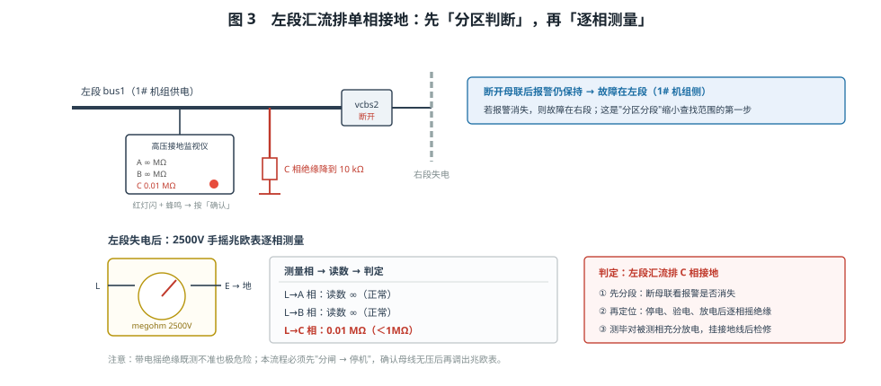
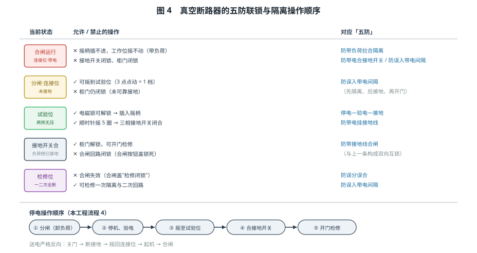

# 船舶高压系统故障处理和断路器隔离

> 适用于船舶电气 / 轮机专业的"高压配电装置、继电保护与绝缘监测"实训。
> 学习目标：① 说清 6.6 kV 配电装置的组成与信号通路；② 会用两侧电流关系解释差动保护
> 为什么只切"内部故障"；③ 会解释变压器高温保护与备用变压器切换；④ 会用"分区分段 + 逐相
> 摇绝缘"判断单相接地；⑤ 能按"五防"顺序完成真空断路器的隔离与恢复送电。

## 一、装置组成

台架是一套 **6.6 kV 高压配电装置**。**1# 高压发电机 `gen_hv`**（6600 V / 50 Hz / 2000 kW，
额定电流约 219 A）的三相出线接 **真空断路器 `qf1`** 的 T1~T3，L1~L3 送 **左段汇流排 `bus1`**。
发电机中性点经 **500 Ω 电阻**接地（限制单相接地电流），机端与中性点两侧各装一组 CT。

`qf1` 是一台完整的开关柜：**储能电机**（m）由 DC 24 V 供电自动储能，**合闸线圈**（c）、
**分励线圈**（fl）、**失压线圈**（uv）分别经遥控面板出口动作；正面有合闸/分闸按钮（带防护玻璃盖）、
**工作位转换旋钮**（连接—试验—检修）、**接地开关摇柄孔与电磁锁**、柜门（与接地开关联锁）。

**遥控面板 `hvgp`** 只有几组接口：起动/停止、调速（频率给定）、合闸/分闸、灭磁、同步表与 24 V 电源；
**微机综合保护装置 `prot1`** 经出口 CT、入口（中性点侧）CT 与 PT 采样，出口接 `qf1` 的跳闸回路。

负荷侧：`bus1` 第 4 口接 **接地监视仪**（液晶显示 A/B/C 相绝缘电阻，带「确认」「复位」），
第 5 口经 **10 MΩ 绝缘支路**接地（模拟电网绝缘水平），第 6 口经 **母联断路器 `vcbs2`** 送右段；
右段带 2# 简化机组、高压负载，并经 `vcbs3`/`vcbs4` + **高压变压器 `tf1`/`tf2`（6600/440 V）**、
空气开关 `aq1`~`aq3` 供两段 440 V 低压母线，三盏白炽灯作馈出指示。

## 二、差动保护为什么只切"内部故障"

差动保护按**基尔霍夫电流定律**构成：正常或外部故障时，流进发电机的电流等于流出电流，
**差流≈0**，保护不动。

- **出口相间短路**：故障电流同时穿过机端 CT 和中性点侧 CT，两只 CT 测到的电流几乎相等，
  差流仍≈0——差动保护**不会**动作，由机端相间短路（速断）保护瞬时跳闸。
- **绕组内部相间短路（如两相绕组中点短接）**：短路环流只在绕组内部经中性点侧流过，
  机端 CT 几乎测不到电流，于是 **入口 ≫ 出口**，差流超过定值（工程整定为 0.09 $I_n$ 量级），
  保护 **0.2 s 确认后瞬时跳闸**。本流程实测 A/B 相入口 745.8 A、出口≈0，因此"差动跳闸"。

这就是高压发电机必须装纵联差动保护的原因：绕组内部短路时，过流、欠压、逆功率等保护都
"看不见"故障，只有差动能把它切除。

## 三、变压器高温保护与切换

`tf1` 的温升由负荷电流决定，高温保护整定为 **130 ℃ 动作、3 s 延时**，延时用于躲过短时冲击负荷；
动作后**跳开其高压侧断路器 `vcbs3`**（`protBk`），变压器断电并自然冷却，温度回落到 **120 ℃（回差）**
以下保护才复归——这套"动作值 + 延时 + 回差"就是温度类保护的通用三要素。

设置「变压器严重散热不良」后，通电约 15 s 升到 130 ℃ 即跳闸；此时**断开 `aq1` 隔离故障变压器低压侧**，
合上 `vcbs4`、`aq2` 改由 2# 变压器供电，白炽灯重新点亮——这就是"备用变压器自动/手动切换"的完整动作：
**先隔离故障设备，再投入备用设备，负荷不中断**。

## 四、单相接地：先分区，再定位

中性点经大电阻接地的系统，单相接地时故障电流被限制得很小，但**非故障相对地电压升高到线电压**，
长时间运行会扩大绝缘损坏，所以必须尽快找出接地点。

1. **报警**：C 相绝缘降到 10 kΩ（0.01 MΩ） → 接地电流剧增 → 监视仪红灯闪、蜂鸣。按「确认」只消音消闪，
   **报警灯保持常亮**，即"故障未消除，记忆不清除"。
2. **分区**：断开母联 `vcbs2`，右段失电而报警仍保持 → 故障在**左段**（1# 机组侧）；
   若报警消失，则故障在右段。这就是"分段法"的核心。
3. **定位**：1# 机分闸、停机，母线**无压**后，用 **2500 V 手摇兆欧表**：
   E 端接地，L 端依次接 A/B/C 三相对地测量 —— A、B 为 ∞，**C 相仅 0.01 MΩ**，即判定 C 相接地。
4. **收尾**：测毕对被测相充分放电，挂接地线后方可检修。

## 五、真空断路器的"五防"与隔离操作

| 五防内容 | 本装置的具体联锁 |
|---|---|
| 防误分误合 | 合分闸按钮加防护玻璃盖，须先翻盖再按 |
| 防带负荷拉合隔离 | 合闸时工作位旋钮机械闭锁，摇柄插不进、摇不动 |
| 防带电合接地开关 | 断路器合闸或 T 侧带电时电磁锁不解锁，摇柄插不进 |
| 防带接地线合闸 | 接地开关闭合时合闸回路被闭锁（合闸盖显示"接地闭锁"） |
| 防误入带电间隔 | 接地开关未合（负荷侧未接地）时柜门无法打开 |

**停电顺序**：分闸 → 停机、验电 → 摇至试验位（每档需点动 3 次）→ 电磁锁解锁、插摇柄顺时针摇 5 圈
合接地开关 → 开门检修。**送电顺序严格反向**：关门 → 逆摇断接地 → 摇回连接位 → 起机 → 合闸。
顺序错一步就必然被联锁挡住，这就是"五防"存在的意义。

## 六、常见问题

| 现象 | 原因 | 处理 |
|---|---|---|
| 按「合闸」无反应 | 未储能（储能电机未得电）；或母线有压且同步表未投 | 检查 24 V 与 m1/m2；合闸前确认母线无压 |
| 差动保护不动作、只有速断动作 | 故障点在发电机出口而非绕组内部 | 属正常：出口短路两侧电流同增，应换做「绕组中点短路」 |
| 保护跳闸后无法复位 | 故障源仍在（差流未衰减、接地未消除） | 先清除故障，再按遥控面板「复位」 |
| 接地报警不停 | 只按了「确认」（消音消闪），故障未清除 | 按流程分区、定位、处理后按「复位」 |
| 零值读数 | 母线未失电就摇绝缘 | 必须先分闸停机，确认无压再测 |
| 摇柄插不进 | 在工作位、断路器合闸、柜门打开或 T 侧带电 | 分闸 → 摇到试验位 → 关门 → 等母线无压 |

## 七、小结

高压配电的每一条规矩都由"电流路径"决定：差动保护比较**两侧电流**，所以只切内部故障；
接地监视比较**各相对地绝缘**，所以先分区再逐相测量；五防联锁约束**操作顺序**，所以停电与送电
必须严格互逆。记住这三点，灯色变化、读数异常和"为什么操作被挡住"都能自己推出来。
