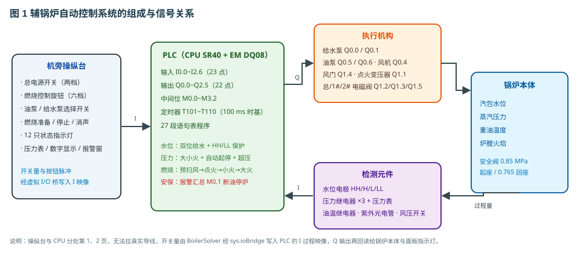
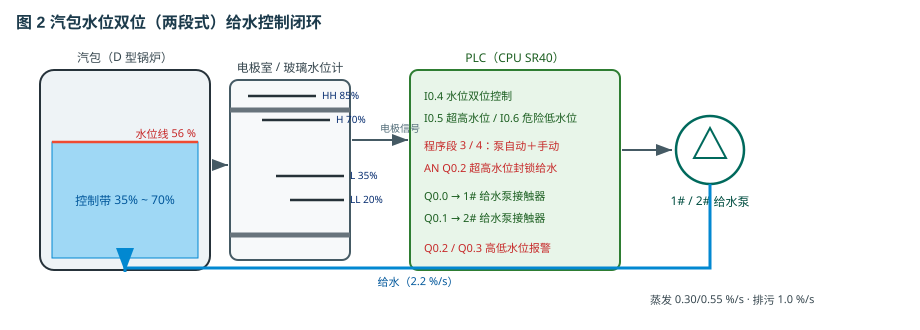
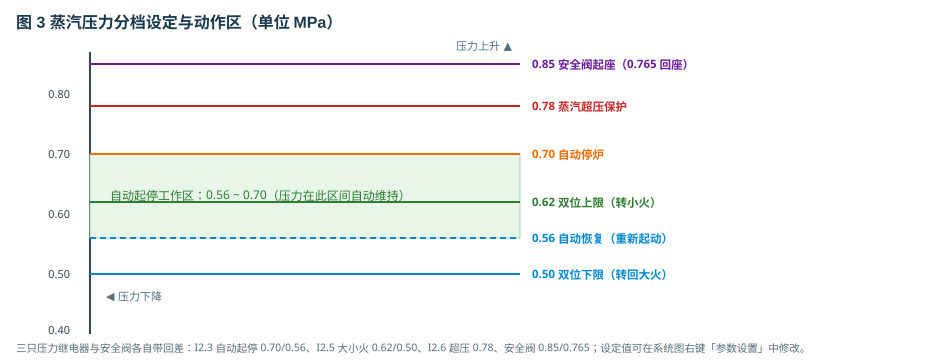
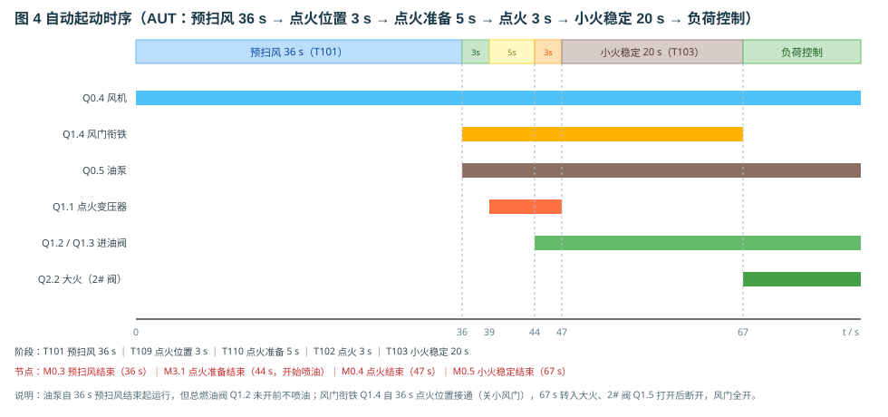
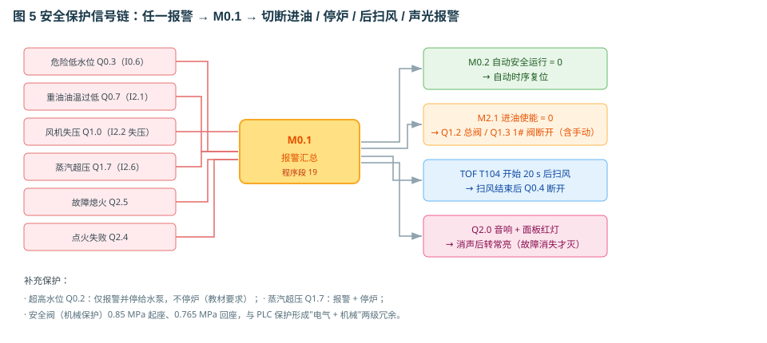

# 辅锅炉自动控制系统的功能测试

> 适用工程：船用辅锅炉 PLC 控制仿真（内部工程编号 lab_10 / syy49_ljzdh87）
> 依据教材：图 6-3-18~6-3-23、表 6-3-1　|　编写日期：2026-11

## 1. 系统组成与信号关系

本工程以 D 型立式水管锅炉（蒸发量 1500 kg/h、工作压力 0.7 MPa）为对象，PLC 采用 S7-200 SMART
SR40 + EM DQ08，共 23 点输入、22 点输出、27 段语句表程序。三个被控量及其控制方式：

| 被控量 | 检测元件 | 执行机构 | 控制方式 |
|---|---|---|---|
| 汽包水位 | 液位继电器（35 %/70 %）+ 电极 HH 85 / H 70 / L 35 / LL 20 | 1#/2# 给水泵（停止/自动/手动） | 双位 |
| 蒸汽压力 | 压力继电器 ×3 + 压力表 | 大小火电磁阀、自动起停 | 双位 + 起停 |
| 重油温度 | 油温继电器（<90 ℃） | 重油加热器（目标 115 ℃） | 双位 |

机旁操纵台在第 1 页、CPU 在第 2 页，跨页无法拉真实导线，因此面板开关量由
`BoilerSolver` 经虚拟 I/O 桥写入 PLC 的 I 过程映像，Q 输出再回读给锅炉本体与指示灯；
第 2 页的端子上可直接看到每一点的电平。

## 2. 汽包水位的双位控制

水位是物质平衡问题：ΔL ∝ ∫(给水 − 蒸发 − 排污)。给水 2.2 %/s，小火/大火蒸发
0.30/0.55 %/s，排污 1.0 %/s。

水位低于 35 % 时液位继电器闭合（I0.4=1）启动给水泵，升到 70 % 断开即停泵，35 %~70 %
之间保持原状态——这段 35 % 的回差避免水泵在设定点附近频繁启停。给水泵开关打「手动」时
水泵连续运行（I0.1），用于起动前补水或排污后补水。

保护分两层：HH 85 % 只报警并强制停泵（防满水），不停炉；LL 20 % 报警并停炉（防管束
缺水过热），但给水泵仍可运行补水——若连泵也停掉，水位永远拉不回来，报警无法复位。

## 3. 蒸汽压力控制

压力由产热与用汽的平衡决定：大火 0.0045 MPa/s、小火 0.0030 MPa/s（火焰建立后），用汽量
随负荷旋钮变化并叠加 ±25 % 的缓慢波动（30 % 负荷与小火平衡、80 % 负荷与大火平衡；
蒸汽主截止阀关闭时实际负荷为 0，锅炉憋压）。

三只压力继电器均带回差：大小火转换 0.62 MPa 转小火、回落到 0.50 转回大火；自动起停
0.70 MPa 停炉、降到 0.56 重新起动；0.78 MPa 蒸汽超压报警停炉。若电气保护全部失效，
安全阀在 0.85 MPa 起座、0.765 MPa 回座，形成「电气 + 机械」两级冗余。

## 4. 起动时序

自动方式下合电源、按「燃烧准备」、旋钮转「自动」后依次执行：预扫风 36 s（T101，风机
运行、风门全开）→ 点火位置 3 s（T109）→ 点火准备 5 s（T110，点火变压器打火）→ 点火
3 s（T102，总阀与 1# 阀开、风门关小）→ 小火稳定 20 s（T103，2# 阀开、转大火）→ 负荷控制。

预扫风把炉膛与烟道内的残油、可燃气排净，否则点火瞬间会爆燃；风压检测 20 s（T108）
确认风压建立，风压不合格不允许点火。停炉后同样要后扫风 20 s（T104）。手动方式的点火
变压器通电 3 s（T107），喷油后 5 s 无火（T105）判点火失败；运行中失去火焰 8 s（T106）
判故障熄火。

## 5. 安全保护与故障处理

7 路报警中，水位过低、油温过低、风机失压、蒸汽超压、故障熄火、点火失败共 6 路并联成
M0.1 报警汇总；超高水位（Q0.2）只报警并停给水泵、不停炉，按教材要求不计入 M0.1。
动作链为：切断进油（含手动）→ 自动时序复位 → 后扫风 20 s → 声光报警。
每路有独立消声记忆 M1.x，按「消声」后音响停止、灯由闪烁转常亮，故障消失才复位。

可注入 4 类故障用于功能测试：

| 故障 | 现象 | 处理 |
|---|---|---|
| 火焰监视器故障 | 点火 8 s 无火报点火失败；运行中转故障熄火 | 修复后按「燃烧停止」复位 |
| 风门卡死 | 风压只建立到 0.45，20 s 后风机失压停炉 | 修复后重新起动 |
| 重油加热器故障 | 油温降到 90 ℃ 以下报警，且点不着火 | 修复并等待油温回升 |
| 压力继电器故障 | 0.70 MPa 不停炉，升到 0.78 MPa 由超压保护兜底 | 修复后复位 |

## 6. 功能测试与操作要点

工具栏提供：起动系统（一键自动起动）、5 点步进（停炉→预扫风→点火→小火→大火）、
故障设置、重置系统、自动演示/单步演示/演练/评估、选择仪表。

建议按「水位 → 压力 → 时序 → 保护」顺序测试：先手动补水到 60 % 再转自动，避免一开始
就低水位报警；压力测试把负荷旋钮调大，观察 0.62 与 0.70 两个动作点；保护测试逐项注入
故障并记录首出报警。参数可在系统图右键「参数设置」中改仿真时间倍率（1~20，默认 1×）；
第 2 页上位机可完成查找设备、连接、上传/下载与在线监控。

## 7. 教学流程（工作流面板）

| 流程 | 内容 |
|------|------|
| 1. 辅锅炉自动起动与运行 | 合电源 → 燃烧准备 → 旋钮转自动 → 观察预扫风、点火、小火稳定到负荷控制的全过程 |
| 2. 手动起动辅锅炉和停炉 | 机旁手动起动、运行与正常停炉（后扫风） |
| 3. 锅炉安保功能测试 | 逐项注入四类故障，观察报警、切断进油与自动停炉，再按消声复位 |

建议按「水位 → 压力 → 时序 → 保护」顺序测试：先手动补水到 60 % 再转自动，避免一开始
就低水位报警；压力测试把负荷旋钮调大，观察 0.62 与 0.70 两个动作点；保护测试逐项注入
故障并记录首出报警。
