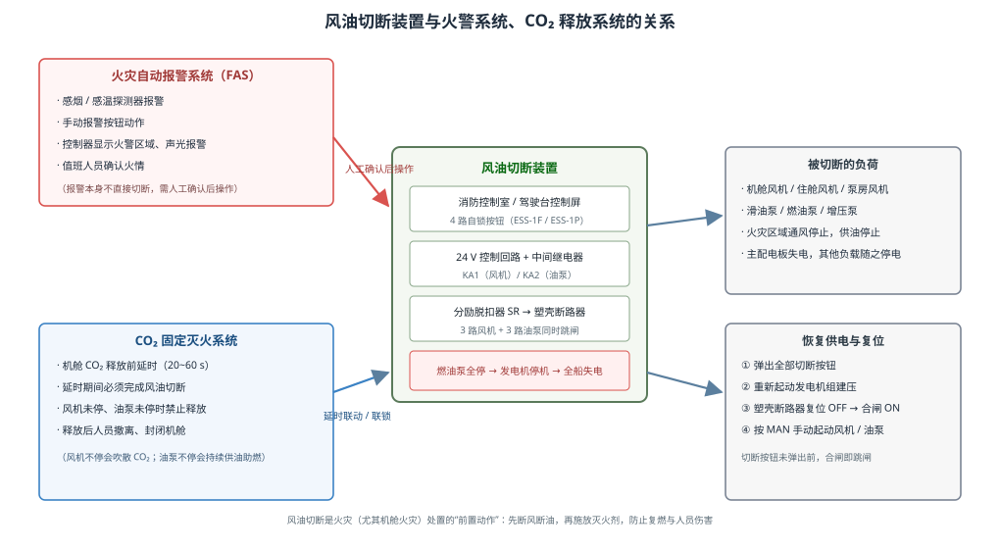
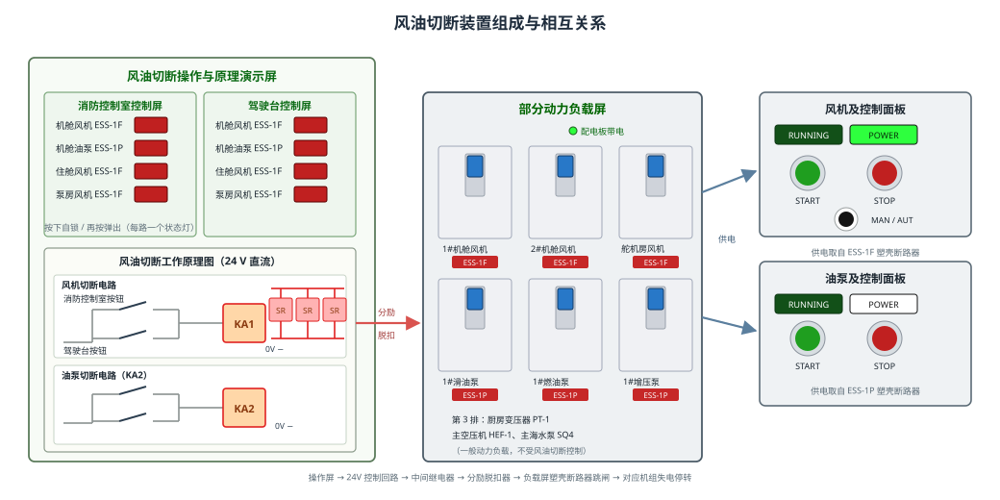
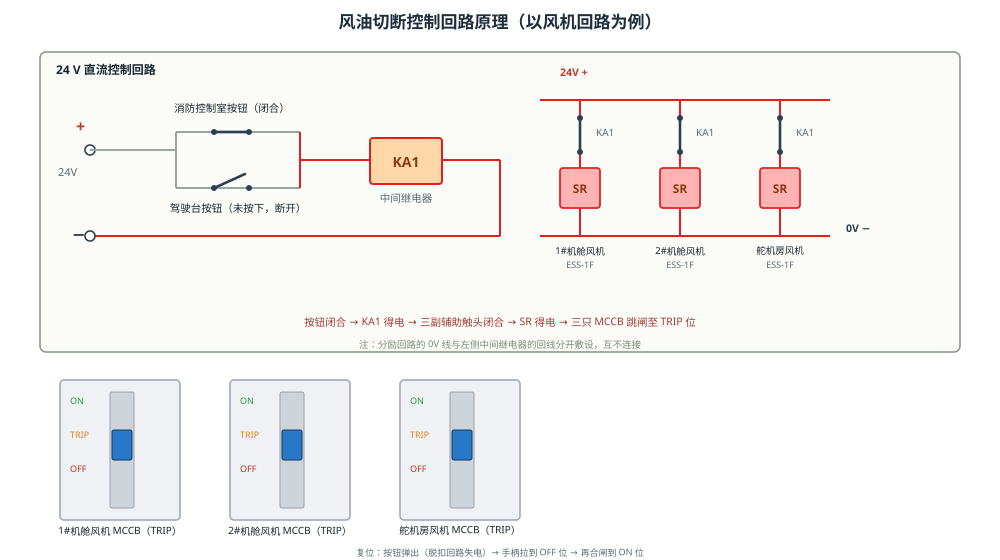
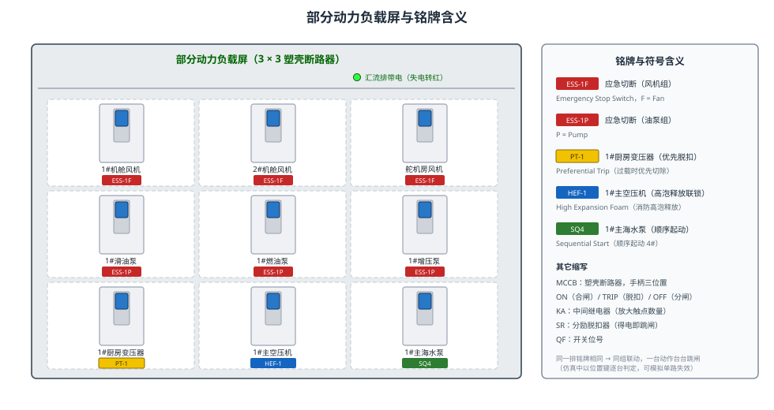
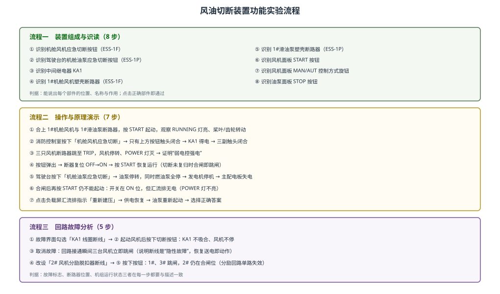

# 风油切断装置的功能实验

> 对象：船舶机舱风油应急切断装置（风机、燃油泵/滑油泵应急切断）
> 配套仿真：本工程单页仿真（操作与原理演示屏 + 部分动力负载屏 + 风机/油泵控制屏）

## 一、装置的应用与系统关系

机舱火灾的燃烧三要素中，**可燃物**是燃油与滑油，**助燃物**是通风机送入的大量空气。风油切断装置的作用，就是在火情确认后**同时切断机舱通风与燃油/滑油供给**：风机停转使火区缺氧、烟气不再被吹散；油泵停转使压力油路失去油源，避免火焰被油雾持续"喂料"。因此它是机舱火灾处置中先于施放灭火剂的**前置动作**。

**与火灾自动报警系统（FAS）的关系。** 探测器（感烟、感温）或手动报警按钮报警后，控制器在驾驶台/消防控制室发出声光报警并显示火警区域。报警信号本身**不直接**切断风油——必须由值班人员确认火情后，就近按下风油切断按钮。这样既避免误报警造成全船失电，又保证动作由人负责。部分船舶设有"火警确认后自动输出切断"的联动方式，但同样以人工确认为前提。

**与 CO₂ 固定灭火系统的关系。** 机舱 CO₂ 释放设有 20~60 s 延时（供人员撤离、确认风油切断）。若风机未停，释放的 CO₂ 会被通风迅速稀释、吹散到舱外；若油泵未停，燃烧会因持续供油而复燃。因此风油切断与 CO₂ 释放构成**联锁**：切断未到位（风机、油泵断路器未跳闸）时，CO₂ 释放回路被闭锁。

**与主配电板、发电机的关系。** 燃油泵是主机与柴油发电机的"燃油供给末端"。当机舱燃油泵全部停止，主辅机随即**断油停机**，主配电板汇流排失电，全船负荷（包括照明、辅机）随之停电。这是风油切断最重要的**次生后果**，也是实验中必须让学员看到的联锁现象：此时即使把塑壳断路器重新合闸，负载仍然没有电。

## 二、装置的组成

装置由四部分组成：

1. **风油切断控制屏**（两处，功能完全相同）：消防控制室屏与驾驶台屏，各设 4 路自锁式方形按钮——机舱风机 ESS-1F、机舱油泵 ESS-1P、住舱风机 ESS-2F、泵房风机 ESS-2F，每路配一只动作指示灯。按钮"按下自锁、再按弹出"。其中三只风机按钮同属风机切断回路（KA1），按任意一路都会令三台风机一起跳闸。
2. **风油切断工作原理图（MIMIC）**：24 V 直流控制回路的展开图，上方为风机切断电路（KA1），下方为油泵切断电路（KA2），每组含两条并联按钮支路、中间继电器、三副常开辅助触头和三只分励脱扣器线圈。
3. **部分动力负载屏**：3×3 共 9 只塑壳断路器（MCCB），第 1 排为三台风机、第 2 排为三台油泵，第 3 排为厨房变压器（PT-1，优先脱扣）、主空压机（HEF-1，高泡释放联锁）、主海水泵（SQ4，顺序起动）等一般负载，它们不受风油切断控制，但会随全船失电而停运。柜顶设主汇流排带电指示。
4. **风机/油泵控制屏**：左为控制面板（RUNNING、POWER 指示窗，START/STOP 按钮，MAN/AUT 转换旋钮），右为机组符号（风机为四叶桨，油泵为两只啮合齿轮）。

## 三、工作原理

**1. 弱电控强电。** 按钮回路是 24 V 直流小电流回路，动力回路是 380 V 大电流回路，两者通过"中间继电器 + 分励脱扣器"间接联系，既不把 380 V 引入操作屏，又能同时控制多台断路器。

**2. 两个地点并联。** 消防控制室与驾驶台的同功能按钮**并联**接在同一回路上：只要任一地点按下，回路即接通；未按下的那一路保持断开（仿真中只有被按下的那一路开关触头闭合）。

**3. 中间继电器放大触点数量。** 一只按钮只能通断一条支路，而风机回路要同时脱扣三台开关。按钮闭合 → KA1 线圈得电吸合 → KA1 的三副常开辅助触头同时闭合，每一副再串入一路分励脱扣器回路。

**4. 分励脱扣器使 MCCB 跳闸。** 分励脱扣器（SR）是塑壳断路器的"外部跳闸线圈"，得电即释放脱扣机构，开关手柄从 ON 位跳到 **TRIP** 位，主触头断开、负荷失电。TRIP 位与手动分闸（OFF）不同：它表示"被保护或外部命令跳闸"，复位时必须先把手柄拉到 OFF 位再合闸。

**5. 自锁与复归。** 按钮按下即自锁并点亮指示灯；此时脱扣回路持续带电，**任何一台开关只要合闸就立即再次跳闸**。必须先把按钮弹出（再按一次），脱扣回路失电，才能复位合闸、重新起动机组。

**6. 油泵回路的特殊联锁。** 油泵切断回路（KA2）动作后三台油泵同时跳闸；燃油泵全停导致发电机断油停机，主配电板汇流排失电。此时负载屏汇流排指示由绿转红，所有负载**合闸也无电**，风机、油泵按 START 均不能起动。恢复须按"弹出按钮 → 重新起动发电机组建压（仿真中点击汇流排指示）→ 断路器复位合闸 → 手动起动"的顺序进行。

**7. 与断路器自身保护的区别。** 过载、短路由断路器自身保护脱扣，属"故障跳闸"；风油切断是外部命令跳闸，断路器本身无故障。两者手柄都停在 TRIP 位，但原因与复位后的处理不同——这是故障分析中必须区分的内容。

## 四、符号与铭牌含义

| 铭牌 | 含义 | 本工程对应负荷 |
|---|---|---|
| `ESS-1F` | Emergency Stop Switch，应急切断，F = Fan 风机 | 1#机舱风机、2#机舱风机、舵机房风机（同组） |
| `ESS-1P` | 应急切断，P = Pump 油泵 | 1#滑油泵、1#燃油泵、1#增压泵（同组） |
| `PT-1` | Preferential Trip 优先脱扣（第 1 组） | 1#厨房变压器：发电机过载时优先脱扣切除的次要负载 |
| `HEF-1` | High Expansion Foam 消防高泡释放（第 1 组） | 1#主空压机：高泡系统释放时被切断联锁，防止气源干扰释放 |
| `SQ4` | Sequential Start 顺序起动（第 4 路） | 1#主海水泵：按顺序起动次序第 4 投入的负荷 |

铭牌**配色**帮助识别：ESS 类为红色（应急切断），PT 为黄色（优先脱扣），SQ 为绿色（顺序起动），HEF 为蓝色（消防高泡释放）。

图中其它缩写：**MCCB** 塑壳断路器（手柄 ON / TRIP / OFF 三位置）；**KA** 中间继电器；**SR** 分励脱扣器；**QF** 开关位号。同一排开关铭牌相同，表示它们由同一路切断回路联动——一台动作台台跳闸，仿真中则用内部位置键逐台判定，以便模拟"某一路分励脱扣器断线"的故障。

## 五、功能实验步骤

**流程一：装置组成与识读（8 步）。** 依次识别机舱风机应急切断按钮、驾驶台的机舱油泵应急切断按钮、中间继电器 KA1、1#机舱风机塑壳断路器、1#滑油泵塑壳断路器、风机面板 START 按钮、MAN/AUT 转换旋钮、油泵面板 STOP 按钮。要求能说出部件位置、名称与作用。

**流程二：操作与原理演示（7 步）。**
1. 合上 1#机舱风机（ESS-1F）与 1#滑油泵（ESS-1P）断路器，按 START 起动，观察 RUNNING 灯亮、桨叶/齿轮转动、POWER 灯亮。
2. 在消防控制室按下「机舱风机应急切断」：原理图中**只有上方那副按钮触头闭合**（下方驾驶台触头仍断开）→ KA1 线圈变色得电 → 三副辅助触头闭合。
3. 观察三只风机断路器全部跳至 TRIP 位，风机停转、POWER 与 RUNNING 灯灭——验证"弱电控强电"。
4. 再按一次按钮使其弹出，断路器复位 OFF 后再合闸，按 START 风机恢复运行（说明切断未复归时"合闸即跳闸"）。
5. 在驾驶台按下「机舱油泵应急切断」：油泵跳闸停转；同时燃油泵全停使发电机停机，负载屏汇流排指示转红（失电），原本运行的风机也随之停转。
6. 合上油泵断路器（手柄在 ON 位）再按 START：POWER 灯不亮、油泵仍不能起动——"开关合闸但汇流排无电"。
7. 点击负载屏汇流排指示「重新建压」恢复供电，油泵重新起动；最后完成一道选择题，巩固"按钮→中间继电器→分励脱扣器→MCCB 跳闸"的动作链。

**流程三：回路故障分析（6 步）。**
1. 在故障设置界面勾选「风机切断回路中间继电器 KA1 线圈断线」并应用。
2. 起动风机后按下切断按钮：按钮已自锁、回路已接通，但 KA1 不吸合、三副触头不闭合，风机照常运行。
3. 取消该故障：断线恢复的瞬间回路接通，三台风机立即跳闸——说明断线属"隐性故障"，平时不影响运行，只在需要动作时暴露。
4. 改设「2# 风机分励脱扣器线圈断线」，复位按钮与断路器后再次按下按钮。
5. 观察 1#、3# 风机跳闸而 2# 风机仍在合闸位：分励回路"单路失效"，该台风机失去应急切断保护，必须及时检修。
6. 完成一道选择题，巩固"中间继电器断线属隐性故障、分励脱扣器单路失效只影响该台开关"的判断。

## 六、思考与注意

1. 为什么风油切断按钮要设在消防控制室与驾驶台**两处并联**，而不是串联？
2. 风机与油泵为什么要分设 KA1、KA2 两个继电器回路？若合并成一路会有什么后果？
3. 若某台风机断路器分励脱扣器线圈断线，平时如何发现？（提示：可通过定期试验按钮检查，注意试验会实际跳闸）
4. 操作注意：切断动作后必须先弹出按钮再复位合闸；油泵回路动作会造成全船失电，实验中应先确认其他设备状态再操作。
